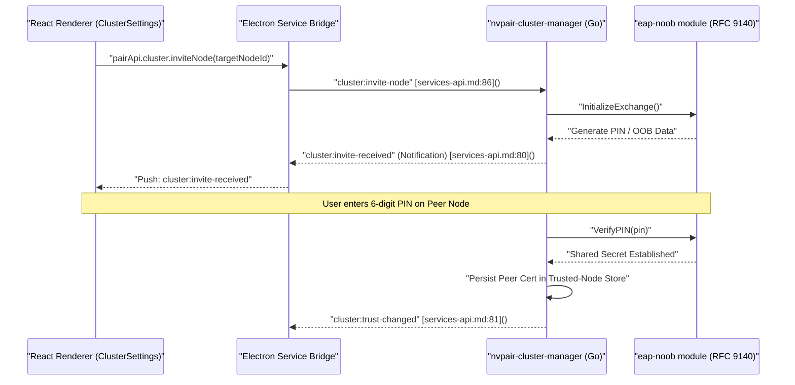

<!-- source: DeepWiki mcp.deepwiki.com · repo NVIDIA/Personal-AI-Router · page 3.4 Cluster Manager and EAP-NOOB Pairing · fetched 2026-10-26 -->

# Cluster Manager and EAP-NOOB Pairing

Relevant source files

The following files were used as context for generating this wiki page:

- [SECURITY.md](SECURITY.md)
- [desktop/docs/architecture.md](desktop/docs/architecture.md)
- [desktop/docs/services-api.md](desktop/docs/services-api.md)

The `nvpair-cluster-manager` is the central authority for node identity and the establishment of cryptographic trust between nodes in a PAIR cluster. It implements the **EAP-NOOB** (Extensible Authentication Protocol - Nimble Out-of-Band) protocol as defined in **RFC 9140** to bootstrap secure communication using a six-digit Out-of-Band (OOB) PIN.

Once paired, nodes communicate via **mutual TLS (mTLS)** using self-signed certificates, enabling secure inter-node operations such as remote engine control and workload replication.

## Node Identity and Cryptography

Each node in a PAIR cluster is uniquely identified by a stable UUID generated upon first run. The `nvpair-cluster-manager` manages the lifecycle of the node's cryptographic material, including a self-signed certificate used for mTLS ingress and egress.

### Identity Components
*   **Node UUID**: A persistent unique identifier stored in the node's settings.
*   **Self-Signed Certificate**: Generated locally to represent the node's identity in the mTLS mesh.
*   **Trusted-Node Store**: A persistent registry of peer UUIDs and their corresponding public keys/certificates established during the EAP-NOOB exchange.

**Sources:** [SECURITY.md:58-60](), [desktop/docs/architecture.md:50-51]()

## EAP-NOOB Pairing Implementation

PAIR uses the `eap-noob` module to implement the Nimble Out-of-Band authentication protocol. This allows two nodes to establish a shared secret and exchange certificates without a pre-existing PKI, relying instead on a short-lived, user-provided PIN.

### Key Exchange and Security
The pairing process involves:
1.  **Curve25519 / P-256**: Used for the primary key exchange to establish a secure channel.
2.  **OOB PIN**: A six-digit decimal PIN used to authenticate the exchange and prevent Man-in-the-Middle (MitM) attacks.
3.  **Ephemeral State**: Pairing states (e.g., `invite-received`, `invite-expired`) are managed by the manager and relayed to the UI via JSON-RPC notifications.

### Pairing Data Flow
The following diagram illustrates the transition from user action in the UI to the protocol execution in the Go backend.

**Pairing Logic: UI to Code Entity Mapping**

**Sources:** [SECURITY.md:91-101](), [desktop/docs/services-api.md:73-95](), [desktop/docs/architecture.md:50-51]()

## Inter-Node Protocol (Port 14321)

The cluster manager listens on a dedicated port for inter-node control traffic. While discovery and initial metadata exchange may occur over plain HTTP, all sensitive cluster operations are promoted to mTLS.

| Port | Protocol | Purpose | Authentication |
| :--- | :--- | :--- | :--- |
| **14321** | HTTP/mTLS | Cluster Management & Peer RPC | mTLS (Post-Pairing) |
| **14320** | HTTP | Node Info & Telemetry | Plaintext / Unauthenticated |

### JSON-RPC Interface
The `nvpair-cluster-manager` exposes a `cluster:*` and `nodes:*` namespace for the Electron frontend to orchestrate membership.

| Method | Role |
| :--- | :--- |
| `cluster:create` | Initializes a new cluster identity for the local node. |
| `cluster:invite-node` | Starts the EAP-NOOB handshake with a discovered peer. |
| `cluster:respond-to-invite` | Accepts or declines an incoming pairing request using the PIN. |
| `cluster:leave` | Dissolves the local node's membership and clears trusted keys. |
| `nodes:remove` | Evicts a specific peer from the local trusted-node store. |

**Sources:** [SECURITY.md:54-56](), [desktop/docs/services-api.md:73-93](), [SECURITY.md:102-109]()

## Security Boundaries and Risks

The cluster manager's design acknowledges specific trade-offs regarding the local network environment:

1.  **Low Entropy PIN**: The 6-digit PIN is a bootstrap convenience and not a durable credential. It is intended for use only when both devices are on a trusted network [SECURITY.md:91-97]().
2.  **mTLS Scope**: mTLS protects cluster-specific channels (e.g., remote model loading). It does not automatically encrypt loopback inference traffic or mDNS discovery packets [SECURITY.md:102-110]().
3.  **Local-First Trust**: PAIR assumes the local network is a trust-relevant boundary. The manager does not protect against a compromised node already within the cluster [SECURITY.md:79-85]().

### Trusted Node Store Implementation
The manager maintains a persistent store of peer identities. When a request arrives at the mTLS ingress (port 14321), the manager:
1.  Validates the client certificate against the local CA or the OOB-exchanged public key.
2.  Maps the certificate identity to a known `NodeID`.
3.  Authorizes the request (e.g., `engine:remote-start`) based on cluster membership.

**Sources:** [SECURITY.md:67-72](), [SECURITY.md:98-101](), [desktop/docs/services-api.md:117-124]()

---

