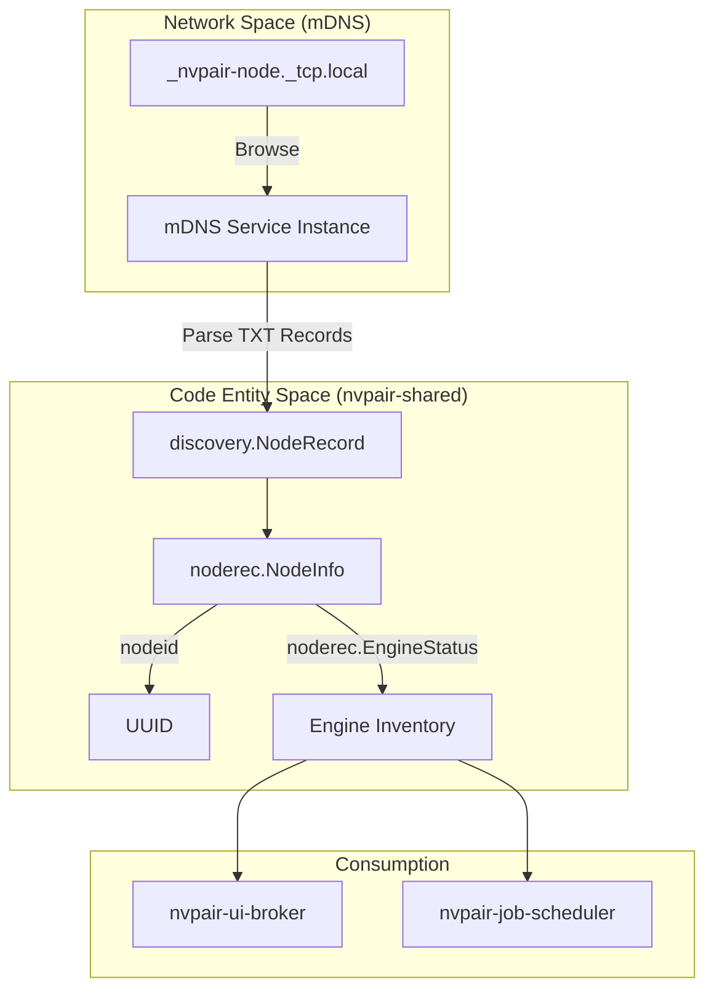
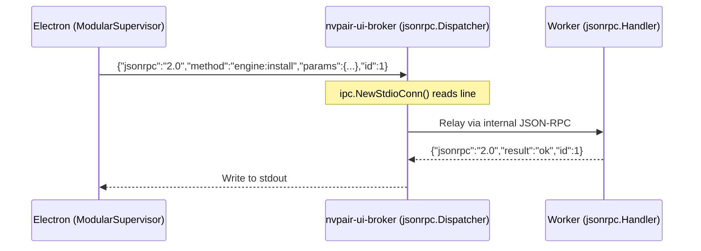

<!-- source: DeepWiki mcp.deepwiki.com · repo NVIDIA/Personal-AI-Router · page 3.6 Shared Go Module (nvpair-shared) · fetched 2026-10-26 -->

# Shared Go Module (nvpair-shared)

<details>
<summary>Relevant source files</summary>

The following files were used as context for generating this wiki page:

- [AGENTS.md](AGENTS.md)
- [CONTRIBUTING.md](CONTRIBUTING.md)

</details>


The `nvpair-shared` module, located at `services/shared/`, serves as the foundational library for all Go-based services within the Personal AI Router (PAIR) ecosystem. It provides common primitives for inter-process communication (IPC), node identity, discovery records, networking, and cluster security.

By centralizing these cross-cutting concerns, the system ensures consistent behavior across the 13 distinct Go binaries (e.g., broker, scanner, proxies) and simplifies the implementation of the JSON-RPC 2.0 protocol used for control-plane traffic.

### Module Integration
Because each Go service in the `services/` directory is its own independent module, they consume `nvpair-shared` using the Go `replace` directive in their respective `go.mod` files. This allows for local development without requiring the shared module to be published to a remote repository.

**Example `go.mod` Entry:**
```go
module github.com/NVIDIA/Personal-AI-Router/services/nvpair-ui-broker

go 1.25

replace github.com/NVIDIA/Personal-AI-Router/services/shared => ../shared

require (
    github.com/NVIDIA/Personal-AI-Router/services/shared v0.0.0
)
```

**Sources:** [AGENTS.md:73-77](), [services/nvpair-ui-broker/go.mod:1-10]() (representative example).

---

### Core Packages and Providers

The shared module is partitioned into specialized packages, each handling a specific domain of the PAIR architecture.

| Package | Purpose | Key Entities / Functions |
| :--- | :--- | :--- |
| `appdir` | Cross-platform data directory resolution. | `GetDataDir()`, `GetLogDir()` |
| `applog` | Structured JSONL logging with rotation. | `NewLogger()`, `Rotate()` |
| `clustertrust` | Certificate management for mTLS. | `LoadCert()`, `TrustStore` |
| `cors` | Standardized CORS policies for HTTP proxies. | `DefaultConfig()` |
| `discovery` | Data structures for mDNS node records. | `NodeRecord`, `ServiceInstance` |
| `errors` | Unified error types and codes for JSON-RPC. | `ErrorCode`, `NewError()` |
| `ipc` | Transport logic for stdio and named pipes. | `NewStdioConn()`, `PipeDialer` |
| `jsonrpc` | JSON-RPC 2.0 framing and dispatching. | `Request`, `Response`, `Handler` |
| `mdns` | Wrapper for mDNS advertising and browsing. | `Advertiser`, `Browser` |
| `netmon` | Network interface and connectivity monitoring. | `InterfaceWatcher` |
| `netpick` | Port selection and availability logic. | `FindAvailablePort()` |
| `nodeactivity` | Tracking local/remote inference activity. | `ActivityTracker` |
| `nodeid` | Stable UUID generation and persistence. | `GetNodeID()` |
| `noderec` | Consolidation of node metadata and state. | `NodeInfo`, `EngineStatus` |
| `reach` | Connectivity testing between cluster nodes. | `Probe()`, `LatencyCheck` |
| `schedulerwire` | Shared types for job scheduling telemetry. | `JobRequest`, `NodeRank` |
| `splitlisten` | Dual-listener for mTLS and plaintext. | `SplitListener` |

**Sources:** [AGENTS.md:76-77](), [docs/architecture.mdx:45-60]().

---

### Implementation Detail: Node Identity and Discovery

The `nodeid` and `discovery` packages define how a PAIR node identifies itself and how it is seen by others. Every node generates a stable UUID stored in the `appdir`. This ID is used in mDNS records defined in the `discovery` package to allow peers to locate each other without manual IP configuration.

#### Data Flow: Discovery to Record
This diagram illustrates how a discovered mDNS service is transformed into a code-level `NodeRecord`.

**Discovery Record Mapping**

**Sources:** [docs/architecture.mdx:88-105](), [AGENTS.md:35-39]().

---

### JSON-RPC and IPC Transport

The `jsonrpc` and `ipc` packages form the backbone of the "Service Bridge." The broker uses these to supervise workers and relay messages from the Electron frontend.

*   **`jsonrpc`**: Implements the JSON-RPC 2.0 specification. It handles the serialization of `Request` and `Response` objects and provides a `Dispatcher` to route incoming method calls to Go functions.
*   **`ipc`**: Provides the low-level transport. While PAIR defaults to `stdio` (stdin/stdout) for worker communication, the `ipc` package supports named pipes (Windows) and Unix domain sockets (Linux/macOS) via the `--ipc` flag.

#### IPC Communication Flow

**Sources:** [docs/architecture.mdx:142-158](), [AGENTS.md:41-44]().

---

### Network and Security Primitives

#### `splitlisten` and `clustertrust`
A unique requirement of PAIR is the "Dual Personality" port. A single service must often accept plaintext traffic from `localhost` (for local inference tools like Ollama) while requiring mTLS for cluster peers. 

The `splitlisten.SplitListener` wraps a standard TCP listener. It inspects the source IP:
1.  **Local Loopback**: Traffic is passed to the service as plaintext.
2.  **Remote IP**: Traffic must undergo a TLS handshake using certificates managed by `clustertrust`.

#### `netpick`
To avoid port conflicts with existing installations of Ollama or LM Studio, `netpick` provides logic to probe for available ports in the `14318–14323` range and implement "Port Takeover" where the PAIR proxy displaces a local engine to provide routing capabilities.

**Sources:** [docs/architecture.mdx:210-230](), [AGENTS.md:110-114]().

---

### Error Handling and Logging

#### `errors`
The `errors` package defines a centralized list of error codes that are shared between the Go services and the TypeScript frontend. This ensures that when a `nvpair-engine-manager` fails to download a model, the Electron UI can catch a specific `ERR_ENGINE_DOWNLOAD_FAILED` code rather than parsing string messages.

#### `applog`
All services use `applog` to write to `nvpair.jsonl`. This package ensures:
*   **No PII**: It provides helpers to avoid logging prompts or keys [AGENTS.md:117-119]().
*   **Rotation**: Automatically rotates logs to prevent disk exhaustion.
*   **Structured Format**: Outputs JSON so that the `collect-logs` utility can easily parse and sanitize the data for support requests.

**Sources:** [AGENTS.md:117-122](), [CONTRIBUTING.md:199-200]().

---

