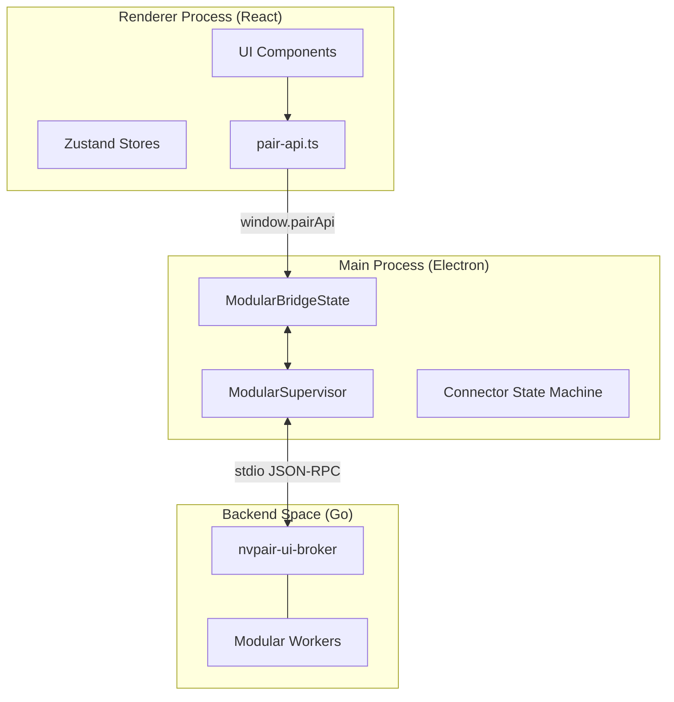

<!-- source: DeepWiki mcp.deepwiki.com · repo NVIDIA/Personal-AI-Router · page 4 Desktop Application (Electron + React) · fetched 2026-10-26 -->

# Desktop Application (Electron + React)

Relevant source files

The following files were used as context for generating this wiki page:

- [desktop/README.md](desktop/README.md)
- [desktop/docs/architecture.md](desktop/docs/architecture.md)
- [desktop/docs/frontend-api.md](desktop/docs/frontend-api.md)
- [desktop/package.json](desktop/package.json)

The PAIR desktop application provides the user interface and orchestration layer for the Personal AI Router system. It is built using **Electron**, **React**, and **TypeScript**, serving as a host for the modular Go backend services. The application follows a strict multi-process architecture where the UI (Renderer) is isolated from the system-level backend processes by a typed IPC bridge.

### System Overview Diagram
The following diagram illustrates the relationship between the high-level system components and their corresponding code entities.

**PAIR Desktop Process Mapping**

**Sources:** [desktop/docs/architecture.md:15-32](), [desktop/docs/frontend-api.md:19-31]()

---

## 4.1 Electron Main Process
The Electron main process (`src/electron/`) is the system's "control plane." It is responsible for the lifecycle of the application, window management, and supervising the backend service tree.

*   **Modular Supervision:** Electron spawns the `nvpair-ui-broker` binary, which in turn manages all other workers [desktop/docs/architecture.md:34-37]().
*   **Connectivity:** A state machine tracks the `connected` or `disconnected` status of the backend, ensuring the UI remains responsive even if the services are restarting [desktop/docs/architecture.md:112-129]().
*   **System Integration:** Handles tray menus, application updates, and the installation of the `nvpair` command-line tool to the user's PATH [desktop/docs/architecture.md:78-84](), [desktop/docs/architecture.md:95-100]().

For implementation details on supervisor logic and IPC handling, see **[Electron Main Process](#4.1)**.

**Sources:** [desktop/docs/architecture.md:10-12](), [desktop/docs/architecture.md:105-134]()

---

## 4.2 Service Bridge and IPC Contracts
Communication between the React UI and the system is strictly mediated by a typed bridge. This prevents the renderer from accessing Node.js APIs or backend processes directly.

*   **Typed Contracts:** Channels are defined in `ws-channels.ts` (logical service calls) and `ipc-channels.ts` (Electron-native operations) [desktop/docs/frontend-api.md:11-16]().
*   **Invoke/Push Pattern:** The bridge supports both `invoke` (request-response) and `push` (server-sent events) patterns to keep the UI in sync with the backend [desktop/docs/architecture.md:66-73]().
*   **Preload Layer:** The `window.pairApi` surface provides a clean TypeScript interface for the renderer to interact with discovery, engines, and clusters [desktop/docs/frontend-api.md:36-120]().

For details on the contract definitions and bridge implementation, see **[Service Bridge and IPC Contracts](#4.2)**.

**Sources:** [desktop/docs/architecture.md:64-76](), [desktop/docs/frontend-api.md:8-16]()

---

## 4.3 React Renderer — Stores, Components, and UI
The renderer layer (`src/ui/`) is a React application that manages user interactions and displays the system state.

*   **State Management:** Uses Zustand stores to project backend state (nodes, engines, models, workloads) into the UI [desktop/docs/architecture.md:145-155]().
*   **Reactive Updates:** The UI does not poll for state; it subscribes to push events from the service bridge to update local stores [desktop/docs/architecture.md:138-149]().
*   **Component Library:** Includes specialized views for the Model Hub, Cluster Settings, and a synthetic Inference Demo for testing routing performance [desktop/docs/frontend-api.md:76-85]().

For details on the UI architecture and state flow, see **[React Renderer — Stores, Components, and UI](#4.3)**.

**Sources:** [desktop/docs/architecture.md:138-155](), [desktop/docs/frontend-api.md:36-120]()

---

## 4.4 macOS Privileged Helper
On macOS, PAIR includes a specialized helper to manage system-level configurations that typically require elevated permissions, such as Application Firewall rules.

*   **Swift Daemon:** A LaunchDaemon (`com.nvidia.nvpair.helper`) that communicates via XPC.
*   **Firewall Configuration:** Allows the application to configure networking rules without requiring a full installer or manual user intervention for every port change.

For details on the Swift implementation and XPC protocol, see **[macOS Privileged Helper](#4.4)**.

---

## Code Layout and Development
The `desktop/` directory is organized into distinct functional areas to maintain the process boundary.

| Directory | Purpose |
| :--- | :--- |
| `src/electron/` | Main process: broker supervision, service bridge, IPC [desktop/README.md:18-18]() |
| `src/preload/` | Typed preload bridge (`window.pairApi`) [desktop/README.md:19-19]() |
| `src/ui/` | React renderer [desktop/README.md:20-20]() |
| `src/shared/` | Types and utilities shared across processes [desktop/README.md:21-21]() |
| `scripts/` | Build, license, and contract verification tooling [desktop/README.md:23-23]() |

**Sources:** [desktop/README.md:15-26](), [desktop/package.json:15-85]()

---

