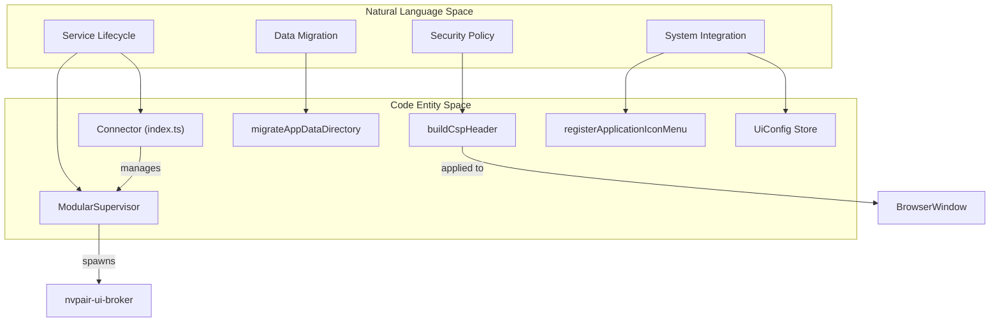
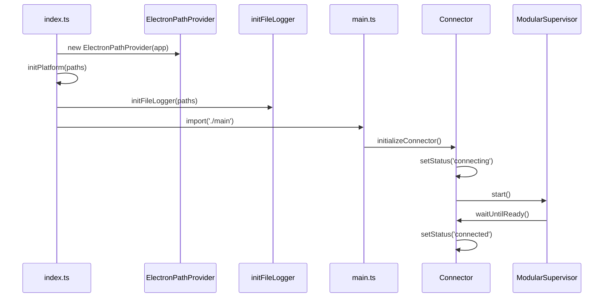

<!-- source: DeepWiki mcp.deepwiki.com · repo NVIDIA/Personal-AI-Router · page 4.1 Electron Main Process · fetched 2026-10-26 -->

# Electron Main Process

Relevant source files

The following files were used as context for generating this wiki page:

- [desktop/src/electron/app-data-migration.ts](desktop/src/electron/app-data-migration.ts)
- [desktop/src/electron/app-data-wipe-orchestrator.ts](desktop/src/electron/app-data-wipe-orchestrator.ts)
- [desktop/src/electron/application-icon-menu.ts](desktop/src/electron/application-icon-menu.ts)
- [desktop/src/electron/config/ui-config.ts](desktop/src/electron/config/ui-config.ts)
- [desktop/src/electron/connector/broker-crash-notification.ts](desktop/src/electron/connector/broker-crash-notification.ts)
- [desktop/src/electron/connector/index.ts](desktop/src/electron/connector/index.ts)
- [desktop/src/electron/csp.ts](desktop/src/electron/csp.ts)
- [desktop/src/electron/event-loop-monitor.ts](desktop/src/electron/event-loop-monitor.ts)
- [desktop/src/electron/globals.ts](desktop/src/electron/globals.ts)
- [desktop/src/electron/index.ts](desktop/src/electron/index.ts)

The Electron Main Process serves as the foundational orchestrator for the NVIDIA Personal AI Router (PAIR). It is responsible for the lifecycle of the backend service tree, system-level integrations (tray, menus, PATH installation), security enforcement (CSP), and state management for the application's connection to its internal broker.

## Process Lifecycle and Management

The main process acts as the parent for the entire PAIR ecosystem. It manages the `ModularSupervisor`, which in turn supervises the Go-based backend binaries.

### Modular Supervisor and Connector
The `Connector` is a state machine that manages the connection between the Electron UI and the `nvpair-ui-broker` [desktop/src/electron/connector/index.ts:23-24](). It transitions through `disconnected`, `connecting`, `connected`, and `reconnecting` states [desktop/src/electron/connector/index.ts:32-36]().

*   **ModularSupervisor**: A singleton that manages the actual spawning and health monitoring of the broker subprocess [desktop/src/electron/connector/index.ts:59-65]().
*   **Ready Handshake**: The connector waits for the supervisor to signal readiness (via the `app:ready` JSON-RPC handshake) before marking the service as `connected` [desktop/src/electron/connector/index.ts:147-148]().
*   **Crash Handling**: If the broker exits unexpectedly, the `handleBrokerCrash` function triggers an OS-level notification and updates the UI state to allow for a manual restart from the Settings menu [desktop/src/electron/connector/broker-crash-notification.ts:15-25]().

### Event Loop Monitoring
To ensure the main process remains responsive, PAIR implements an `event-loop-monitor`. This utility samples the event loop every 500ms [desktop/src/electron/event-loop-monitor.ts:8](). If the loop is blocked for more than 1000ms, it logs a warning [desktop/src/electron/event-loop-monitor.ts:39-44](). This is critical because a blocked main process halts all structured logging from backend services and can cause false positives in timeout measurements.

**Sources:** [desktop/src/electron/connector/index.ts:1-179](), [desktop/src/electron/event-loop-monitor.ts:1-47](), [desktop/src/electron/connector/broker-crash-notification.ts:1-41]()

---

## Data Management and Migration

### App-Data Migration
When the application directory structure changes (e.g., during version upgrades), the `migrateAppDataDirectory` function moves existing configuration and data files to the new location [desktop/src/electron/app-data-migration.ts:64-70]().
*   **Atomic Move**: It attempts to move the entire tree atomically if no destination exists [desktop/src/electron/app-data-migration.ts:80-89]().
*   **Merge Logic**: If a destination already exists, it performs a non-destructive merge, leaving conflicting files in the source directory to prevent data loss [desktop/src/electron/app-data-migration.ts:91-112]().
*   **Entry Skipping**: Certain entries, such as the `nvpair` launcher bin, are skipped during migration to avoid breaking the user's system `PATH` [desktop/src/electron/app-data-migration.ts:54-58]().

### Wipe Orchestrator
The `wipeAppDataAndRelaunch` function provides a "factory reset" capability [desktop/src/electron/app-data-wipe-orchestrator.ts:37-38]().
1.  **Shutdown**: It stops the tray and destroys the connector/service tree [desktop/src/electron/app-data-wipe-orchestrator.ts:41-42]().
2.  **Script Execution**: It spawns a detached `wipe` script, passing the current PID so the script can wait for Electron to exit before deleting data [desktop/src/electron/app-data-wipe-orchestrator.ts:45-48]().
3.  **Relaunch**: For packaged builds, the script is instructed to relaunch the application once the wipe is complete [desktop/src/electron/app-data-wipe-orchestrator.ts:24-26]().

**Sources:** [desktop/src/electron/app-data-migration.ts:1-121](), [desktop/src/electron/app-data-wipe-orchestrator.ts:1-67]()

---

## System Integration and Security

### Content Security Policy (CSP)
The main process enforces a strict CSP for the renderer process to mitigate XSS and unauthorized data exfiltration.
*   **Connect-Src**: Restricts network requests to `'self'` and local loopback (`127.0.0.1`, `localhost`) [desktop/src/electron/csp.ts:5-11]().
*   **Script/Style-Src**: Restricts execution to local assets only, with `'unsafe-inline'` permitted for styles to support certain UI components [desktop/src/electron/csp.ts:9-10]().
*   **Media/Worker-Src**: Specifically allows `blob:` URLs to support SVG rasterization and PDF.js workers [desktop/src/electron/csp.ts:12-24]().

### Tray and Menus
*   **Application Icon Menu**: Configures the platform-specific dock/taskbar menus. On Windows, it uses `app.setUserTasks` to provide an "Exit" option directly from the taskbar icon [desktop/src/electron/application-icon-menu.ts:27-39]().
*   **UI Configuration**: Manages `ui-config.json`, which stores the `firstRun` flag, the global `modularLogLevel`, and macOS-specific privileged helper status [desktop/src/electron/config/ui-config.ts:13-26]().

### Diagram: Main Process Entity Mapping
This diagram maps logical system responsibilities to the specific code entities in the Electron Main Process.

**Sources:** [desktop/src/electron/csp.ts:4-31](), [desktop/src/electron/application-icon-menu.ts:13-40](), [desktop/src/electron/config/ui-config.ts:1-123]()

---

## Startup Sequence

The entry point for the application is `desktop/src/electron/index.ts`. It initializes the environment before handing off to the main logic.

1.  **Global Initialization**: Sets the application name and initializes platform-specific paths [desktop/src/electron/index.ts:12-16]().
2.  **Logging**: The `initFileLogger` is called using the established paths to begin capturing main process logs [desktop/src/electron/index.ts:17]().
3.  **Module Load**: The actual main process logic is imported dynamically via `./main` [desktop/src/electron/index.ts:19]().

### Diagram: Initialization Data Flow

**Sources:** [desktop/src/electron/index.ts:10-26](), [desktop/src/electron/connector/index.ts:134-168](), [desktop/src/electron/globals.ts:8-16]()

## Summary of Key Files

| File | Responsibility |
| :--- | :--- |
| `index.ts` | Entry point, path initialization, and logger setup. |
| `connector/index.ts` | State machine for the backend connection and supervisor management. |
| `app-data-migration.ts` | Logic for moving user data between application versions. |
| `csp.ts` | Generation of the Content Security Policy header. |
| `event-loop-monitor.ts` | Monitoring main process responsiveness. |
| `config/ui-config.ts` | Persistence for UI-specific settings and first-run state. |

**Sources:** [desktop/src/electron/index.ts:1-26](), [desktop/src/electron/connector/index.ts:1-53](), [desktop/src/electron/app-data-migration.ts:50-64](), [desktop/src/electron/csp.ts:4-6](), [desktop/src/electron/event-loop-monitor.ts:31-47](), [desktop/src/electron/config/ui-config.ts:1-20]()

---

