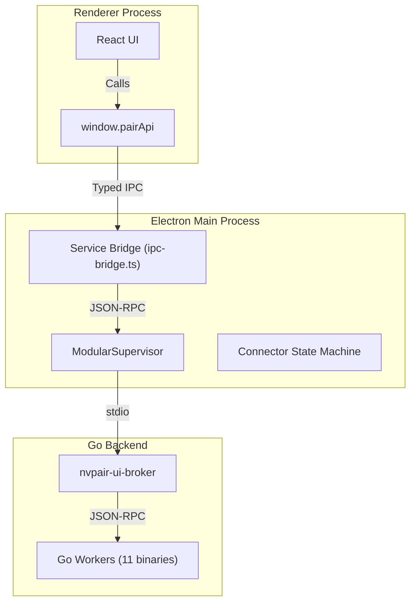

<!-- source: DeepWiki mcp.deepwiki.com · repo NVIDIA/Personal-AI-Router · page 4.2 Service Bridge and IPC Contracts · fetched 2026-10-26 -->

# Service Bridge and IPC Contracts

<details>
<summary>Relevant source files</summary>

The following files were used as context for generating this wiki page:

- [desktop/docs/frontend-api.md](desktop/docs/frontend-api.md)
- [desktop/docs/services-api.md](desktop/docs/services-api.md)
- [desktop/docs/services-parity.md](desktop/docs/services-parity.md)
- [desktop/src/electron/ipc/app-data.ipc.ts](desktop/src/electron/ipc/app-data.ipc.ts)
- [desktop/src/electron/ipc/bootstrap.ipc.ts](desktop/src/electron/ipc/bootstrap.ipc.ts)
- [desktop/src/electron/ipc/index.ts](desktop/src/electron/ipc/index.ts)
- [desktop/src/electron/ipc/safe-handle.ts](desktop/src/electron/ipc/safe-handle.ts)
- [desktop/src/electron/ipc/service-bridge.ipc.ts](desktop/src/electron/ipc/service-bridge.ipc.ts)
- [desktop/src/electron/ipc/service.ipc.ts](desktop/src/electron/ipc/service.ipc.ts)
- [desktop/src/electron/ipc/settings.ipc.ts](desktop/src/electron/ipc/settings.ipc.ts)
- [desktop/src/electron/ipc/update.ipc.ts](desktop/src/electron/ipc/update.ipc.ts)
- [desktop/src/electron/ipc/window.ipc.ts](desktop/src/electron/ipc/window.ipc.ts)

</details>


The **Service Bridge** is the typed communication layer that connects the Electron renderer process to the Go backend services. It abstracts the underlying IPC mechanisms—Electron's `ipcMain`/`ipcRenderer` and the JSON-RPC over `stdio` transport used by the Go binaries—into a unified, type-safe API available on the `window` object.

## Architecture Overview

Communication in PAIR follows a strict hierarchy. The renderer process never communicates with the Go backend directly; instead, it uses the **Preload Bridge** to send messages to the Electron Main process, which then relays them to the `nvpair-ui-broker`.

### Data Flow Diagram


**Sources:** [desktop/docs/frontend-api.md:19-31](), [desktop/docs/services-parity.md:38-55]()

## Type-Safe IPC (IpcChannelMap)

Electron-native operations (window management, updates, settings) are handled via `IpcChannelMap`. This map defines the request and response shapes for every Electron IPC call, ensuring that the renderer and main processes remain in sync.

### Key Components
- **`safeHandle`**: The single trust boundary between Electron's untyped `ipcMain.handle` and the typed IPC system. It verifies the sender's origin before executing the handler [[desktop/src/electron/ipc/safe-handle.ts:34-51]()].
- **Channel Registration**: IPC handlers are grouped by domain (e.g., `window`, `service`, `update`) and registered during app startup [[desktop/src/electron/ipc/index.ts:13-22]()].

| Module | Purpose | Example Channels |
| :--- | :--- | :--- |
| **Window** | UI state and Electron windows | `window:close`, `window:maximize`, `tray:resize` |
| **Service** | Broker and Go binary lifecycle | `service:get-status`, `service:restart`, `service:get-versions` |
| **Update** | App update orchestration | `update:check`, `update:download`, `update:install` |
| **App Data** | User data management | `app:get-wipe-plan`, `app:wipe-data` |

**Sources:** [desktop/src/electron/ipc/safe-handle.ts:4-10](), [desktop/src/electron/ipc/window.ipc.ts:13-98](), [desktop/src/electron/ipc/service.ipc.ts:47-126]()

## Service Bridge (ws-channels.ts)

The Service Bridge handles logical communication with the Go backend. Although named `WsInvokeChannelMap` and `WsPushChannelMap`, these do **not** imply a WebSocket connection; they represent logical service messages relayed over Electron IPC [[desktop/docs/frontend-api.md:33-35]()].

### Logical Channel Mapping

```mermaid
classDiagram
    class WsInvokeChannelMap {
        app:get-initial
        nodes:get-initial
        discovery:get-nodes
        cluster:invite-node
        engines:get-initial
        engine:command
    }
    class WsPushChannelMap {
        nodes:upsert
        engines:state-changed
        metrics:update
        workloads:upsert
        errors:update
    }
    WsInvokeChannelMap --|> IpcChannelMap : Relayed via service-bridge:invoke
    WsPushChannelMap --|> IpcChannelMap : Relayed via service-bridge:push
```

### Implementation Details
- **`handleServiceBridgeInvoke`**: The central dispatcher in Electron Main that receives requests from the renderer and forwards them to the `ModularSupervisor` [[desktop/src/electron/ipc/service-bridge.ipc.ts:7-11]()].
- **ModularBridgeState**: Manages the local cache of backend state (nodes, engines, workloads) within the Electron Main process to ensure the UI has immediate access to data upon mounting [[desktop/docs/frontend-api.md:78-85]()].

**Sources:** [desktop/docs/frontend-api.md:121-159](), [desktop/src/electron/ipc/service-bridge.ipc.ts:7-11]()

## Preload Bridge (window.pairApi)

The `window.pairApi` object is the only supported API for the React renderer. It is injected via Electron's preload script and provides a high-level, promise-based interface to the service bridge.

### API Sub-namespaces
- **`pairApi.nodes`**: Manages the cluster node map, removals, and membership snapshots [[desktop/docs/frontend-api.md:47-53]()].
- **`pairApi.cluster`**: Handles EAP-NOOB PIN pairing, inbound/outbound invites, and cluster identity [[desktop/docs/frontend-api.md:55-65]()].
- **`pairApi.engines`**: Manages engine lifecycle (install/toggle) and model operations (pull/load/delete) [[desktop/docs/frontend-api.md:76-85]()].
- **`pairApi.metrics`**: Streams CPU, Memory, GPU, and VRAM telemetry [[desktop/docs/frontend-api.md:117-119]()].

**Sources:** [desktop/docs/frontend-api.md:36-119]()

## Service Contracts and Drift Detection

To prevent runtime errors caused by mismatched versions between the TypeScript frontend and Go backend, PAIR employs a strict contract verification system.

- **`services-api.md`**: A generated document that serves as the source of truth for the JSON-RPC surface. It lists every method, its direction, and whether it is currently consumed by the Electron bridge [[desktop/docs/services-api.md:1-11]()].
- **Drift Detection**: The build system includes a `verify-service-contracts` gate. This tool extracts the RPC methods from the `services/` Go source code and cross-checks them against the `WsInvokeChannelMap` and `WsPushChannelMap` in the desktop tree [[desktop/docs/services-api.md:3-7]()].
- **Exceptions**: Any backend methods that are intentionally ignored by the UI (e.g., internal debugging methods) are documented in `service-contract-exceptions.json` [[desktop/docs/services-api.md:11-14]()].

### Known Parity Limitations
- **Remote Telemetry**: Because the backend metrics poll uses plain HTTP, remote nodes that do not expose a plaintext `/v1/node-info` endpoint will not show live GPU/VRAM metrics in the UI [[desktop/docs/services-parity.md:88-91]()].
- **Remote OS**: The current contract does not report the operating system of remote cluster peers; they appear with a placeholder until the backend is updated [[desktop/docs/services-parity.md:92-94]()].

**Sources:** [desktop/docs/services-api.md:13-46](), [desktop/docs/services-parity.md:83-94]()

---

