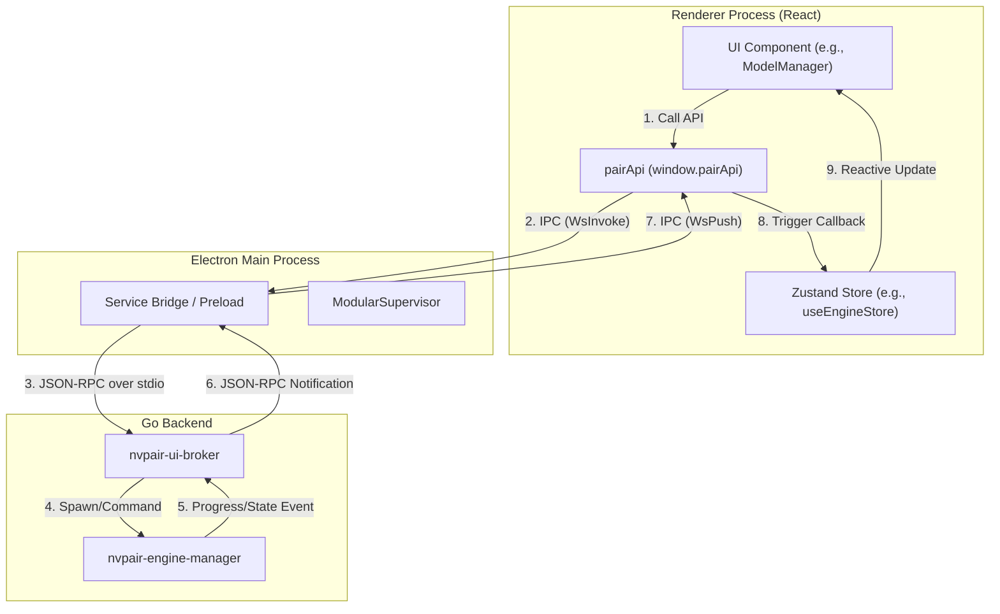
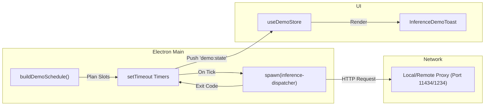

<!-- source: DeepWiki mcp.deepwiki.com · repo NVIDIA/Personal-AI-Router · page 4.3 React Renderer — Stores, Components, and UI · fetched 2026-10-26 -->

# React Renderer — Stores, Components, and UI

Relevant source files

The following files were used as context for generating this wiki page:

- [desktop/docs/frontend-api.md](desktop/docs/frontend-api.md)
- [desktop/src/electron/inference-demo-schedule.ts](desktop/src/electron/inference-demo-schedule.ts)
- [desktop/src/electron/inference-demo.ts](desktop/src/electron/inference-demo.ts)
- [desktop/src/electron/ipc/debug-log-export.ts](desktop/src/electron/ipc/debug-log-export.ts)
- [desktop/src/electron/ipc/inference-demo.ipc.ts](desktop/src/electron/ipc/inference-demo.ipc.ts)

The React Renderer layer is responsible for providing the graphical user interface for PAIR. It consumes the backend services via a typed IPC bridge and maintains a local reactive state using **Zustand** stores. The UI is designed to manage the lifecycle of local AI engines, monitor cluster-wide workloads, and facilitate secure node pairing.

## Architecture and Data Flow

The renderer does not communicate with the Go backend directly. Instead, it uses `window.pairApi`, which is exposed via an Electron preload script. This bridge translates frontend method calls into JSON-RPC 2.0 messages sent over `stdio` to the `nvpair-ui-broker`.

### Communication Topology
The following diagram illustrates how a UI action (like clicking "Install Engine") travels through the system and how the resulting state change flows back to the UI.

**Diagram: UI to Backend Command and State Loop**

**Sources:** [desktop/docs/frontend-api.md:19-31](), [desktop/src/ui/api/pair-api.ts:1-20]()

## State Management (Zustand Stores)

The frontend uses a set of domain-specific Zustand stores to cache backend state and provide reactive hooks for UI components.

| Store | Purpose | Primary Data Sources |
| :--- | :--- | :--- |
| `useNodeStore` | Tracks all nodes in the current cluster, their health, and metadata. | `nodes:upsert`, `nodes:remove` |
| `useEngineStore` | Manages local engine status (Ollama/LM Studio), installed models, and download progress. | `engines:state-changed`, `engines:progress-changed` |
| `useWorkloadStore` | Monitors active inference jobs across the entire cluster. | `workloads:upsert`, `workloads:remove` |
| `useDiscoveryStore` | Lists un-paired nodes found on the local network via mDNS. | `discovery:nodes-changed` |
| `useClusterStore` | Manages the local node's identity and inbound/outbound pairing invitations. | `cluster:invite-received`, `connection:cluster-identity` |
| `useErrorStore` | Aggregates and displays service-level errors from all backend workers. | `errors:update` |

**Sources:** [desktop/docs/frontend-api.md:38-120](), [desktop/docs/frontend-api.md:142-159]()

## The `pairApi` Surface

The `pairApi` is the primary interface for the React layer to interact with the rest of the system. It is categorized into functional namespaces.

### Key API Namespaces
- **`pairApi.engines`**: Used for lifecycle commands like `install()`, `uninstall()`, and `toggle()`. It also handles model management (e.g., `pullModel()`, `deleteModel()`) [desktop/docs/frontend-api.md:76-104]().
- **`pairApi.cluster`**: Facilitates the EAP-NOOB pairing process. Functions include `inviteNode(ipAddress)` to start a PIN-based handshake and `respondToInvite()` to accept/decline inbound requests [desktop/docs/frontend-api.md:55-66]().
- **`pairApi.discovery`**: Provides a list of `AvailableNode` objects discovered via mDNS that are not yet part of the cluster [desktop/docs/frontend-api.md:67-75]().
- **`pairApi.workloads`**: Provides a real-time stream of cluster-wide inference activity, including which node is serving which model [desktop/docs/frontend-api.md:105-110]().

## Key UI Components

### Model Hub and Manager
The `ModelHub` allows users to browse a curated list of models for supported engines. The `ModelManager` provides the interface for viewing local models, checking for updates, and managing disk space. It relies on the `engines:search-hub` invoke channel [desktop/docs/frontend-api.md:84-84]().

### Cluster and Service Settings
- **ClusterSettings**: Manages node identity (name) and handles the pairing UI (PIN entry, invite management).
- **ServiceSettings**: Configures port assignments for proxies (e.g., Ollama 11434) and engines, utilizing the `setPorts` command [desktop/docs/frontend-api.md:81-81]().

## Inference Demo

The Inference Demo is a synthetic traffic generator that simulates a multi-user load on the cluster for 60 seconds.

### Implementation Details
- **Scheduling**: The schedule is calculated in `buildDemoSchedule`, which plans requests across different "cohorts" to ensure all targets (node/model pairs) are exercised [desktop/src/electron/inference-demo-schedule.ts:60-87]().
- **Execution**: The Electron main process spawns the `inference-dispatcher` Go binary for each scheduled request [desktop/src/electron/inference-demo.ts:31-34]().
- **State Reporting**: The demo state (Idle, Probing, Running) is broadcast to the UI via the `demo:state` push channel [desktop/src/electron/inference-demo.ts:102-104]().

**Diagram: Inference Demo Logic**

**Sources:** [desktop/src/electron/inference-demo-schedule.ts:20-26](), [desktop/src/electron/inference-demo.ts:16-25](), [desktop/src/electron/ipc/inference-demo.ipc.ts:11-15]()

## Debugging and Logs
The UI provides a mechanism to export a comprehensive debug bundle. This bundle includes the current Zustand state (`modularState`), metadata about the environment, and the last N lines of the structured JSONL logs [desktop/src/electron/ipc/debug-log-export.ts:104-123]().

**Sources:** [desktop/src/electron/ipc/debug-log-export.ts:67-124]()

---

