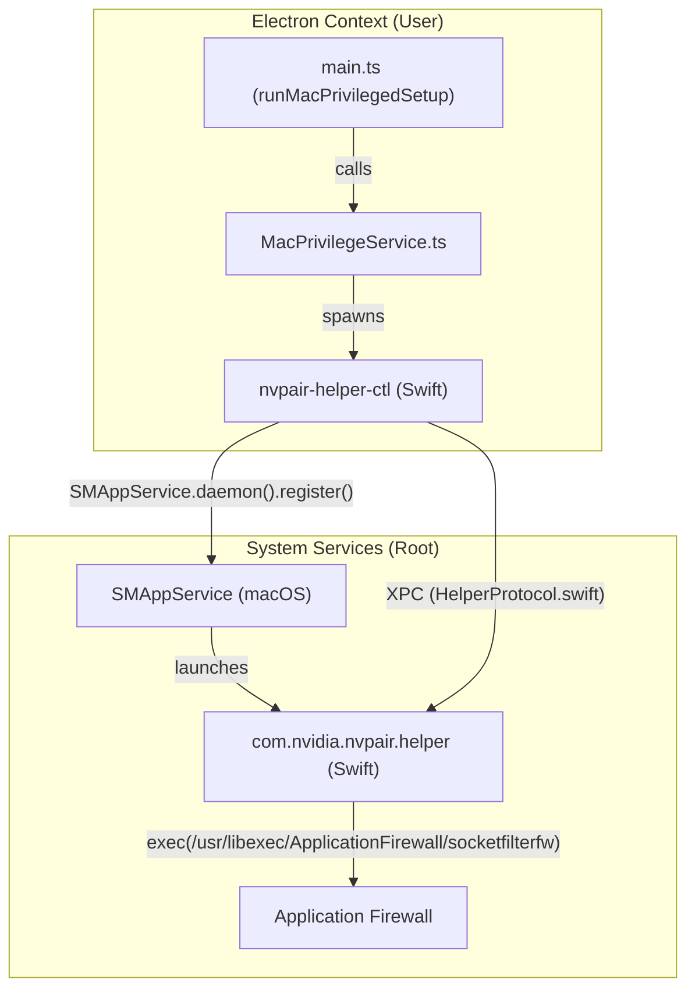
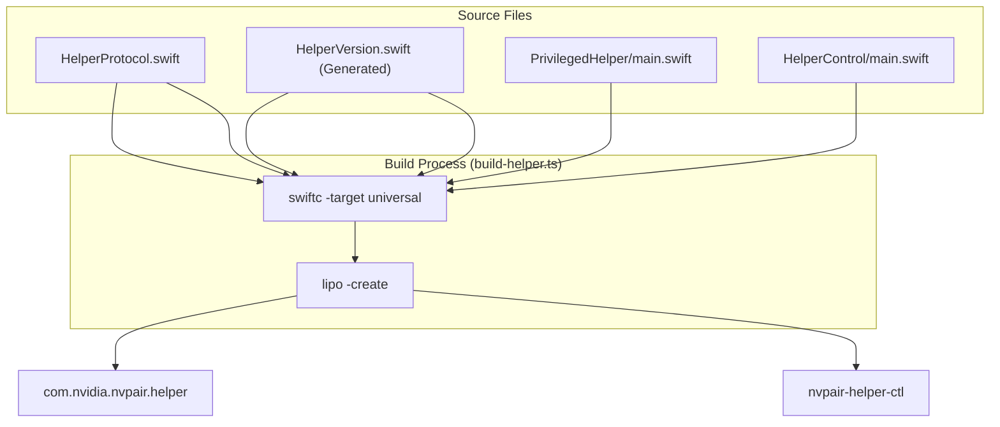

<!-- source: DeepWiki mcp.deepwiki.com · repo NVIDIA/Personal-AI-Router · page 4.4 macOS Privileged Helper · fetched 2026-10-26 -->

# macOS Privileged Helper

Relevant source files

The following files were used as context for generating this wiki page:

- [desktop/docs/macos-privileged-helper.md](desktop/docs/macos-privileged-helper.md)
- [desktop/native/HelperControl/main.swift](desktop/native/HelperControl/main.swift)
- [desktop/native/PrivilegedHelper/main.swift](desktop/native/PrivilegedHelper/main.swift)
- [desktop/native/Shared/HelperProtocol.swift](desktop/native/Shared/HelperProtocol.swift)
- [desktop/scripts/build/macos/build-helper.ts](desktop/scripts/build/macos/build-helper.ts)
- [desktop/scripts/build/macos/com.nvidia.nvpair.helper.plist](desktop/scripts/build/macos/com.nvidia.nvpair.helper.plist)
- [desktop/scripts/build/macos/hooks.ts](desktop/scripts/build/macos/hooks.ts)

Personal AI Router (PAIR) ships as a drag-to-install `.dmg` on macOS, which lacks a traditional installer step. To ensure the bundled networked binaries function correctly within the macOS Application Firewall, PAIR utilizes an Apple [`SMAppService`](https://developer.apple.com/documentation/servicemanagement/smappservice) LaunchDaemon bundled inside the `.app` [desktop/docs/macos-privileged-helper.md:8-12](). This helper allows the application to configure firewall rules on first launch without requiring a full system installer [desktop/docs/macos-privileged-helper.md:8-13]().

The implementation requires macOS 13.0 or later due to the `SMAppService` dependency [desktop/docs/macos-privileged-helper.md:14-14]().

## Components and Architecture

The system consists of two Swift binaries, a LaunchDaemon configuration, and a TypeScript service in the Electron main process.

| Component | Path in `.app` | Language | Role |
| :--- | :--- | :--- | :--- |
| **Daemon** (`com.nvidia.nvpair.helper`) | `Contents/MacOS/com.nvidia.nvpair.helper` | Swift | Runs as **root** via launchd; applies `socketfilterfw` rules [desktop/docs/macos-privileged-helper.md:20-20](). |
| **Control tool** (`nvpair-helper-ctl`) | `Contents/MacOS/nvpair-helper-ctl` | Swift | User-context CLI spawned by Electron; manages registration via `SMAppService` [desktop/docs/macos-privileged-helper.md:21-21](). |
| **LaunchDaemon plist** | `Contents/Library/LaunchDaemons/com.nvidia.nvpair.helper.plist` | plist | launchd configuration including `BundleProgram` and `MachServices` [desktop/docs/macos-privileged-helper.md:22-22](). |
| **Shared protocol** | `native/Shared/HelperProtocol.swift` | Swift | Defines the XPC interface and security constants for both binaries [desktop/docs/macos-privileged-helper.md:23-23](). |
| `MacPrivilegeService` | `src/electron/services/mac-privilege-service.ts` | TS | The TypeScript wrapper Electron uses to drive the helper [desktop/docs/macos-privileged-helper.md:24-24](). |

### System Flow: Natural Language to Code Entities

This diagram maps the high-level runtime flow to the specific code entities responsible for each stage.

**Sources:** [desktop/docs/macos-privileged-helper.md:32-40](), [desktop/native/HelperControl/main.swift:7-11](), [desktop/native/PrivilegedHelper/main.swift:28-29]()

## Registration and Lifecycle

The `runMacPrivilegedSetup()` function executes once per launch [desktop/docs/macos-privileged-helper.md:42-42](). It follows a specific state machine to ensure the helper is installed and the firewall is configured:

1.  **Status Check**: The control tool runs `cmdStatus()` to determine if the daemon is registered and reachable [desktop/native/HelperControl/main.swift:152-164]().
2.  **Version Sync**: If the daemon version does not match the app version (common after a Squirrel.Mac update), the service is uninstalled and reinstalled to refresh the binary [desktop/docs/macos-privileged-helper.md:48-49]().
3.  **Registration**: If not registered, `cmdInstall()` calls `daemon.register()` [desktop/native/HelperControl/main.swift:108-110]().
4.  **Approval**: If `SMAppService.Status` returns `.requiresApproval`, the tool opens System Settings via `openSystemSettingsLoginItems()` [desktop/native/HelperControl/main.swift:123-126]().
5.  **Firewall Configuration**: Once enabled, the daemon executes `configureFirewall` to add rules for networked binaries [desktop/docs/macos-privileged-helper.md:50-52]().

**Sources:** [desktop/docs/macos-privileged-helper.md:42-63](), [desktop/native/HelperControl/main.swift:108-164]()

## XPC Protocol and Security

The `PAIRHelperProtocol` defined in `HelperProtocol.swift` defines the fixed command surface. There is no support for arbitrary shell commands [desktop/native/Shared/HelperProtocol.swift:67-68]().

### Protocol Interface
*   `getVersion(reply:)`: Returns the build version stamped during compilation [desktop/native/Shared/HelperProtocol.swift:72-72]().
*   `configureFirewall(appPath:reply:)`: Adds and unblocks networked binaries [desktop/native/Shared/HelperProtocol.swift:79-79]().
*   `removeFirewall(appPath:reply:)`: Removes rules for networked binaries [desktop/native/Shared/HelperProtocol.swift:83-83]().

### Security Constraints
The system uses strict code-signing requirements to prevent unauthorized access to the root daemon:

*   **Verified Caller**: The daemon ignores the `appPath` argument sent via XPC. Instead, it derives the target bundle from the verified identity of the connecting process [desktop/native/Shared/HelperProtocol.swift:75-78]().
*   **Team ID Pinning**: All binaries must satisfy the `developerIdAnchor`, which requires an Apple-issued Developer ID chain and NVIDIA's Team ID (`6KR3T733EC`) [desktop/native/Shared/HelperProtocol.swift:19-20, 40-45]().
*   **Bidirectional Pinning**: The daemon pins `ctlCodeSigningRequirement` on inbound connections [desktop/native/Shared/HelperProtocol.swift:51-54](), and the control tool pins `daemonCodeSigningRequirement` on outbound connections [desktop/native/Shared/HelperProtocol.swift:56-59]().

**Sources:** [desktop/native/Shared/HelperProtocol.swift:40-84](), [desktop/native/PrivilegedHelper/main.swift:88-95]()

## Firewall Configuration Implementation

The daemon targets a specific set of binaries located in `Contents/Resources/cli-bin` that require network access [desktop/native/PrivilegedHelper/main.swift:110-111]().

### Networked Binaries List
The following binaries receive firewall rules via `socketfilterfw --add` and `--unblockapp`:
*   `ollama-proxy`, `lmstudio-proxy`, `nvpair-node-info`, `nvpair-node-scanner`, `nvpair-workload-manager`, `nvpair-errors`, `nvpair-cluster-manager`, `nvpair-engine-manager` [desktop/native/PrivilegedHelper/main.swift:38-47]().

### Verification Logic
Before calling the system firewall tool, the daemon performs multiple safety checks:
1.  **Symlink Rejection**: Uses `O_NOFOLLOW` to ensure the target is a real file/directory, preventing TOCTOU attacks [desktop/native/PrivilegedHelper/main.swift:119, 128]().
2.  **Signature Re-verification**: Re-verifies the individual binary's NVIDIA signature using `nvidiaSignedRequirement` before granting access [desktop/native/PrivilegedHelper/main.swift:66-73]().
3.  **Ancestor Check**: Rejects the path if any ancestor directory is world-writable [desktop/native/PrivilegedHelper/main.swift:145-153]().

**Sources:** [desktop/native/PrivilegedHelper/main.swift:28-86, 118-153](), [desktop/docs/macos-privileged-helper.md:76-88]()

## Build Pipeline

The helper binaries are compiled using a custom TypeScript build script (`build-helper.ts`) that invokes `swiftc` directly [desktop/scripts/build/macos/build-helper.ts:4-13]().

### Compilation Steps
1.  **SDK Discovery**: Resolves the macOS SDK path using `xcrun --show-sdk-path` [desktop/scripts/build/macos/build-helper.ts:55-64]().
2.  **Version Stamping**: Reads `package.json` and generates `HelperVersion.swift` so the daemon can report its version for lifecycle management [desktop/scripts/build/macos/build-helper.ts:78-89]().
3.  **Cross-Compilation**: Compiles for both `arm64` and `x86_64` targets using the `-target` flag [desktop/scripts/build/macos/build-helper.ts:117-118]().
4.  **Universal Binary**: Uses `lipo` to create a single universal Mach-O binary for each component [desktop/scripts/build/macos/build-helper.ts:128-129]().

### Binary Compilation Map

**Sources:** [desktop/scripts/build/macos/build-helper.ts:147-160]()

---

