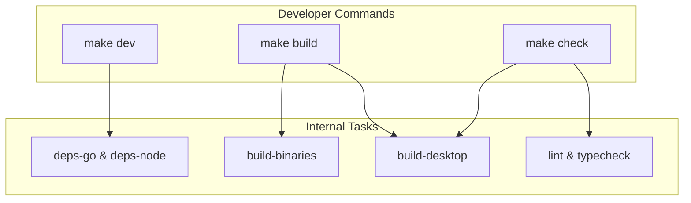

<!-- source: DeepWiki mcp.deepwiki.com · repo NVIDIA/Personal-AI-Router · page 5 Build System and Tooling · fetched 2026-10-26 -->

# Build System and Tooling

Relevant source files

The following files were used as context for generating this wiki page:

- [Makefile](Makefile)
- [desktop/electron-builder.config.ts](desktop/electron-builder.config.ts)
- [desktop/electron.vite.config.ts](desktop/electron.vite.config.ts)
- [desktop/package.json](desktop/package.json)

The Personal AI Router (PAIR) build system manages a hybrid environment consisting of a **TypeScript/Electron** desktop application and **13 Go-based backend services**. The system is designed to provide a unified developer experience via a root-level `Makefile` while utilizing specialized tooling for each ecosystem, such as `electron-vite` for the frontend and shell/batch scripts for the Go services.

### Build Architecture Overview

The build process is divided into two primary domains: the **Desktop Tree** (`/desktop`) and the **Services Tree** (`/services`). These are orchestrated to ensure that the Go binaries are compiled and staged within the Electron application's resource directory before packaging.

#### Natural Language to Code Entity Mapping

| System Concept | Code Entity / Script | Role |
| :--- | :--- | :--- |
| **Monorepo Entrypoint** | `Makefile` | High-level task runner for Linux/macOS. |
| **Desktop Bundler** | `electron-vite` | Compiles Main, Preload, and Renderer processes. |
| **Service Compiler** | `build-modular-binaries.ts` | Compiles Go services into `desktop/cli-bin`. |
| **App Packager** | `electron-builder` | Creates installers (NSIS, DMG, DEB). |
| **License Auditor** | `spdx-headers.mjs` | Enforces license headers across all files. |

Sources: [Makefile:4-10](), [desktop/package.json:37-43](), [desktop/electron.vite.config.ts:49-113]().

### The Root Makefile

The `Makefile` serves as the primary developer interface for non-Windows environments. It wraps canonical commands to provide a consistent entry point for installation, building, and linting.

Sources: [Makefile:12-48](), [Makefile:129-134]().

### Desktop Build Pipeline
The desktop pipeline uses `electron-vite` to handle the three-process architecture of Electron. A critical aspect of this pipeline is the compilation of Go services via `scripts/build-modular-binaries.ts`, which places the resulting executables into the `desktop/cli-bin` directory. These binaries are then bundled into the final application by `electron-builder`.

For details on asset bundling, binary staging, and installer generation, see [Desktop Build Pipeline](#5.1).

Sources: [desktop/package.json:59-64](), [desktop/electron.vite.config.ts:12-22](), [desktop/electron-builder.config.ts:83-112]().

### Services Build Pipeline and Versioning
The backend consists of 13 Go binaries. The build system ensures that these services are compiled with correct version metadata using `-ldflags`. The source of truth for all component versions is `services/versions.json`. While the desktop app bundles these into `cli-bin`, a standalone services bundle can also be generated for use in headless environments or the `nvpair-tui`.

For details on Go compilation, version stamping, and the `versions.json` schema, see [Services Build Pipeline and Versioning](#5.2).

Sources: [Makefile:137-138](), [desktop/package.json:37-43]().

### Code Quality and Tooling
PAIR enforces strict quality gates to maintain monorepo health. This includes:
*   **Linting and Formatting**: ESLint and Prettier.
*   **Type Safety**: Multiple `tsconfig` projects (node, web, test).
*   **Dead Code Analysis**: Custom scripts using `knip`.
*   **License Compliance**: Verification of SPDX headers in every source file.
*   **Contract Validation**: Ensuring the TypeScript IPC definitions match the Go JSON-RPC service definitions.

For details on linting configurations and quality gate scripts, see [Code Quality and Linting](#5.3).

Sources: [desktop/package.json:17-24](), [desktop/package.json:83-85](), [Makefile:112-117]().

### Build Toolchain Requirements
The build system requires specific minimum versions of the following tools:
*   **Go**: 1.25+
*   **Node.js**: 25.5.0+
*   **npm**: Included with Node.
*   **jq**: Required for JSON processing in shell scripts.

The `make tools` command can be used to verify the local environment against these requirements.

Sources: [Makefile:19-21](), [Makefile:59-83]().

---

