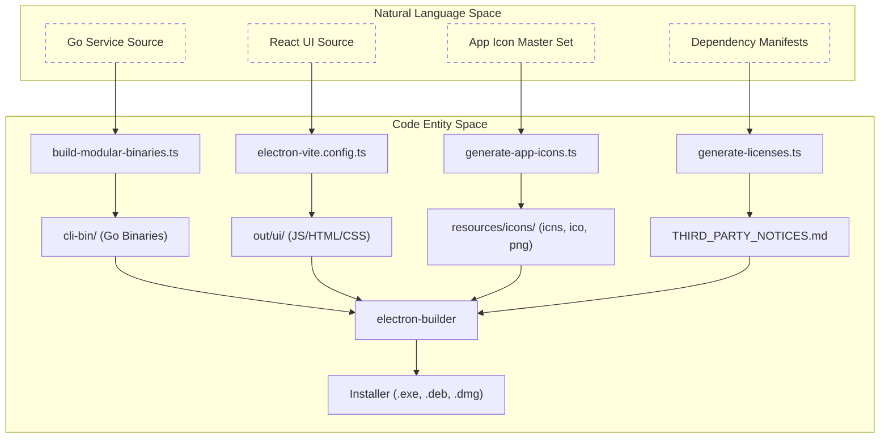
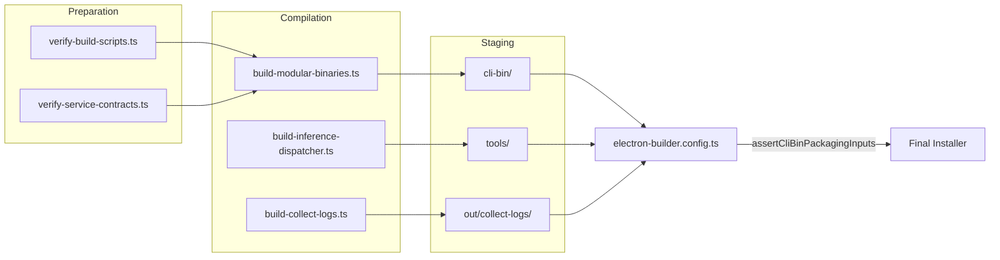

<!-- source: DeepWiki mcp.deepwiki.com · repo NVIDIA/Personal-AI-Router · page 5.1 Desktop Build Pipeline · fetched 2026-10-26 -->

# Desktop Build Pipeline

Relevant source files

The following files were used as context for generating this wiki page:

- [desktop/electron-builder.config.ts](desktop/electron-builder.config.ts)
- [desktop/electron.vite.config.ts](desktop/electron.vite.config.ts)
- [desktop/scripts/build-collect-logs.ts](desktop/scripts/build-collect-logs.ts)
- [desktop/scripts/build-inference-dispatcher.ts](desktop/scripts/build-inference-dispatcher.ts)
- [desktop/scripts/build-modular-binaries.ts](desktop/scripts/build-modular-binaries.ts)
- [desktop/scripts/build/generate-app-icons.ts](desktop/scripts/build/generate-app-icons.ts)
- [desktop/scripts/build/installer.nsh](desktop/scripts/build/installer.nsh)
- [desktop/scripts/build/linux/after-install.sh](desktop/scripts/build/linux/after-install.sh)
- [desktop/scripts/build/linux/after-remove.sh](desktop/scripts/build/linux/after-remove.sh)
- [desktop/scripts/collect-go-licenses.ts](desktop/scripts/collect-go-licenses.ts)
- [desktop/scripts/generate-licenses.ts](desktop/scripts/generate-licenses.ts)
- [desktop/scripts/verify-build-scripts.ts](desktop/scripts/verify-build-scripts.ts)
- [desktop/scripts/verify-service-contracts.ts](desktop/scripts/verify-service-contracts.ts)
- [desktop/scripts/vite-alias.ts](desktop/scripts/vite-alias.ts)

The NVIDIA Personal AI Router (PAIR) desktop build pipeline is responsible for orchestrating the compilation of high-performance Go backend services, bundling the Electron/React frontend, and generating cross-platform installers. The pipeline emphasizes reproducible builds by using a manifest-driven approach for binary inventory and license compliance.

## Build Orchestration Overview

The build process is managed via `npm` scripts that invoke specialized TypeScript build utilities. The pipeline is designed to be cross-platform; since the Go services are pure Go (no `cgo`), a host on any supported OS can cross-compile binaries for Windows, Linux, or macOS.

### High-Level Build Flow

| Step | Script / Tool | Description |
| :--- | :--- | :--- |
| **Frontend Bundling** | `electron-vite` | Compiles React renderer, Preload, and Main processes [desktop/electron.vite.config.ts:49-113](). |
| **Service Compilation** | `build-modular-binaries.ts` | Compiles 13 Go services from `services/` into `cli-bin/` [desktop/scripts/build-modular-binaries.ts:4-16](). |
| **Tooling Compilation** | `build-inference-dispatcher.ts` | Compiles the standalone synthetic traffic generator into `tools/` [desktop/scripts/build-inference-dispatcher.ts:8-13](). |
| **Asset Generation** | `generate-app-icons.ts` | Assembles `.icns`, `.ico`, and Linux hicolor PNG sets [desktop/scripts/build/generate-app-icons.ts:4-28](). |
| **License Collection** | `generate-licenses.ts` | Aggregates licenses for npm deps and Go modules into `THIRD_PARTY_NOTICES.md` [desktop/scripts/generate-licenses.ts:4-21](). |
| **Packaging** | `electron-builder` | Packages the bundles into installers (NSIS, .deb, .dmg) [desktop/electron-builder.config.ts:4-11](). |

**Sources:** [desktop/electron.vite.config.ts](), [desktop/scripts/build-modular-binaries.ts](), [desktop/scripts/build-inference-dispatcher.ts](), [desktop/scripts/build/generate-app-icons.ts](), [desktop/scripts/generate-licenses.ts](), [desktop/electron-builder.config.ts]().

## Frontend Bundling (`electron-vite`)

PAIR uses `electron-vite` for rapid development and optimized production builds. A key architectural decision is setting `externalizeDeps: false` for the `main` and `preload` processes [desktop/electron.vite.config.ts:12-22](). This ensures all npm dependencies are inlined into the final bundles, allowing the packaged application to ship with zero `node_modules/` folder.

### Configuration Highlights
*   **Main Process**: Entry point is `src/electron/index.ts` [desktop/electron.vite.config.ts:56](). It includes a `copyIconsPlugin` to ensure tray and window icons are available at runtime [desktop/electron.vite.config.ts:24-47]().
*   **Preload Process**: Entry point is `src/preload/index.ts` [desktop/electron.vite.config.ts:76]().
*   **Renderer**: Rooted in `src/ui` [desktop/electron.vite.config.ts:85](). Uses a relative `base: './'` to ensure assets resolve correctly when loaded via the `file://` protocol in Electron [desktop/electron.vite.config.ts:91]().

**Sources:** [desktop/electron.vite.config.ts:12-22](), [desktop/electron.vite.config.ts:56](), [desktop/electron.vite.config.ts:76](), [desktop/electron.vite.config.ts:85-91]().

## Backend Service Pipeline

The desktop application acts as a supervisor for multiple Go-based microservices. These must be compiled and staged in specific directories before packaging.

### Modular Binaries (`build-modular-binaries.ts`)
This script compiles the 13 core services (e.g., `nvpair-ui-broker`, `nvpair-cluster-manager`) into the `cli-bin/` directory [desktop/scripts/build-modular-binaries.ts:5-16]().
*   **Version Stamping**: Versions are read from `services/versions.json` and injected via `-ldflags "-X main.Version=..."` [desktop/scripts/build-modular-binaries.ts:14-16]().
*   **Manifest Safety**: A `cli-bin/manifest.json` is generated, recording source fingerprints, component versions, and SHA256 hashes [desktop/scripts/build-modular-binaries.ts:71-80](). This allows `npm start` to skip redundant builds [desktop/scripts/build-modular-binaries.ts:25-27]().
*   **Contract Enforcement**: The script warns if a service defined in `versions.json` is missing from the `MODULAR_RUNTIME_BINARIES` constant [desktop/scripts/build-modular-binaries.ts:158-170]().

### Inference Dispatcher (`build-inference-dispatcher.ts`)
The `inference-dispatcher` is a standalone HTTP client used by the "Inference Demo" feature [desktop/scripts/build-inference-dispatcher.ts:8-13](). It is built into a separate `tools/` directory because it is not a supervised service and does not speak JSON-RPC [desktop/scripts/build-inference-dispatcher.ts:8-9]().

### Log Sanitizer (`build-collect-logs.ts`)
The `collectlogs` Go utility is compiled into `out/collect-logs/` [desktop/scripts/build-collect-logs.ts:13-15](). It is bundled so that users can generate sanitized logs for support without needing the Go toolchain installed [desktop/scripts/build-collect-logs.ts:7-11]().

**Sources:** [desktop/scripts/build-modular-binaries.ts](), [desktop/scripts/build-inference-dispatcher.ts](), [desktop/scripts/build-collect-logs.ts]().

## Asset and Compliance Generation

### Icon Assembly
The `generate-app-icons.ts` script transforms a master set of PNGs in `resources/app-icon/` into platform-specific formats [desktop/scripts/build/generate-app-icons.ts:4-17]().
*   **macOS**: Uses `@fiahfy/icns` to manually assemble a `.icns` container from sized PNGs, avoiding the need for the macOS-only `iconutil` [desktop/scripts/build/generate-app-icons.ts:24-28]().
*   **Linux**: Generates a standard Freedesktop hicolor icon set (16x16 through 512x512) [desktop/scripts/build/generate-app-icons.ts:49-50]().

### License Attribution
PAIR generates a unified `THIRD_PARTY_NOTICES.md` at the repository root [desktop/scripts/generate-licenses.ts:5-6]().
*   **Go Licenses**: `collect-go-licenses.ts` uses `go list -deps` to find every third-party module linked into the 13 binaries [desktop/scripts/collect-go-licenses.ts:8-16](). It iterates through all `GO_TARGETS` (Windows, Linux, Darwin x x64, arm64) to ensure OS-specific dependencies (like `go-winio`) are captured [desktop/scripts/collect-go-licenses.ts:42-49]().
*   **npm Licenses**: Uses `license-checker-rseidelsohn` to scan production dependencies [desktop/scripts/generate-licenses.ts:22]().

**Sources:** [desktop/scripts/build/generate-app-icons.ts](), [desktop/scripts/generate-licenses.ts](), [desktop/scripts/collect-go-licenses.ts]().

## Build Verification and Gates

To ensure build integrity, several "gate" scripts run in CI and locally:

1.  **`verify-build-scripts.ts`**: Ensures that installer scripts (`.sh`, `.nsh`) use LF line endings, have proper shebangs, and end with a single newline [desktop/scripts/verify-build-scripts.ts:7-11]().
2.  **`verify-service-contracts.ts`**: Checks for drift between the backend Go service definitions and the frontend TypeScript bridge types.
3.  **`electron-builder` Asset Assertion**: The `electron-builder.config.ts` includes `assertCliBinPackagingInputs` and `assertToolsPackagingInputs`, which validate that the `cli-bin/` and `tools/` directories contain exactly the binaries required for the target architecture and platform before packaging begins [desktop/electron-builder.config.ts:83-156]().

**Sources:** [desktop/scripts/verify-build-scripts.ts](), [desktop/electron-builder.config.ts:83-156]().

## Data Flow: Code to Artifact

The following diagram illustrates how source entities in the repository are transformed into packaged artifacts.

### Build Transformation Map

**Sources:** [desktop/scripts/build-modular-binaries.ts](), [desktop/electron.vite.config.ts](), [desktop/scripts/build/generate-app-icons.ts](), [desktop/scripts/generate-licenses.ts]().

## Installer Customization

PAIR uses custom hooks for platform-specific installers to manage service lifecycles and security configurations.

### Windows (NSIS)
The `installer.nsh` script provides macros for the Windows installation process:
*   **`pairCloseRunningProcesses`**: Uses `taskkill` to force-close the broker and all 12 worker processes before an update or uninstall [desktop/scripts/build/installer.nsh:11-33]().
*   **`pairRemoveUserData`**: Wipes `%LOCALAPPDATA%\Nvidia Corporation\Personal AI Router` during a full uninstall [desktop/scripts/build/installer.nsh:67-76]().
*   **`pairAddFirewallRules`**: Configures the Windows Firewall to allow inbound traffic on port 14318 (node-info) specifically for the `localsubnet` to enable LAN discovery while maintaining security [desktop/scripts/build/installer.nsh:112-121]().

### Linux (Debian)
*   **`after-install.sh`**: Replaces the default `electron-builder` template to set up a SUID Chromium sandbox and install an AppArmor profile for Ubuntu 24.04 compatibility [desktop/scripts/build/linux/after-install.sh:5-44](). It also creates a `/usr/bin/` wrapper that launches the `nvpair-tui` terminal interface [desktop/scripts/build/linux/after-install.sh:15-32]().
*   **`after-remove.sh`**: Handles clean removal of the AppArmor profile and conditionally wipes user data in `~/.config/Nvidia Corporation/` only if the user performs an `apt purge` [desktop/scripts/build/linux/after-remove.sh:45-80]().

**Sources:** [desktop/scripts/build/installer.nsh](), [desktop/scripts/build/linux/after-install.sh](), [desktop/scripts/build/linux/after-remove.sh]().

### Build Pipeline Logic

**Sources:** [desktop/scripts/verify-build-scripts.ts](), [desktop/scripts/build-modular-binaries.ts](), [desktop/scripts/build-inference-dispatcher.ts](), [desktop/electron-builder.config.ts:83-156]().

---

