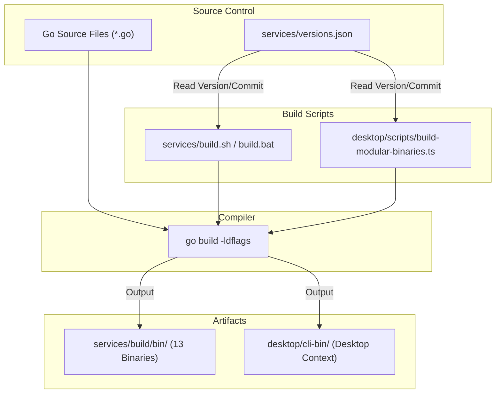

<!-- source: DeepWiki mcp.deepwiki.com · repo NVIDIA/Personal-AI-Router · page 5.2 Services Build Pipeline and Versioning · fetched 2026-10-26 -->

# Services Build Pipeline and Versioning

Relevant source files

The following files were used as context for generating this wiki page:

- [.github/PULL_REQUEST_TEMPLATE.md](.github/PULL_REQUEST_TEMPLATE.md)
- [.gitignore](.gitignore)
- [Makefile](Makefile)

The Personal AI Router (PAIR) Go services are built as a suite of 13 independent binaries that form the backend of the application. This page details the automated pipeline used to compile these services, the versioning strategy that ensures consistency across the monorepo, and the relationship between the Go services and the Electron desktop application.

## Build Pipeline Overview

The services build pipeline is designed to produce a consistent set of binaries for multiple platforms (Windows, macOS, Linux). The process can be triggered via the root `Makefile` for development or via platform-specific scripts in the `services/` directory for release packaging.

### Build Orchestration

There are three primary ways the Go services are built:

1.  **Desktop Integration (`build-binaries`)**: When building the full desktop application, the Electron build process invokes a script to compile Go services directly into `desktop/cli-bin/` [Makefile:129-130]().
2.  **Standalone Services (`build-services`)**: For headless environments or the Terminal UI (TUI), the `services/build.sh` (or `build.bat` on Windows) script compiles the services into `services/build/bin/` [Makefile:137-138]().
3.  **Test-Time Compilation**: The Go integration test suite in `services/tests/` builds the necessary worker binaries into a temporary directory at runtime to ensure tests always run against the latest code [Makefile:121-122]().

### Data Flow: From Source to Binary

The build process follows a strict flow to ensure that every binary is stamped with the correct version information from the single source of truth.

**Sources:** [Makefile:129-139](), [services/build.sh](), [desktop/scripts/build-modular-binaries.ts]()

## Versioning Strategy

PAIR uses a "Single Source of Truth" model for versioning to prevent drift between the 13 microservices and the UI.

### The `versions.json` Manifest
The file `services/versions.json` contains the SemVer version for every service. During the build, the script reads this file and uses Go's `-ldflags` to inject these values into the `main.version` variable of each binary.

### VERSIONING.md and SemVer Rules
The project follows Semantic Versioning (SemVer). Contributors are required to bump the version in `services/versions.json` whenever a change is made to a specific service. This requirement is enforced via the Pull Request checklist [.github/PULL_REQUEST_TEMPLATE.md:26-26]().

*   **Major**: Breaking changes to the JSON-RPC contract or mTLS protocol.
*   **Minor**: New features (e.g., a new engine supported in `nvpair-engine-manager`).
*   **Patch**: Bug fixes or internal refactoring.

### Relationship to `desktop/package.json`
While the services have individual versions in `versions.json`, the overall PAIR application version is defined in `desktop/package.json`. The desktop version generally encompasses the suite of services it bundles. During a release, the versions are synchronized to ensure the `nvpair-ui-broker` can correctly supervise workers that match its expected version.

## Service Binaries Output

The build pipeline produces 13 distinct binaries. These are compiled from their respective modules within the `services/` directory.

| Binary Name | Role | Source Path |
| :--- | :--- | :--- |
| `nvpair-ui-broker` | Main supervisor and JSON-RPC gateway | `services/ui-broker/` |
| `nvpair-node-scanner` | mDNS discovery and node inventory | `services/node-scanner/` |
| `nvpair-cluster-manager` | EAP-NOOB pairing and mTLS trust | `services/cluster-manager/` |
| `nvpair-engine-manager` | Ollama/LM Studio lifecycle | `services/engine-manager/` |
| `nvpair-job-scheduler` | Workload ranking and node selection | `services/job-scheduler/` |
| `nvpair-workload-manager` | Cluster-wide workload tracking | `services/workload-manager/` |
| `nvpair-node-settings` | Persistent KV store for node config | `services/node-settings/` |
| `nvpair-node-info` | HTTP metadata server (Port 14321) | `services/node-info/` |
| `nvpair-manual-nodes` | User-defined static node management | `services/manual-nodes/` |
| `nvpair-errors` | Centralized error aggregation | `services/errors/` |
| `ollama-proxy` | HTTP proxy for Ollama API | `services/ollama-proxy/` |
| `lmstudio-proxy` | HTTP proxy for LM Studio API | `services/lmstudio-proxy/` |
| `nvpair-tui` | Terminal User Interface | `services/tui/` |

**Sources:** [Makefile:53-56](), [services/]()

## Build Commands and Maintenance

### Development Build
Developers on Linux or macOS use the `Makefile` to manage the build lifecycle:

*   `make deps-go`: Fetches dependencies and runs a verification build to `/dev/null` to populate the build cache without polluting the tree [Makefile:89-93]().
*   `make build-binaries`: Compiles all services specifically for the Electron app's `cli-bin` directory [Makefile:129-130]().
*   `make clean`: Removes all generated artifacts, including `services/build/`, `desktop/cli-bin/`, and per-module binaries [Makefile:49-56]().

### CI and Verification
The build pipeline includes several "gates" to ensure code quality before binaries are finalized:
*   **Contract Check**: `npm run service-contracts:check` ensures the TypeScript definitions in the frontend match the JSON-RPC handlers in the Go services [Makefile:107-108]().
*   **Header Check**: `node scripts/spdx-headers.mjs` verifies that every source file contains the required SPDX license headers [Makefile:112-113]().

### Artifact Locations and Git Policy
To keep the repository clean, all build artifacts are explicitly ignored by Git. This includes the `pair-logs-*` bundles, the `token-map.json` used for log de-anonymization, and all compiled binaries in `scripts/` or `desktop/cli-bin/` [.gitignore:9-17]().

**Sources:** [Makefile:49-56](), [.gitignore:1-24](), [.github/PULL_REQUEST_TEMPLATE.md:18-26]()

---

