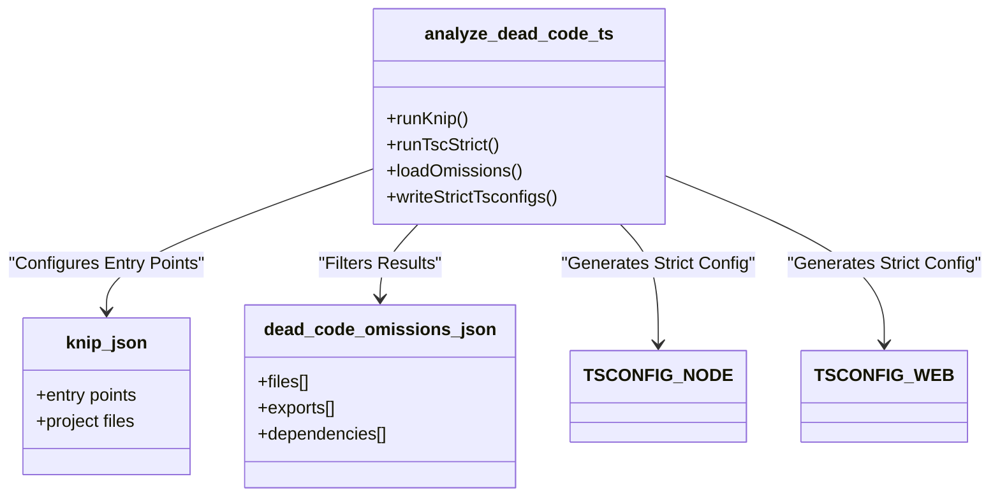

<!-- source: DeepWiki mcp.deepwiki.com · repo NVIDIA/Personal-AI-Router · page 5.3 Code Quality and Linting · fetched 2026-10-26 -->

# Code Quality and Linting

<details>
<summary>Relevant source files</summary>

The following files were used as context for generating this wiki page:

- [desktop/.prettierrc.yaml](desktop/.prettierrc.yaml)
- [desktop/dead-code-omissions.json](desktop/dead-code-omissions.json)
- [desktop/eslint.config.ts](desktop/eslint.config.ts)
- [desktop/knip.json](desktop/knip.json)
- [desktop/scripts/analyze-dead-code.ts](desktop/scripts/analyze-dead-code.ts)
- [desktop/scripts/vendor-kaizen-ui-foundations-css.ts](desktop/scripts/vendor-kaizen-ui-foundations-css.ts)

</details>


This page details the quality gates and static analysis tools enforced within the Personal AI Router (PAIR) `desktop/` tree. These gates ensure architectural consistency, type safety, license compliance, and the removal of unused code across the Electron main process, preload scripts, and React renderer.

## Quality Gate Overview

The PAIR desktop tree utilizes a multi-layered validation strategy that combines industry-standard tools (ESLint, Prettier, TypeScript) with custom analysis scripts to handle the complexities of a multi-process Electron application.

### Data Flow: Static Analysis Pipeline

The following diagram illustrates how source code is processed by the various quality gates.

**Static Analysis Data Flow**
```mermaid
graph TD
    subgraph "Source Code"
        [TS_Files] --> "src/**/*.{ts,tsx}"
        [Scripts] --> "scripts/*.ts"
    end

    subgraph "Linting & Formatting"
        [TS_Files] --> ESLint["ESLint (eslint.config.ts)"]
        [TS_Files] --> Prettier[".prettierrc.yaml"]
    end

    subgraph "Type Safety"
        [TS_Files] --> TSC_Main["tsc -p tsconfig.node.json"]
        [TS_Files] --> TSC_Web["tsc -p tsconfig.web.json"]
    end

    subgraph "Dead Code Analysis"
        [TS_Files] --> Knip["Knip (knip.json)"]
        Knip --> Filter["analyze-dead-code.ts"]
        [Omissions] --> "dead-code-omissions.json"
        [Omissions] --> Filter
    end

    subgraph "Compliance"
        [TS_Files] --> SPDX["spdx-headers.mjs"]
    end

    ESLint --> [Report]
    Prettier --> [Report]
    TSC_Main --> [Type Errors]
    Filter --> [dead-code-report.md]
    SPDX --> [License Failures]
```
**Sources:** `desktop/eslint.config.ts:1-10` (), `desktop/knip.json:1-13` (), `desktop/scripts/analyze-dead-code.ts:5-15` ()

---

## Linting and Formatting

### ESLint Configuration
The project uses a flat configuration file `eslint.config.ts` [desktop/eslint.config.ts:10]() which leverages `@electron-toolkit/eslint-config-ts`. It enforces specific rules for React hooks and refresh behavior to ensure stable UI updates.

*   **Key Rules:**
    *   `@typescript-eslint/no-unused-vars`: Set to `error`, but allows variables prefixed with `_` [desktop/eslint.config.ts:34-37]().
    *   `react-refresh/only-export-components`: Warns if non-component exports are mixed in React files to preserve Fast Refresh [desktop/eslint.config.ts:32]().
    *   `no-empty`: Errors on empty catch blocks unless specifically allowed [desktop/eslint.config.ts:38]().

### Prettier Configuration
Formatting is strictly enforced via `.prettierrc.yaml` to maintain a consistent style across the codebase.
*   **Indentation:** 4 spaces, no tabs [desktop/.prettierrc.yaml:5-6]().
*   **Quotes:** Single quotes [desktop/.prettierrc.yaml:8]().
*   **Semicolons:** Disabled (`semi: false`) [desktop/.prettierrc.yaml:7]().
*   **Line Length:** 100 characters [desktop/.prettierrc.yaml:4]().

**Sources:** `desktop/eslint.config.ts:1-53` (), `desktop/.prettierrc.yaml:1-12` ()

---

## Dead-Code Analysis

PAIR employs a specialized dead-code detection system controlled by `scripts/analyze-dead-code.ts`. This script orchestrates two distinct passes:
1.  **Cross-File Analysis:** Uses `knip` to find unused exports, files, and dependencies [desktop/scripts/analyze-dead-code.ts:6-7]().
2.  **In-File Analysis:** Generates temporary strict `tsconfig` files to run `tsc --noEmit` with `noUnusedLocals` and `noUnusedParameters` enabled [desktop/scripts/analyze-dead-code.ts:81-92]().

### Omission Management
To handle false positives (e.g., libraries loaded by Vite config but not imported in source), the system references `dead-code-omissions.json`.

| Category | Purpose | Example from Codebase |
| :--- | :--- | :--- |
| `dependencies` | Packages used by build tools | `tailwindcss`, `@tailwindcss/postcss` [desktop/dead-code-omissions.json:11]() |
| `exports` | Symbols used dynamically | `@electron-toolkit/preload` [desktop/dead-code-omissions.json:6]() |

### Implementation Details
The `analyze-dead-code.ts` script filters Knip output against the omissions list using `isOmittedFile`, `isOmittedExport`, and `isOmittedDependency` [desktop/scripts/analyze-dead-code.ts:57-77](). It specifically looks for TypeScript error codes such as `TS6133` (declared but never read) and `TS7027` (unreachable code) [desktop/scripts/analyze-dead-code.ts:162-169]().

**Entity Mapping: Dead Code Analysis**

**Sources:** `desktop/scripts/analyze-dead-code.ts:27-55` (), `desktop/knip.json:3-13` (), `desktop/dead-code-omissions.json:1-12` ()

---

## TypeScript Type-Checking

The project maintains separate TypeScript configurations for the different execution environments in Electron:
1.  **Node.js Context:** `tsconfig.node.json` covers the Electron main process and scripts [desktop/scripts/analyze-dead-code.ts:24]().
2.  **Web Context:** `tsconfig.web.json` covers the React renderer and UI components [desktop/scripts/analyze-dead-code.ts:25]().
3.  **Shared Logic:** Common types and utilities used by both.

During the dead-code check, these are extended into "strict" versions that disable `composite` and enable `noUnusedLocals` [desktop/scripts/analyze-dead-code.ts:81-92]().

**Sources:** `desktop/scripts/analyze-dead-code.ts:21-26` (), `desktop/scripts/analyze-dead-code.ts:81-92` ()

---

## License Compliance (SPDX)

Every source file in the repository is required to include a standard SPDX license header:
*   `SPDX-FileCopyrightText: Copyright (c) 2026 NVIDIA CORPORATION & AFFILIATES. All rights reserved.`
*   `SPDX-License-Identifier: Apache-2.0`

This requirement is enforced by `scripts/spdx-headers.mjs`. This script scans the tree to ensure the header is present and correctly formatted at the top of every `.ts`, `.tsx`, `.js`, and `.yaml` file [desktop/.prettierrc.yaml:1-2](), [desktop/eslint.config.ts:1-2](), [desktop/scripts/vendor-kaizen-ui-foundations-css.ts:1-2]().

**Sources:** `desktop/.prettierrc.yaml:1-2` (), `desktop/eslint.config.ts:1-2` (), `desktop/scripts/vendor-kaizen-ui-foundations-css.ts:1-2` ()

---

## Vendoring and Offline Integrity

The script `scripts/vendor-kaizen-ui-foundations-css.ts` serves as a quality gate for external CSS assets. It fetches NVIDIA Kaizen UI foundations and processes them to ensure the application can run in air-gapped or offline environments.

*   **Function `removeRemoteFontFaces`**: Strips `@font-face` rules that point to external URLs [desktop/scripts/vendor-kaizen-ui-foundations-css.ts:28-30]().
*   **Function `ensureOfflineCss`**: Validates that no `https://` imports or URL references remain in the CSS after processing, throwing an error if any are detected [desktop/scripts/vendor-kaizen-ui-foundations-css.ts:49-63]().

**Sources:** `desktop/scripts/vendor-kaizen-ui-foundations-css.ts:13-26` (), `desktop/scripts/vendor-kaizen-ui-foundations-css.ts:49-63` ()

---

