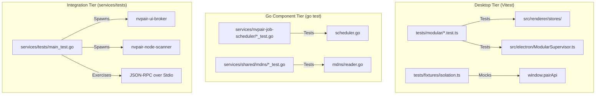
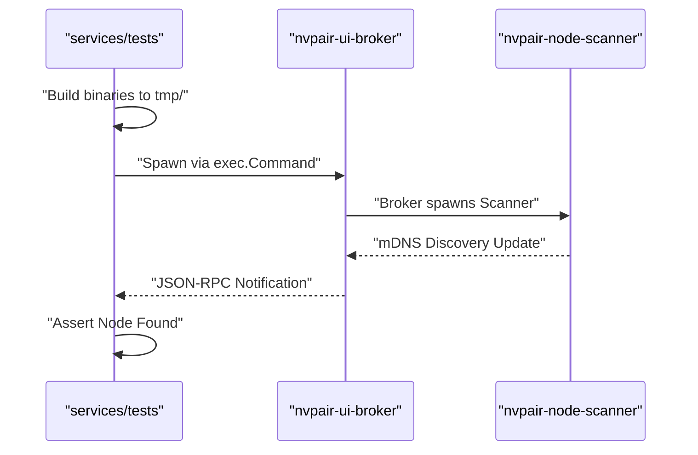

<!-- source: DeepWiki mcp.deepwiki.com · repo NVIDIA/Personal-AI-Router · page 6 Testing · fetched 2026-10-26 -->

# Testing

Relevant source files

The following files were used as context for generating this wiki page:

- [AGENTS.md](AGENTS.md)
- [CONTRIBUTING.md](CONTRIBUTING.md)

The NVIDIA Personal AI Router (PAIR) employs a three-tier testing strategy to ensure reliability across its multi-process architecture. Testing spans from isolated TypeScript unit tests in the Electron renderer to cross-process integration tests that drive real Go binaries and network discovery.

### Testing Strategy Overview

The testing hierarchy is designed to validate the system at different levels of abstraction:

1.  **Desktop Unit Tests (Vitest):** Validate the React UI, Zustand stores, and Electron main-process logic using extensive mocks and a specialized test fixture environment.
2.  **Go Component Tests:** Per-module unit tests within `services/` that validate individual worker logic (e.g., scheduling algorithms, mDNS record parsing) in isolation.
3.  **Cross-Process Integration Tests:** End-to-end tests located in `services/tests/` that spawn the actual compiled binaries to verify IPC, mTLS handshakes, and cluster-wide workload routing.

### System Test Map
The following diagram maps the testing tiers to the codebase entities they exercise.

"Testing Tier to Code Entity Map"

Sources: [AGENTS.md:60-88](), [CONTRIBUTING.md:123-135]()

---

### Desktop Unit Tests (Vitest)

The desktop suite focuses on the Electron main process and the React renderer. It utilizes **Vitest** for execution and provides a robust fixture system to simulate the multi-process backend without spawning real Go workers.

*   **Modular Tests:** Located in `desktop/tests/modular/`, these tests exercise the `ModularSupervisor` and the service bridge.
*   **Fixtures:** The `tests/fixtures/isolation.ts` file sets up a controlled environment, including a temporary `PAIR_USER_DATA` directory and network interceptors to prevent leakage.
*   **Coverage:** The suite includes coverage reporting via `coverage-summary.ts`.

For details on running these tests and managing mocks, see **[Desktop Unit Tests (Vitest)](#6.1)**.

Sources: [AGENTS.md:60-62](), [CONTRIBUTING.md:96-103]()

---

### Go Component and Cross-Process Tests

The backend testing is split between isolated logic checks and full-binary integration.

#### Component Tests
Each Go module in the `services/` directory contains its own unit tests. These are standard Go tests executed via `go test ./...` within the specific component directory. They are ideal for testing pure functions, such as the ranking algorithm in `nvpair-job-scheduler` or identity generation in `nvpair-cluster-manager`.

#### Cross-Process Integration
The `services/tests/` directory contains a specialized test suite that treats the Go workers as black boxes.
*   **Binary Lifecycle:** The `TestMain` function builds all workers into a temporary directory before execution.
*   **Live Engine Tests:** Optional tests for Ollama and LM Studio can be enabled via environment variables (e.g., `NVPAIR_LIVE_OLLAMA`) to verify compatibility with real inference engines.
*   **Network Requirements:** These tests often require a functioning mDNS responder and may skip themselves if port conflicts are detected on the host.

For details on Go test configuration and live engine requirements, see **[Go Component and Cross-Process Tests](#6.2)**.

"Go Testing Flow"

Sources: [AGENTS.md:75-88](), [CONTRIBUTING.md:123-138]()

---

### Execution Summary

| Command | Scope | Tier |
| :--- | :--- | :--- |
| `npm test` | `desktop/` | Vitest Unit Tests |
| `go test ./...` (in component) | `services/module/` | Go Unit Tests |
| `go test ./...` (in `services/tests`) | `services/` | Cross-Process Integration |
| `make test` | Repository-wide | All of the above (Linux/macOS) |

Sources: [AGENTS.md:92-98](), [CONTRIBUTING.md:76-82]()

---

