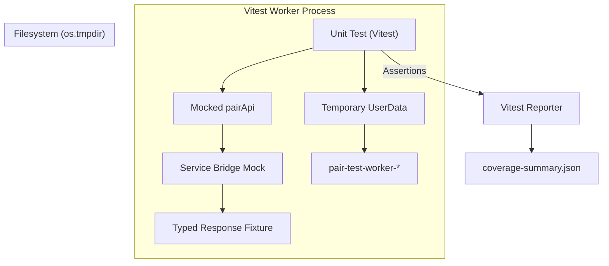
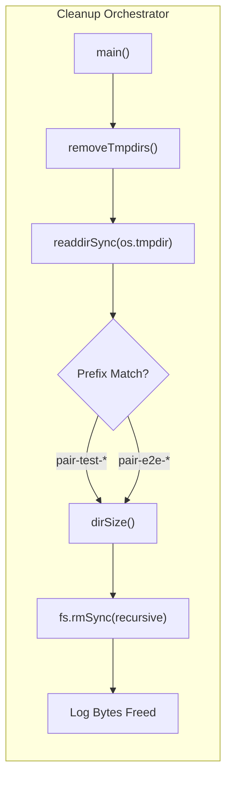

<!-- source: DeepWiki mcp.deepwiki.com · repo NVIDIA/Personal-AI-Router · page 6.1 Desktop Unit Tests (Vitest) · fetched 2026-10-26 -->

# Desktop Unit Tests (Vitest)

Relevant source files

The following files were used as context for generating this wiki page:

- [desktop/scripts/coverage-summary.ts](desktop/scripts/coverage-summary.ts)
- [desktop/scripts/test-clean.ts](desktop/scripts/test-clean.ts)
- [desktop/src/declarations/vite-raw.d.ts](desktop/src/declarations/vite-raw.d.ts)

The PAIR desktop unit test suite is built on **Vitest**. It is designed to validate the Electron main process logic, React components, and the shared service bridge without requiring the full overhead of spawning Go binaries or Electron windows. The suite emphasizes **isolation**, **typed mocking**, and **filesystem sandboxing**.

## Test Infrastructure and Environment

The test suite uses a specialized environment to ensure that tests do not interfere with the developer's local PAIR installation or with other concurrent test workers.

### Filesystem Isolation
To prevent tests from corrupting real application data, the suite uses a temporary directory strategy. 
- **Worker Isolation**: Each Vitest worker process is assigned a unique `PAIR_USER_DATA` root directory under the system's temporary directory, prefixed with `pair-test-worker-` [desktop/scripts/test-clean.ts:8-10]().
- **Per-Test Sandboxing**: Individual tests can further isolate their state using `tests/fixtures/tmpdir.ts`, which creates a `pair-test-<rand>` directory [desktop/scripts/test-clean.ts:10-11]().
- **Cleanup**: Because interrupted test runs can leave behind these directories, the `test-clean.ts` script is provided to reclaim disk space by scanning `os.tmpdir()` for these specific prefixes [desktop/scripts/test-clean.ts:24-26]().

### Network and Mocking
The suite utilizes **typed mocks** to simulate the behavior of the Go backend services and the Electron IPC bridge.
- **Network Interceptor**: Prevents tests from making real outbound network calls, ensuring deterministic results and allowing for the simulation of failure states (e.g., 500 errors, timeouts).
- **Service Bridge Mocks**: The `WsInvokeChannelMap` and `IpcChannelMap` are mocked to allow tests to "invoke" backend methods and receive predictable responses without a running broker [desktop/src/declarations/vite-raw.d.ts:4-8]().

### Logical Organization of Tests

| Component | Directory | Description |
| :--- | :--- | :--- |
| **Modular Logic** | `tests/modular/` | Tests for the `ModularSupervisor`, service bridge, and backend connectors. |
| **Fixtures** | `tests/fixtures/` | Shared utilities for isolation, network interception, and temporary data. |
| **Scripts** | `desktop/scripts/` | Tooling for coverage reporting and artifact cleanup. |

---

## Test Execution and Data Flow

The following diagram illustrates how a unit test interacts with the mocked PAIR environment.

### Unit Test Execution Flow

Sources: [desktop/scripts/test-clean.ts:8-11](), [desktop/scripts/coverage-summary.ts:17-24]()

---

## Coverage Analysis (`coverage-summary.ts`)

PAIR uses a custom coverage reporting script to solve a specific issue with Vitest's V8 provider. When a project uses multiple environments (e.g., `unit` and `e2e`), V8 may emit duplicate source paths in `coverage-summary.json`—one with actual coverage and one with 0% [desktop/scripts/coverage-summary.ts:16-20]().

The `coverage-summary.ts` script performs the following:
1.  **Normalization**: Converts all paths to a standard format [desktop/scripts/coverage-summary.ts:73]().
2.  **Deduplication**: Keeps the entry with the highest line percentage for each file [desktop/scripts/coverage-summary.ts:75-76]().
3.  **Real Totals**: Recalculates the "All files" total based on the deduped data, providing a more accurate representation than the default reporter [desktop/scripts/coverage-summary.ts:108-121]().

### Coverage Metrics Tracked
| Metric | Description |
| :--- | :--- |
| **L (Lines)** | Percentage of source code lines executed [desktop/scripts/coverage-summary.ts:98](). |
| **F (Functions)** | Percentage of defined functions called [desktop/scripts/coverage-summary.ts:100](). |
| **B (Branches)** | Percentage of logical branches (if/else) traversed [desktop/scripts/coverage-summary.ts:102](). |

---

## Artifact Management (`test-clean.ts`)

To maintain a clean development environment, `test-clean.ts` is used to purge orphaned directories. It targets directories matching `pair-test-` and `pair-e2e-` [desktop/scripts/test-clean.ts:26]().

### Cleanup Logic
The script recursively calculates the size of the artifacts before removal using `dirSize` [desktop/scripts/test-clean.ts:48-64](). It uses `fs.rmSync` with a retry policy to handle files that might be temporarily locked by the OS [desktop/scripts/test-clean.ts:39]().

Sources: [desktop/scripts/test-clean.ts:28-46](), [desktop/scripts/test-clean.ts:73-79]()

---

## Commands

The following commands are used to manage and run the unit test suite:

-   **`npm test`**: Runs the full suite of unit tests.
-   **`npm run test:unit`**: Runs unit tests and automatically triggers `coverage-summary.ts` upon completion [desktop/scripts/coverage-summary.ts:26-27]().
-   **`npm run test:unit:watch`**: Runs Vitest in watch mode for active development.
-   **`tsx scripts/test-clean.ts`**: Manually triggers the cleanup of temporary test directories [desktop/scripts/test-clean.ts:73-81]().
-   **`tsx scripts/coverage-summary.ts <substring>`**: Filters the coverage report to specific subdirectories (e.g., `tsx scripts/coverage-summary.ts inference/runner`) [desktop/scripts/coverage-summary.ts:9-10]().

Sources: [desktop/scripts/coverage-summary.ts:8-10](), [desktop/scripts/test-clean.ts:4-18]()

---

