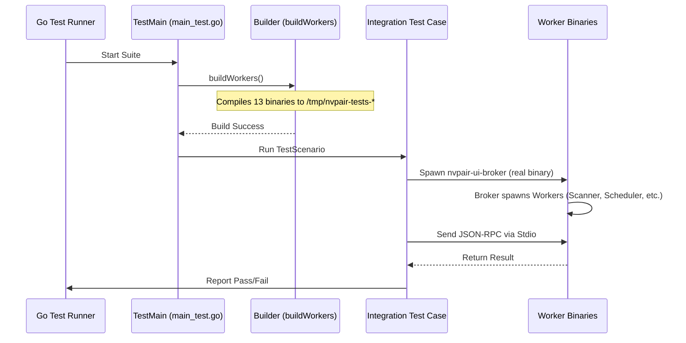

<!-- source: DeepWiki mcp.deepwiki.com · repo NVIDIA/Personal-AI-Router · page 6.2 Go Component and Cross-Process Tests · fetched 2026-10-26 -->

# Go Component and Cross-Process Tests

<details>
<summary>Relevant source files</summary>

The following files were used as context for generating this wiki page:

- [AGENTS.md](AGENTS.md)
- [CONTRIBUTING.md](CONTRIBUTING.md)

</details>


The NVIDIA Personal AI Router (PAIR) employs a multi-tiered testing strategy for its Go-based backend. This includes isolated unit tests for individual components and a comprehensive cross-process integration suite that orchestrates real binaries to validate inter-service communication, discovery, and routing logic.

## Testing Strategy Overview

The Go testing infrastructure is divided into two primary categories:
1.  **Component Tests**: Located within each service or shared package directory, focusing on internal logic and unit-level validation [AGENTS.md:73-77]().
2.  **Cross-Process Tests**: Located in `services/tests/`, these tests drive real compiled binaries to verify the system as a whole [AGENTS.md:77-78]().

### Natural Language to Code Entity Mapping: Test Infrastructure

| System Concept | Code Entity / Path | Role |
| :--- | :--- | :--- |
| **Component Test** | `go test ./...` (per module) | Validates internal package logic and JSON-RPC handlers. |
| **Integration Suite** | `services/tests/` | Orchestrates multiple workers to test end-to-end flows. |
| **Test Orchestrator** | `TestMain` in `services/tests/main_test.go` | Builds all 13 binaries into a temporary directory before execution. |
| **Live Engine Opt-in** | `NVPAIR_LIVE_OLLAMA` | Environment variable to enable tests against a running Ollama instance. |
| **Service Builder** | `buildWorkers()` | Internal function in `main_test.go` that prepares the test environment. |

Sources: [AGENTS.md:73-89](), [CONTRIBUTING.md:123-138]()

## Component-Level Testing

Each of the 13 Go binaries and the shared module packages contain localized tests. These tests are executed by running `go test ./...` from the respective module directory [AGENTS.md:84-85]().

### Key Component Test Areas
*   **Shared Module (`services/shared`)**: Tests for core utilities like `mdns`, `jsonrpc`, `clustertrust` (mTLS), and `netpick` (port selection).
*   **JSON-RPC Handlers**: Components like `nvpair-ui-broker` and `nvpair-engine-manager` test their method handlers by simulating JSON-RPC requests over pipes or buffers.
*   **Logic Isolation**: The `nvpair-job-scheduler` tests its ranking algorithm by providing mock node pressure and workload states.

Sources: [AGENTS.md:73-78](), [CONTRIBUTING.md:130-135]()

## Cross-Process Integration Tests

The integration suite in `services/tests/` is a standalone Go module designed to simulate the full PAIR environment. Unlike unit tests, these tests interact with the actual compiled binaries produced by the Go compiler.

### Test Execution Flow
When `go test` is invoked in `services/tests/`, the `TestMain` function performs a setup phase:
1.  **Binary Compilation**: It calls a build routine (equivalent to `build.sh`) to compile all workers into a temporary directory [AGENTS.md:77-78]().
2.  **Environment Isolation**: Each test case typically spawns its own `nvpair-ui-broker`, which in turn supervises the necessary workers for that specific test scenario [AGENTS.md:35-39]().
3.  **Cleanup**: Binaries and temporary data directories are purged after the test suite completes.

### Sequence: Cross-Process Test Setup

Sources: [AGENTS.md:35-45](), [AGENTS.md:77-78](), [CONTRIBUTING.md:123-129]()

## Live Engine and Environment Requirements

Some tests require specific environment conditions or external dependencies. To prevent false negatives, these tests utilize "skipping" logic rather than failing when requirements are not met.

### mDNS Responder Requirement
Tests involving `nvpair-node-scanner` require a functional mDNS responder on the host system (e.g., Avahi on Linux, mDNSResponder on macOS/Windows). If the responder is unavailable or blocked, discovery tests will skip [AGENTS.md:85-86]().

### Port Conflict Handling
The test suite attempts to bind to the standard PAIR ports (e.g., 14321, 11434). If these ports are already occupied by a running instance of PAIR or another application, the tests will skip to avoid interference.

### Opt-in Live Engine Tests
Tests that interact with real inference engines are disabled by default to prevent unintended modification of system state. They are enabled via environment variables:
*   `NVPAIR_LIVE_OLLAMA`: Enables tests that attempt to pull models or run inference via a local Ollama instance [AGENTS.md:86-88]().
*   `NVPAIR_LIVE_LMSTUDIO`: Enables tests targeting a running LM Studio instance [AGENTS.md:86-88]().

### Data Flow: Live Engine Testing
```mermaid
graph LR
    subgraph "Test Environment"
        [IntegrationTest] -- "JSON-RPC" --> [EngineManager]
        [EngineManager] -- "HTTP/REST" --> [LocalEngine]
    end

    subgraph "External Engines (Opt-in)"
        [LocalEngine] -.-> [Ollama_Service]
        [LocalEngine] -.-> [LM_Studio_Service]
    end

    subgraph "Environment Controls"
        [NVPAIR_LIVE_OLLAMA] -- "Enable" --> [LocalEngine]
        [NVPAIR_LIVE_LMSTUDIO] -- "Enable" --> [LocalEngine]
    end
```
Sources: [AGENTS.md:84-89](), [CONTRIBUTING.md:137-139]()

## Test Evidence and Logging

During cross-process tests, service logs are captured to assist in debugging.
*   **Standard Output**: The broker and workers communicate via stdio [AGENTS.md:41-42](). Tests capture this stream to verify JSON-RPC responses.
*   **Privacy Guarantees**: Even in testing, the system enforces the policy of never logging prompts, response bodies, or pairing PINs [AGENTS.md:117-119]().
*   **Log Sanitization**: When tests fail, logs can be collected using the `scripts/collect-logs` utilities, which automatically redact PII (Personal Identifiable Information) [CONTRIBUTING.md:60-61]().

Sources: [AGENTS.md:117-119](), [CONTRIBUTING.md:56-61]()

---

