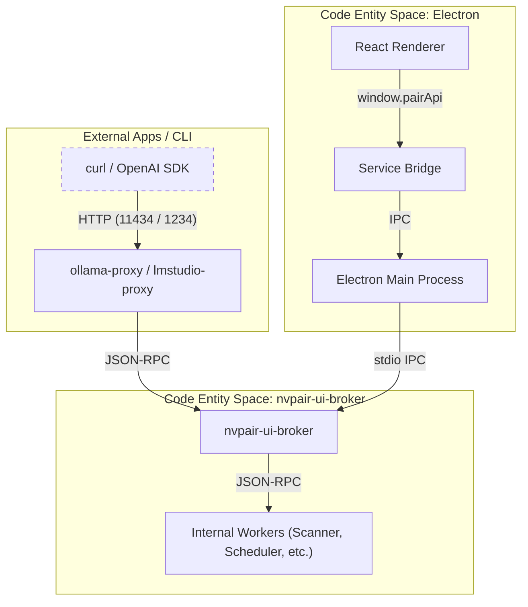
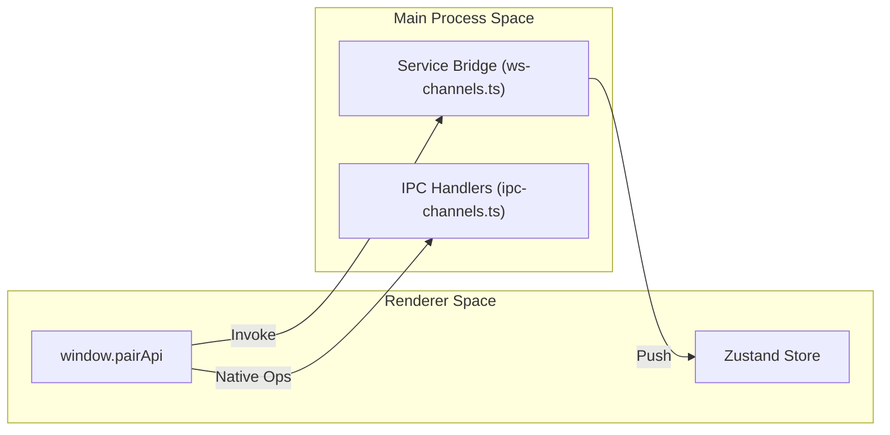

<!-- source: DeepWiki mcp.deepwiki.com · repo NVIDIA/Personal-AI-Router · page 7 API Reference · fetched 2026-10-26 -->

# API Reference

Relevant source files

The following files were used as context for generating this wiki page:

- [desktop/docs/frontend-api.md](desktop/docs/frontend-api.md)
- [desktop/docs/services-api.md](desktop/docs/services-api.md)
- [desktop/docs/services-parity.md](desktop/docs/services-parity.md)

The NVIDIA Personal AI Router (PAIR) exposes three distinct API surfaces that facilitate local inference, cross-process coordination, and frontend-to-backend communication. This reference provides a high-level overview of these surfaces, ranging from public-facing HTTP endpoints to internal JSON-RPC protocols.

## API Surface Overview

PAIR is architected around a multi-process model where the frontend (Electron/React) communicates with a central broker, which in turn orchestrates specialized worker services.

| API Surface | Protocol | Target Audience | Primary Use Case |
| :--- | :--- | :--- | :--- |
| **HTTP Proxy API** | HTTP/JSON | External Apps | OpenAI/Ollama compatible inference routing. |
| **Broker JSON-RPC** | JSON-RPC 2.0 | Internal Services | Control plane: discovery, engine management, pairing. |
| **Frontend TS API** | Electron IPC | UI Components | Exposing backend state to the React renderer. |

### API Connectivity Map

The following diagram illustrates how these APIs bridge the "Natural Language Space" (User/App requests) to the "Code Entity Space" (specific service handlers and IPC channels).

**Sources:** [desktop/docs/frontend-api.md:19-31](), [desktop/docs/services-parity.md:38-55]()

---

## 7.1 HTTP Proxy API (OpenAPI)

The **HTTP Proxy API** is the primary entry point for inference. It acts as a routing layer that mimics the APIs of popular local LLM engines like Ollama and LM Studio. When a request hits these endpoints, the `nvpair-job-scheduler` determines the best node in the cluster to handle the workload.

*   **Ollama Compatibility:** Supports `/api/chat`, `/api/generate`, and `/api/tags`.
*   **OpenAI Compatibility:** Supports `/v1/chat/completions` and `/v1/models`.
*   **Metadata:** Responses include an `X-PAIR-Served-By` header indicating which node UUID fulfilled the request.

For endpoint specifications and routing logic, see **[HTTP Proxy API (OpenAPI)](#7.1)**.

**Sources:** [desktop/docs/services-parity.md:25-26](), [desktop/docs/services-parity.md:62-65]()

---

## 7.2 Broker JSON-RPC API

The **Broker JSON-RPC API** is the internal backbone of the system. The `nvpair-ui-broker` acts as a central message bus, supervising 11+ worker processes and providing a unified API surface for the Electron main process.

### Logical Namespaces
The API is organized into namespaces that map to specific backend responsibilities:
*   `discovery:*`: Managed by `nvpair-node-scanner` for mDNS node tracking.
*   `engine:*`: Managed by `nvpair-engine-manager` for lifecycle (install/start/stop).
*   `cluster:*`: Managed by `nvpair-cluster-manager` for EAP-NOOB pairing and mTLS.
*   `workloads:*`: Real-time tracking of active inference jobs across the cluster.

For a full list of methods and notification patterns, see **[Broker JSON-RPC API](#7.2)**.

**Sources:** [desktop/docs/services-api.md:1-153](), [desktop/docs/services-parity.md:38-55]()

---

## 7.3 Frontend TypeScript API (window.pairApi)

The **Frontend TypeScript API** (`window.pairApi`) is the interface provided to the React renderer via Electron's preload bridge. It abstracts the complexities of JSON-RPC and IPC into typed TypeScript methods and observable event callbacks.

### Service Bridge Mapping
The bridge maps logical "Invoke" channels (request/response) and "Push" channels (notifications) to the UI stores.

### Key Modules
*   `pairApi.engines`: Controls local/remote engine lifecycle [desktop/docs/frontend-api.md:76-103]().
*   `pairApi.cluster`: Handles PIN-based pairing invitations [desktop/docs/frontend-api.md:55-66]().
*   `pairApi.nodes`: Provides the authoritative map of discovered and trusted nodes [desktop/docs/frontend-api.md:47-54]().

For implementation details and the full channel map, see **[Frontend TypeScript API (window.pairApi)](#7.3)**.

**Sources:** [desktop/docs/frontend-api.md:6-16](), [desktop/docs/frontend-api.md:121-159]()

---

