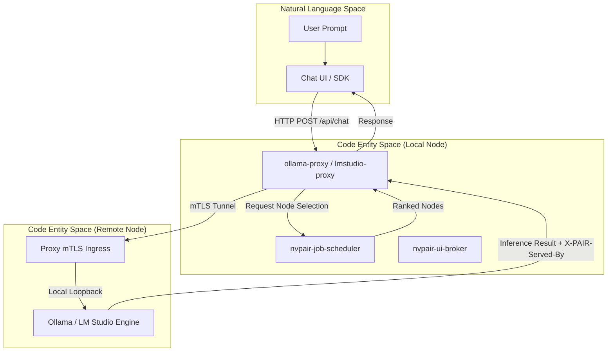
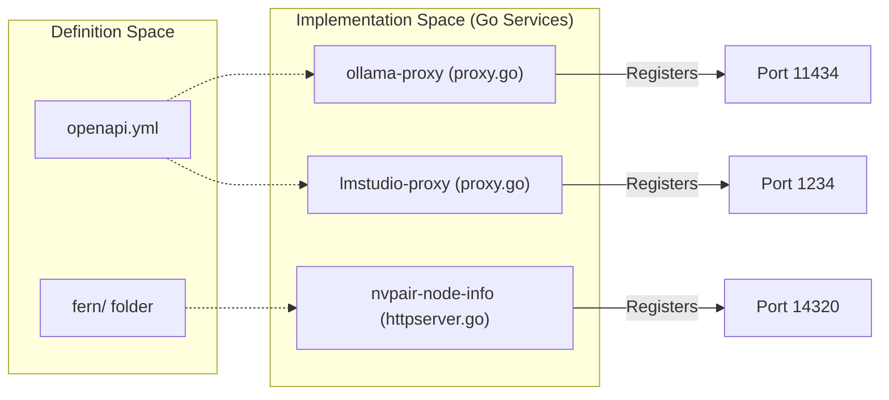

<!-- source: DeepWiki mcp.deepwiki.com · repo NVIDIA/Personal-AI-Router · page 7.1 HTTP Proxy API (OpenAPI) · fetched 2026-10-26 -->

# HTTP Proxy API (OpenAPI)

Relevant source files

The following files were used as context for generating this wiki page:

- [desktop/docs/services-api.md](desktop/docs/services-api.md)
- [desktop/docs/services-parity.md](desktop/docs/services-parity.md)

The NVIDIA Personal AI Router (PAIR) exposes a set of HTTP endpoints that allow local applications to perform inference across a distributed cluster of nodes. By acting as a routing layer, PAIR presents a unified API surface that is compatible with major LLM ecosystems, specifically **Ollama** and **OpenAI**.

## Overview

The HTTP Proxy API is primarily served by two worker processes: `ollama-proxy` and `lmstudio-proxy`. These proxies intercept local traffic on standard ports (e.g., 11434 for Ollama) and either handle the request locally or route it to a remote peer in the cluster based on model availability and hardware pressure `[desktop/docs/services-parity.md:25-26]()`.

### Base URLs
The base URL for the API depends on which proxy is being targeted and the current port configuration. Users can find the active addresses in the **Endpoints** window of the PAIR desktop application.
- **Ollama Proxy:** Typically `http://localhost:11434`
- **LM Studio Proxy:** Typically `http://localhost:1234`
- **Node Info:** Typically `http://localhost:14320/v1/node-info` `[desktop/docs/services-parity.md:83-85]()`

## Supported Endpoints

### Ollama-Compatible Endpoints
These endpoints mimic the Ollama API, allowing tools like LangChain or local LLM UIs to work with PAIR without modification.

| Endpoint | Method | Description |
| :--- | :--- | :--- |
| `/api/chat` | POST | Generate a chat completion using a specific model. |
| `/api/generate` | POST | Generate a completion for a single prompt. |
| `/api/tags` | GET | List models available across the entire cluster. |

### OpenAI-Compatible Endpoints
PAIR provides a compatibility layer for the OpenAI API specification, enabling integration with the OpenAI SDK and compatible clients.

| Endpoint | Method | Description |
| :--- | :--- | :--- |
| `/v1/chat/completions` | POST | OpenAI-style chat completions. |
| `/v1/models` | GET | List all models available in the cluster. |

### PAIR-Specific Endpoints
| Endpoint | Method | Description |
| :--- | :--- | :--- |
| `/v1/node-info` | GET | Returns hardware telemetry (CPU, GPU, VRAM) and node identity `[desktop/docs/services-parity.md:83-85]()`. |

## Request Routing and Metadata

When a request is sent to a PAIR proxy, the `nvpair-job-scheduler` determines the best node to handle the workload. If the request is routed to a remote peer, it is transmitted over an mTLS-encrypted tunnel `[desktop/docs/services-parity.md:34-34]()`.

### X-PAIR-Served-By Header
Every inference response includes the `X-PAIR-Served-By` header. This header contains the `hostUuid` of the node that actually performed the inference, allowing clients to track where workloads are being executed within the cluster.

### Diagram: HTTP Request Data Flow
This diagram illustrates how a request from a Natural Language client (like a Chat UI) transitions into the code entities that manage routing and execution.

**Sources:** `[desktop/docs/services-parity.md:25-26]()`, `[desktop/docs/services-parity.md:34-34]()`, `[desktop/docs/services-api.md:147-153]()`

## API Specification (Fern / OpenAPI)

PAIR utilizes [Fern](https://buildwithfern.com/) to manage its API definitions. The source of truth for the HTTP surface is located in the `fern/` directory of the repository.

- **`openapi.yml`**: The standard OpenAPI 3.0 specification defining the endpoints, request schemas, and response formats.
- **`fern.config.json`**: Configuration for the Fern compiler.
- **`generators.yml`**: Defines the output formats (e.g., TypeScript SDKs, Python SDKs, or documentation).

### Diagram: API Definition to Implementation
This diagram bridges the static API definitions to the runtime Go services that implement them.

**Sources:** `[desktop/docs/services-api.md:48-69]()`, `[desktop/docs/services-api.md:94-95]()`, `[desktop/docs/services-parity.md:42-45]()`

## Telemetry and Node Info

The `/v1/node-info` endpoint is a critical part of the PAIR infrastructure. While the broker provides high-level discovery snapshots, the desktop application polls this endpoint directly to retrieve real-time telemetry `[desktop/docs/services-parity.md:83-85]()`.

The response includes:
- **`hostUuid`**: The stable unique identifier for the node `[desktop/docs/services-parity.md:62-65]()`.
- **GPU Metrics**: Utilization and VRAM usage.
- **CPU/RAM**: System-level resource consumption.

**Note:** Currently, remote telemetry is limited to nodes that allow plain HTTP access to this endpoint; nodes restricted by internal firewalls may only show discovery-level data `[desktop/docs/services-parity.md:88-91]()`.

**Sources:**
- `desktop/docs/services-api.md:48-69, 73-92, 147-153`
- `desktop/docs/services-parity.md:19-36, 40-52, 59-81, 83-98`

---

