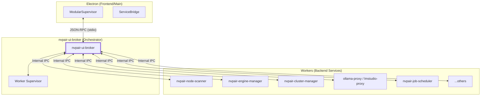
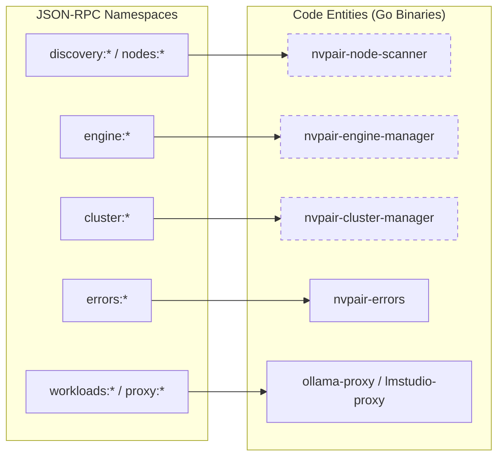

<!-- source: DeepWiki mcp.deepwiki.com · repo NVIDIA/Personal-AI-Router · page 7.2 Broker JSON-RPC API · fetched 2026-10-26 -->

# Broker JSON-RPC API

Relevant source files

The following files were used as context for generating this wiki page:

- [desktop/docs/services-api.md](desktop/docs/services-api.md)
- [desktop/docs/services-backend.md](desktop/docs/services-backend.md)
- [desktop/docs/services-parity.md](desktop/docs/services-parity.md)

The `nvpair-ui-broker` serves as the central orchestration hub for the Personal AI Router (PAIR) backend services. It implements a JSON-RPC 2.0 interface over standard input/output (stdio) to communicate with the Electron main process. The broker acts as a supervisor for all other worker processes and a message relay that consolidates multiple service namespaces into a single unified API surface.

## Architecture and Data Flow

The broker is the sole process started directly by the Electron `ModularSupervisor` [desktop/docs/services-backend.md:18-19](). It manages the lifecycle of 11 worker binaries, including proxies, scanners, and managers [desktop/docs/services-backend.md:21-35]().

### Request/Response Pattern
The API follows standard JSON-RPC 2.0. The Electron process sends requests to the broker's `stdin`, and the broker routes these to the appropriate internal worker or handles them locally.

### Notification Subscriptions
The broker uses a "Pub/Sub" model for state updates. Upon receiving an `app:ready` signal, the Electron `ServiceBridge` subscribes to various namespaces (discovery, engine, cluster, etc.) to receive asynchronous notifications [desktop/docs/services-backend.md:88-90]().

### Service Topology

**Sources:** [desktop/docs/services-backend.md:42-68](), [desktop/docs/services-backend.md:79-80]()

## API Namespaces

The API is divided into logical namespaces corresponding to the backend workers.

### 1. Discovery and Nodes (`discovery:*`, `nodes:*`)
Used for mDNS node discovery and manual node management. The broker provides a consolidated snapshot of the network state.

| Method | Type | Description |
| :--- | :--- | :--- |
| `discovery:nodes-changed` | Notification | Emitted when nodes are added, removed, or updated [desktop/docs/services-backend.md:119](). |
| `nodes:list` | Request | Retrieves the current list of all known nodes [desktop/docs/services-api.md:68](). |
| `node/add-manual` | Request | Manually adds a node by IP/Hostname [desktop/docs/services-api.md:62](). |
| `node/remove-manual` | Request | Removes a manually added node [desktop/docs/services-api.md:63](). |

### 2. Engine Manager (`engine:*`)
Controls the lifecycle of inference engines (Ollama, LM Studio) and model operations.

| Method | Type | Description |
| :--- | :--- | :--- |
| `engine:state-changed` | Notification | Signal for engine start/stop/error transitions [desktop/docs/services-api.md:106](). |
| `engine:install-progress` | Notification | Streams percentage and status during engine installation [desktop/docs/services-api.md:101](). |
| `engine:pull-progress` | Notification | Streams model download progress [desktop/docs/services-api.md:103](). |
| `engine:start` / `engine:stop` | Request | Local engine control [desktop/docs/services-api.md:127-129](). |
| `engine:remote-pull-model` | Request | Triggers a model download on a cluster peer [desktop/docs/services-api.md:121](). |

### 3. Cluster Management (`cluster:*`)
Handles EAP-NOOB pairing, node identity, and trust relationships.

| Method | Type | Description |
| :--- | :--- | :--- |
| `cluster:invite-received` | Notification | Incoming pairing request from a peer [desktop/docs/services-api.md:80](). |
| `cluster:create` | Request | Initializes a new cluster identity [desktop/docs/services-api.md:84](). |
| `cluster:invite-node` | Request | Generates a PIN to invite a specific node [desktop/docs/services-api.md:86](). |
| `cluster:respond-to-invite` | Request | Accepts or declines a pairing invitation [desktop/docs/services-api.md:89](). |

### 4. Workloads and Errors (`workloads:*`, `errors:*`)
Relays telemetry about active inference jobs and system-wide errors.

| Method | Type | Description |
| :--- | :--- | :--- |
| `proxy/request` | Notification | Emitted when an inference request starts/ends [desktop/docs/services-api.md:59](). |
| `errors:update` | Notification | Syncs error logs across the cluster [desktop/docs/services-api.md:141](). |
| `errors:clear` | Request | Flushes the error registry [desktop/docs/services-api.md:143](). |

**Sources:** [desktop/docs/services-api.md:48-153](), [desktop/docs/services-parity.md:59-77]()

## Handshake and Lifecycle

### The `app:ready` Handshake
The broker does not immediately accept all requests. It first initializes its workers and then emits a specific notification to signal readiness.

1.  **Spawn**: Electron starts `nvpair-ui-broker`.
2.  **Worker Initialization**: Broker spawns `nvpair-node-scanner`, `nvpair-engine-manager`, etc.
3.  **Ready Signal**: Broker emits `{"jsonrpc": "2.0", "method": "app:ready", "params": {}}` [desktop/docs/services-backend.md:92-98]().
4.  **Subscription**: Electron calls `discovery:subscribe`, `engine:subscribe`, etc.
5.  **State Sync**: Electron calls `nodes:list`, `engine:get-installed`, and `cluster:get-node-id` to populate the UI [desktop/docs/services-parity.md:79-81]().

### Connection Mapping: Code to Logic
The following diagram maps high-level API namespaces to the specific Go service binaries that implement them.

**Sources:** [desktop/docs/services-backend.md:21-35](), [desktop/docs/services-api.md:1-153]()

## Special Methods and Exceptions

### Ping Method
The broker supports a `ping` request to verify IPC health. This is used by the `ModularSupervisor` to ensure the process hasn't deadlocked.

### The Telemetry Exception
While most control data flows through JSON-RPC, **Node Telemetry** (CPU, GPU, VRAM usage) is an exception. The broker does not relay rich telemetry. Instead, the Electron `node-info-poller.ts` polls each node's `/v1/node-info` HTTP endpoint directly every 2 seconds [desktop/docs/services-backend.md:102-105]().

### Unused Methods
Several methods are implemented in the backend but not currently consumed by the Electron bridge (e.g., `engine:logs`, `scheduler:tick`) [desktop/docs/services-api.md:18-43]().

**Sources:** [desktop/docs/services-backend.md:79-83](), [desktop/docs/services-api.md:18-43]()

---

