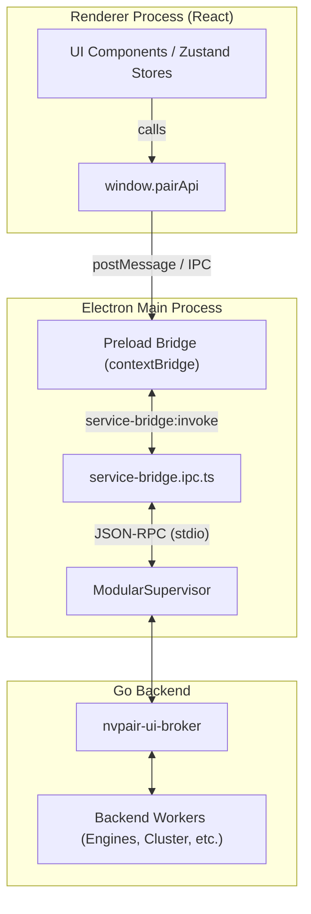
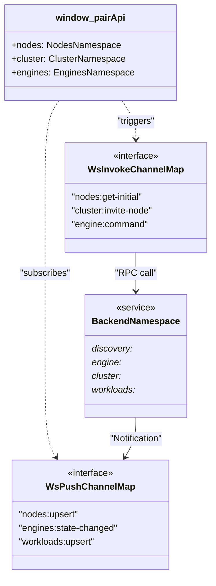

<!-- source: DeepWiki mcp.deepwiki.com · repo NVIDIA/Personal-AI-Router · page 7.3 Frontend TypeScript API (window.pairApi) · fetched 2026-10-26 -->

# Frontend TypeScript API (window.pairApi)

Relevant source files

The following files were used as context for generating this wiki page:

- [desktop/docs/frontend-api.md](desktop/docs/frontend-api.md)
- [desktop/docs/services-parity.md](desktop/docs/services-parity.md)
- [desktop/src/electron/ipc/service-bridge.ipc.ts](desktop/src/electron/ipc/service-bridge.ipc.ts)

The `window.pairApi` is the primary interface provided to the React renderer for interacting with the PAIR backend services and the Electron main process. It acts as a typed bridge, abstracting the underlying JSON-RPC over stdio and Electron IPC transports into a logical service-oriented API.

## Architecture and Data Flow

The API follows a multi-layered transport architecture. While the renderer uses logical "channels," these do not imply a WebSocket connection; instead, they are routed through Electron's context-isolated preload scripts to the main process, which then communicates with the `nvpair-ui-broker` via JSON-RPC 2.0.

### Logical Transport Diagram
"Logical Transport and Process Bridge"

**Sources:** [desktop/docs/frontend-api.md:19-31](), [desktop/src/electron/ipc/service-bridge.ipc.ts:7-11]()

## API Surface Structure

The API is divided into functional namespaces, each corresponding to a specific backend domain. The source of truth for these channels is defined in `ws-channels.ts` (logical invoke/push) and `ipc-channels.ts` (native Electron operations).

### 1. App and Connection (`pairApi.app`, `pairApi.connection`)
Manages the initial handshake and global application state.

*   **`app.getInitial()`**: Retrieves the `AppInitialSnapshot`, including connection status and the local node's unique ID [desktop/docs/frontend-api.md:40-40]().
*   **`connection.onStateRequestRefresh(callback)`**: Triggered when the backend requires the UI to refresh its domain snapshot [desktop/docs/frontend-api.md:44-44]().
*   **`connection.onClusterIdentity(callback)`**: Reports changes to the local node's cluster identity [desktop/docs/frontend-api.md:45-45]().

### 2. Discovery and Nodes (`pairApi.discovery`, `pairApi.nodes`)
Handles mDNS discovery of peers and the management of the cluster membership list.

| Method / Listener | Description |
| :--- | :--- |
| `discovery.getNodes()` | Returns `AvailableNode[]` found via mDNS. Includes `hostUuid`, `ipAddress`, and `trusted`/`clustered` flags [desktop/docs/frontend-api.md:69-73](). |
| `nodes.getInitial()` | Returns the current node map and fetch status for known cluster members [desktop/docs/frontend-api.md:49-49](). |
| `nodes.removeMember(nodeId)` | Evicts a node from the cluster [desktop/docs/frontend-api.md:50-50](). |
| `nodes.onUpsert(callback)` | Pushes updates when a node is added or its metadata changes [desktop/docs/frontend-api.md:51-51](). |

**Sources:** [desktop/docs/frontend-api.md:47-75](), [desktop/docs/services-parity.md:59-65]()

### 3. Cluster Management (`pairApi.cluster`)
Implements the EAP-NOOB pairing flow and trust establishment.

*   **`inviteNode(ipAddress)`**: Initiates the PIN-based pairing sequence with a remote IP [desktop/docs/frontend-api.md:58-58]().
*   **`respondToInvite(inviteId, accept, pin?)`**: Accepts or declines an inbound request, providing the 6-digit PIN if accepting [desktop/docs/frontend-api.md:60-60]().
*   **`cancelInvite(inviteId)`**: Invalidates a pending outbound invite and its PIN [desktop/docs/frontend-api.md:61-62]().
*   **`onInviteReceived(callback)`**: Notifies the UI of a new inbound pairing request [desktop/docs/frontend-api.md:64-64]().

**Sources:** [desktop/docs/frontend-api.md:55-66]()

### 4. Engines and Models (`pairApi.engines`)
Controls the lifecycle of inference backends (Ollama/LM Studio) and their respective models.

*   **Engine Commands**: A single `engine:command` channel handles `toggle`, `install`, `uninstall`, `update`, and `setPorts` [desktop/docs/frontend-api.md:87-94]().
*   **Model Management**: Supports `pullModel`, `loadModel`, `unloadModel`, and `deleteModel` [desktop/docs/frontend-api.md:95-98]().
*   **`searchHub(engineType)`**: Fetches the curated model catalog (Ollama Library or LM Studio Hub) [desktop/docs/frontend-api.md:84-84]().
*   **State Updates**: The renderer does not receive immediate state from commands; it listens for `onStateChanged`, `onProgress`, and `onProgressRemove` notifications [desktop/docs/frontend-api.md:101-103]().

**Sources:** [desktop/docs/frontend-api.md:76-103]()

### 5. Workloads and Errors (`pairApi.workloads`, `pairApi.errors`)
Monitors active inference jobs and system-wide error states.

*   **`workloads.onUpsert`**: Reports new jobs or status changes (e.g., scheduled, processing) [desktop/docs/frontend-api.md:108-108]().
*   **`errors.getInitial()`**: Returns all active `ServiceError` objects synced across the cluster [desktop/docs/frontend-api.md:113-113]().
*   **`errors.clear(id)`**: Dismisses a specific error globally [desktop/docs/frontend-api.md:114-114]().

**Sources:** [desktop/docs/frontend-api.md:105-115]()

## Entity Mapping: API to Code

The following diagram maps high-level API concepts to the specific TypeScript types and backend JSON-RPC namespaces used in the implementation.

"Code Entity Mapping"

**Sources:** [desktop/docs/frontend-api.md:121-159](), [desktop/docs/frontend-api.md:13-15]()

## Channel Reference

### Logical Invoke Channels (Request/Response)
| Channel | Request Type | Response Type |
| :--- | :--- | :--- |
| `app:get-initial` | `void` | `AppInitialSnapshot` |
| `discovery:get-nodes` | `void` | `AvailableNode[]` |
| `cluster:invite-node` | `{ ipAddress: string }` | `Invite` |
| `engine:command` | `EngineCommandPayload` | `null` |
| `errors:clear` | `string` (Error ID) | `null` |

### Logical Push Channels (Notifications)
| Channel | Payload Type |
| :--- | :--- |
| `nodes:upsert` | `NodeItem` |
| `engines:state-changed` | `EngineStatePatch` |
| `metrics:update` | `NodeItemMetrics` |
| `cluster:invite-received` | `Invite` |

**Sources:** [desktop/docs/frontend-api.md:123-159]()

---

