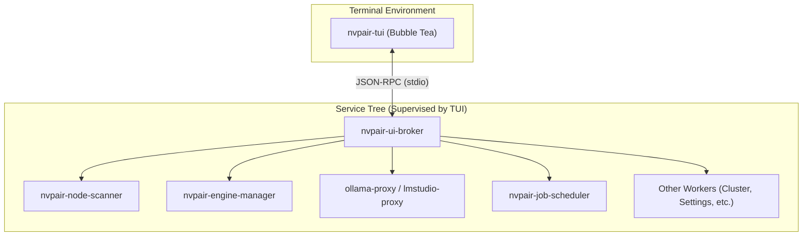
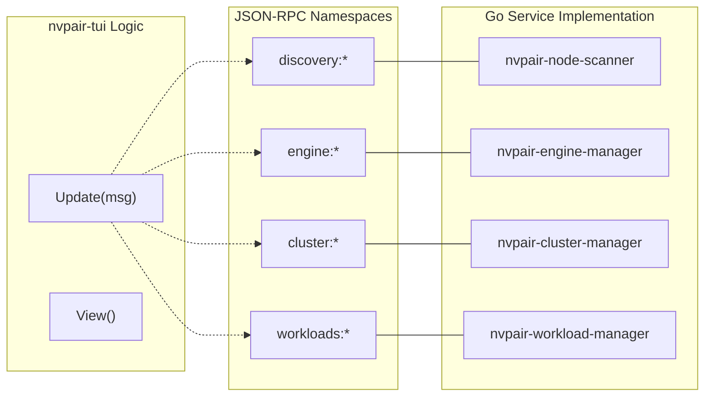

<!-- source: DeepWiki mcp.deepwiki.com · repo NVIDIA/Personal-AI-Router · page 8.1 Terminal Interface (nvpair-tui) · fetched 2026-10-26 -->

# Terminal Interface (nvpair-tui)

Relevant source files

The following files were used as context for generating this wiki page:

- [AGENTS.md](AGENTS.md)
- [desktop/docs/services-backend.md](desktop/docs/services-backend.md)

The `nvpair-tui` is a standalone terminal-based user interface built using the [Bubble Tea](https://github.com/charmbracelet/bubbletea) framework. It is designed for headless environments, remote SSH sessions, or users who prefer a command-line experience over the Electron desktop application. While it provides a similar functional surface to the desktop app, it operates under a distinct process model tailored for terminal use.

## Purpose and Scope

The terminal interface serves as a full-featured control plane for a Personal AI Router (PAIR) node. It allows for:
*   **Monitoring:** Viewing cluster health, node telemetry, active workloads, and error logs.
*   **Management:** Controlling engine lifecycles (Ollama/LM Studio), managing model downloads, and configuring cluster pairings.
*   **Diagnostics:** Real-time log streaming and manual node management.

### The Exclusive Runtime Rule
A critical operational constraint is that `nvpair-tui` **must not run alongside the desktop application** on the same machine. Both applications attempt to manage the underlying Go service tree. If both are active, they will compete for control over the broker and workers, leading to port conflicts and unstable service states `[AGENTS.md:40-40]()`, `[desktop/docs/services-backend.md:35-35]()`.

## Architecture and Process Model

Unlike the desktop application where the Electron `ModularSupervisor` manages the broker, `nvpair-tui` acts as its own supervisor.

### Self-Managed Broker
When `nvpair-tui` starts, it spawns its own instance of `nvpair-ui-broker`. The TUI communicates with this broker via JSON-RPC 2.0 over standard I/O (stdin/stdout). The broker, in turn, supervises the standard 11 worker services required for PAIR operations `[AGENTS.md:35-42]()`.

### Data Flow Diagram: TUI Integration
The following diagram illustrates how the TUI bridges the user's terminal to the Go backend services.

**Sources:** `[AGENTS.md:35-42]()`, `[desktop/docs/services-backend.md:42-68]()`

## Interface Structure (Tabs)

The TUI organizes information into several functional tabs, mirroring the navigation structure of the desktop application.

| Tab | Purpose | Code Entity / Service Source |
| :--- | :--- | :--- |
| **Overview** | High-level status of the local node and cluster. | `nvpair-ui-broker` |
| **Errors** | Aggregated error logs from all local workers. | `nvpair-errors` |
| **Nodes** | List of discovered nodes in the mDNS network. | `nvpair-node-scanner` |
| **Proxies** | Status of Ollama and LM Studio API listeners. | `ollama-proxy`, `lmstudio-proxy` |
| **Workloads** | Active and historical inference jobs. | `nvpair-workload-manager` |
| **Engines** | Management of local AI engines and model files. | `nvpair-engine-manager` |
| **Cluster** | EAP-NOOB pairing and trusted node management. | `nvpair-cluster-manager` |
| **Manual** | Configuration for non-mDNS static nodes. | `nvpair-manual-nodes` |
| **Settings** | Global node configuration and persistence. | `nvpair-node-settings` |
| **Logs** | Real-time tailing of service-level JSONL logs. | `nvpair-ui-broker` (Relay) |

**Sources:** `[desktop/docs/services-backend.md:21-35]()`, `[AGENTS.md:36-39]()`

## Implementation Details

### Bubble Tea Framework
The TUI uses the Elm architecture (Model-Update-View). 
*   **Model:** Holds the current state of all services (e.g., list of nodes, engine status).
*   **Update:** Processes incoming JSON-RPC notifications from the broker and updates the model.
*   **View:** Renders the terminal UI using Lip Gloss for styling.

### Service Mapping to Code Entities
The TUI interacts with the backend through specific JSON-RPC namespaces defined in the Go services.

**Sources:** `[AGENTS.md:75-78]()`, `[desktop/docs/services-backend.md:116-119]()`

## Key Functions and Data Flow

1.  **Startup:** `nvpair-tui` executes the broker binary found in the application directory. It passes flags to ensure the broker uses `stdio` for communication rather than named pipes or sockets `[AGENTS.md:41-42]()`.
2.  **Handshake:** The TUI waits for the `app:ready` notification from the broker before enabling the interface tabs `[desktop/docs/services-backend.md:88-92]()`.
3.  **Subscription:** Upon readiness, the TUI sends subscription requests for all relevant streams: `discovery:nodes-changed`, `engine:status-changed`, and `workloads:update` `[desktop/docs/services-backend.md:88-90]()`.
4.  **Telemetry:** While the broker handles most state, the TUI (like the desktop app) may perform direct HTTP polling to `nvpair-node-info` (port 14321) for high-frequency metrics like GPU utilization `[desktop/docs/services-backend.md:102-105]()`.

## Keyboard Shortcuts
*   **Tab / Shift+Tab:** Navigate between different views (Overview, Nodes, etc.).
*   **Arrows / J/K:** Scroll through lists (e.g., list of models or logs).
*   **Enter:** Select or toggle items (e.g., starting an engine).
*   **Q / Ctrl+C:** Gracefully shut down the TUI and the supervised broker/workers.

**Sources:**
* `AGENTS.md:33-48`
* `desktop/docs/services-backend.md:16-68`
* `desktop/docs/services-backend.md:73-112`

---

