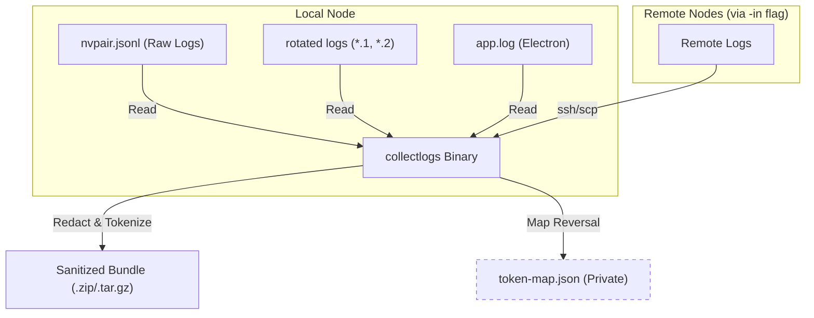
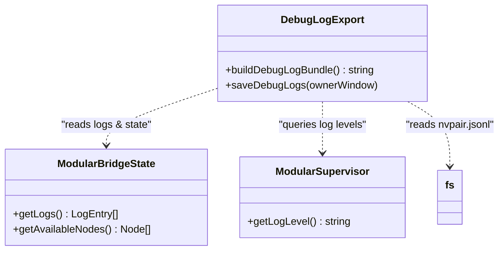

<!-- source: DeepWiki mcp.deepwiki.com · repo NVIDIA/Personal-AI-Router · page 8.2 Log Collection and Sanitization · fetched 2026-10-26 -->

# Log Collection and Sanitization

Relevant source files

The following files were used as context for generating this wiki page:

- [.gitignore](.gitignore)
- [desktop/scripts/build-collect-logs.ts](desktop/scripts/build-collect-logs.ts)
- [desktop/src/electron/ipc/debug-log-export.ts](desktop/src/electron/ipc/debug-log-export.ts)

The Log Collection and Sanitization pipeline provides a secure, privacy-preserving mechanism for operators and users to gather diagnostic data. The system ensures that sensitive information—such as user prompts, response bodies, pairing PINs, and local network identifiers—is never included in the logs or is systematically replaced with anonymous tokens before being shared.

## Overview

The pipeline consists of two primary entry points:
1.  **Shell Wrappers**: `scripts/collect-logs.sh` (Linux/macOS) and `collect-logs.ps1` (Windows) which orchestrate the collection process.
2.  **Sanitization Binary**: A specialized Go tool `collectlogs` that performs the actual data transformation and redaction.

### Privacy Policy
The following data points are strictly excluded from all logs by design:
*   **No Prompts/Responses**: The inference proxies (`ollama-proxy`, `lmstudio-proxy`) do not log the content of `messages` or `prompt` fields, nor the generated response bodies.
*   **No PINs**: The `nvpair-cluster-manager` suppresses the 6-digit EAP-NOOB pairing PINs from all log output.
*   **Sanitization**: Hostnames, IP addresses, UUIDs, and system usernames are replaced with deterministic tokens (e.g., `USER-1`, `IP-1`).

## Data Flow and Implementation

The collection process follows a multi-stage pipeline where raw logs from the local machine (and optionally remote cluster nodes) are aggregated and then passed through the `collectlogs` binary.

### Logical Data Flow
"Natural Language Space" to "Code Entity Space" mapping:

**Sources:** [scripts/collect-logs.sh:1-50](), [desktop/scripts/build-collect-logs.ts:4-18]()

### The `collectlogs` Go Binary
The `collectlogs` tool is the core engine for sanitization. It is compiled during the desktop build process and packaged with the application to ensure users do not need a Go toolchain installed to generate diagnostic reports [desktop/scripts/build-collect-logs.ts:4-11]().

Key functions of the sanitizer:
*   **Tokenization**: It identifies patterns for IPv4/IPv6 addresses, UUIDs, and hostnames. Each unique value is assigned a token.
*   **Reversal Map**: A `token-map.json` file is generated locally. This file contains the mapping of `Original Value -> Token`. **Crucially**, this file is excluded from the final bundle and must never be shared, as it allows de-anonymizing the logs [/.gitignore:9-12]().
*   **Structured Parsing**: It processes `nvpair.jsonl` files, ensuring that the JSON structure remains valid while the values within are sanitized.

## Multi-Node Collection
For clustered environments, the `collect-logs.sh` script supports an `-in` (include node) flag. This allows an operator to pull logs from multiple machines into a single sanitized report.

| Feature | Description |
| :--- | :--- |
| **Local Aggregation** | Reads from the standard `userData` path determined by the OS. |
| **Remote Fetching** | Uses `scp` to pull logs from peer nodes defined in the cluster. |
| **Parallel Sanitization** | The Go binary processes all gathered logs in a single pass to ensure token consistency across nodes (e.g., `Node-A` has the same token in all files). |

**Sources:** [scripts/collect-logs.sh:1-20](), [desktop/src/electron/ipc/debug-log-export.ts:67-102]()

## Desktop Export Implementation

In the Electron application, the `saveDebugLogs` function provides a GUI-driven way to export logs. It builds a "Debug Log Bundle" which includes high-level system metadata and a snapshot of the current modular state.

### Code Entity Relationship: Log Exporting

**Sources:** [desktop/src/electron/ipc/debug-log-export.ts:67-124](), [desktop/src/electron/service-bridge/modular-state.ts:1-50](), [desktop/src/electron/service-bridge/modular-supervisor.ts:1-20]()

### Exported Metadata
When logs are exported via the UI, the following metadata is captured to assist in debugging [desktop/src/electron/ipc/debug-log-export.ts:79-102]():
*   **Application Info**: `appVersion`, `packageVersion`, `isPackaged`.
*   **Environment**: `platform`, `arch`, `hostname` (sanitized later), `userDataPath`.
*   **Process State**: `modularLogLevel`, `envLogLevel`, and the status of the 11 managed worker binaries.
*   **Node State**: `selfId`, `availableNodes`, and `nodeInfoPollTargets` [desktop/src/electron/ipc/debug-log-export.ts:104-110]().

## Build and Packaging
The sanitizer is compiled using `CGO_ENABLED=0` to ensure the resulting binary is statically linked and portable across different Linux distributions and Windows versions [desktop/scripts/build-collect-logs.ts:17-17]().

*   **Output Path**: `desktop/out/collect-logs/` [desktop/scripts/build-collect-logs.ts:30-30]().
*   **Build Script**: `desktop/scripts/build-collect-logs.ts` handles cross-compilation for `win32`, `darwin`, and `linux` [desktop/scripts/build-collect-logs.ts:39-44]().

**Sources:** [desktop/scripts/build-collect-logs.ts:61-90](), [/.gitignore:14-15]()

---

