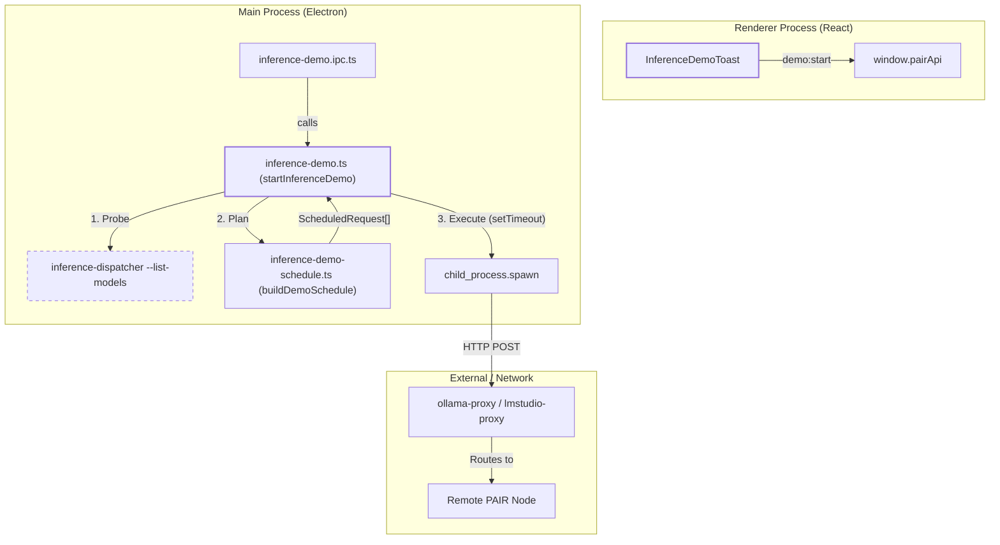
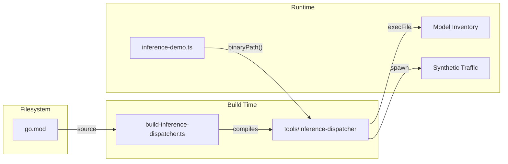

<!-- source: DeepWiki mcp.deepwiki.com · repo NVIDIA/Personal-AI-Router · page 8.3 Inference Demo and Dispatcher · fetched 2026-10-26 -->

# Inference Demo and Dispatcher

Relevant source files

The following files were used as context for generating this wiki page:

- [desktop/scripts/build-inference-dispatcher.ts](desktop/scripts/build-inference-dispatcher.ts)
- [desktop/src/electron/inference-demo-schedule.ts](desktop/src/electron/inference-demo-schedule.ts)
- [desktop/src/electron/inference-demo.ts](desktop/src/electron/inference-demo.ts)
- [desktop/src/electron/ipc/inference-demo.ipc.ts](desktop/src/electron/ipc/inference-demo.ipc.ts)

The Inference Demo is a built-in synthetic traffic generator designed to demonstrate the multi-node routing and load-balancing capabilities of NVIDIA Personal AI Router (PAIR). It uses a specialized Go binary, the `inference-dispatcher`, to simulate concurrent user requests across all available engines and models in a cluster within a strict 60-second window.

## Overview and Privacy Guarantees

The system is designed to provide a "live" visualization of the PAIR scheduler in action without compromising user privacy or system stability.

*   **Privacy**: The dispatcher is invoked with `stdio: ignore` for inference tasks [desktop/src/electron/inference-demo.ts:255-256](). It does not log prompts or response bodies to the standard PAIR logs, ensuring that synthetic traffic does not clutter diagnostic data [desktop/src/electron/inference-demo.ts:33-49]().
*   **Targeting**: The demo always targets the **proxy ports** (e.g., 11434 for Ollama, 1234 for LM Studio) rather than direct engine ports. This ensures that every request passes through the PAIR routing logic, failover mechanisms, and telemetry collection [desktop/src/electron/inference-demo.ts:30-33]().
*   **Isolation**: The `inference-dispatcher` is a standalone tool. It does not speak JSON-RPC and is not supervised by the broker; it is treated as a standard HTTP client [desktop/scripts/build-inference-dispatcher.ts:8-13]().

## System Components

### Inference Dispatcher (`scripts/inference-dispatcher/`)
A pure Go utility that performs HTTP inference requests. It supports two primary modes:
1.  **Inventory Discovery**: Called with `--list-models` to return a JSON array of available models on a specific backend [desktop/src/electron/inference-demo.ts:139-152]().
2.  **Inference Execution**: Performs a single completion or chat request against a targeted model and backend [desktop/src/electron/inference-demo.ts:241-252]().

### Inference Demo Scheduler (`inference-demo-schedule.ts`)
A pure functional planning module that builds a 60-second execution plan. It calculates "cohorts" and "agents" to ensure that even in large clusters, every model is touched at least once while respecting a hard 60-second ceiling [desktop/src/electron/inference-demo-schedule.ts:37-42]().

### Inference Demo Manager (`inference-demo.ts`)
The Electron main process controller that manages the lifecycle of a demo run. It probes for models, arms timers based on the schedule, and spawns the dispatcher processes [desktop/src/electron/inference-demo.ts:27-33]().

## Logical Data Flow: Planning to Execution

The following diagram illustrates how the system transitions from the React UI request to the execution of Go-based inference tasks.

**Inference Demo Request Flow**

**Sources:** [desktop/src/electron/ipc/inference-demo.ipc.ts:11-15](), [desktop/src/electron/inference-demo.ts:241-260](), [desktop/src/electron/inference-demo-schedule.ts:60-87]()

## Implementation Details

### Scheduling Logic
The schedule is "open-loop," meaning offsets are absolute wall-clock positions. No request waits for a previous one to complete [desktop/src/electron/inference-demo-schedule.ts:57-58]().

| Parameter | Value | Description |
| :--- | :--- | :--- |
| `DEMO_MAX_SUBMIT_SECONDS` | 60s | Hard ceiling; no process is spawned after this limit [desktop/src/electron/inference-demo-schedule.ts:70-71](). |
| `DEMO_STAGES` | 6 stages | The number of requests an "agent" makes in one run [desktop/src/electron/inference-demo-schedule.ts:32-33](). |
| `cohorts` | 5 | Staggered start times for groups of agents [desktop/src/electron/inference-demo-schedule.ts:39](). |

### The `demo:state` Channel
The Electron main process broadcasts the current state of the demo (e.g., `active`, `idle`, `progress`) to all renderer windows via the `demo:state` IPC push channel [desktop/src/electron/inference-demo.ts:102-104](). This allows the UI to update progress bars and success/error counts in real-time.

### Process Management
The manager tracks `live` processes in a `Set<ChildProcess>` [desktop/src/electron/inference-demo.ts:60](). 
*   **Stop**: Cancels future timers but allows in-flight requests to finish [desktop/src/electron/inference-demo.ts:41-44]().
*   **Teardown**: The `destroyInferenceDemoSync` function (used on app quit) forcefully kills all processes in the `live` set [desktop/src/electron/inference-demo.ts:43-44]().

## Build and Packaging
The `inference-dispatcher` is compiled as a standalone tool during the build process. Unlike the core services, it is placed in a `tools/` directory rather than `cli-bin/` to exempt it from the broker's service inventory checks [desktop/scripts/build-inference-dispatcher.ts:8-13]().

**Code Mapping: Build to Execution**

**Sources:** [desktop/scripts/build-inference-dispatcher.ts:51-54](), [desktop/src/electron/inference-demo.ts:73-80]()

**Sources:**
*   [desktop/scripts/build-inference-dispatcher.ts:1-179]()
*   [desktop/src/electron/inference-demo-schedule.ts:1-87]()
*   [desktop/src/electron/inference-demo.ts:1-179]()
*   [desktop/src/electron/ipc/inference-demo.ipc.ts:1-15]()

---

