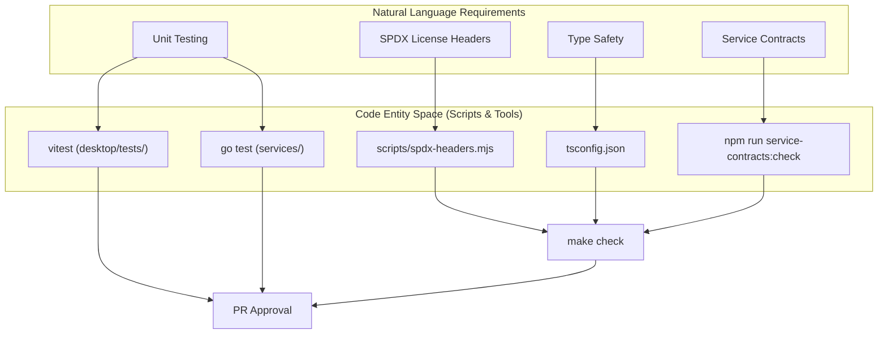
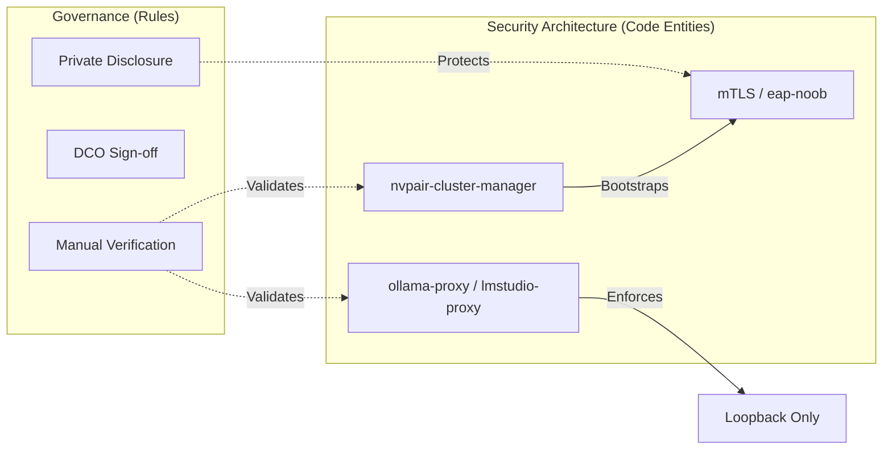

<!-- source: DeepWiki mcp.deepwiki.com · repo NVIDIA/Personal-AI-Router · page 9 Contributing and Governance · fetched 2026-10-26 -->

# Contributing and Governance

Relevant source files

The following files were used as context for generating this wiki page:

- [CODE_OF_CONDUCT.md](CODE_OF_CONDUCT.md)
- [CONTRIBUTING.md](CONTRIBUTING.md)
- [GOVERNANCE.md](GOVERNANCE.md)
- [SECURITY.md](SECURITY.md)

This page outlines the standards, processes, and governance model for the NVIDIA Personal AI Router (PAIR) project. As an open-source project, PAIR relies on community contributions to maintain reliability and security in local-network inference routing.

## Overview of Participation

PAIR is developed through a transparent pull-request review process. Contributors are expected to maintain the "local-first" privacy model and ensure that all changes adhere to the project's security boundaries and architectural constraints.

### Key Community Standards
*   **Harassment-Free Experience:** All participants must follow the [Contributor Covenant Code of Conduct](CODE_OF_CONDUCT.md:6-23) ().
*   **Maintainer Responsibility:** Project maintainers are responsible for clarifying standards and taking corrective action against unacceptable behavior [CODE_OF_CONDUCT.md:47-57] ().
*   **Reporting Misconduct:** Abusive or harassing behavior should be reported to `GitHub_Conduct@nvidia.com` [CODE_OF_CONDUCT.md:69-75] ().

Sources: [CODE_OF_CONDUCT.md:6-23](), [CODE_OF_CONDUCT.md:47-57](), [CODE_OF_CONDUCT.md:69-75]()

## Governance Model

PAIR follows a maintainer-led governance model where changes are accepted based on technical merit and alignment with project goals.

### How Changes Are Accepted
1.  **Pull Request Submission:** Contributors open a PR describing the problem and outcome [GOVERNANCE.md:13-16] ().
2.  **Maintainer Review:** A maintainer reviews the code and merges it once it meets all quality and security standards [GOVERNANCE.md:17-17] ().
3.  **Manual Verification:** Because the repository does not run automated CI gates on PRs, contributors must run local checks and record results in the PR [GOVERNANCE.md:21-23] ().
4.  **Releases:** Releases involve synchronized updates to version manifests, notices, and documentation [GOVERNANCE.md:25-34] ().

For details on the step-by-step submission process, see [Contribution Workflow](#9.1).

Sources: [GOVERNANCE.md:13-34]()

## Security Policy

Security is a primary concern for PAIR due to its role in handling inference traffic and cluster trust.

### Vulnerability Reporting
**Do not report security vulnerabilities through public issues or PRs** [SECURITY.md:11-13] (). Suspected vulnerabilities should be reported privately via:
*   The [NVIDIA Vulnerability Disclosure Program form](https://www.nvidia.com/en-us/security/report-vulnerability/) [SECURITY.md:20-20] ().
*   Email to `psirt@nvidia.com` [SECURITY.md:21-21] ().

### Security Boundaries and Trust
Contributors must respect the following architectural boundaries:
*   **Loopback Restriction:** Plaintext inference endpoints are restricted to `127.0.0.1` to prevent unauthorized network access [SECURITY.md:67-72] ().
*   **mTLS:** Inter-node cluster traffic must use mutual TLS after a PIN-based bootstrap [SECURITY.md:54-56] ().
*   **Data Privacy:** Prompts and generated response bodies must never be logged [CONTRIBUTING.md:199-199] ().

For more on the security model and licensing, see [Security Policy and Licensing](#9.2).

Sources: [SECURITY.md:11-72](), [CONTRIBUTING.md:199-199]()

## Development and Contribution Workflow

The PAIR codebase spans a TypeScript/Electron frontend and a suite of Go backend services.

### Contribution Process
1.  **Setup:** Clone the repository and install dependencies (Node.js 25.5.0+, Go 1.25+) [CONTRIBUTING.md:68-74] ().
2.  **Licensing:** Every new file **must** include a two-line SPDX license header [CONTRIBUTING.md:140-148] ().
3.  **Local Validation:** Use `make check` (Linux/macOS) or specific `npm` and `go test` commands to verify changes before submission [CONTRIBUTING.md:76-84] ().

### Contribution Logic Flow
The following diagram maps the contribution requirements to the code entities responsible for enforcing them.

**Contribution Validation Map**

Sources: [CONTRIBUTING.md:76-103](), [CONTRIBUTING.md:158-161]()

## Governance and Security Relationships

The following diagram illustrates how governance policies interact with the security architecture of the system.

**Governance to Security Architecture Bridge**

Sources: [SECURITY.md:54-72](), [GOVERNANCE.md:11-23]()

## Child Pages
*   [Contribution Workflow](#9.1): Detailed guide on forking, PR templates, running local gates, and the DCO sign-off process.
*   [Security Policy and Licensing](#9.2): Comprehensive view of the security model, PSIRT reporting, Apache 2.0 requirements, and third-party notices.

---

