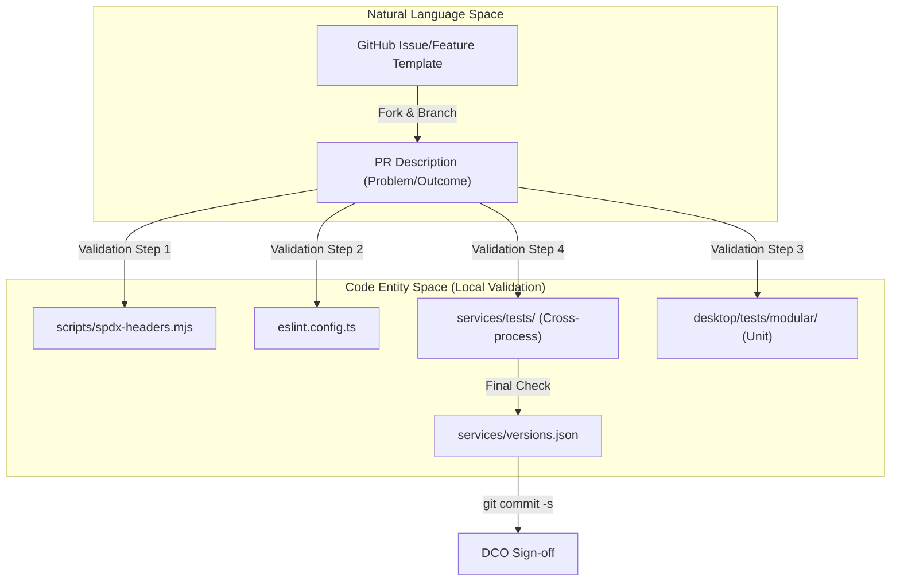
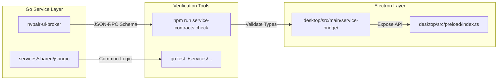

<!-- source: DeepWiki mcp.deepwiki.com · repo NVIDIA/Personal-AI-Router · page 9.1 Contribution Workflow · fetched 2026-10-26 -->

# Contribution Workflow

Relevant source files

The following files were used as context for generating this wiki page:

- [.github/ISSUE_TEMPLATE/bug.yml](.github/ISSUE_TEMPLATE/bug.yml)
- [.github/ISSUE_TEMPLATE/feature.yml](.github/ISSUE_TEMPLATE/feature.yml)
- [.github/ISSUE_TEMPLATE/task.yml](.github/ISSUE_TEMPLATE/task.yml)
- [.github/PULL_REQUEST_TEMPLATE.md](.github/PULL_REQUEST_TEMPLATE.md)
- [CONTRIBUTING.md](CONTRIBUTING.md)
- [GOVERNANCE.md](GOVERNANCE.md)

The NVIDIA Personal AI Router (PAIR) project follows a manual-verification contribution model. Because the repository does not employ automated CI gates for pull requests, contributors are responsible for running local validation suites and providing evidence of correctness within their submissions. All contributions must adhere to the **Developer Certificate of Origin (DCO)** by signing off every commit.

## Development Lifecycle

The contribution process bridges the gap between the **Natural Language Space** (issues and feature descriptions) and the **Code Entity Space** (Go services and Electron components).

### 1. Preparation and Environment Setup
Before contributing, ensure the local environment meets the minimum requirements: Node.js 25.5.0+ and Go 1.25+ [CONTRIBUTING.md:73-74](). The repository uses a root-level `Makefile` to orchestrate multi-language builds.

| Command | Purpose |
| :--- | :--- |
| `make dev` | Installs Go dependencies and `npm` packages [CONTRIBUTING.md:78](). |
| `make build` | Compiles Go binaries into `desktop/cli-bin/` and builds Electron bundles [CONTRIBUTING.md:79](). |
| `make check` | Runs linting, type-checking, and SPDX header verification [CONTRIBUTING.md:81](). |
| `make test` | Executes both Vitest (desktop) and `go test` (services) suites [CONTRIBUTING.md:82](). |

**Sources:** [CONTRIBUTING.md:68-84](), [CONTRIBUTING.md:96-103]()

### 2. Issue and Feature Proposal
Contributors should use the provided GitHub templates to align with maintainers before substantial implementation.

*   **Bug Reports:** Must include environment details (GPU, Driver, OS) and sanitized logs [ .github/ISSUE_TEMPLATE/bug.yml:42-85]().
*   **Feature Requests:** Must define the user problem and "Desired Outcome" before proposing implementation [ .github/ISSUE_TEMPLATE/feature.yml:33-48]().
*   **Tasks:** Used for documentation or repository hygiene [ .github/ISSUE_TEMPLATE/task.yml:4-22]().

**Sources:** [.github/ISSUE_TEMPLATE/bug.yml:1-96](), [.github/ISSUE_TEMPLATE/feature.yml:1-74](), [.github/ISSUE_TEMPLATE/task.yml:1-61]()

---

## Technical Workflow Diagram: From Issue to PR

The following diagram maps the logical flow of a contribution to the specific code entities and files involved in the validation process.

**Contribution Logic to Code Mapping**

**Sources:** [CONTRIBUTING.md:140-161](), [CONTRIBUTING.md:20-27](), [GOVERNANCE.md:21-23]()

---

## Pull Request Requirements

A Pull Request (PR) is only considered "Ready for Review" if it satisfies the criteria defined in the `PULL_REQUEST_TEMPLATE.md`.

### The PR Template Fields
*   **Problem & Outcome:** A clear explanation of the user-visible change [.github/PULL_REQUEST_TEMPLATE.md:1-5]().
*   **Validation:** Exact commands and environment details used for testing [.github/PULL_REQUEST_TEMPLATE.md:10-13]().
*   **Risk:** Analysis of compatibility, security, or migration concerns [.github/PULL_REQUEST_TEMPLATE.md:14-17]().
*   **Version Bump:** Any change to a service must be reflected in `services/versions.json` [.github/PULL_REQUEST_TEMPLATE.md:26]().

### Developer Certificate of Origin (DCO)
Every commit must be signed off using `git commit -s`. This certifies that the contributor has the right to submit the code under the project's Apache 2.0 license [.github/PULL_REQUEST_TEMPLATE.md:21]().

### License Headers
Every new file must include a two-line SPDX header. The project provides a script to automate this:
*   Check: `node scripts/spdx-headers.mjs`
*   Apply: `node scripts/spdx-headers.mjs --fix`

**Sources:** [.github/PULL_REQUEST_TEMPLATE.md:1-26](), [CONTRIBUTING.md:140-175]()

---

## Verification Model

PAIR uses a **Manual-Verification Model** [GOVERNANCE.md:21-23](). Since there are no automated CI gates, the maintainer review process relies heavily on the "Validation" section of the PR.

### Service-Contract Integrity
When modifying the JSON-RPC interface between the Go services and the Electron renderer, contributors must run:
`npm run service-contracts:check` [CONTRIBUTING.md:102]()

This ensures that the TypeScript types in the renderer stay in sync with the Go struct definitions in the broker.

**Data Flow: Service Change Validation**

**Sources:** [CONTRIBUTING.md:96-103](), [CONTRIBUTING.md:191-203]()

## Review and Merging
1.  **Submission:** Contributor opens PR with full validation logs.
2.  **Review:** Maintainers review code for architecture alignment (e.g., ensuring the renderer does not connect directly to Go workers) [CONTRIBUTING.md:191-200]().
3.  **Security Audit:** Any security-sensitive changes are handled via a private process defined in `SECURITY.md` rather than public PRs [GOVERNANCE.md:18-19]().
4.  **Acceptance:** Once accepted, a maintainer merges the PR. Releases are handled as a separate controlled process [GOVERNANCE.md:35-36]().

**Sources:** [GOVERNANCE.md:8-23](), [CONTRIBUTING.md:177-203]()

---

