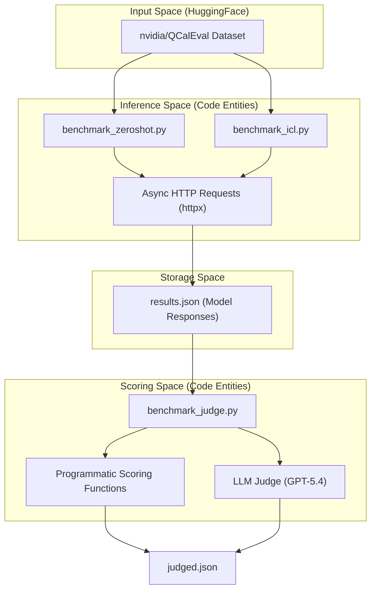
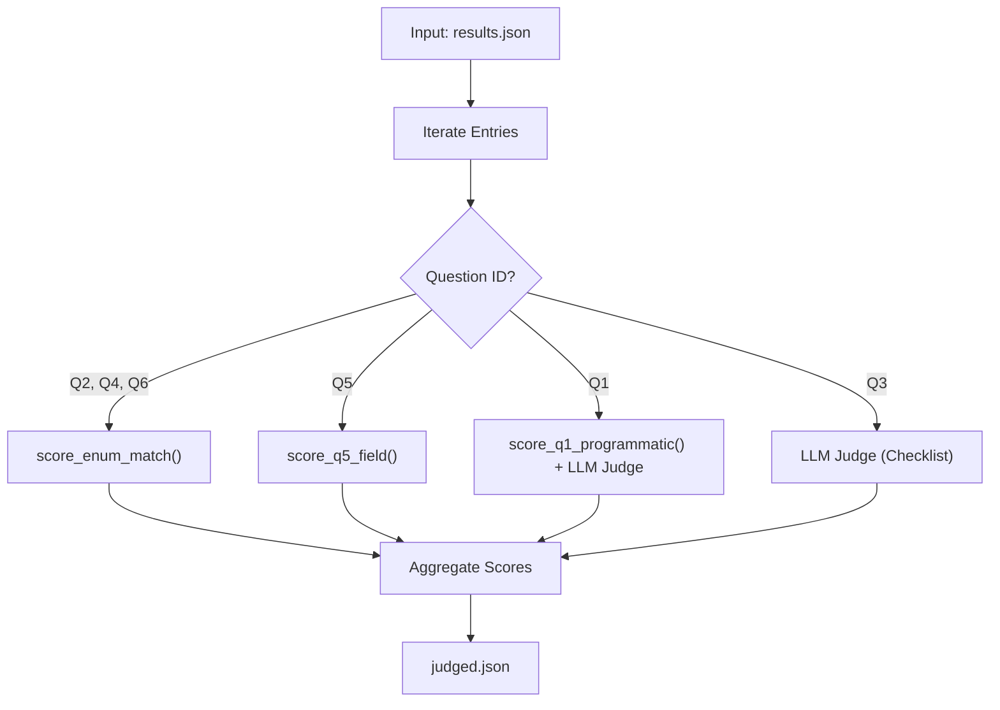

<!-- source: DeepWiki mcp.deepwiki.com · repo NVIDIA/QCalEval · page 1 QCalEval Overview · fetched 2026-10-26 -->

# QCalEval Overview

Relevant source files

The following files were used as context for generating this wiki page:

- [README.md](README.md)
- [leaderboard_top5.svg](leaderboard_top5.svg)

QCalEval is a specialized benchmark designed to evaluate the visual reasoning and quantitative analysis capabilities of Vision-Language Models (VLMs) within the domain of **quantum calibration**. Unlike general-purpose VLM benchmarks, QCalEval focuses on scientific plot interpretation, requiring models to identify experimental outcomes, extract physical parameters, and suggest corrective actions based on visual data from superconducting qubit experiments.

The project provides a standardized evaluation pipeline that interfaces with the `nvidia/QCalEval` HuggingFace dataset and supports any OpenAI-compatible API endpoint (including local vLLM or NVIDIA NIM instances).

### Core Evaluation Objectives
The benchmark assesses models across six distinct question types (Q1–Q6), ranging from high-level technical descriptions to precise parameter extraction:

| Label | Question | Task |
| :--- | :--- | :--- |
| **Tech. Desc.** | Q1 | Structured JSON description of plot type, axes, and salient visual features. |
| **Exp. Status** | Q2 | 4-way classification: expected behavior, suboptimal, anomalous, or apparatus issue. |
| **Reasoning** | Q3 | Scientific analysis: implications of patterns and next calibration steps. |
| **Fit Rel.** | Q4 | Assessment of whether a visible fit is trustworthy (reliable, unreliable, or none). |
| **Param. Ext.** | Q5 | Extraction of family-specific physical parameters into structured JSON. |
| **Cal. Diag.** | Q6 | Assignment of family-specific status codes (e.g., `SUCCESS`, `NO_SIGNAL`) with actions. |

Sources: [README.md:1-21](), [README.md:148-175]()

---

### System Architecture

The QCalEval codebase is structured into three primary execution stages: Inference (Zero-Shot or ICL), Results Storage, and Scoring/Judging.

#### Logical Flow: Natural Language to Code Entities
The following diagram illustrates how the conceptual evaluation flow maps to specific scripts and data structures within the repository.

Sources: [README.md:148-175](), [benchmark_zeroshot.py:1-20](), [benchmark_icl.py:1-20](), [benchmark_judge.py:1-30]()

---

### Evaluation Modes

QCalEval supports two primary evaluation paradigms to test model adaptability and few-shot reasoning.

#### 1. Zero-Shot Evaluation
Conducted via `benchmark_zeroshot.py`, this mode sends each image and question independently to the model. It serves as the baseline for a model's inherent understanding of quantum experimental data without prior context.
*   **Key Script:** `benchmark_zeroshot.py` [[benchmark_zeroshot.py:1-218]]()
*   **Details:** See [Getting Started](#1.1) for execution steps.

#### 2. In-Context Learning (ICL) Evaluation
Conducted via `benchmark_icl.py`, this mode provides the model with labeled demonstration examples from the same experiment family.
*   **Q3 & Q6:** Use N-way demonstrations (multiple examples).
*   **Q5:** Uses a single 1-shot demonstration containing the required JSON extraction schema.
*   **Key Script:** `benchmark_icl.py` [[benchmark_icl.py:1-325]]()
*   **Details:** See [In-Context Learning Inference (benchmark_icl.py)](#2.2).

---

### Scoring Mechanism

The `benchmark_judge.py` script implements a hybrid scoring architecture to ensure both precision and semantic accuracy.

| Scoring Type | Applied To | Description |
| :--- | :--- | :--- |
| **Programmatic** | Q1, Q2, Q4, Q5, Q6 | Direct matching of enums, JSON schema validation, and field-specific tolerance checks. |
| **LLM-Based** | Q1, Q3 | Uses a high-capability "Judge" model (e.g., GPT-5.4) to evaluate open-ended descriptions against a key-points checklist. |

#### Scoring Pipeline Detail
The diagram below shows how `benchmark_judge.py` selects scoring paths based on the question ID.

Sources: [benchmark_judge.py:446-550](), [benchmark_judge.py:650-750]()

---

### Navigation

For detailed information on specific components of the QCalEval framework, refer to the following child pages:

*   **[Getting Started](#1.1)**: Step-by-step guide for environment setup, dependency installation, and running your first evaluation.
*   **[Benchmark Dataset and Question Taxonomy](#1.2)**: Deep dive into the `nvidia/QCalEval` dataset structure, the six question types, and the underlying quantum experiment families.
*   **[Leaderboard and Results](#1.3)**: Current rankings for state-of-the-art models and details on the **Ising-Cal-1-35B** model release.

Sources: [README.md:72-146]()

---

