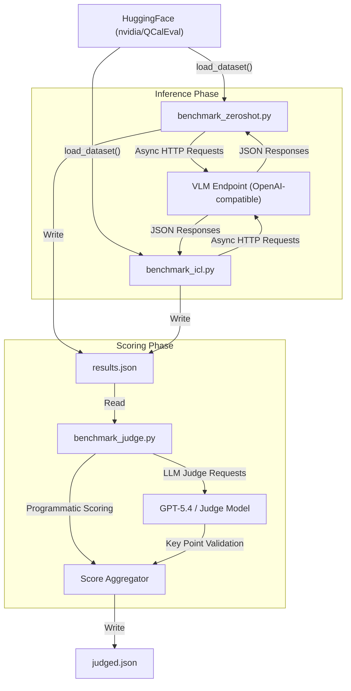
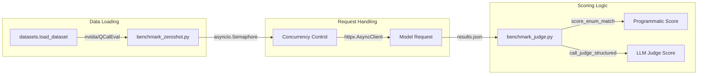

<!-- source: DeepWiki mcp.deepwiki.com · repo NVIDIA/QCalEval · page 1.1 Getting Started · fetched 2026-10-26 -->

# Getting Started

<details>
<summary>Relevant source files</summary>

The following files were used as context for generating this wiki page:

- [ATTRIBUTIONS](ATTRIBUTIONS)
- [README.md](README.md)
- [requirements.txt](requirements.txt)

</details>


This page provides a technical guide for setting up the QCalEval environment, installing necessary dependencies, and executing an end-to-end evaluation pipeline. QCalEval is designed to assess Vision-Language Models (VLMs) on quantum calibration experiment analysis using data hosted on HuggingFace [README.md:1-6]().

## Environment Setup

The QCalEval evaluation suite requires Python and several key libraries for data handling, image processing, and asynchronous API communication.

### 1. Install Dependencies
Install the required packages using the provided `requirements.txt`.
```bash
pip install -r requirements.txt
```
The core dependencies include:
*   `datasets`: For loading the benchmark data from HuggingFace [requirements.txt:1]().
*   `httpx`: For high-concurrency asynchronous requests to OpenAI-compatible endpoints [requirements.txt:2]().
*   `Pillow`: For image encoding and processing [requirements.txt:3]().
*   `huggingface-hub`: For authentication and dataset management [requirements.txt:4]().

### 2. Authentication
Since the dataset is hosted on HuggingFace, you must ensure your environment is authenticated to pull the data.
```bash
huggingface-cli login
```
Additionally, you must set an environment variable for your inference API key (e.g., `OPENAI_API_KEY` or `NVIDIA_API_KEY`) to be used by the benchmark scripts [README.md:89,116]().

---

## Evaluation Workflow

The evaluation process is split into two distinct phases: **Inference** (generating model responses) and **Scoring** (judging those responses against ground truth).

### System Data Flow
The following diagram illustrates how the codebase entities interact to move from the raw HuggingFace dataset to a final judged score.

**Data Flow: From Dataset to Judged Results**

Sources: [README.md:80-146](), [benchmark_zeroshot.py:1-20](), [benchmark_icl.py:1-20](), [benchmark_judge.py:1-30]()

---

## Running Your First Evaluation

### Step 1: Zero-Shot Inference
The `benchmark_zeroshot.py` script sends each image and its associated question (Q1–Q6) to the model independently [README.md:80-82]().

```bash
python benchmark_zeroshot.py \
  --api-base https://api.openai.com/v1/chat/completions \
  --model-id gpt-5.4 \
  --api-key-env OPENAI_API_KEY \
  --output results_zeroshot.json \
  --concurrency 64
```

### Step 2: In-Context Learning (ICL) Inference (Optional)
To test the model's ability to learn from examples, use `benchmark_icl.py`. This script constructs prompts containing labeled demonstration examples from the same experiment family [README.md:48-50]().

```bash
python benchmark_icl.py \
  --api-base https://api.openai.com/v1/chat/completions \
  --model-id gpt-5.4 \
  --api-key-env OPENAI_API_KEY \
  --output results_icl.json
```

### Step 3: Scoring and Judging
Once you have a `results.json` file, run `benchmark_judge.py`. This script performs hybrid scoring:
1.  **Programmatic Scoring**: Uses exact matches or tolerance ranges for physical parameters (Q2, Q4, Q5, Q6) [README.md:16-21]().
2.  **LLM-based Judging**: Uses a high-capability model (e.g., GPT-5.4) to evaluate structured descriptions (Q1) and scientific reasoning (Q3) [README.md:25,128-130]().

```bash
python benchmark_judge.py results_zeroshot.json \
  --judge-api-base https://api.openai.com/v1/chat/completions \
  --judge-model-id gpt-5.4 \
  --judge-api-key-env OPENAI_API_KEY \
  --output judged_final.json
```

---

## Implementation Details: Code Entity Map

This diagram maps the logical steps of the evaluation to the specific Python files and functions responsible for execution.

**Code Entity Map: Execution Pipeline**

Sources: [benchmark_zeroshot.py:100-106](), [benchmark_judge.py:128-146](), [requirements.txt:1-4]()

### Summary of Question Types
The following table summarizes the tasks evaluated during the "Getting Started" run:

| Question | Task | Scoring Method |
| :--- | :--- | :--- |
| **Q1** | Tech. Description | 50% Programmatic JSON / 50% LLM Judge [README.md:16,25]() |
| **Q2** | Exp. Status | 4-way classification match [README.md:17]() |
| **Q3** | Reasoning | LLM Judge (Key-points checklist) [README.md:18,130]() |
| **Q4** | Fit Reliability | Enum match (Reliable/Unreliable/None) [README.md:19]() |
| **Q5** | Param. Extraction | Programmatic JSON field tolerance [README.md:20]() |
| **Q6** | Cal. Diagnosis | Status code + corrective action match [README.md:21]() |

Sources: [README.md:14-21](), [README.md:25](), [README.md:128-130]()

---

