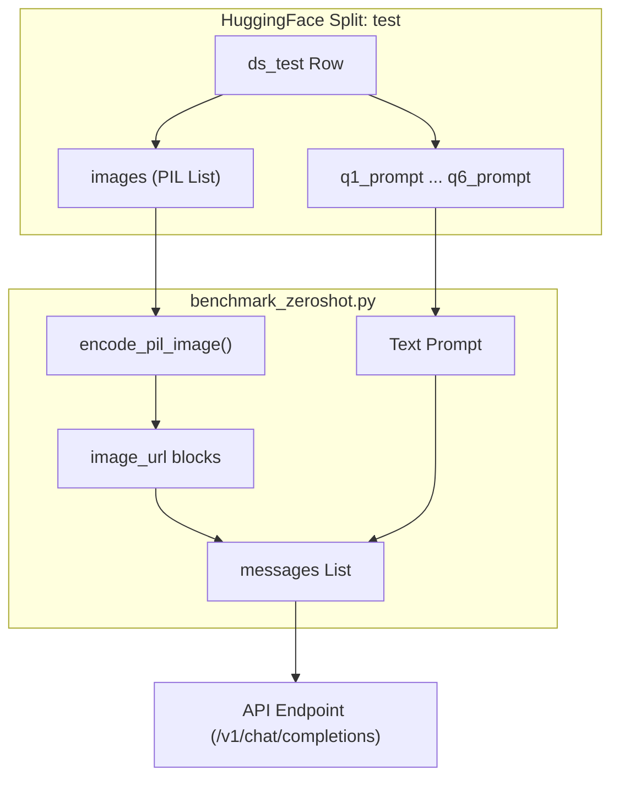
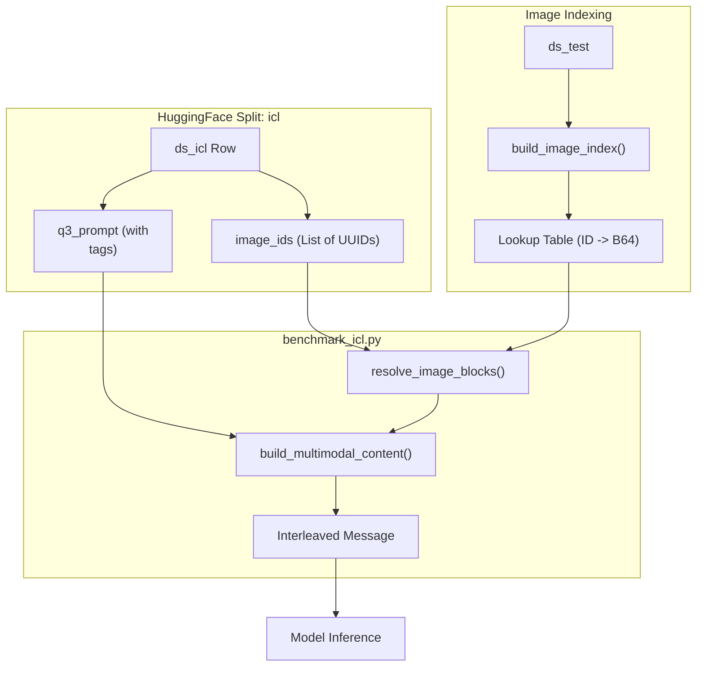

<!-- source: DeepWiki mcp.deepwiki.com · repo NVIDIA/QCalEval · page 1.2 Benchmark Dataset and Question Taxonomy · fetched 2026-10-26 -->

# Benchmark Dataset and Question Taxonomy

<details>
<summary>Relevant source files</summary>

The following files were used as context for generating this wiki page:

- [README.md](README.md)
- [benchmark_icl.py](benchmark_icl.py)
- [benchmark_zeroshot.py](benchmark_zeroshot.py)

</details>


This page provides a technical deep dive into the `nvidia/QCalEval` dataset hosted on HuggingFace. It details the six-question taxonomy used to evaluate Vision-Language Models (VLMs) on quantum calibration tasks, the data schema, and how the evaluation scripts interact with these data structures.

## Dataset Overview

The QCalEval benchmark is hosted at `nvidia/QCalEval` [benchmark_zeroshot.py:40-40](). It consists of two primary splits used by the evaluation suite:
1.  **Test Split**: Used for zero-shot evaluation via `benchmark_zeroshot.py` [benchmark_zeroshot.py:202-202]().
2.  **ICL (In-Context Learning) Split**: Contains pre-formatted prompts with demonstration examples, used by `benchmark_icl.py` [benchmark_icl.py:221-221]().

### Experiment Families
The dataset covers multiple quantum experiment families (e.g., Rabi oscillations, Ramsey fringes, T1/T2 relaxation). Each entry in the dataset is tagged with an `experiment_type` [benchmark_zeroshot.py:161-161](), which dictates how specific questions (like Q5 and Q6) are scored programmatically [README.md:20-21]().

## Question Taxonomy (Q1–Q6)

The benchmark evaluates models across six distinct tasks, ranging from visual description to physical parameter extraction.

| Label | Key Name | Type | Task Description |
| :--- | :--- | :--- | :--- |
| **Q1** | `technical_description` | Structured | JSON description of plot type, axes, and salient visual features. |
| **Q2** | `experimental_conclusion` | Classification | 4-way outcome: expected, suboptimal, anomalous, or apparatus issue. |
| **Q3** | `experimental_significance` | Reasoning | Scientific analysis of patterns and next calibration steps. |
| **Q4** | `fit_reliability` | Assessment | Evaluate if a visible fit is trustworthy (reliable, unreliable, or none). |
| **Q5** | `parameter_extraction` | Extraction | Extract family-specific physical parameters into structured JSON. |
| **Q6** | `calibration_diagnosis` | Diagnostic | Assign family-specific status codes and corrective actions. |

**Sources:** [README.md:14-21](), [benchmark_zeroshot.py:42-49]()

## Data Flow: From HuggingFace to Model Input

The evaluation scripts transform raw HuggingFace rows into OpenAI-compatible multimodal messages.

### Zero-Shot Data Flow
In zero-shot mode, each of the 6 questions is sent as an independent request [benchmark_zeroshot.py:20-21]().

Title: Zero-Shot Multimodal Message Construction

**Sources:** [benchmark_zeroshot.py:54-73](), [benchmark_zeroshot.py:96-99](), [benchmark_zeroshot.py:142-149]()

### In-Context Learning (ICL) Data Flow
The ICL split uses a more complex interleaving mechanism. Since ICL prompts contain `<image>` placeholders for demonstrations, the script must resolve `image_ids` against the test set to build the final message [benchmark_icl.py:20-22]().

Title: ICL Image Interleaving Logic

**Sources:** [benchmark_icl.py:57-68](), [benchmark_icl.py:71-76](), [benchmark_icl.py:79-91]()

## Data Schema

### Input Schema (HuggingFace)
The following keys are essential for the evaluation pipeline:
*   `id` / `source_id`: Unique identifier for the experiment [benchmark_zeroshot.py:136-136](), [benchmark_icl.py:147-147]().
*   `images`: A list of PIL image objects [benchmark_zeroshot.py:66-66]().
*   `experiment_type`: String identifier (e.g., "rabi") [benchmark_zeroshot.py:161-161]().
*   `q1_prompt` through `q6_prompt`: The system/user strings for each task [benchmark_zeroshot.py:51-51]().

### Output Schema (results.json)
The inference scripts produce a JSON file containing model responses, which serves as the input for `benchmark_judge.py`.

```json
{
  "id": "exp_123",
  "experiment_type": "rabi",
  "responses": {
    "technical_description": {
      "answer": "...",
      "error": null
    },
    "experimental_significance": {
      "answer": "...",
      "error": null
    }
  }
}
```
**Sources:** [benchmark_zeroshot.py:159-164](), [benchmark_icl.py:175-180]()

## Implementation Details

### Image Encoding
Images are converted to `RGBA` and encoded as `PNG` base64 strings to ensure compatibility across different VLM backends [benchmark_zeroshot.py:54-60]().

### Content Extraction
The `extract_content` function is designed to handle "reasoning" models (like DeepSeek-R1 or Qwen-Thinking) by checking for a `reasoning` field in the API response if the standard `content` field is empty [benchmark_zeroshot.py:76-86](), [benchmark_icl.py:94-103]().

### ICL Question Mapping
In ICL mode, only a subset of questions (Q3, Q5, Q6) are evaluated. These are mapped using `FEWSHOT_Q_MAP`:
*   Index 0 -> `experimental_significance` (Q3)
*   Index 1 -> `parameter_extraction` (Q5)
*   Index 2 -> `calibration_diagnosis` (Q6)

**Sources:** [benchmark_icl.py:42-46](), [benchmark_icl.py:168-170]()

---

