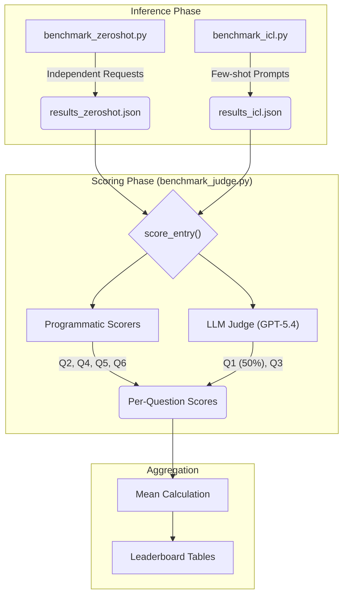

<!-- source: DeepWiki mcp.deepwiki.com · repo NVIDIA/QCalEval · page 1.3 Leaderboard and Results · fetched 2026-10-26 -->

# Leaderboard and Results

Relevant source files

The following files were used as context for generating this wiki page:

- [README.md](README.md)
- [leaderboard_top5.svg](leaderboard_top5.svg)

This page provides a detailed technical overview of the QCalEval benchmark results, including the zero-shot and In-Context Learning (ICL) leaderboards, the performance of the NVIDIA Ising-Cal-1-35B model, and the interpretation of scoring metrics across the six question types (Q1–Q6).

## Evaluation Metrics and Question Taxonomy

The benchmark evaluates models on six distinct tasks related to quantum calibration. Scores are normalized to a 0–100 scale. The evaluation utilizes a hybrid scoring mechanism implemented in `benchmark_judge.py`, combining programmatic validation (for structured JSON and classification) with LLM-based grading for complex reasoning tasks.

| Label | Question | Task Description | Scoring Method |
|:---|:---|:---|:---|
| **Tech. Desc.** | Q1 | Structured JSON description of plot type and axes. | Hybrid: 50% Programmatic / 50% LLM Judge |
| **Exp. Status** | Q2 | 4-way outcome classification (Expected, Suboptimal, etc.). | Programmatic: Enum Match |
| **Reasoning** | Q3 | Scientific analysis and next-step prediction. | LLM Judge: Checklist-based |
| **Fit Rel.** | Q4 | Reliability assessment of visible fits. | Programmatic: Enum Match |
| **Param. Ext.** | Q5 | Extraction of physical parameters (e.g., $T_1$, Rabi frequency). | Programmatic: Tolerance-based JSON comparison |
| **Cal. Diag.** | Q6 | Family-specific status codes and corrective actions. | Programmatic: Status Mapping |

Sources: `[README.md:14-21]()`, `[benchmark_judge.py:440-475]()`

## Zero-Shot Leaderboard

The zero-shot evaluation measures a model's "out-of-the-box" capability to interpret quantum calibration data without prior examples. In this mode, `benchmark_zeroshot.py` sends an independent request for each question associated with a dataset entry.

### Top 5 Visualization
The `leaderboard_top5.svg` file visualizes the performance of the leading models across the six question categories. This visualization highlights the trade-offs between general-purpose models (like GPT-5.4) and domain-specialized models.

### Performance Data (April 2026)
| Type | Model | Mean | Q1 | Q2 | Q3 | Q4 | Q5 | Q6 |
|:---|:---|:---:|:---:|:---:|:---:|:---:|:---:|:---:|
| **NVIDIA** | **Ising-Cal-1-35B** | **74.7** | 87.8 | **67.1** | **64.7** | **90.5** | 62.5 | **75.3** |
| Closed | Gemini-3.1-Pro | 72.3 | 88.5 | 57.2 | 61.1 | 84.4 | **71.5** | 71.2 |
| Open | Gemma-4-31B-IT | 68.8 | 85.6 | 54.3 | 59.8 | 82.7 | 68.3 | 62.1 |
| Closed | Gemini-3.1-Flash-Lite | 68.2 | 89.2 | 53.5 | 59.4 | 82.7 | 63.8 | 60.9 |
| Closed | Claude Opus 4.6 | 67.8 | 90.8 | 49.0 | 65.5 | 76.1 | 64.7 | 60.5 |

Sources: `[README.md:12-33]()`, `[leaderboard_top5.svg:1-265]()`

## NVIDIA Ising-Cal-1-35B Model

Based on benchmark findings, NVIDIA released **Ising-Calibration-1-35B**, an open-weight 35B Mixture-of-Experts (MoE) model. This model is specifically fine-tuned for quantum calibration plot understanding and currently holds the top position on the zero-shot leaderboard. It demonstrates superior performance in scientific reasoning (Q3) and diagnostic status assignment (Q6) compared to much larger closed-source models.

Sources: `[README.md:8-10]()`, `[README.md:29-29]()`

## In-Context Learning (ICL) Results

The ICL leaderboard evaluates models when provided with labeled demonstration examples. This is implemented in `benchmark_icl.py`, which constructs prompts containing examples from the same experiment family as the query.

### ICL Implementation Logic
*   **Q3 & Q6 (N-way):** Multiple labeled examples from the same family are provided to show the expected reasoning chain or status mapping.
*   **Q5 (1-shot):** A single demonstration is provided to establish the required JSON schema for physical parameter extraction.

### ICL Performance Data (April 2026)
| Model | Mean | Q3 | Delta | Q5 | Delta | Q6 | Delta |
|:---|:---|:---:|:---:|:---:|:---:|:---:|:---:|
| Gemini-3.1-Pro | **85.2** | 81.3 | +20.2 | **84.5** | +13.0 | **89.8** | +18.6 |
| Claude Opus 4.6 | 85.1 | **84.7** | +19.2 | 81.3 | +16.6 | 89.4 | +28.9 |
| Gemma-4-31B-IT | 81.2 | 80.6 | +20.8 | 76.9 | +8.6 | 86.0 | +23.9 |

**Note on "Negative Delta":** Several models (e.g., Qwen3.5 family) show a performance decrease in ICL mode. This often indicates sensitivity to long-context visual prompts or a failure to follow the demonstration pattern over the zero-shot instruction.

Sources: `[README.md:48-70]()`

## Data Flow: From Inference to Results

The following diagram illustrates how raw model outputs are transformed into the leaderboard scores presented above.

### Leaderboard Data Generation Flow

Sources: `[benchmark_judge.py:440-475]()`, `[README.md:148-160]()`

## Interpreting Scores

The scoring logic in `benchmark_judge.py` defines how "success" is measured for each task:

1.  **Exact Match (Q2, Q4):** The model must return the exact string from the allowed enum (e.g., `EXPECTED_BEHAVIOR`).
2.  **Tolerance Match (Q5):** For numerical parameters, the `score_q5_field` function checks if the model's value is within a percentage tolerance (defined in `experiment_config.json`) of the ground truth.
3.  **Checklist Scoring (Q3):** The LLM judge checks for the presence of specific scientific "key points" in the model's explanation.
4.  **JSON Schema (Q1):** The `score_q1_programmatic` function validates that the output is valid JSON and contains the required keys for plot description.

### Scoring Implementation Reference
| Code Entity | Purpose |
|:---|:---|
| `score_enum_match` | Validates classification tasks (Q2, Q4). |
| `score_q5_field` | Handles numerical tolerance for physics parameters. |
| `score_q1_programmatic` | Validates JSON structure for technical descriptions. |
| `call_judge_structured` | Interface for the LLM judge to grade Q1 and Q3. |

Sources: `[benchmark_judge.py:100-115]()`, `[benchmark_judge.py:146-170]()`, `[benchmark_judge.py:192-210]()`, `[benchmark_judge.py:348-370]()`

---

