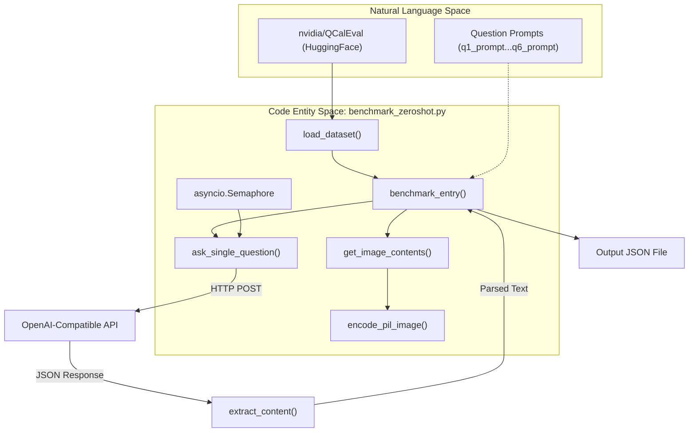
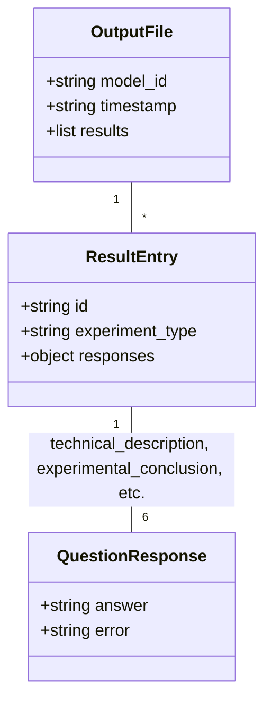

<!-- source: DeepWiki mcp.deepwiki.com · repo NVIDIA/QCalEval · page 2.1 Zero-Shot Inference (benchmark_zeroshot.py) · fetched 2026-10-26 -->

# Zero-Shot Inference (benchmark_zeroshot.py)

Relevant source files

The following files were used as context for generating this wiki page:

- [benchmark_zeroshot.py](benchmark_zeroshot.py)

The `benchmark_zeroshot.py` script is the entry point for evaluating Vision-Language Models (VLMs) in a zero-shot setting on the QCalEval benchmark. It automates the process of loading the benchmark dataset from HuggingFace, encoding experimental plot images, and dispatching six distinct questions per data entry to an OpenAI-compatible API endpoint.

## Execution Flow and Architecture

The script utilizes `asyncio` to manage high-concurrency requests to the inference server. For every entry in the dataset, the script performs six independent API calls—one for each question type defined in the taxonomy (Q1–Q6).

### Data Flow Diagram
The following diagram illustrates the transformation of a HuggingFace dataset row into a series of API requests and the final structured JSON output.

**Zero-Shot Request Pipeline**

Sources: [benchmark_zeroshot.py:18-27](), [benchmark_zeroshot.py:132-164](), [benchmark_zeroshot.py:89-130]()

## Image Encoding Pipeline

The script handles multi-image entries by converting PIL images from the HuggingFace `datasets` objects into base64-encoded PNG strings.

- **`encode_pil_image(pil_img)`**: Ensures images are in `RGBA` mode before saving to a `BytesIO` buffer as PNGs. This is critical for maintaining transparency layers if present in experimental plots. [benchmark_zeroshot.py:54-60]()
- **`get_image_contents(row)`**: Iterates through the `images` list in a dataset row. It constructs the content blocks required by the vision API, prefixing base64 strings with `data:image/png;base64,`. [benchmark_zeroshot.py:63-73]()

Sources: [benchmark_zeroshot.py:54-73]()

## Concurrency and Retry Model

To maximize throughput while respecting server limits, `benchmark_zeroshot.py` employs a semaphore-controlled asynchronous model.

| Feature | Implementation Detail |
| :--- | :--- |
| **Concurrency Control** | Uses `asyncio.Semaphore` initialized with the `--concurrency` argument (default: 8). [benchmark_zeroshot.py:178](), [benchmark_zeroshot.py:93]() |
| **Question Parallelism** | For a single entry, all 6 questions are dispatched simultaneously using `asyncio.gather`. [benchmark_zeroshot.py:144-150]() |
| **Retry Logic** | Implements a 3-attempt retry loop with exponential backoff. [benchmark_zeroshot.py:94-129]() |
| **Rate Limiting** | Specifically catches HTTP `429` (Too Many Requests) and waits `5 * (2 ** attempt)` seconds. [benchmark_zeroshot.py:118-120]() |
| **Timeout** | Hardcoded `300.0` second timeout per request to accommodate long reasoning traces. [benchmark_zeroshot.py:116]() |

Sources: [benchmark_zeroshot.py:89-130](), [benchmark_zeroshot.py:144-150]()

## Per-Question Request Flow

Each request follows a strict schema to ensure compatibility with modern VLMs and reasoning models.

1. **Message Construction**: The user message is a list containing all images followed by the specific question text. [benchmark_zeroshot.py:96-99]()
2. **Reasoning Control**: If `--no-think` is passed, the script adds `chat_template_kwargs: {"enable_thinking": False}` to the payload, which is used to suppress internal chain-of-thought for models like Qwen-7B-Instruct or DeepSeek-V3 in certain inference engines. [benchmark_zeroshot.py:101-102]()
3. **Response Extraction**: The `extract_content` function handles standard `content` fields as well as `reasoning` fields for models that separate thoughts from the final answer. [benchmark_zeroshot.py:76-87]()

Sources: [benchmark_zeroshot.py:76-114]()

## CLI Arguments and Configuration

The script is configured via command-line arguments to point to different backends (e.g., local vLLM, NVIDIA NIM, or OpenAI).

| Argument | Description |
| :--- | :--- |
| `--api-base` | The full URL to the `/v1/chat/completions` endpoint. |
| `--model-id` | The string identifier for the model on the server. |
| `--concurrency` | Number of simultaneous requests (default: 8). |
| `--filter-type` | Optional. Filter dataset by `experiment_type` (e.g., "Rabi"). |
| `--max-tokens` | Limit for model output (default: 16384). |
| `--no-think` | Disables internal thinking/reasoning traces for compatible models. |

Sources: [benchmark_zeroshot.py:168-186]()

## Output JSON Schema

The results are saved to a JSON file specified by `--output`. This file is the required input for the `benchmark_judge.py` script.

**Entity-to-Schema Mapping**

The `responses` object uses keys from `Q_NAMES`:
- `technical_description` (Q1)
- `experimental_conclusion` (Q2)
- `experimental_significance` (Q3)
- `fit_reliability` (Q4)
- `parameter_extraction` (Q5)
- `calibration_diagnosis` (Q6)

Sources: [benchmark_zeroshot.py:42-49](), [benchmark_zeroshot.py:152-164]()

---

