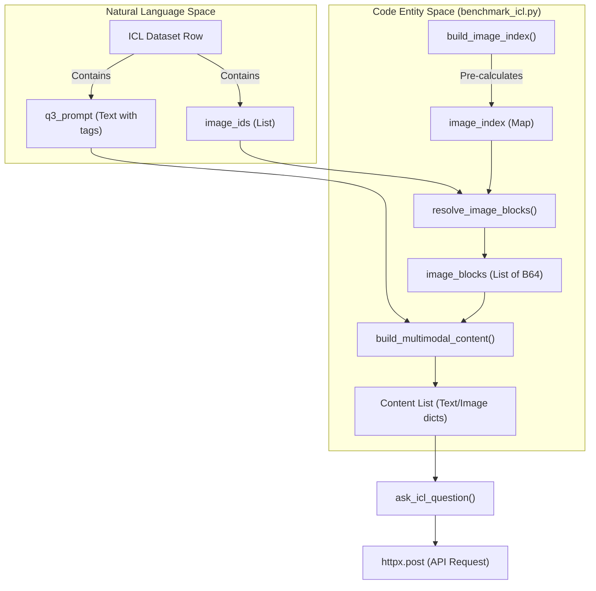
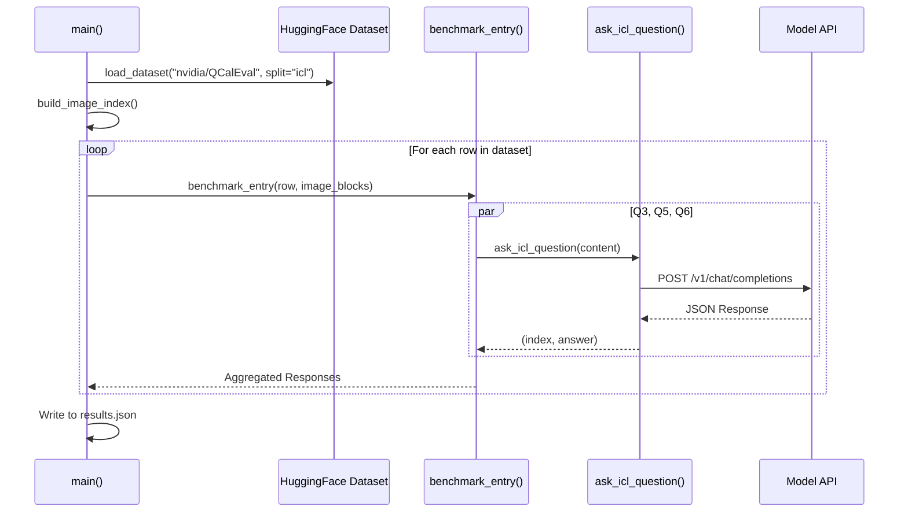

<!-- source: DeepWiki mcp.deepwiki.com · repo NVIDIA/QCalEval · page 2.2 In-Context Learning Inference (benchmark_icl.py) · fetched 2026-10-26 -->

# In-Context Learning Inference (benchmark_icl.py)

<details>
<summary>Relevant source files</summary>

The following files were used as context for generating this wiki page:

- [benchmark_icl.py](benchmark_icl.py)

</details>


The `benchmark_icl.py` script performs evaluation of Multimodal Large Language Models (MLLMs) using **In-Context Learning (ICL)**. Unlike zero-shot evaluation, this script utilizes specialized prompt templates that interleave demonstration examples (few-shot) with the target question. It specifically targets three complex question types from the QCalEval taxonomy: Q3 (Experimental Significance), Q5 (Parameter Extraction), and Q6 (Calibration Diagnosis).

### Prompt Construction and Interleaving

The ICL evaluation relies on a multimodal interleaving mechanism where `<image>` placeholders in the dataset text are replaced with base64-encoded image blocks compatible with OpenAI-style APIs.

#### Image Indexing and Resolution
Because the ICL dataset contains references to images used across different demonstrations, the script first builds a global lookup table.
1. **`build_image_index(ds_test)`**: Iterates through the test split of the dataset to map `image_id` strings to base64-encoded PNG content blocks `[benchmark_icl.py:57-68]()`.
2. **`resolve_image_blocks(image_ids, image_index)`**: For a given benchmark row, it retrieves the corresponding image data blocks from the index based on the `image_ids` list `[benchmark_icl.py:71-76]()`.

#### Multimodal Content Building
The function `build_multimodal_content` is the core logic for interleaving text and images `[benchmark_icl.py:79-91]()`. It splits the prompt text by the `<image>` tag and iterates through the resulting parts, inserting an image block from the resolved list between each text segment. An `image_offset` is maintained to ensure that images are consumed sequentially across the three questions (Q3, Q5, Q6) within a single benchmark entry `[benchmark_icl.py:153-158]()`.

**Data Flow: From Dataset to API Payload**


Sources: `[benchmark_icl.py:57-91]()`, `[benchmark_icl.py:144-163]()`

---

### Question Mapping and N-way Demonstrations

The script processes three specific question types for every entry in the ICL dataset. These are mapped internally using the `FEWSHOT_Q_MAP` `[benchmark_icl.py:42-46]()`.

| Index | Question Type | Internal Map Key (`FEWSHOT_Q_MAP`) |
| :--- | :--- | :--- |
| 0 | Q3 | `experimental_significance` |
| 1 | Q5 | `parameter_extraction` |
| 2 | Q6 | `calibration_diagnosis` |

#### N-way vs 1-shot
The ICL prompts in the `nvidia/QCalEval` dataset are pre-formatted. Depending on the specific row in the dataset, the `q{N}_prompt` field may contain:
- **1-shot**: A single demonstration (Example Image + Example Question + Example Answer) followed by the test query.
- **N-way**: Multiple demonstrations (e.g., a "Good" calibration example and a "Bad" calibration example) to provide the model with contrasting contexts before the test query.

The script treats these transparently by resolving all `<image>` tags sequentially as they appear in the combined demonstration + query string `[benchmark_icl.py:155-163]()`.

---

### Inference Execution and Control

The script uses `asyncio` to manage high-throughput requests to the inference server.

#### Concurrency and Retries
- **Semaphore**: A `asyncio.Semaphore` (defaulting to `--concurrency` value) limits the number of simultaneous outgoing requests to prevent overwhelming the API `[benchmark_icl.py:109]()`.
- **Retry Logic**: `ask_icl_question` implements a 3-attempt retry loop with exponential backoff `[benchmark_icl.py:110-141]()`. It specifically handles HTTP 429 (Rate Limit) errors by sleeping before retrying `[benchmark_icl.py:131-133]()`.

#### The --no-think Flag
For models that support "Thinking" or "Reasoning" phases (like DeepSeek-R1 or similar), the script provides a `--no-think` CLI argument. When enabled, it passes `enable_thinking: False` inside `chat_template_kwargs` to the API `[benchmark_icl.py:114-115]()`. This is useful for benchmarking the raw performance of the model without the overhead of extended reasoning tokens.

#### Content Extraction
The `extract_content` function handles diverse API response formats `[benchmark_icl.py:94-103]()`:
- Prefers `message.content`.
- Falls back to `message.reasoning` if content is null.
- If the content is returned as a list of blocks, it joins all text blocks into a single string.

---

### Output Schema

The results are saved as a JSON array where each object represents one experiment entry.

```json
{
  "id": "exp_123",
  "experiment_type": "T1_Echo",
  "error": null,
  "responses": {
    "experimental_significance": {
      "answer": "The image shows a T1 decay curve...",
      "error": null
    },
    "parameter_extraction": {
      "answer": "{\"T1\": 45.2, \"unit\": \"us\"}",
      "error": null
    },
    "calibration_diagnosis": {
      "answer": "Status: Success",
      "error": null
    }
  }
}
```

**Implementation Sequence Diagram**


Sources: `[benchmark_icl.py:144-180]()`, `[benchmark_icl.py:183-210]()`

Sources:
- Prompt construction: `[benchmark_icl.py:57-91]()`
- ICL Logic: `[benchmark_icl.py:144-180]()`
- CLI and Main: `[benchmark_icl.py:183-220]()`
- Question Mapping: `[benchmark_icl.py:42-46]()`

---

