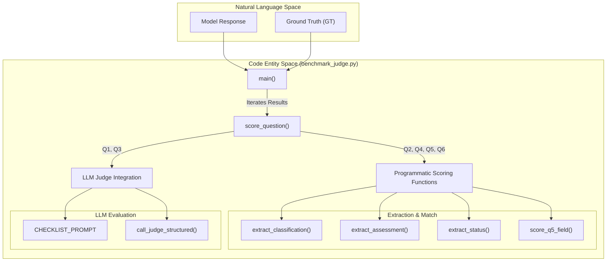
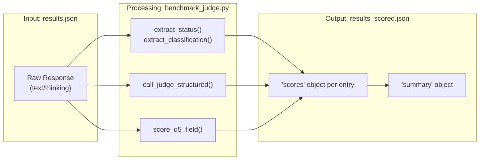

<!-- source: DeepWiki mcp.deepwiki.com · repo NVIDIA/QCalEval · page 2.3 Scoring and Judging (benchmark_judge.py) · fetched 2026-10-26 -->

# Scoring and Judging (benchmark_judge.py)

Relevant source files

The following files were used as context for generating this wiki page:

- [benchmark_judge.py](benchmark_judge.py)

The `benchmark_judge.py` script is the final stage of the QCalEval pipeline. It evaluates model responses against ground truth (GT) data using a hybrid scoring architecture that combines strict programmatic validation with LLM-based semantic judging.

## Overview

The script processes results generated by `benchmark_zeroshot.py` or `benchmark_icl.py`. It uses a "best-of-both-worlds" approach:
1.  **Programmatic Scoring:** Used for objective fields like classification enums, extracted parameters (with tolerance), and JSON schema adherence.
2.  **LLM-based Judging:** Used for open-ended responses (Q1 and Q3) where a "key-points checklist" is applied to verify technical accuracy and completeness.

The scoring logic is mapped to the six question types defined in the benchmark taxonomy: `technical_description` (Q1), `experimental_conclusion` (Q2), `experimental_significance` (Q3), `fit_reliability` (Q4), `parameter_extraction` (Q5), and `calibration_diagnosis` (Q6) [benchmark_judge.py:46-53]().

### System Architecture: Logic to Code Mapping

The following diagram illustrates how the natural language evaluation requirements are translated into specific code entities within `benchmark_judge.py`.

**Scoring Logic Flow**

Sources: [benchmark_judge.py:46-53](), [benchmark_judge.py:57-64](), [benchmark_judge.py:104-184](), [benchmark_judge.py:383-455]()

---

## Programmatic Scoring Methods

Programmatic scoring ensures reproducibility and speed for deterministic components of the benchmark. This includes regex-based extraction of model "final answers" and numerical comparison for physical parameters.

### Key Programmatic Components
*   **JSON Parsing:** `parse_json_answer` attempts to find and decode JSON objects within model responses, supporting both raw text and markdown code blocks [benchmark_judge.py:70-101]().
*   **Enum Extraction:** Functions like `extract_classification` (Q2) and `extract_assessment` (Q4) normalize model strings into standard categories (e.g., "Expected behavior", "Reliable") [benchmark_judge.py:104-130]().
*   **Parameter Validation:** For Q5, the script uses `score_q5_field` to compare extracted numerical values against GT using per-field tolerances defined in the experiment configuration [benchmark_judge.py:228-261]().
*   **Status Mapping:** Q6 uses `extract_status` to identify specific calibration states from a list of `KNOWN_STATUSES` (e.g., `SUCCESS`, `FIT_POOR`, `NO_SIGNAL`) [benchmark_judge.py:150-184]().

For detailed function signatures and regex patterns, see **[Programmatic Scoring Methods](#2.3.1)**.

Sources: [benchmark_judge.py:70-184](), [benchmark_judge.py:228-261]()

---

## LLM Judge Integration

For complex, multi-part questions like Q1 (Technical Description) and Q3 (Experimental Significance), simple string matching is insufficient. The script integrates an LLM (typically GPT-4o or similar) to act as a "Judge."

### The Checklist Mechanism
The judge uses a `CHECKLIST_PROMPT` to evaluate responses against a list of `key_points` provided in the ground truth [benchmark_judge.py:57-64]().
*   **Scoring Rubric:** 1.0 (Correct), 0.5 (Partial), or 0.0 (Missing/Wrong) per key point [benchmark_judge.py:58-58]().
*   **Q1 Hybrid Weighting:** Q1 scores are calculated as a 50/50 split between programmatic JSON field matching and the LLM checklist score [benchmark_judge.py:388-393]().
*   **Concurrency:** The script uses `asyncio` and a `Semaphore` to manage parallel calls to the judge API, preventing rate-limiting issues [benchmark_judge.py:333-335]().

For details on prompt templates and retry logic, see **[LLM Judge Integration](#2.3.2)**.

Sources: [benchmark_judge.py:57-64](), [benchmark_judge.py:333-335](), [benchmark_judge.py:383-400]()

---

## Output Schema and Aggregation

After scoring all questions, `benchmark_judge.py` aggregates results into a structured JSON format and prints a summary table to the console.

### Aggregation Logic
The script calculates:
1.  **Question-Level Scores:** The mean score for each of the six question types [benchmark_judge.py:530-534]().
2.  **Overall Score:** The unweighted average across all question types [benchmark_judge.py:536-536]().
3.  **Experiment Family Scores:** Grouped performance (e.g., "Rabi", "Readout") [benchmark_judge.py:518-525]().

### Data Transformation Diagram
This diagram shows how data flows from the raw model output to the final scored JSON.

**Data Transformation Pipeline**

Sources: [benchmark_judge.py:465-515](), [benchmark_judge.py:518-548]()

### Output File Structure
The resulting file (typically `*_scored.json`) includes:
*   `metadata`: Configuration used for the run [benchmark_judge.py:543-543]().
*   `results`: Original data augmented with a `scores` dictionary containing individual question scores [benchmark_judge.py:514-515]().
*   `summary`: Final metrics including `overall_score` and per-question-type means [benchmark_judge.py:544-544]().

Sources: [benchmark_judge.py:518-548]()

---

