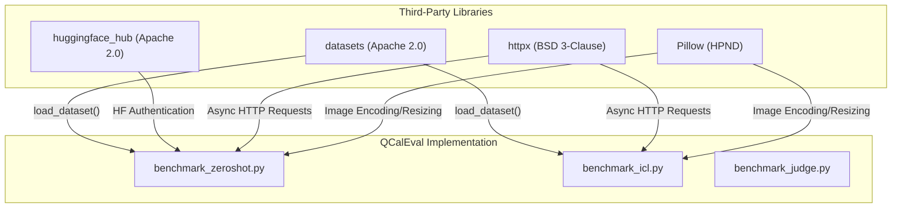
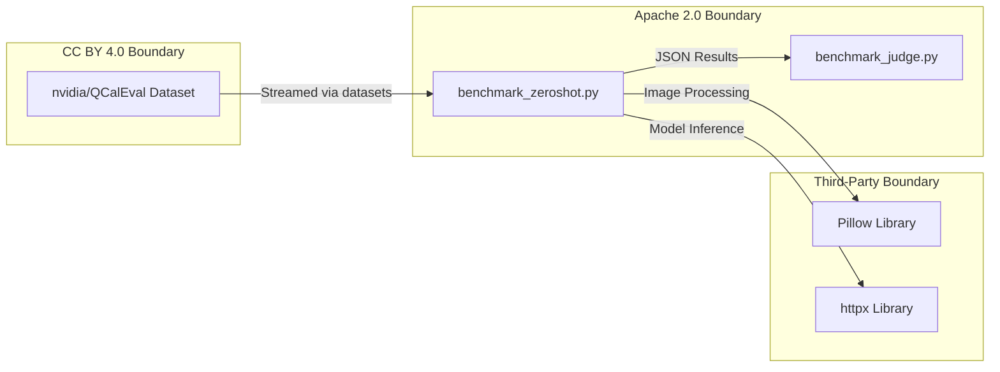

<!-- source: DeepWiki mcp.deepwiki.com · repo NVIDIA/QCalEval · page 3.1 License and Attribution · fetched 2026-10-26 -->

# License and Attribution

Relevant source files

The following files were used as context for generating this wiki page:

- [ATTRIBUTIONS](ATTRIBUTIONS)
- [LICENSE](LICENSE)

This page details the licensing structure and third-party attributions for the QCalEval project. The project employs a dual-licensing model to distinguish between the evaluation software and the benchmark dataset, while maintaining a comprehensive record of third-party dependencies.

## Licensing Overview

The QCalEval repository is governed by two primary licenses depending on the asset type.

| Asset Type | License | Description |
| :--- | :--- | :--- |
| **Evaluation Scripts** | Apache License 2.0 | Covers all `.py` files, including inference and scoring logic. |
| **Benchmark Dataset** | CC BY 4.0 | Covers the `nvidia/QCalEval` dataset hosted on Hugging Face. |
| **Third-Party Code** | Various | Detailed in the `ATTRIBUTIONS` file. |

### Apache License 2.0 (Software)
The evaluation scripts (e.g., `benchmark_zeroshot.py`, `benchmark_icl.py`, and `benchmark_judge.py`) are licensed under the Apache License, Version 2.0 [LICENSE:1-200](). This license allows for:
*   **Commercial Use**: You may use the software for commercial purposes.
*   **Modification**: You may modify the source code, provided that modified files carry prominent notices stating that you changed the files [LICENSE:97-98]().
*   **Distribution**: You may distribute the software in source or object form [LICENSE:89-91]().
*   **Patent Grant**: Contributors provide a perpetual, worldwide, non-exclusive patent license [LICENSE:73-77]().

### CC BY 4.0 (Dataset)
The `nvidia/QCalEval` dataset is released under the Creative Commons Attribution 4.0 International license. This requires that any redistribution or derivative work must provide appropriate credit to NVIDIA.

**Sources:**
* [LICENSE:1-200]()

---

## Third-Party Attributions

The QCalEval evaluation suite relies on several open-source Python libraries. These dependencies are critical for data handling, network communication, and image processing.

### Dependency Mapping

The following diagram illustrates how specific third-party libraries are integrated into the QCalEval "Code Entity Space".

**Dependency Integration Diagram**

### Detailed Attribution List

As specified in the `ATTRIBUTIONS` file, the following software is included or used by this product:

| Library | License | Usage in QCalEval |
| :--- | :--- | :--- |
| `datasets` | Apache 2.0 | Used to fetch and stream the QCalEval benchmark data from Hugging Face [ATTRIBUTIONS:16-17](). |
| `huggingface_hub` | Apache 2.0 | Manages authentication and repository interactions [ATTRIBUTIONS:35-36](). |
| `httpx` | BSD 3-Clause | Provides the asynchronous HTTP client for model inference requests [ATTRIBUTIONS:54-55](). |
| `Pillow` | HPND | Handles image processing, including base64 encoding for vision-language model inputs [ATTRIBUTIONS:86-87](). |

**Sources:**
* [ATTRIBUTIONS:1-118]()

---

## Data Flow and License Boundaries

The following diagram bridges the "Natural Language Space" (Legal/Licensing concepts) to the "Code Entity Space" (Files and Functions) to show where license boundaries apply during execution.

**License Boundary and Data Flow**

### Attribution Requirements for Redistribution
If you redistribute the QCalEval software or derivative works, you must:
1.  Include a copy of the Apache 2.0 License [LICENSE:94-95]().
2.  Retain all copyright, patent, trademark, and attribution notices [LICENSE:100-102]().
3.  Include a readable copy of the attribution notices contained within the `ATTRIBUTIONS` (or `NOTICE`) file [LICENSE:107-111]().

**Sources:**
* [LICENSE:94-111]()
* [ATTRIBUTIONS:1-10]()

---

