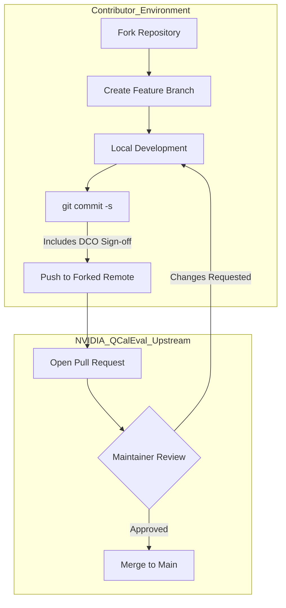
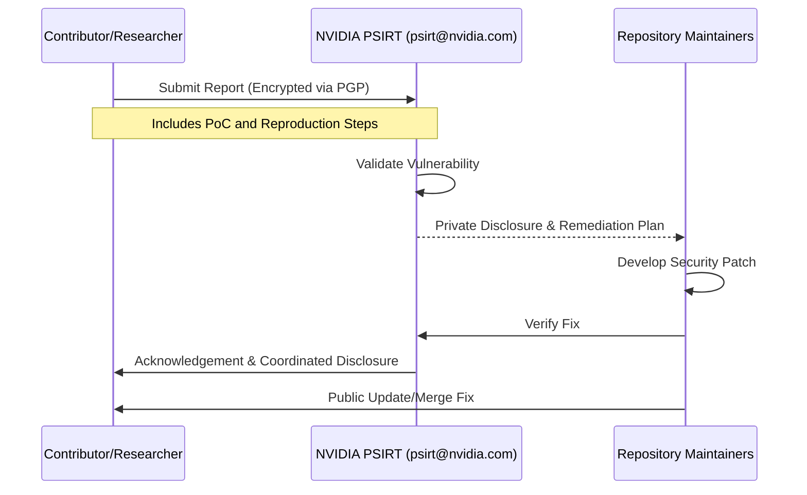

<!-- source: DeepWiki mcp.deepwiki.com · repo NVIDIA/QCalEval · page 3.2 Contributing and Security · fetched 2026-10-26 -->

# Contributing and Security

Relevant source files

The following files were used as context for generating this wiki page:

- [CONTRIBUTING.md](CONTRIBUTING.md)
- [SECURITY.md](SECURITY.md)

This page outlines the governance and security protocols for the QCalEval repository. To maintain the integrity of the benchmark and ensure legal compliance, all contributors must follow the Developer Certificate of Origin (DCO) sign-off workflow and adhere to NVIDIA's coordinated vulnerability disclosure policy.

## 1. Contribution Workflow

QCalEval follows a standard **fork-and-pull** model for contributions [CONTRIBUTING.md:55-61](). This process ensures that all changes are reviewed by maintainers before being merged into the main codebase.

### 1.1 Developer Certificate of Origin (DCO)

All contributions to this project must be accompanied by a "sign-off" to certify that the contributor has the legal right to submit the work under the project's license [CONTRIBUTING.md:7-43](). By adding a sign-off, you certify that:
*   The work was created by you, or based on work covered by an appropriate open-source license [CONTRIBUTING.md:20-32]().
*   You understand that the contribution and a record of the sign-off will be maintained indefinitely and redistributed publicly [CONTRIBUTING.md:38-42]().

### 1.2 Implementation: Signing Off Commits

To sign off a contribution, you must include a `Signed-off-by` line in every commit message [CONTRIBUTING.md:45-51]().

| Method | Command / Syntax |
| :--- | :--- |
| **Manual** | `Signed-off-by: Your Name <your.email@example.com>` |
| **Automatic** | `git commit -s` |

**Sources:**
* [CONTRIBUTING.md:7-43]() (DCO Version 1.1 text and certification requirements)
* [CONTRIBUTING.md:45-53]() (Sign-off instructions and git command)

### 1.3 The Pull Request Process

The following diagram illustrates the lifecycle of a contribution from a local environment to the upstream QCalEval repository.

**Contribution Data Flow: Fork-and-Pull Model**

**Sources:**
* [CONTRIBUTING.md:55-61]() (Submitting changes steps)
* [CONTRIBUTING.md:63-65]() (Licensing agreement for contributions)

---

## 2. Security Policy

NVIDIA is committed to the security of the QCalEval codebase. Security concerns are handled through private channels rather than public GitHub issues to prevent the premature disclosure of vulnerabilities [SECURITY.md:1-6]().

### 2.1 Reporting Vulnerabilities

If you discover a potential security issue (e.g., code execution, denial of service, or buffer overflow), do **not** report it via a public GitHub issue or PR [SECURITY.md:5-7](). Instead, use the following official NVIDIA Product Security Incident Response Team (PSIRT) channels:

| Channel | Contact Information |
| :--- | :--- |
| **Web Form** | [Security Vulnerability Submission Form](https://www.nvidia.com/object/submit-security-vulnerability.html) |
| **Email** | `psirt@nvidia.com` |
| **Encryption** | [NVIDIA Public PGP Key](https://www.nvidia.com/en-us/security/pgp-key) |

### 2.2 Submission Requirements

When reporting a vulnerability, include the following technical details to facilitate the investigation [SECURITY.md:13-18]():
1.  **Product Name:** QCalEval and the specific branch/version.
2.  **Vulnerability Type:** Categorization (e.g., arbitrary code execution).
3.  **Reproduction Steps:** Detailed instructions to trigger the issue.
4.  **Proof-of-Concept (PoC):** Exploit code or scripts demonstrating the flaw.
5.  **Impact Assessment:** How an attacker could exploit the vulnerability and the potential consequences.

### 2.3 Disclosure and Acknowledgement

NVIDIA operates under a coordinated vulnerability disclosure policy. While no formal bug bounty program exists for this repository, NVIDIA provides public acknowledgement once an externally reported security issue is addressed [SECURITY.md:20-22]().

**Security Communication Pipeline**

**Sources:**
* [SECURITY.md:1-6]() (Security dedication and private reporting policy)
* [SECURITY.md:7-19]() (Reporting channels and required information)
* [SECURITY.md:20-25]() (PSIRT policies and acknowledgement)

---

