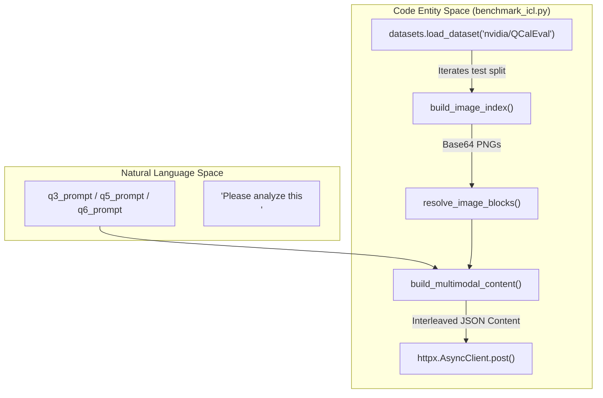
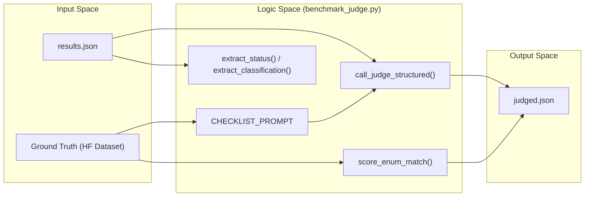

<!-- source: DeepWiki mcp.deepwiki.com · repo NVIDIA/QCalEval · page 4 Glossary · fetched 2026-10-26 -->

# Glossary

Relevant source files

The following files were used as context for generating this wiki page:

- [ATTRIBUTIONS](ATTRIBUTIONS)
- [README.md](README.md)
- [benchmark_icl.py](benchmark_icl.py)
- [benchmark_judge.py](benchmark_judge.py)
- [benchmark_zeroshot.py](benchmark_zeroshot.py)
- [leaderboard_top5.svg](leaderboard_top5.svg)
- [requirements.txt](requirements.txt)

This page provides definitions for the domain-specific terminology, evaluation metrics, and technical concepts used in the QCalEval codebase. It serves as a reference for onboarding engineers to understand the mapping between quantum computing calibration concepts and the implementation details in the evaluation scripts.

## Core Concepts & Data Entities

### Experiment Family
A grouping of quantum calibration tasks that share similar physical goals, data structures, or visual patterns. The benchmark organizes data by these families to ensure consistent evaluation.
*   **Implementation**: Used in `benchmark_icl.py` to select relevant few-shot demonstrations [benchmark_icl.py:177-179]() and in `benchmark_judge.py` to apply family-specific scoring logic [benchmark_judge.py:161-184]().
*   **Source ID**: A unique identifier for each experiment entry, typically following the format `family_uuid` [benchmark_icl.py:147]().

### Question Taxonomy (Q1–Q6)
The benchmark evaluates models across six distinct functional tasks, referred to as `Q1` through `Q6` in the code and dataset.

| Code Key | Label | Description |
| :--- | :--- | :--- |
| `technical_description` | Q1 | Structured JSON description of plot type, axes, and visual features. |
| `experimental_conclusion` | Q2 | 4-way outcome classification (Expected, Suboptimal, Anomalous, Apparatus). |
| `experimental_significance` | Q3 | Scientific analysis and next-step reasoning. |
| `fit_reliability` | Q4 | Assessment of whether a mathematical fit is trustworthy. |
| `parameter_extraction` | Q5 | Extraction of physical constants (e.g., $T_1$, Rabi frequency) into JSON. |
| `calibration_diagnosis` | Q6 | Family-specific status code (e.g., `BEATING`, `NO_SIGNAL`) and action. |

**Sources**: [README.md:14-22](), [benchmark_zeroshot.py:42-49](), [benchmark_judge.py:46-53]()

---

## Technical Terms & Implementation Details

### In-Context Learning (ICL)
A prompting strategy where the model is provided with "demonstrations" (example image/answer pairs) before the target query.
*   **N-way Demonstrations**: Used for Q3 and Q6, providing multiple examples from the same experiment family [README.md:50-51]().
*   **1-shot Demonstration**: Used for Q5 to define the required JSON schema [README.md:50-51]().
*   **Implementation**: Managed in `benchmark_icl.py` via `build_multimodal_content` which interleaves `<image>` tags with text [benchmark_icl.py:79-91]().

### Image Indexing
The process of mapping abstract `image_ids` found in the ICL dataset to actual base64-encoded image data from the test split.
*   **Function**: `build_image_index` [benchmark_icl.py:57-68]().
*   **Data Flow**:
    1.  Load `nvidia/QCalEval` dataset.
    2.  Iterate through `test` split to cache PIL images as Base64.
    3.  Lookup images during ICL prompt construction using `resolve_image_blocks` [benchmark_icl.py:71-76]().

### Thinking Tokens / Reasoning Models
Refers to models (like Qwen3.5 or DeepSeek-R1) that generate an internal "chain of thought" before the final answer.
*   **`--no-think` flag**: A CLI argument that passes `enable_thinking: False` to the API to bypass reasoning generation [benchmark_zeroshot.py:101-102](), [benchmark_icl.py:114-115]().
*   **Extraction**: `extract_content` handles responses where the answer might be located in a `reasoning` field instead of `content` [benchmark_zeroshot.py:76-86]().

---

## Scoring & Judging Definitions

### Programmatic Scoring
Deterministic evaluation using regex or exact string matching for objective fields (Q2, Q4, Q6).
*   **Enum Match**: Used for Q2 and Q4 classification labels [benchmark_judge.py:200-204]().
*   **Status Extraction**: The `extract_status` function uses a set of `KNOWN_STATUSES` (e.g., `NO_SIGNAL`, `WINDOW_TOO_SHORT`) to normalize model output [benchmark_judge.py:150-184]().

### LLM-based Judging
The use of a high-capability model (e.g., GPT-5.4) to evaluate subjective or complex text.
*   **Checklist Prompt**: A rubric-based system where the judge assigns scores (0, 0.5, or 1) to specific "key points" provided in the ground truth [benchmark_judge.py:57-64]().
*   **Implementation**: Handled by `call_judge_structured`, which enforces JSON array output from the judge model [benchmark_judge.py:257-285]().

---

## System Architecture Diagrams

### Inference Data Flow
This diagram illustrates how the `benchmark_icl.py` script resolves data from the HuggingFace `datasets` library into a multimodal payload for an OpenAI-compatible endpoint.

**Title: Multimodal ICL Prompt Construction**

**Sources**: [benchmark_icl.py:57-91](), [benchmark_icl.py:116-130]()

### Judging Pipeline
This diagram shows the transition from raw model responses to final scores using the hybrid scoring logic in `benchmark_judge.py`.

**Title: Hybrid Scoring Logic**

**Sources**: [benchmark_judge.py:57-64](), [benchmark_judge.py:163-184](), [benchmark_judge.py:200-204](), [benchmark_judge.py:257-285]()

---

## Abbreviations Reference

| Abbreviation | Full Term | Context |
| :--- | :--- | :--- |
| **VLM** | Vision-Language Model | The class of models being evaluated. |
| **ICL** | In-Context Learning | Prompting with examples. |
| **GT** | Ground Truth | The reference answers in the dataset. |
| **Q1-Q6** | Questions 1 through 6 | The six tasks in the taxonomy. |
| **API Base** | API Base URL | The endpoint for OpenAI-compatible requests (e.g., vLLM, NIM). |

**Sources**: [README.md:6-10](), [benchmark_zeroshot.py:18-27](), [benchmark_judge.py:18-22]()