# Page: QCalEval Overview

# QCalEval Overview

<details>
<summary>Relevant source files</summary>

The following files were used as context for generating this wiki page:

- [README.md](README.md)
- [leaderboard_top5.svg](leaderboard_top5.svg)

</details>


QCalEval is a specialized benchmark designed to evaluate the visual reasoning and quantitative analysis capabilities of Vision-Language Models (VLMs) within the domain of **quantum calibration**. Unlike general-purpose VLM benchmarks, QCalEval focuses on scientific plot interpretation, requiring models to identify experimental outcomes, extract physical parameters, and suggest corrective actions based on visual data from superconducting qubit experiments.

The project provides a standardized evaluation pipeline that interfaces with the `nvidia/QCalEval` HuggingFace dataset and supports any OpenAI-compatible API endpoint (including local vLLM or NVIDIA NIM instances).

### Core Evaluation Objectives
The benchmark assesses models across six distinct question types (Q1–Q6), ranging from high-level technical descriptions to precise parameter extraction:

| Label | Question | Task |
| :--- | :--- | :--- |
| **Tech. Desc.** | Q1 | Structured JSON description of plot type, axes, and salient visual features. |
| **Exp. Status** | Q2 | 4-way classification: expected behavior, suboptimal, anomalous, or apparatus issue. |
| **Reasoning** | Q3 | Scientific analysis: implications of patterns and next calibration steps. |
| **Fit Rel.** | Q4 | Assessment of whether a visible fit is trustworthy (reliable, unreliable, or none). |
| **Param. Ext.** | Q5 | Extraction of family-specific physical parameters into structured JSON. |
| **Cal. Diag.** | Q6 | Assignment of family-specific status codes (e.g., `SUCCESS`, `NO_SIGNAL`) with actions. |

Sources: [README.md:1-21](), [README.md:148-175]()

---

### System Architecture

The QCalEval codebase is structured into three primary execution stages: Inference (Zero-Shot or ICL), Results Storage, and Scoring/Judging.

#### Logical Flow: Natural Language to Code Entities
The following diagram illustrates how the conceptual evaluation flow maps to specific scripts and data structures within the repository.

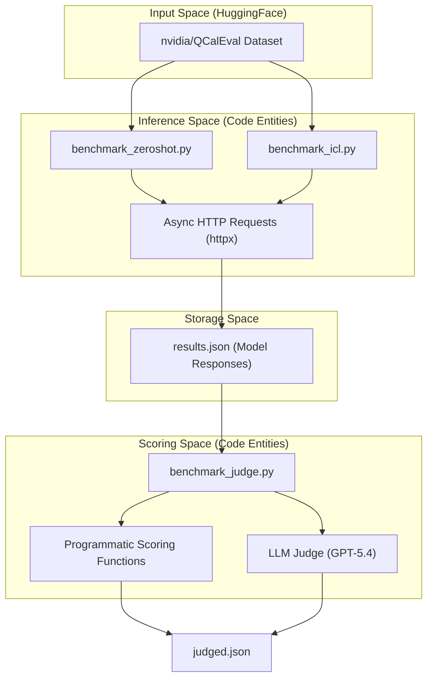
Sources: [README.md:148-175](), [benchmark_zeroshot.py:1-20](), [benchmark_icl.py:1-20](), [benchmark_judge.py:1-30]()

---

### Evaluation Modes

QCalEval supports two primary evaluation paradigms to test model adaptability and few-shot reasoning.

#### 1. Zero-Shot Evaluation
Conducted via `benchmark_zeroshot.py`, this mode sends each image and question independently to the model. It serves as the baseline for a model's inherent understanding of quantum experimental data without prior context.
*   **Key Script:** `benchmark_zeroshot.py` [[benchmark_zeroshot.py:1-218]]()
*   **Details:** See [Getting Started](#1.1) for execution steps.

#### 2. In-Context Learning (ICL) Evaluation
Conducted via `benchmark_icl.py`, this mode provides the model with labeled demonstration examples from the same experiment family.
*   **Q3 & Q6:** Use N-way demonstrations (multiple examples).
*   **Q5:** Uses a single 1-shot demonstration containing the required JSON extraction schema.
*   **Key Script:** `benchmark_icl.py` [[benchmark_icl.py:1-325]]()
*   **Details:** See [In-Context Learning Inference (benchmark_icl.py)](#2.2).

---

### Scoring Mechanism

The `benchmark_judge.py` script implements a hybrid scoring architecture to ensure both precision and semantic accuracy.

| Scoring Type | Applied To | Description |
| :--- | :--- | :--- |
| **Programmatic** | Q1, Q2, Q4, Q5, Q6 | Direct matching of enums, JSON schema validation, and field-specific tolerance checks. |
| **LLM-Based** | Q1, Q3 | Uses a high-capability "Judge" model (e.g., GPT-5.4) to evaluate open-ended descriptions against a key-points checklist. |

#### Scoring Pipeline Detail
The diagram below shows how `benchmark_judge.py` selects scoring paths based on the question ID.

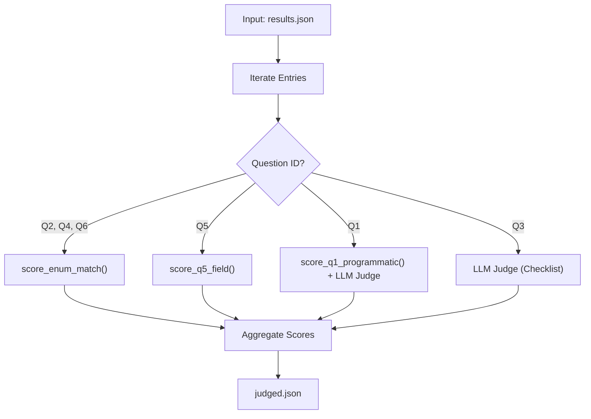
Sources: [benchmark_judge.py:446-550](), [benchmark_judge.py:650-750]()

---

### Navigation

For detailed information on specific components of the QCalEval framework, refer to the following child pages:

*   **[Getting Started](#1.1)**: Step-by-step guide for environment setup, dependency installation, and running your first evaluation.
*   **[Benchmark Dataset and Question Taxonomy](#1.2)**: Deep dive into the `nvidia/QCalEval` dataset structure, the six question types, and the underlying quantum experiment families.
*   **[Leaderboard and Results](#1.3)**: Current rankings for state-of-the-art models and details on the **Ising-Cal-1-35B** model release.

Sources: [README.md:72-146]()

---

# Page: Getting Started

# Getting Started

<details>
<summary>Relevant source files</summary>

The following files were used as context for generating this wiki page:

- [ATTRIBUTIONS](ATTRIBUTIONS)
- [README.md](README.md)
- [requirements.txt](requirements.txt)

</details>


This page provides a technical guide for setting up the QCalEval environment, installing necessary dependencies, and executing an end-to-end evaluation pipeline. QCalEval is designed to assess Vision-Language Models (VLMs) on quantum calibration experiment analysis using data hosted on HuggingFace [README.md:1-6]().

## Environment Setup

The QCalEval evaluation suite requires Python and several key libraries for data handling, image processing, and asynchronous API communication.

### 1. Install Dependencies
Install the required packages using the provided `requirements.txt`.
```bash
pip install -r requirements.txt
```
The core dependencies include:
*   `datasets`: For loading the benchmark data from HuggingFace [requirements.txt:1]().
*   `httpx`: For high-concurrency asynchronous requests to OpenAI-compatible endpoints [requirements.txt:2]().
*   `Pillow`: For image encoding and processing [requirements.txt:3]().
*   `huggingface-hub`: For authentication and dataset management [requirements.txt:4]().

### 2. Authentication
Since the dataset is hosted on HuggingFace, you must ensure your environment is authenticated to pull the data.
```bash
huggingface-cli login
```
Additionally, you must set an environment variable for your inference API key (e.g., `OPENAI_API_KEY` or `NVIDIA_API_KEY`) to be used by the benchmark scripts [README.md:89,116]().

---

## Evaluation Workflow

The evaluation process is split into two distinct phases: **Inference** (generating model responses) and **Scoring** (judging those responses against ground truth).

### System Data Flow
The following diagram illustrates how the codebase entities interact to move from the raw HuggingFace dataset to a final judged score.

**Data Flow: From Dataset to Judged Results**
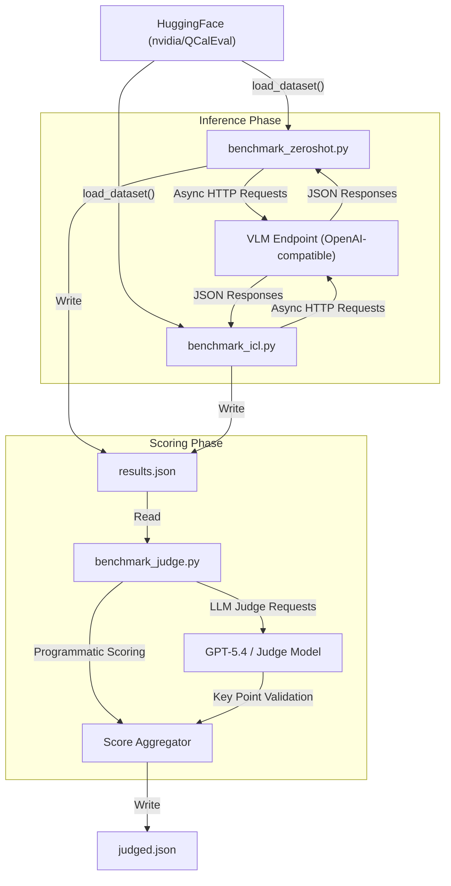
Sources: [README.md:80-146](), [benchmark_zeroshot.py:1-20](), [benchmark_icl.py:1-20](), [benchmark_judge.py:1-30]()

---

## Running Your First Evaluation

### Step 1: Zero-Shot Inference
The `benchmark_zeroshot.py` script sends each image and its associated question (Q1–Q6) to the model independently [README.md:80-82]().

```bash
python benchmark_zeroshot.py \
  --api-base https://api.openai.com/v1/chat/completions \
  --model-id gpt-5.4 \
  --api-key-env OPENAI_API_KEY \
  --output results_zeroshot.json \
  --concurrency 64
```

### Step 2: In-Context Learning (ICL) Inference (Optional)
To test the model's ability to learn from examples, use `benchmark_icl.py`. This script constructs prompts containing labeled demonstration examples from the same experiment family [README.md:48-50]().

```bash
python benchmark_icl.py \
  --api-base https://api.openai.com/v1/chat/completions \
  --model-id gpt-5.4 \
  --api-key-env OPENAI_API_KEY \
  --output results_icl.json
```

### Step 3: Scoring and Judging
Once you have a `results.json` file, run `benchmark_judge.py`. This script performs hybrid scoring:
1.  **Programmatic Scoring**: Uses exact matches or tolerance ranges for physical parameters (Q2, Q4, Q5, Q6) [README.md:16-21]().
2.  **LLM-based Judging**: Uses a high-capability model (e.g., GPT-5.4) to evaluate structured descriptions (Q1) and scientific reasoning (Q3) [README.md:25,128-130]().

```bash
python benchmark_judge.py results_zeroshot.json \
  --judge-api-base https://api.openai.com/v1/chat/completions \
  --judge-model-id gpt-5.4 \
  --judge-api-key-env OPENAI_API_KEY \
  --output judged_final.json
```

---

## Implementation Details: Code Entity Map

This diagram maps the logical steps of the evaluation to the specific Python files and functions responsible for execution.

**Code Entity Map: Execution Pipeline**
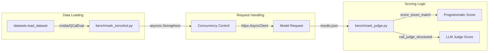
Sources: [benchmark_zeroshot.py:100-106](), [benchmark_judge.py:128-146](), [requirements.txt:1-4]()

### Summary of Question Types
The following table summarizes the tasks evaluated during the "Getting Started" run:

| Question | Task | Scoring Method |
| :--- | :--- | :--- |
| **Q1** | Tech. Description | 50% Programmatic JSON / 50% LLM Judge [README.md:16,25]() |
| **Q2** | Exp. Status | 4-way classification match [README.md:17]() |
| **Q3** | Reasoning | LLM Judge (Key-points checklist) [README.md:18,130]() |
| **Q4** | Fit Reliability | Enum match (Reliable/Unreliable/None) [README.md:19]() |
| **Q5** | Param. Extraction | Programmatic JSON field tolerance [README.md:20]() |
| **Q6** | Cal. Diagnosis | Status code + corrective action match [README.md:21]() |

Sources: [README.md:14-21](), [README.md:25](), [README.md:128-130]()

---

# Page: Benchmark Dataset and Question Taxonomy

# Benchmark Dataset and Question Taxonomy

<details>
<summary>Relevant source files</summary>

The following files were used as context for generating this wiki page:

- [README.md](README.md)
- [benchmark_icl.py](benchmark_icl.py)
- [benchmark_zeroshot.py](benchmark_zeroshot.py)

</details>


This page provides a technical deep dive into the `nvidia/QCalEval` dataset hosted on HuggingFace. It details the six-question taxonomy used to evaluate Vision-Language Models (VLMs) on quantum calibration tasks, the data schema, and how the evaluation scripts interact with these data structures.

## Dataset Overview

The QCalEval benchmark is hosted at `nvidia/QCalEval` [benchmark_zeroshot.py:40-40](). It consists of two primary splits used by the evaluation suite:
1.  **Test Split**: Used for zero-shot evaluation via `benchmark_zeroshot.py` [benchmark_zeroshot.py:202-202]().
2.  **ICL (In-Context Learning) Split**: Contains pre-formatted prompts with demonstration examples, used by `benchmark_icl.py` [benchmark_icl.py:221-221]().

### Experiment Families
The dataset covers multiple quantum experiment families (e.g., Rabi oscillations, Ramsey fringes, T1/T2 relaxation). Each entry in the dataset is tagged with an `experiment_type` [benchmark_zeroshot.py:161-161](), which dictates how specific questions (like Q5 and Q6) are scored programmatically [README.md:20-21]().

## Question Taxonomy (Q1–Q6)

The benchmark evaluates models across six distinct tasks, ranging from visual description to physical parameter extraction.

| Label | Key Name | Type | Task Description |
| :--- | :--- | :--- | :--- |
| **Q1** | `technical_description` | Structured | JSON description of plot type, axes, and salient visual features. |
| **Q2** | `experimental_conclusion` | Classification | 4-way outcome: expected, suboptimal, anomalous, or apparatus issue. |
| **Q3** | `experimental_significance` | Reasoning | Scientific analysis of patterns and next calibration steps. |
| **Q4** | `fit_reliability` | Assessment | Evaluate if a visible fit is trustworthy (reliable, unreliable, or none). |
| **Q5** | `parameter_extraction` | Extraction | Extract family-specific physical parameters into structured JSON. |
| **Q6** | `calibration_diagnosis` | Diagnostic | Assign family-specific status codes and corrective actions. |

**Sources:** [README.md:14-21](), [benchmark_zeroshot.py:42-49]()

## Data Flow: From HuggingFace to Model Input

The evaluation scripts transform raw HuggingFace rows into OpenAI-compatible multimodal messages.

### Zero-Shot Data Flow
In zero-shot mode, each of the 6 questions is sent as an independent request [benchmark_zeroshot.py:20-21]().

Title: Zero-Shot Multimodal Message Construction
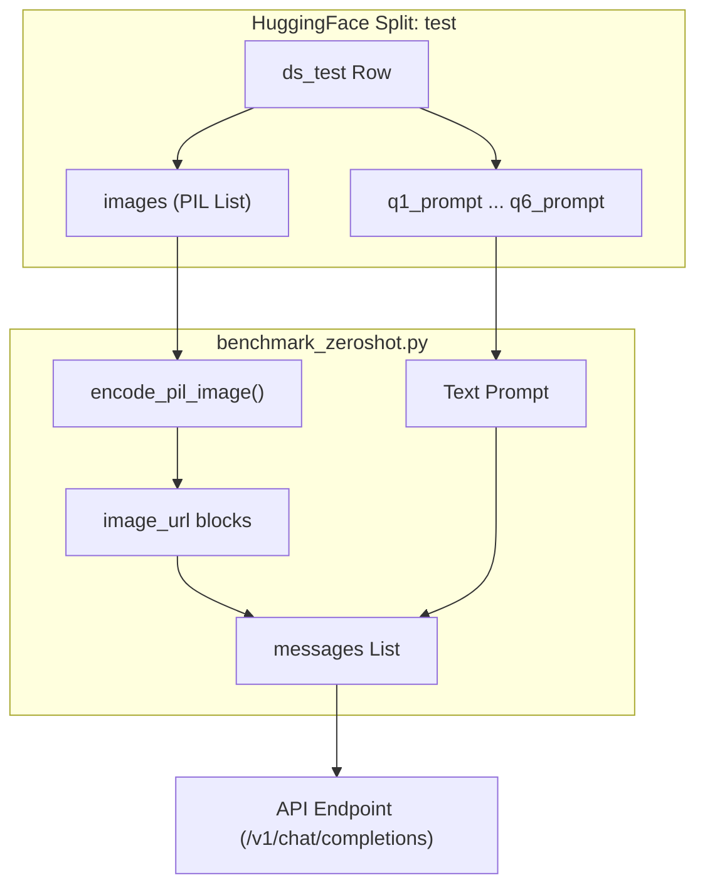
**Sources:** [benchmark_zeroshot.py:54-73](), [benchmark_zeroshot.py:96-99](), [benchmark_zeroshot.py:142-149]()

### In-Context Learning (ICL) Data Flow
The ICL split uses a more complex interleaving mechanism. Since ICL prompts contain `<image>` placeholders for demonstrations, the script must resolve `image_ids` against the test set to build the final message [benchmark_icl.py:20-22]().

Title: ICL Image Interleaving Logic
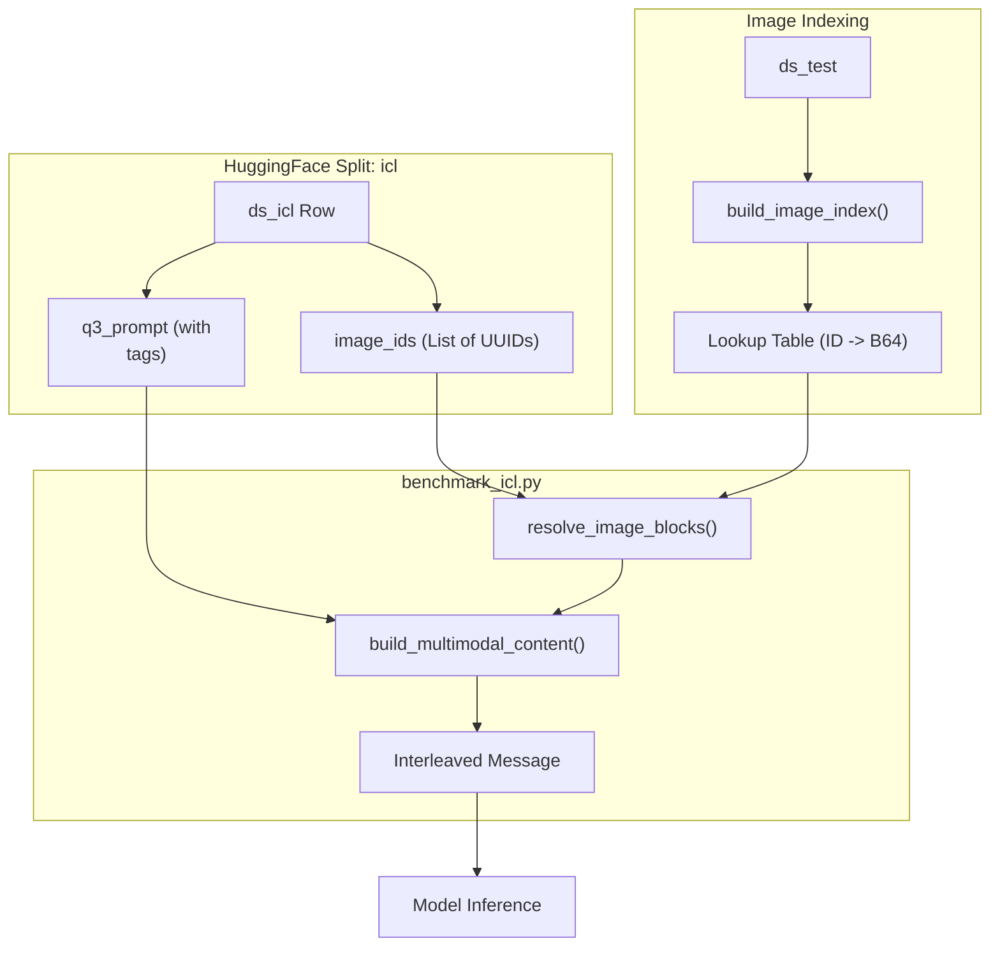
**Sources:** [benchmark_icl.py:57-68](), [benchmark_icl.py:71-76](), [benchmark_icl.py:79-91]()

## Data Schema

### Input Schema (HuggingFace)
The following keys are essential for the evaluation pipeline:
*   `id` / `source_id`: Unique identifier for the experiment [benchmark_zeroshot.py:136-136](), [benchmark_icl.py:147-147]().
*   `images`: A list of PIL image objects [benchmark_zeroshot.py:66-66]().
*   `experiment_type`: String identifier (e.g., "rabi") [benchmark_zeroshot.py:161-161]().
*   `q1_prompt` through `q6_prompt`: The system/user strings for each task [benchmark_zeroshot.py:51-51]().

### Output Schema (results.json)
The inference scripts produce a JSON file containing model responses, which serves as the input for `benchmark_judge.py`.

```json
{
  "id": "exp_123",
  "experiment_type": "rabi",
  "responses": {
    "technical_description": {
      "answer": "...",
      "error": null
    },
    "experimental_significance": {
      "answer": "...",
      "error": null
    }
  }
}
```
**Sources:** [benchmark_zeroshot.py:159-164](), [benchmark_icl.py:175-180]()

## Implementation Details

### Image Encoding
Images are converted to `RGBA` and encoded as `PNG` base64 strings to ensure compatibility across different VLM backends [benchmark_zeroshot.py:54-60]().

### Content Extraction
The `extract_content` function is designed to handle "reasoning" models (like DeepSeek-R1 or Qwen-Thinking) by checking for a `reasoning` field in the API response if the standard `content` field is empty [benchmark_zeroshot.py:76-86](), [benchmark_icl.py:94-103]().

### ICL Question Mapping
In ICL mode, only a subset of questions (Q3, Q5, Q6) are evaluated. These are mapped using `FEWSHOT_Q_MAP`:
*   Index 0 -> `experimental_significance` (Q3)
*   Index 1 -> `parameter_extraction` (Q5)
*   Index 2 -> `calibration_diagnosis` (Q6)

**Sources:** [benchmark_icl.py:42-46](), [benchmark_icl.py:168-170]()

---

# Page: Leaderboard and Results

# Leaderboard and Results

<details>
<summary>Relevant source files</summary>

The following files were used as context for generating this wiki page:

- [README.md](README.md)
- [leaderboard_top5.svg](leaderboard_top5.svg)

</details>


This page provides a detailed technical overview of the QCalEval benchmark results, including the zero-shot and In-Context Learning (ICL) leaderboards, the performance of the NVIDIA Ising-Cal-1-35B model, and the interpretation of scoring metrics across the six question types (Q1–Q6).

## Evaluation Metrics and Question Taxonomy

The benchmark evaluates models on six distinct tasks related to quantum calibration. Scores are normalized to a 0–100 scale. The evaluation utilizes a hybrid scoring mechanism implemented in `benchmark_judge.py`, combining programmatic validation (for structured JSON and classification) with LLM-based grading for complex reasoning tasks.

| Label | Question | Task Description | Scoring Method |
|:---|:---|:---|:---|
| **Tech. Desc.** | Q1 | Structured JSON description of plot type and axes. | Hybrid: 50% Programmatic / 50% LLM Judge |
| **Exp. Status** | Q2 | 4-way outcome classification (Expected, Suboptimal, etc.). | Programmatic: Enum Match |
| **Reasoning** | Q3 | Scientific analysis and next-step prediction. | LLM Judge: Checklist-based |
| **Fit Rel.** | Q4 | Reliability assessment of visible fits. | Programmatic: Enum Match |
| **Param. Ext.** | Q5 | Extraction of physical parameters (e.g., $T_1$, Rabi frequency). | Programmatic: Tolerance-based JSON comparison |
| **Cal. Diag.** | Q6 | Family-specific status codes and corrective actions. | Programmatic: Status Mapping |

Sources: `[README.md:14-21]()`, `[benchmark_judge.py:440-475]()`

## Zero-Shot Leaderboard

The zero-shot evaluation measures a model's "out-of-the-box" capability to interpret quantum calibration data without prior examples. In this mode, `benchmark_zeroshot.py` sends an independent request for each question associated with a dataset entry.

### Top 5 Visualization
The `leaderboard_top5.svg` file visualizes the performance of the leading models across the six question categories. This visualization highlights the trade-offs between general-purpose models (like GPT-5.4) and domain-specialized models.


### Performance Data (April 2026)
| Type | Model | Mean | Q1 | Q2 | Q3 | Q4 | Q5 | Q6 |
|:---|:---|:---:|:---:|:---:|:---:|:---:|:---:|:---:|
| **NVIDIA** | **Ising-Cal-1-35B** | **74.7** | 87.8 | **67.1** | **64.7** | **90.5** | 62.5 | **75.3** |
| Closed | Gemini-3.1-Pro | 72.3 | 88.5 | 57.2 | 61.1 | 84.4 | **71.5** | 71.2 |
| Open | Gemma-4-31B-IT | 68.8 | 85.6 | 54.3 | 59.8 | 82.7 | 68.3 | 62.1 |
| Closed | Gemini-3.1-Flash-Lite | 68.2 | 89.2 | 53.5 | 59.4 | 82.7 | 63.8 | 60.9 |
| Closed | Claude Opus 4.6 | 67.8 | 90.8 | 49.0 | 65.5 | 76.1 | 64.7 | 60.5 |

Sources: `[README.md:12-33]()`, `[leaderboard_top5.svg:1-265]()`

## NVIDIA Ising-Cal-1-35B Model

Based on benchmark findings, NVIDIA released **Ising-Calibration-1-35B**, an open-weight 35B Mixture-of-Experts (MoE) model. This model is specifically fine-tuned for quantum calibration plot understanding and currently holds the top position on the zero-shot leaderboard. It demonstrates superior performance in scientific reasoning (Q3) and diagnostic status assignment (Q6) compared to much larger closed-source models.

Sources: `[README.md:8-10]()`, `[README.md:29-29]()`

## In-Context Learning (ICL) Results

The ICL leaderboard evaluates models when provided with labeled demonstration examples. This is implemented in `benchmark_icl.py`, which constructs prompts containing examples from the same experiment family as the query.

### ICL Implementation Logic
*   **Q3 & Q6 (N-way):** Multiple labeled examples from the same family are provided to show the expected reasoning chain or status mapping.
*   **Q5 (1-shot):** A single demonstration is provided to establish the required JSON schema for physical parameter extraction.

### ICL Performance Data (April 2026)
| Model | Mean | Q3 | Delta | Q5 | Delta | Q6 | Delta |
|:---|:---|:---:|:---:|:---:|:---:|:---:|:---:|
| Gemini-3.1-Pro | **85.2** | 81.3 | +20.2 | **84.5** | +13.0 | **89.8** | +18.6 |
| Claude Opus 4.6 | 85.1 | **84.7** | +19.2 | 81.3 | +16.6 | 89.4 | +28.9 |
| Gemma-4-31B-IT | 81.2 | 80.6 | +20.8 | 76.9 | +8.6 | 86.0 | +23.9 |

**Note on "Negative Delta":** Several models (e.g., Qwen3.5 family) show a performance decrease in ICL mode. This often indicates sensitivity to long-context visual prompts or a failure to follow the demonstration pattern over the zero-shot instruction.

Sources: `[README.md:48-70]()`

## Data Flow: From Inference to Results

The following diagram illustrates how raw model outputs are transformed into the leaderboard scores presented above.

### Leaderboard Data Generation Flow
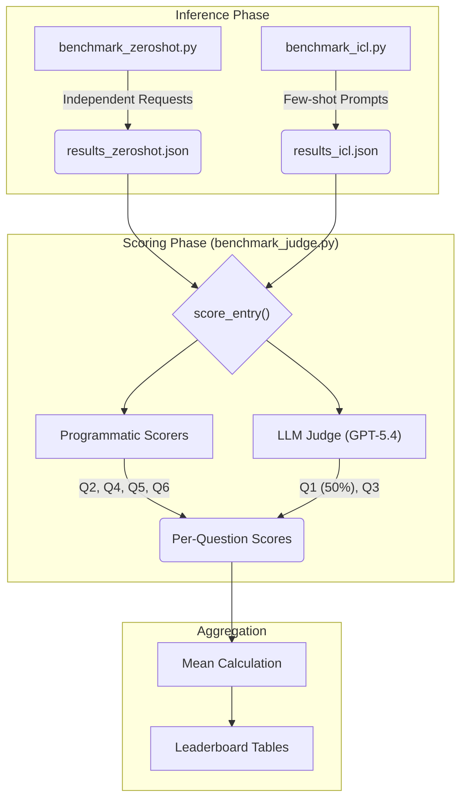
Sources: `[benchmark_judge.py:440-475]()`, `[README.md:148-160]()`

## Interpreting Scores

The scoring logic in `benchmark_judge.py` defines how "success" is measured for each task:

1.  **Exact Match (Q2, Q4):** The model must return the exact string from the allowed enum (e.g., `EXPECTED_BEHAVIOR`).
2.  **Tolerance Match (Q5):** For numerical parameters, the `score_q5_field` function checks if the model's value is within a percentage tolerance (defined in `experiment_config.json`) of the ground truth.
3.  **Checklist Scoring (Q3):** The LLM judge checks for the presence of specific scientific "key points" in the model's explanation.
4.  **JSON Schema (Q1):** The `score_q1_programmatic` function validates that the output is valid JSON and contains the required keys for plot description.

### Scoring Implementation Reference
| Code Entity | Purpose |
|:---|:---|
| `score_enum_match` | Validates classification tasks (Q2, Q4). |
| `score_q5_field` | Handles numerical tolerance for physics parameters. |
| `score_q1_programmatic` | Validates JSON structure for technical descriptions. |
| `call_judge_structured` | Interface for the LLM judge to grade Q1 and Q3. |

Sources: `[benchmark_judge.py:100-115]()`, `[benchmark_judge.py:146-170]()`, `[benchmark_judge.py:192-210]()`, `[benchmark_judge.py:348-370]()`

---

# Page: Evaluation Pipeline

# Evaluation Pipeline

<details>
<summary>Relevant source files</summary>

The following files were used as context for generating this wiki page:

- [README.md](README.md)
- [benchmark_icl.py](benchmark_icl.py)
- [benchmark_judge.py](benchmark_judge.py)
- [benchmark_zeroshot.py](benchmark_zeroshot.py)

</details>


The QCalEval evaluation pipeline is a multi-stage process designed to measure Vision-Language Model (VLM) performance on quantum calibration tasks. The pipeline transitions from raw data loading and model inference to structured scoring and final metric aggregation. It is implemented through three primary scripts that communicate via standardized JSON files.

### Pipeline Architecture

The following diagram illustrates the flow of data from the HuggingFace dataset through the inference engines and into the scoring judge.

**Data Flow: From Inference to Results**
```mermaid
graph TD
  subgraph "Input Space"
    [HF_Dataset] -- "load_dataset" --> [benchmark_scripts]
  end

  subgraph "Inference Space"
    [benchmark_scripts] -- "HTTP POST" --> [VLM_Endpoint]
    [VLM_Endpoint] -- "JSON Response" --> [benchmark_scripts]
    [benchmark_scripts] -- "write" --> [results_json]
  end

  subgraph "Scoring Space"
    [results_json] -- "read" --> [benchmark_judge_py]
    [benchmark_judge_py] -- "Programmatic" --> [Scores]
    [benchmark_judge_py] -- "LLM Judge" --> [Scores]
    [Scores] -- "write" --> [judged_json]
  end

  [benchmark_scripts]:::code
  [benchmark_judge_py]:::code
  [results_json]:::file
  [judged_json]:::file

  classDef code font-family:monospace,font-weight:bold
  classDef file font-family:monospace,stroke-dasharray: 5 5
```
Sources: [benchmark_zeroshot.py:18-27](), [benchmark_icl.py:18-27](), [benchmark_judge.py:18-27]()

---

### Inference Modes

The pipeline supports two distinct inference strategies: Zero-Shot and In-Context Learning (ICL). Both scripts utilize an asynchronous concurrency model to maximize throughput against OpenAI-compatible API endpoints.

#### Zero-Shot Inference
The `benchmark_zeroshot.py` script evaluates the model's baseline performance. It sends each of the six question types (Q1–Q6) as independent requests to the model, ensuring no leakage between different aspects of the same experiment.
*   **Key File:** `benchmark_zeroshot.py`
*   **Mechanism:** Iterates through `Q_PROMPT_KEYS` [benchmark_zeroshot.py:51-51]() and calls `ask_single_question` [benchmark_zeroshot.py:89-91]().
*   **For details, see [Zero-Shot Inference (benchmark_zeroshot.py)](#2.1).**

#### In-Context Learning (ICL) Inference
The `benchmark_icl.py` script provides the model with labeled demonstration examples from the same experiment family. This mode evaluates the model's ability to adapt to specific calibration patterns and extraction schemas.
*   **Key File:** `benchmark_icl.py`
*   **Mechanism:** Uses `FEWSHOT_Q_MAP` [benchmark_icl.py:42-46]() to handle Q3, Q5, and Q6. It interleaves multiple images into the prompt using `<image>` tags [benchmark_icl.py:79-92]().
*   **For details, see [In-Context Learning Inference (benchmark_icl.py)](#2.2).**

---

### Scoring and Judging

Once inference is complete, `benchmark_judge.py` processes the model responses. The scoring architecture is hybrid, combining deterministic programmatic checks with LLM-based qualitative assessment.

**Code Entity Mapping: Scoring Logic**
```mermaid
graph LR
  subgraph "benchmark_judge.py"
    [score_entry] --> [Programmatic_Scoring]
    [score_entry] --> [LLM_Judge_Scoring]
    
    subgraph "Programmatic_Scoring"
      [score_enum_match]
      [score_q1_programmatic]
      [score_q5_field]
      [extract_status]
    end

    subgraph "LLM_Judge_Scoring"
      [call_judge_structured] --> [CHECKLIST_PROMPT]
    end
  end

  [score_entry]:::func
  [score_enum_match]:::func
  [score_q1_programmatic]:::func
  [score_q5_field]:::func
  [extract_status]:::func
  [call_judge_structured]:::func

  classDef func font-family:monospace
```
Sources: [benchmark_judge.py:46-53](), [benchmark_judge.py:200-204](), [benchmark_judge.py:57-64]()

#### Programmatic Scoring
Questions with objective or structured answers (Q2, Q4, Q5, Q6) are scored using regular expressions and JSON parsing. For example, `extract_status` [benchmark_judge.py:163-184]() normalizes model output against `KNOWN_STATUSES` [benchmark_judge.py:150-160]() to determine if a calibration diagnosis is correct.

#### LLM-Based Judging
For open-ended scientific reasoning (Q3) and technical descriptions (Q1), the pipeline employs an LLM judge. The judge uses a `CHECKLIST_PROMPT` [benchmark_judge.py:57-64]() to verify if the model's response covers specific key points defined in the ground truth.

**For details, see [Scoring and Judging (benchmark_judge.py)](#2.3).**

---

### Execution Sequence

To run the full pipeline, follow these steps:

1.  **Inference:** Run either `benchmark_zeroshot.py` or `benchmark_icl.py`. This generates a results JSON file containing raw model answers.
2.  **Judging:** Run `benchmark_judge.py`, passing the results file from step 1. This script will append scores and aggregate metrics.
3.  **Analysis:** The final output includes a `summary` block with mean scores across all question types and experiment families.

Sources: [README.md:148-160]()

---

# Page: Zero-Shot Inference (benchmark_zeroshot.py)

# Zero-Shot Inference (benchmark_zeroshot.py)

<details>
<summary>Relevant source files</summary>

The following files were used as context for generating this wiki page:

- [benchmark_zeroshot.py](benchmark_zeroshot.py)

</details>


The `benchmark_zeroshot.py` script is the entry point for evaluating Vision-Language Models (VLMs) in a zero-shot setting on the QCalEval benchmark. It automates the process of loading the benchmark dataset from HuggingFace, encoding experimental plot images, and dispatching six distinct questions per data entry to an OpenAI-compatible API endpoint.

## Execution Flow and Architecture

The script utilizes `asyncio` to manage high-concurrency requests to the inference server. For every entry in the dataset, the script performs six independent API calls—one for each question type defined in the taxonomy (Q1–Q6).

### Data Flow Diagram
The following diagram illustrates the transformation of a HuggingFace dataset row into a series of API requests and the final structured JSON output.

**Zero-Shot Request Pipeline**
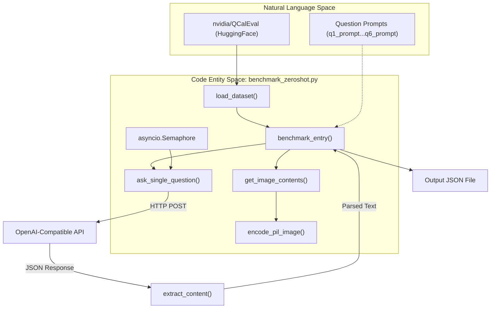
Sources: [benchmark_zeroshot.py:18-27](), [benchmark_zeroshot.py:132-164](), [benchmark_zeroshot.py:89-130]()

## Image Encoding Pipeline

The script handles multi-image entries by converting PIL images from the HuggingFace `datasets` objects into base64-encoded PNG strings.

- **`encode_pil_image(pil_img)`**: Ensures images are in `RGBA` mode before saving to a `BytesIO` buffer as PNGs. This is critical for maintaining transparency layers if present in experimental plots. [benchmark_zeroshot.py:54-60]()
- **`get_image_contents(row)`**: Iterates through the `images` list in a dataset row. It constructs the content blocks required by the vision API, prefixing base64 strings with `data:image/png;base64,`. [benchmark_zeroshot.py:63-73]()

Sources: [benchmark_zeroshot.py:54-73]()

## Concurrency and Retry Model

To maximize throughput while respecting server limits, `benchmark_zeroshot.py` employs a semaphore-controlled asynchronous model.

| Feature | Implementation Detail |
| :--- | :--- |
| **Concurrency Control** | Uses `asyncio.Semaphore` initialized with the `--concurrency` argument (default: 8). [benchmark_zeroshot.py:178](), [benchmark_zeroshot.py:93]() |
| **Question Parallelism** | For a single entry, all 6 questions are dispatched simultaneously using `asyncio.gather`. [benchmark_zeroshot.py:144-150]() |
| **Retry Logic** | Implements a 3-attempt retry loop with exponential backoff. [benchmark_zeroshot.py:94-129]() |
| **Rate Limiting** | Specifically catches HTTP `429` (Too Many Requests) and waits `5 * (2 ** attempt)` seconds. [benchmark_zeroshot.py:118-120]() |
| **Timeout** | Hardcoded `300.0` second timeout per request to accommodate long reasoning traces. [benchmark_zeroshot.py:116]() |

Sources: [benchmark_zeroshot.py:89-130](), [benchmark_zeroshot.py:144-150]()

## Per-Question Request Flow

Each request follows a strict schema to ensure compatibility with modern VLMs and reasoning models.

1. **Message Construction**: The user message is a list containing all images followed by the specific question text. [benchmark_zeroshot.py:96-99]()
2. **Reasoning Control**: If `--no-think` is passed, the script adds `chat_template_kwargs: {"enable_thinking": False}` to the payload, which is used to suppress internal chain-of-thought for models like Qwen-7B-Instruct or DeepSeek-V3 in certain inference engines. [benchmark_zeroshot.py:101-102]()
3. **Response Extraction**: The `extract_content` function handles standard `content` fields as well as `reasoning` fields for models that separate thoughts from the final answer. [benchmark_zeroshot.py:76-87]()

Sources: [benchmark_zeroshot.py:76-114]()

## CLI Arguments and Configuration

The script is configured via command-line arguments to point to different backends (e.g., local vLLM, NVIDIA NIM, or OpenAI).

| Argument | Description |
| :--- | :--- |
| `--api-base` | The full URL to the `/v1/chat/completions` endpoint. |
| `--model-id` | The string identifier for the model on the server. |
| `--concurrency` | Number of simultaneous requests (default: 8). |
| `--filter-type` | Optional. Filter dataset by `experiment_type` (e.g., "Rabi"). |
| `--max-tokens` | Limit for model output (default: 16384). |
| `--no-think` | Disables internal thinking/reasoning traces for compatible models. |

Sources: [benchmark_zeroshot.py:168-186]()

## Output JSON Schema

The results are saved to a JSON file specified by `--output`. This file is the required input for the `benchmark_judge.py` script.

**Entity-to-Schema Mapping**
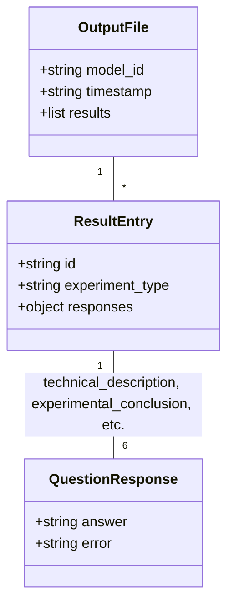

The `responses` object uses keys from `Q_NAMES`:
- `technical_description` (Q1)
- `experimental_conclusion` (Q2)
- `experimental_significance` (Q3)
- `fit_reliability` (Q4)
- `parameter_extraction` (Q5)
- `calibration_diagnosis` (Q6)

Sources: [benchmark_zeroshot.py:42-49](), [benchmark_zeroshot.py:152-164]()

---

# Page: In-Context Learning Inference (benchmark_icl.py)

# In-Context Learning Inference (benchmark_icl.py)

<details>
<summary>Relevant source files</summary>

The following files were used as context for generating this wiki page:

- [benchmark_icl.py](benchmark_icl.py)

</details>


The `benchmark_icl.py` script performs evaluation of Multimodal Large Language Models (MLLMs) using **In-Context Learning (ICL)**. Unlike zero-shot evaluation, this script utilizes specialized prompt templates that interleave demonstration examples (few-shot) with the target question. It specifically targets three complex question types from the QCalEval taxonomy: Q3 (Experimental Significance), Q5 (Parameter Extraction), and Q6 (Calibration Diagnosis).

### Prompt Construction and Interleaving

The ICL evaluation relies on a multimodal interleaving mechanism where `<image>` placeholders in the dataset text are replaced with base64-encoded image blocks compatible with OpenAI-style APIs.

#### Image Indexing and Resolution
Because the ICL dataset contains references to images used across different demonstrations, the script first builds a global lookup table.
1. **`build_image_index(ds_test)`**: Iterates through the test split of the dataset to map `image_id` strings to base64-encoded PNG content blocks `[benchmark_icl.py:57-68]()`.
2. **`resolve_image_blocks(image_ids, image_index)`**: For a given benchmark row, it retrieves the corresponding image data blocks from the index based on the `image_ids` list `[benchmark_icl.py:71-76]()`.

#### Multimodal Content Building
The function `build_multimodal_content` is the core logic for interleaving text and images `[benchmark_icl.py:79-91]()`. It splits the prompt text by the `<image>` tag and iterates through the resulting parts, inserting an image block from the resolved list between each text segment. An `image_offset` is maintained to ensure that images are consumed sequentially across the three questions (Q3, Q5, Q6) within a single benchmark entry `[benchmark_icl.py:153-158]()`.

**Data Flow: From Dataset to API Payload**

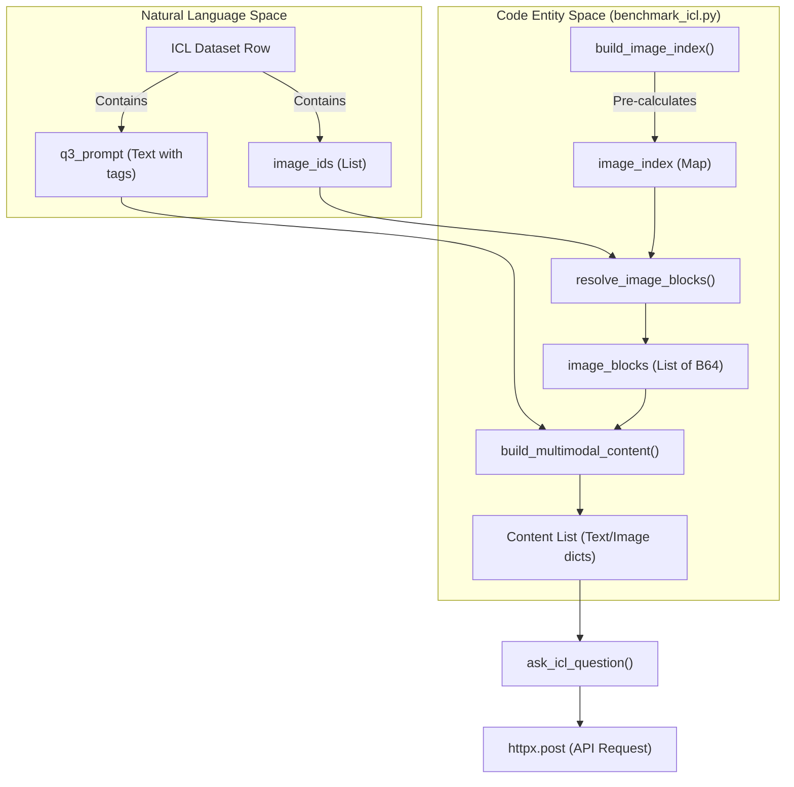
Sources: `[benchmark_icl.py:57-91]()`, `[benchmark_icl.py:144-163]()`

---

### Question Mapping and N-way Demonstrations

The script processes three specific question types for every entry in the ICL dataset. These are mapped internally using the `FEWSHOT_Q_MAP` `[benchmark_icl.py:42-46]()`.

| Index | Question Type | Internal Map Key (`FEWSHOT_Q_MAP`) |
| :--- | :--- | :--- |
| 0 | Q3 | `experimental_significance` |
| 1 | Q5 | `parameter_extraction` |
| 2 | Q6 | `calibration_diagnosis` |

#### N-way vs 1-shot
The ICL prompts in the `nvidia/QCalEval` dataset are pre-formatted. Depending on the specific row in the dataset, the `q{N}_prompt` field may contain:
- **1-shot**: A single demonstration (Example Image + Example Question + Example Answer) followed by the test query.
- **N-way**: Multiple demonstrations (e.g., a "Good" calibration example and a "Bad" calibration example) to provide the model with contrasting contexts before the test query.

The script treats these transparently by resolving all `<image>` tags sequentially as they appear in the combined demonstration + query string `[benchmark_icl.py:155-163]()`.

---

### Inference Execution and Control

The script uses `asyncio` to manage high-throughput requests to the inference server.

#### Concurrency and Retries
- **Semaphore**: A `asyncio.Semaphore` (defaulting to `--concurrency` value) limits the number of simultaneous outgoing requests to prevent overwhelming the API `[benchmark_icl.py:109]()`.
- **Retry Logic**: `ask_icl_question` implements a 3-attempt retry loop with exponential backoff `[benchmark_icl.py:110-141]()`. It specifically handles HTTP 429 (Rate Limit) errors by sleeping before retrying `[benchmark_icl.py:131-133]()`.

#### The --no-think Flag
For models that support "Thinking" or "Reasoning" phases (like DeepSeek-R1 or similar), the script provides a `--no-think` CLI argument. When enabled, it passes `enable_thinking: False` inside `chat_template_kwargs` to the API `[benchmark_icl.py:114-115]()`. This is useful for benchmarking the raw performance of the model without the overhead of extended reasoning tokens.

#### Content Extraction
The `extract_content` function handles diverse API response formats `[benchmark_icl.py:94-103]()`:
- Prefers `message.content`.
- Falls back to `message.reasoning` if content is null.
- If the content is returned as a list of blocks, it joins all text blocks into a single string.

---

### Output Schema

The results are saved as a JSON array where each object represents one experiment entry.

```json
{
  "id": "exp_123",
  "experiment_type": "T1_Echo",
  "error": null,
  "responses": {
    "experimental_significance": {
      "answer": "The image shows a T1 decay curve...",
      "error": null
    },
    "parameter_extraction": {
      "answer": "{\"T1\": 45.2, \"unit\": \"us\"}",
      "error": null
    },
    "calibration_diagnosis": {
      "answer": "Status: Success",
      "error": null
    }
  }
}
```

**Implementation Sequence Diagram**

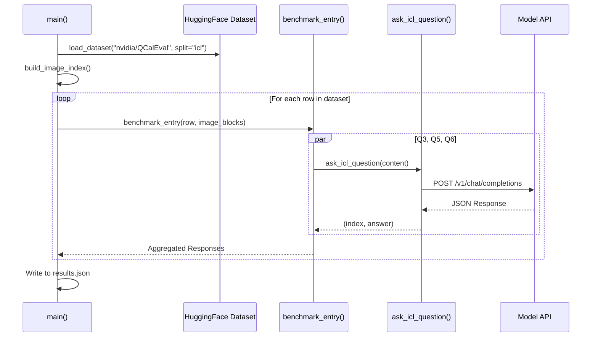
Sources: `[benchmark_icl.py:144-180]()`, `[benchmark_icl.py:183-210]()`

Sources:
- Prompt construction: `[benchmark_icl.py:57-91]()`
- ICL Logic: `[benchmark_icl.py:144-180]()`
- CLI and Main: `[benchmark_icl.py:183-220]()`
- Question Mapping: `[benchmark_icl.py:42-46]()`

---

# Page: Scoring and Judging (benchmark_judge.py)

# Scoring and Judging (benchmark_judge.py)

<details>
<summary>Relevant source files</summary>

The following files were used as context for generating this wiki page:

- [benchmark_judge.py](benchmark_judge.py)

</details>


The `benchmark_judge.py` script is the final stage of the QCalEval pipeline. It evaluates model responses against ground truth (GT) data using a hybrid scoring architecture that combines strict programmatic validation with LLM-based semantic judging.

## Overview

The script processes results generated by `benchmark_zeroshot.py` or `benchmark_icl.py`. It uses a "best-of-both-worlds" approach:
1.  **Programmatic Scoring:** Used for objective fields like classification enums, extracted parameters (with tolerance), and JSON schema adherence.
2.  **LLM-based Judging:** Used for open-ended responses (Q1 and Q3) where a "key-points checklist" is applied to verify technical accuracy and completeness.

The scoring logic is mapped to the six question types defined in the benchmark taxonomy: `technical_description` (Q1), `experimental_conclusion` (Q2), `experimental_significance` (Q3), `fit_reliability` (Q4), `parameter_extraction` (Q5), and `calibration_diagnosis` (Q6) [benchmark_judge.py:46-53]().

### System Architecture: Logic to Code Mapping

The following diagram illustrates how the natural language evaluation requirements are translated into specific code entities within `benchmark_judge.py`.

**Scoring Logic Flow**
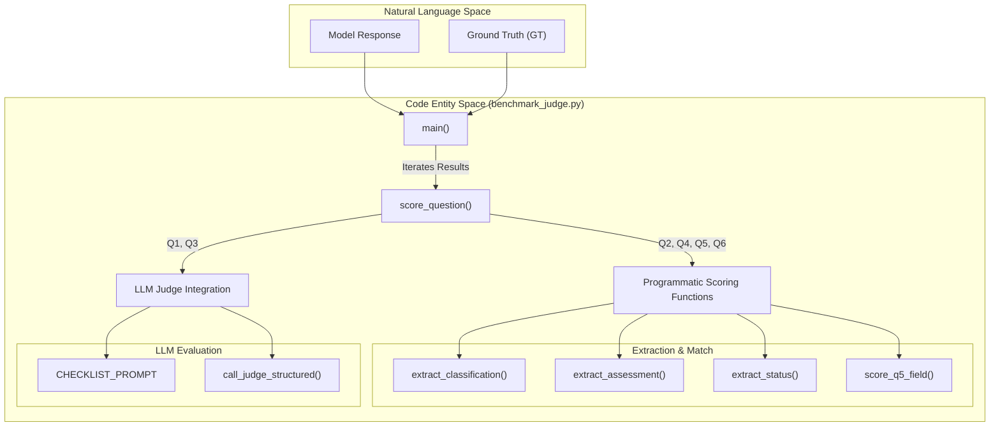
Sources: [benchmark_judge.py:46-53](), [benchmark_judge.py:57-64](), [benchmark_judge.py:104-184](), [benchmark_judge.py:383-455]()

---

## Programmatic Scoring Methods

Programmatic scoring ensures reproducibility and speed for deterministic components of the benchmark. This includes regex-based extraction of model "final answers" and numerical comparison for physical parameters.

### Key Programmatic Components
*   **JSON Parsing:** `parse_json_answer` attempts to find and decode JSON objects within model responses, supporting both raw text and markdown code blocks [benchmark_judge.py:70-101]().
*   **Enum Extraction:** Functions like `extract_classification` (Q2) and `extract_assessment` (Q4) normalize model strings into standard categories (e.g., "Expected behavior", "Reliable") [benchmark_judge.py:104-130]().
*   **Parameter Validation:** For Q5, the script uses `score_q5_field` to compare extracted numerical values against GT using per-field tolerances defined in the experiment configuration [benchmark_judge.py:228-261]().
*   **Status Mapping:** Q6 uses `extract_status` to identify specific calibration states from a list of `KNOWN_STATUSES` (e.g., `SUCCESS`, `FIT_POOR`, `NO_SIGNAL`) [benchmark_judge.py:150-184]().

For detailed function signatures and regex patterns, see **[Programmatic Scoring Methods](#2.3.1)**.

Sources: [benchmark_judge.py:70-184](), [benchmark_judge.py:228-261]()

---

## LLM Judge Integration

For complex, multi-part questions like Q1 (Technical Description) and Q3 (Experimental Significance), simple string matching is insufficient. The script integrates an LLM (typically GPT-4o or similar) to act as a "Judge."

### The Checklist Mechanism
The judge uses a `CHECKLIST_PROMPT` to evaluate responses against a list of `key_points` provided in the ground truth [benchmark_judge.py:57-64]().
*   **Scoring Rubric:** 1.0 (Correct), 0.5 (Partial), or 0.0 (Missing/Wrong) per key point [benchmark_judge.py:58-58]().
*   **Q1 Hybrid Weighting:** Q1 scores are calculated as a 50/50 split between programmatic JSON field matching and the LLM checklist score [benchmark_judge.py:388-393]().
*   **Concurrency:** The script uses `asyncio` and a `Semaphore` to manage parallel calls to the judge API, preventing rate-limiting issues [benchmark_judge.py:333-335]().

For details on prompt templates and retry logic, see **[LLM Judge Integration](#2.3.2)**.

Sources: [benchmark_judge.py:57-64](), [benchmark_judge.py:333-335](), [benchmark_judge.py:383-400]()

---

## Output Schema and Aggregation

After scoring all questions, `benchmark_judge.py` aggregates results into a structured JSON format and prints a summary table to the console.

### Aggregation Logic
The script calculates:
1.  **Question-Level Scores:** The mean score for each of the six question types [benchmark_judge.py:530-534]().
2.  **Overall Score:** The unweighted average across all question types [benchmark_judge.py:536-536]().
3.  **Experiment Family Scores:** Grouped performance (e.g., "Rabi", "Readout") [benchmark_judge.py:518-525]().

### Data Transformation Diagram
This diagram shows how data flows from the raw model output to the final scored JSON.

**Data Transformation Pipeline**
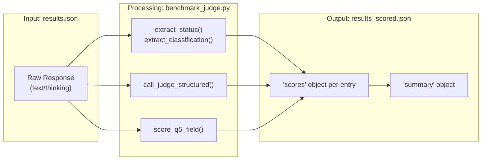
Sources: [benchmark_judge.py:465-515](), [benchmark_judge.py:518-548]()

### Output File Structure
The resulting file (typically `*_scored.json`) includes:
*   `metadata`: Configuration used for the run [benchmark_judge.py:543-543]().
*   `results`: Original data augmented with a `scores` dictionary containing individual question scores [benchmark_judge.py:514-515]().
*   `summary`: Final metrics including `overall_score` and per-question-type means [benchmark_judge.py:544-544]().

Sources: [benchmark_judge.py:518-548]()

---

# Page: Programmatic Scoring Methods

# Programmatic Scoring Methods

<details>
<summary>Relevant source files</summary>

The following files were used as context for generating this wiki page:

- [benchmark_judge.py](benchmark_judge.py)

</details>


The QCalEval benchmark utilizes a hybrid scoring architecture that combines Large Language Model (LLM) judging with deterministic programmatic functions. Programmatic scoring is used for objective fields such as numerical parameters, classification enums, and structured JSON outputs to ensure high precision and reproducibility in evaluation.

## Overview of Programmatic Scoring

Programmatic scoring functions are defined within `benchmark_judge.py` and are responsible for extracting model predictions from raw text and comparing them against ground truth (GT) values. These functions handle data normalization, regex-based extraction, and tolerance-based numerical comparisons.

### System Mapping: Natural Language to Code Entities

The following diagram maps the logical scoring requirements for different question types to the specific functions implemented in the codebase.

**Scoring Entity Mapping**
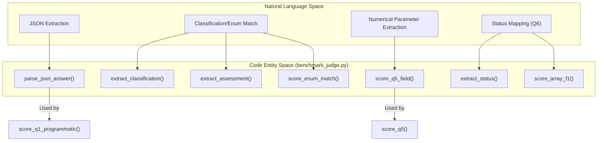
Sources: [benchmark_judge.py:70-220](), [benchmark_judge.py:410-460]()

## Core Extraction Functions

Before scoring, the judge must extract structured data from the model's free-text response.

### JSON Parsing
The `parse_json_answer` function attempts to locate and parse JSON content within a string using a multi-step fallback strategy:
1. **Direct Parse**: Attempts `json.loads(text)` on the entire trimmed string [benchmark_judge.py:76-77]().
2. **Markdown Blocks**: Searches for content inside ` ```json ` or ` ``` ` blocks [benchmark_judge.py:81-86]().
3. **Regex Objects/Arrays**: Uses regex to find the first occurrence of `{...}` or `[...]` [benchmark_judge.py:88-100]().

### Classification and Assessment
For Q2 (Experimental Conclusion) and Q4 (Fit Reliability), the model is expected to provide a specific tag.
*   **`extract_classification(text)`**: Extracts the value following "Classification:" in Q2. It normalizes common values like "Expected behavior" or "Anomalous behavior" [benchmark_judge.py:104-116]().
*   **`extract_assessment(text)`**: Extracts the value following "Assessment:" in Q4, normalizing to "Unreliable", "No fit", or "Reliable" [benchmark_judge.py:119-130]().

### Status Extraction (Q6)
For Q6 (Calibration Diagnosis), the model must identify diagnostic status codes.
*   **`extract_status(text)`**: Searches for "Status:" or "Classification:" prefixes. If not found, it performs a fallback search against `KNOWN_STATUSES`, a set of 40+ quantum calibration states (e.g., `BEATING`, `SAMPLING_TOO_COARSE`, `TELEGRAPHIC`) [benchmark_judge.py:150-184]().

Sources: [benchmark_judge.py:70-184]()

## Scoring Logic by Question Type

### Q1: Technical Description (Programmatic Component)
Q1 scoring is a 50/50 split between an LLM judge and programmatic validation.
*   **Function**: `score_q1_programmatic(model_text, gt_json)` [benchmark_judge.py:207-220]()
*   **Logic**: It parses the model's JSON response and compares it against the ground truth dictionary. It returns 1.0 if the JSON is valid and matches the GT exactly, and 0.0 otherwise.

### Q5: Parameter Extraction
Q5 requires extracting specific numerical values (e.g., frequencies, amplitudes) and comparing them against GT with a defined tolerance.

**Numerical Scoring Flow**
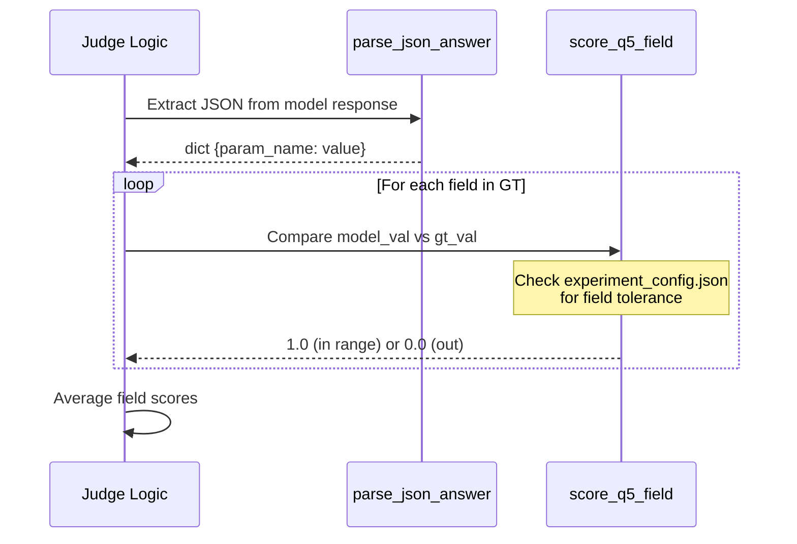

*   **`score_q5_field(val, gt_val, tolerance)`**: Handles both numeric and string comparisons. For numbers, it calculates the absolute difference and checks if it is $\le$ tolerance. If the GT is a string, it performs a case-insensitive match [benchmark_judge.py:231-252]().

### Q6: Calibration Diagnosis
Q6 evaluation uses an F1-score approach because multiple diagnostic statuses may apply to a single calibration trace.
*   **`score_array_f1(model_arr, gt_arr)`**: Calculates the F1 score between the set of statuses predicted by the model and the ground truth set [benchmark_judge.py:255-271]().
*   **Mapping**: The `q6_status_mapping` in `experiment_config.json` provides the ground truth status arrays for specific experimental outcomes [benchmark_judge.py:448-450]().

Sources: [benchmark_judge.py:207-271](), [benchmark_judge.py:440-460]()

## Configuration Schemas

The programmatic scoring behavior is governed by `experiment_config.json`, which defines tolerances and status mappings.

### Q5 Scoring Schema
The `q5_scoring` object defines the tolerance levels for different physical parameters:
| Field Name | Typical Tolerance | Description |
| :--- | :--- | :--- |
| `frequency` | 0.001 - 0.005 | Tolerance for resonance or qubit frequencies (GHz). |
| `amplitude` | 0.01 - 0.05 | Tolerance for pulse amplitudes (V or normalized). |
| `t1_time` | 5.0 | Tolerance for relaxation time (µs). |

### Q6 Status Mapping Schema
Maps specific experiment "labels" to arrays of `KNOWN_STATUSES`.
```json
"q6_status_mapping": {
    "case_a": ["SUCCESS", "STABLE"],
    "case_b": ["NO_SIGNAL", "FIT_FAILED"]
}
```

Sources: [benchmark_judge.py:150-160](), [benchmark_judge.py:448-455]()

---

# Page: LLM Judge Integration

# LLM Judge Integration

<details>
<summary>Relevant source files</summary>

The following files were used as context for generating this wiki page:

- [benchmark_judge.py](benchmark_judge.py)

</details>


The LLM Judge is a critical component of the `QCalEval` scoring pipeline, providing qualitative assessment for complex open-ended responses that cannot be evaluated via simple string matching or numerical tolerance. It is primarily utilized for **Q1 (Technical Description)** and **Q3 (Experimental Significance)**.

The system uses a hybrid scoring model where programmatic checks (JSON parsing, regex) are combined with LLM-based rubric evaluation to produce a final accuracy score [benchmark_judge.py:18-22]().

## Judge Roles in Question Taxonomy

The LLM judge is integrated into the `score_question` logic to handle specific subsets of the evaluation [benchmark_judge.py:383-455]().

| Question Type | LLM Judge Role | Weighting |
| :--- | :--- | :--- |
| **Q1: Technical Description** | Evaluates the descriptive text against a ground-truth checklist. | 50% (The other 50% is programmatic JSON validation) [benchmark_judge.py:392-396]() |
| **Q3: Experimental Significance** | Evaluates the significance explanation against a key-points checklist. | 100% [benchmark_judge.py:414-416]() |

### Q1 Hybrid Scoring Logic
For Q1, the model is expected to provide both a structured JSON object and a natural language description. The `score_q1_programmatic` function handles the JSON fields, while `call_judge_structured` evaluates the text [benchmark_judge.py:390-396]().

## Implementation Architecture

The integration relies on an asynchronous, retry-resilient flow to communicate with OpenAI-compatible APIs.

### Data Flow Diagram: Judging Process
This diagram illustrates the transition from the `benchmark_judge.py` execution environment to the LLM API and back to the scoring state.

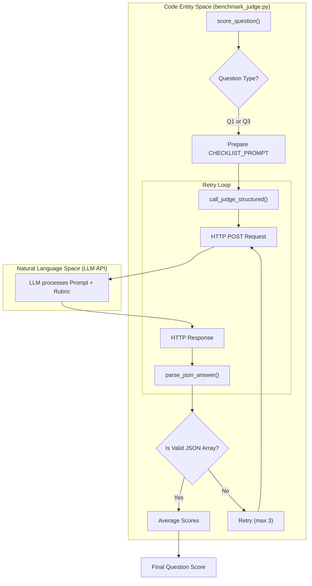
Sources: [benchmark_judge.py:57-64](), [benchmark_judge.py:328-378](), [benchmark_judge.py:383-455]()

### The Checklist Rubric
The judge is guided by the `CHECKLIST_PROMPT`. This template forces the judge to decompose the model's answer into discrete points and assign partial credit [benchmark_judge.py:57-64]().

*   **1.0**: Correctly addressed.
*   **0.5**: Partially addressed.
*   **0.0**: Missing or wrong.

The prompt explicitly instructs the judge to respond with **ONLY** a JSON array of scores (e.g., `[1, 0.5, 1]`) to facilitate programmatic parsing [benchmark_judge.py:63-64]().

## Key Functions and Concurrency

### `call_judge_structured`
This is the core interface for the LLM judge. It manages the communication lifecycle [benchmark_judge.py:328-378]().

*   **Payload Construction**: Builds a standard OpenAI Chat Completion payload using the `judge_model_id` [benchmark_judge.py:344-353]().
*   **Retry Logic**: Implements a 3-attempt retry loop for network errors (`urllib.error.URLError`) or JSON parsing failures [benchmark_judge.py:341-375]().
*   **JSON Extraction**: Uses `parse_json_answer` to find the score array even if the LLM includes conversational filler or markdown blocks [benchmark_judge.py:70-101](), [benchmark_judge.py:364-366]().

### Concurrency Control
To prevent overwhelming the API endpoint and hitting rate limits, the judge uses an `asyncio.Semaphore` [benchmark_judge.py:465]().

*   The semaphore limit is controlled by the `--concurrency` flag (defaulting to 10) [benchmark_judge.py:516]().
*   The `main` loop wraps the judging of each sample in an `asyncio.gather` call, ensuring that no more than the specified number of judge requests are active simultaneously [benchmark_judge.py:465-470]().

## Judge Model Selection

The judge is invoked via the CLI, allowing users to point to any OpenAI-compatible server (e.g., vLLM, NIM, or OpenAI).

```bash
python benchmark_judge.py results.json \
  --judge-api-base https://api.openai.com/v1/chat/completions \
  --judge-model-id gpt-4o \
  --judge-api-key $OPENAI_API_KEY
```
Sources: [benchmark_judge.py:25-27](), [benchmark_judge.py:511-525]()

### Requirements for Judge Models
1.  **Instruction Following**: Must strictly follow the "JSON array only" constraint in `CHECKLIST_PROMPT` [benchmark_judge.py:63-64]().
2.  **Reasoning Capability**: Must be able to map domain-specific quantum calibration concepts (e.g., "Rabi oscillations," "DRAG pulses") to the provided ground-truth key points.
3.  **Context Window**: Needs to accommodate the prompt, the model's response, and the ground-truth checklist.

## Logic Flow for Score Aggregation

The judge's output (an array of scores) is averaged to produce a value between 0.0 and 1.0.

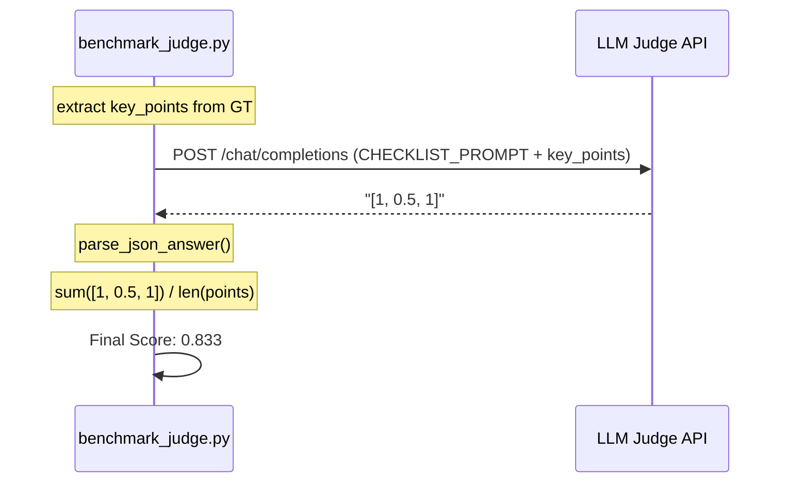
Sources: [benchmark_judge.py:364-370](), [benchmark_judge.py:414-416]()

If the judge fails to provide a valid JSON array after all retries, the system defaults to a score of `0.0` for that component to ensure the scoring script completes [benchmark_judge.py:377]().

Sources:
- `benchmark_judge.py` lines 18-22 (Purpose)
- `benchmark_judge.py` lines 57-64 (Prompt template)
- `benchmark_judge.py` lines 70-101 (JSON parsing)
- `benchmark_judge.py` lines 328-378 (Judge call logic)
- `benchmark_judge.py` lines 383-455 (Integration in scoring)
- `benchmark_judge.py` lines 465-470 (Concurrency)
- `benchmark_judge.py` lines 511-525 (CLI arguments)

---

# Page: Project Governance and Legal

# Project Governance and Legal

<details>
<summary>Relevant source files</summary>

The following files were used as context for generating this wiki page:

- [ATTRIBUTIONS](ATTRIBUTIONS)
- [CONTRIBUTING.md](CONTRIBUTING.md)
- [LICENSE](LICENSE)
- [SECURITY.md](SECURITY.md)

</details>


This page provides a high-level overview of the legal framework, licensing, and contribution guidelines for the QCalEval project. It outlines how the software and datasets are licensed, the requirements for third-party attributions, and the formal processes for contributing code or reporting security vulnerabilities.

### Governance and Legal Framework

The QCalEval project operates under a standardized open-source model managed by NVIDIA. The governance structure ensures that all contributions are legally cleared through a sign-off process and that security concerns are handled through dedicated professional channels rather than public issue trackers.

#### Legal Entity Relationships
The following diagram illustrates the relationship between the project's legal components and the entities involved in its governance.

**Legal and Contribution Workflow**
```mermaid
graph TD
    subgraph "Legal Framework"
        ["LICENSE (Apache 2.0)"]
        ["ATTRIBUTIONS (Third-Party)"]
    end

    subgraph "Contribution Process"
        ["CONTRIBUTING.md"] -- "Requires" --> ["DCO Sign-off"]
        ["DCO Sign-off"] -- "via" --> ["git commit -s"]
    end

    subgraph "Security Oversight"
        ["SECURITY.md"] -- "Redirects to" --> ["NVIDIA PSIRT"]
    end

    ["Contributor"] -- "Fork & Pull Request" --> ["CONTRIBUTING.md"]
    ["NVIDIA Corporation"] -- "Licensor" --> ["LICENSE (Apache 2.0)"]
```
Sources: [LICENSE:1-12](), [CONTRIBUTING.md:5-13](), [SECURITY.md:20-25]()

---

### License and Attribution
The QCalEval codebase is primarily licensed under the **Apache License 2.0**, which governs the evaluation scripts and associated software tools [LICENSE:1-3](). This license allows for broad use, modification, and distribution while providing a grant of patent rights from contributors [LICENSE:66-88]().

In addition to the primary license, the project maintains an `ATTRIBUTIONS` file to acknowledge and comply with the licenses of third-party Python dependencies used in the evaluation pipeline, such as `datasets`, `httpx`, `Pillow`, and `huggingface-hub` [ATTRIBUTIONS:11-100]().

For details on specific license terms and the CC BY 4.0 license covering the benchmark dataset, see **[License and Attribution (#3.1)]**.

**Sources:** [LICENSE:1-201](), [ATTRIBUTIONS:1-119]()

---

### Contributing and Security
We welcome community contributions to improve the evaluation pipeline. To maintain legal integrity, all contributors must adhere to the **Developer Certificate of Origin (DCO)** by signing off on every commit [CONTRIBUTING.md:5-13](). This is typically handled using the `git commit -s` command [CONTRIBUTING.md:53-54]().

Security is a top priority for NVIDIA. We request that potential vulnerabilities **not** be reported via public GitHub issues. Instead, they should be directed to the **NVIDIA Product Security Incident Response Team (PSIRT)** through their secure submission form or encrypted email [SECURITY.md:5-12]().

For a step-by-step guide on the fork-and-pull model and detailed security reporting instructions, see **[Contributing and Security (#3.2)]**.

#### Code-to-Governance Mapping
The following diagram maps specific files in the repository to their respective governance roles.

**Governance Documentation Mapping**
```mermaid
graph LR
    ["Repository Root"] --> ["LICENSE"]
    ["Repository Root"] --> ["CONTRIBUTING.md"]
    ["Repository Root"] --> ["SECURITY.md"]
    ["Repository Root"] --> ["ATTRIBUTIONS"]

    ["LICENSE"] --- ["Software Usage Terms"]
    ["CONTRIBUTING.md"] --- ["DCO & Pull Request Flow"]
    ["SECURITY.md"] --- ["Vulnerability Disclosure"]
    ["ATTRIBUTIONS"] --- ["Third-party Dependency Credits"]
```
Sources: [LICENSE:1-5](), [CONTRIBUTING.md:1-4](), [SECURITY.md:1-3](), [ATTRIBUTIONS:1-10]()

**Sources:** [CONTRIBUTING.md:5-62](), [SECURITY.md:1-25]()

---

# Page: License and Attribution

# License and Attribution

<details>
<summary>Relevant source files</summary>

The following files were used as context for generating this wiki page:

- [ATTRIBUTIONS](ATTRIBUTIONS)
- [LICENSE](LICENSE)

</details>


This page details the licensing structure and third-party attributions for the QCalEval project. The project employs a dual-licensing model to distinguish between the evaluation software and the benchmark dataset, while maintaining a comprehensive record of third-party dependencies.

## Licensing Overview

The QCalEval repository is governed by two primary licenses depending on the asset type.

| Asset Type | License | Description |
| :--- | :--- | :--- |
| **Evaluation Scripts** | Apache License 2.0 | Covers all `.py` files, including inference and scoring logic. |
| **Benchmark Dataset** | CC BY 4.0 | Covers the `nvidia/QCalEval` dataset hosted on Hugging Face. |
| **Third-Party Code** | Various | Detailed in the `ATTRIBUTIONS` file. |

### Apache License 2.0 (Software)
The evaluation scripts (e.g., `benchmark_zeroshot.py`, `benchmark_icl.py`, and `benchmark_judge.py`) are licensed under the Apache License, Version 2.0 [LICENSE:1-200](). This license allows for:
*   **Commercial Use**: You may use the software for commercial purposes.
*   **Modification**: You may modify the source code, provided that modified files carry prominent notices stating that you changed the files [LICENSE:97-98]().
*   **Distribution**: You may distribute the software in source or object form [LICENSE:89-91]().
*   **Patent Grant**: Contributors provide a perpetual, worldwide, non-exclusive patent license [LICENSE:73-77]().

### CC BY 4.0 (Dataset)
The `nvidia/QCalEval` dataset is released under the Creative Commons Attribution 4.0 International license. This requires that any redistribution or derivative work must provide appropriate credit to NVIDIA.

**Sources:**
* [LICENSE:1-200]()

---

## Third-Party Attributions

The QCalEval evaluation suite relies on several open-source Python libraries. These dependencies are critical for data handling, network communication, and image processing.

### Dependency Mapping

The following diagram illustrates how specific third-party libraries are integrated into the QCalEval "Code Entity Space".

**Dependency Integration Diagram**
```mermaid
graph TD
    subgraph "Third-Party Libraries"
        A["datasets (Apache 2.0)"]
        B["huggingface_hub (Apache 2.0)"]
        C["httpx (BSD 3-Clause)"]
        D["Pillow (HPND)"]
    end

    subgraph "QCalEval Implementation"
        E["benchmark_zeroshot.py"]
        F["benchmark_icl.py"]
        G["benchmark_judge.py"]
    end

    A -->|"load_dataset()"| E
    A -->|"load_dataset()"| F
    B -->|"HF Authentication"| E
    C -->|"Async HTTP Requests"| E
    C -->|"Async HTTP Requests"| F
    D -->|"Image Encoding/Resizing"| E
    D -->|"Image Encoding/Resizing"| F
```

### Detailed Attribution List

As specified in the `ATTRIBUTIONS` file, the following software is included or used by this product:

| Library | License | Usage in QCalEval |
| :--- | :--- | :--- |
| `datasets` | Apache 2.0 | Used to fetch and stream the QCalEval benchmark data from Hugging Face [ATTRIBUTIONS:16-17](). |
| `huggingface_hub` | Apache 2.0 | Manages authentication and repository interactions [ATTRIBUTIONS:35-36](). |
| `httpx` | BSD 3-Clause | Provides the asynchronous HTTP client for model inference requests [ATTRIBUTIONS:54-55](). |
| `Pillow` | HPND | Handles image processing, including base64 encoding for vision-language model inputs [ATTRIBUTIONS:86-87](). |

**Sources:**
* [ATTRIBUTIONS:1-118]()

---

## Data Flow and License Boundaries

The following diagram bridges the "Natural Language Space" (Legal/Licensing concepts) to the "Code Entity Space" (Files and Functions) to show where license boundaries apply during execution.

**License Boundary and Data Flow**
```mermaid
flowchart LR
    subgraph "CC BY 4.0 Boundary"
        Data["nvidia/QCalEval Dataset"]
    end

    subgraph "Apache 2.0 Boundary"
        Script["benchmark_zeroshot.py"]
        Judge["benchmark_judge.py"]
    end

    subgraph "Third-Party Boundary"
        PIL["Pillow Library"]
        HTTP["httpx Library"]
    end

    Data -- "Streamed via datasets" --> Script
    Script -- "Image Processing" --> PIL
    Script -- "Model Inference" --> HTTP
    Script -- "JSON Results" --> Judge
```

### Attribution Requirements for Redistribution
If you redistribute the QCalEval software or derivative works, you must:
1.  Include a copy of the Apache 2.0 License [LICENSE:94-95]().
2.  Retain all copyright, patent, trademark, and attribution notices [LICENSE:100-102]().
3.  Include a readable copy of the attribution notices contained within the `ATTRIBUTIONS` (or `NOTICE`) file [LICENSE:107-111]().

**Sources:**
* [LICENSE:94-111]()
* [ATTRIBUTIONS:1-10]()

---

# Page: Contributing and Security

# Contributing and Security

<details>
<summary>Relevant source files</summary>

The following files were used as context for generating this wiki page:

- [CONTRIBUTING.md](CONTRIBUTING.md)
- [SECURITY.md](SECURITY.md)

</details>


This page outlines the governance and security protocols for the QCalEval repository. To maintain the integrity of the benchmark and ensure legal compliance, all contributors must follow the Developer Certificate of Origin (DCO) sign-off workflow and adhere to NVIDIA's coordinated vulnerability disclosure policy.

## 1. Contribution Workflow

QCalEval follows a standard **fork-and-pull** model for contributions [CONTRIBUTING.md:55-61](). This process ensures that all changes are reviewed by maintainers before being merged into the main codebase.

### 1.1 Developer Certificate of Origin (DCO)

All contributions to this project must be accompanied by a "sign-off" to certify that the contributor has the legal right to submit the work under the project's license [CONTRIBUTING.md:7-43](). By adding a sign-off, you certify that:
*   The work was created by you, or based on work covered by an appropriate open-source license [CONTRIBUTING.md:20-32]().
*   You understand that the contribution and a record of the sign-off will be maintained indefinitely and redistributed publicly [CONTRIBUTING.md:38-42]().

### 1.2 Implementation: Signing Off Commits

To sign off a contribution, you must include a `Signed-off-by` line in every commit message [CONTRIBUTING.md:45-51]().

| Method | Command / Syntax |
| :--- | :--- |
| **Manual** | `Signed-off-by: Your Name <your.email@example.com>` |
| **Automatic** | `git commit -s` |

**Sources:**
* [CONTRIBUTING.md:7-43]() (DCO Version 1.1 text and certification requirements)
* [CONTRIBUTING.md:45-53]() (Sign-off instructions and git command)

### 1.3 The Pull Request Process

The following diagram illustrates the lifecycle of a contribution from a local environment to the upstream QCalEval repository.

**Contribution Data Flow: Fork-and-Pull Model**

```mermaid
graph TD
    subgraph "Contributor_Environment"
        A["Fork Repository"] --> B["Create Feature Branch"]
        B --> C["Local Development"]
        C --> D["git commit -s"]
        D -- "Includes DCO Sign-off" --> E["Push to Forked Remote"]
    end

    subgraph "NVIDIA_QCalEval_Upstream"
        F["Open Pull Request"]
        G{"Maintainer Review"}
        H["Merge to Main"]
    end

    E --> F
    F --> G
    G -- "Approved" --> H
    G -- "Changes Requested" --> C
```

**Sources:**
* [CONTRIBUTING.md:55-61]() (Submitting changes steps)
* [CONTRIBUTING.md:63-65]() (Licensing agreement for contributions)

---

## 2. Security Policy

NVIDIA is committed to the security of the QCalEval codebase. Security concerns are handled through private channels rather than public GitHub issues to prevent the premature disclosure of vulnerabilities [SECURITY.md:1-6]().

### 2.1 Reporting Vulnerabilities

If you discover a potential security issue (e.g., code execution, denial of service, or buffer overflow), do **not** report it via a public GitHub issue or PR [SECURITY.md:5-7](). Instead, use the following official NVIDIA Product Security Incident Response Team (PSIRT) channels:

| Channel | Contact Information |
| :--- | :--- |
| **Web Form** | [Security Vulnerability Submission Form](https://www.nvidia.com/object/submit-security-vulnerability.html) |
| **Email** | `psirt@nvidia.com` |
| **Encryption** | [NVIDIA Public PGP Key](https://www.nvidia.com/en-us/security/pgp-key) |

### 2.2 Submission Requirements

When reporting a vulnerability, include the following technical details to facilitate the investigation [SECURITY.md:13-18]():
1.  **Product Name:** QCalEval and the specific branch/version.
2.  **Vulnerability Type:** Categorization (e.g., arbitrary code execution).
3.  **Reproduction Steps:** Detailed instructions to trigger the issue.
4.  **Proof-of-Concept (PoC):** Exploit code or scripts demonstrating the flaw.
5.  **Impact Assessment:** How an attacker could exploit the vulnerability and the potential consequences.

### 2.3 Disclosure and Acknowledgement

NVIDIA operates under a coordinated vulnerability disclosure policy. While no formal bug bounty program exists for this repository, NVIDIA provides public acknowledgement once an externally reported security issue is addressed [SECURITY.md:20-22]().

**Security Communication Pipeline**

```mermaid
sequenceDiagram
    participant C as Contributor/Researcher
    participant P as NVIDIA PSIRT (psirt@nvidia.com)
    participant M as Repository Maintainers

    C->>P: Submit Report (Encrypted via PGP)
    Note over C,P: Includes PoC and Reproduction Steps
    P->>P: Validate Vulnerability
    P-->>M: Private Disclosure & Remediation Plan
    M->>M: Develop Security Patch
    M->>P: Verify Fix
    P->>C: Acknowledgement & Coordinated Disclosure
    M->>C: Public Update/Merge Fix
```

**Sources:**
* [SECURITY.md:1-6]() (Security dedication and private reporting policy)
* [SECURITY.md:7-19]() (Reporting channels and required information)
* [SECURITY.md:20-25]() (PSIRT policies and acknowledgement)

---

# Page: Glossary

# Glossary

<details>
<summary>Relevant source files</summary>

The following files were used as context for generating this wiki page:

- [ATTRIBUTIONS](ATTRIBUTIONS)
- [README.md](README.md)
- [benchmark_icl.py](benchmark_icl.py)
- [benchmark_judge.py](benchmark_judge.py)
- [benchmark_zeroshot.py](benchmark_zeroshot.py)
- [leaderboard_top5.svg](leaderboard_top5.svg)
- [requirements.txt](requirements.txt)

</details>


This page provides definitions for the domain-specific terminology, evaluation metrics, and technical concepts used in the QCalEval codebase. It serves as a reference for onboarding engineers to understand the mapping between quantum computing calibration concepts and the implementation details in the evaluation scripts.

## Core Concepts & Data Entities

### Experiment Family
A grouping of quantum calibration tasks that share similar physical goals, data structures, or visual patterns. The benchmark organizes data by these families to ensure consistent evaluation.
*   **Implementation**: Used in `benchmark_icl.py` to select relevant few-shot demonstrations [benchmark_icl.py:177-179]() and in `benchmark_judge.py` to apply family-specific scoring logic [benchmark_judge.py:161-184]().
*   **Source ID**: A unique identifier for each experiment entry, typically following the format `family_uuid` [benchmark_icl.py:147]().

### Question Taxonomy (Q1–Q6)
The benchmark evaluates models across six distinct functional tasks, referred to as `Q1` through `Q6` in the code and dataset.

| Code Key | Label | Description |
| :--- | :--- | :--- |
| `technical_description` | Q1 | Structured JSON description of plot type, axes, and visual features. |
| `experimental_conclusion` | Q2 | 4-way outcome classification (Expected, Suboptimal, Anomalous, Apparatus). |
| `experimental_significance` | Q3 | Scientific analysis and next-step reasoning. |
| `fit_reliability` | Q4 | Assessment of whether a mathematical fit is trustworthy. |
| `parameter_extraction` | Q5 | Extraction of physical constants (e.g., $T_1$, Rabi frequency) into JSON. |
| `calibration_diagnosis` | Q6 | Family-specific status code (e.g., `BEATING`, `NO_SIGNAL`) and action. |

**Sources**: [README.md:14-22](), [benchmark_zeroshot.py:42-49](), [benchmark_judge.py:46-53]()

---

## Technical Terms & Implementation Details

### In-Context Learning (ICL)
A prompting strategy where the model is provided with "demonstrations" (example image/answer pairs) before the target query.
*   **N-way Demonstrations**: Used for Q3 and Q6, providing multiple examples from the same experiment family [README.md:50-51]().
*   **1-shot Demonstration**: Used for Q5 to define the required JSON schema [README.md:50-51]().
*   **Implementation**: Managed in `benchmark_icl.py` via `build_multimodal_content` which interleaves `<image>` tags with text [benchmark_icl.py:79-91]().

### Image Indexing
The process of mapping abstract `image_ids` found in the ICL dataset to actual base64-encoded image data from the test split.
*   **Function**: `build_image_index` [benchmark_icl.py:57-68]().
*   **Data Flow**:
    1.  Load `nvidia/QCalEval` dataset.
    2.  Iterate through `test` split to cache PIL images as Base64.
    3.  Lookup images during ICL prompt construction using `resolve_image_blocks` [benchmark_icl.py:71-76]().

### Thinking Tokens / Reasoning Models
Refers to models (like Qwen3.5 or DeepSeek-R1) that generate an internal "chain of thought" before the final answer.
*   **`--no-think` flag**: A CLI argument that passes `enable_thinking: False` to the API to bypass reasoning generation [benchmark_zeroshot.py:101-102](), [benchmark_icl.py:114-115]().
*   **Extraction**: `extract_content` handles responses where the answer might be located in a `reasoning` field instead of `content` [benchmark_zeroshot.py:76-86]().

---

## Scoring & Judging Definitions

### Programmatic Scoring
Deterministic evaluation using regex or exact string matching for objective fields (Q2, Q4, Q6).
*   **Enum Match**: Used for Q2 and Q4 classification labels [benchmark_judge.py:200-204]().
*   **Status Extraction**: The `extract_status` function uses a set of `KNOWN_STATUSES` (e.g., `NO_SIGNAL`, `WINDOW_TOO_SHORT`) to normalize model output [benchmark_judge.py:150-184]().

### LLM-based Judging
The use of a high-capability model (e.g., GPT-5.4) to evaluate subjective or complex text.
*   **Checklist Prompt**: A rubric-based system where the judge assigns scores (0, 0.5, or 1) to specific "key points" provided in the ground truth [benchmark_judge.py:57-64]().
*   **Implementation**: Handled by `call_judge_structured`, which enforces JSON array output from the judge model [benchmark_judge.py:257-285]().

---

## System Architecture Diagrams

### Inference Data Flow
This diagram illustrates how the `benchmark_icl.py` script resolves data from the HuggingFace `datasets` library into a multimodal payload for an OpenAI-compatible endpoint.

**Title: Multimodal ICL Prompt Construction**
```mermaid
graph TD
    subgraph "Natural Language Space"
        UserPrompt["q3_prompt / q5_prompt / q6_prompt"]
        ImgTags["'Please analyze this <image>'"]
    end

    subgraph "Code Entity Space (benchmark_icl.py)"
        HF_DS["datasets.load_dataset('nvidia/QCalEval')"]
        ImgIndex["build_image_index()"]
        Resolver["resolve_image_blocks()"]
        Builder["build_multimodal_content()"]
        Client["httpx.AsyncClient.post()"]
    end

    HF_DS -->|"Iterates test split"| ImgIndex
    UserPrompt --> Builder
    ImgIndex -->|"Base64 PNGs"| Resolver
    Resolver --> Builder
    Builder -->|"Interleaved JSON Content"| Client
```
**Sources**: [benchmark_icl.py:57-91](), [benchmark_icl.py:116-130]()

### Judging Pipeline
This diagram shows the transition from raw model responses to final scores using the hybrid scoring logic in `benchmark_judge.py`.

**Title: Hybrid Scoring Logic**
```mermaid
graph LR
    subgraph "Input Space"
        Results["results.json"]
        GT["Ground Truth (HF Dataset)"]
    end

    subgraph "Logic Space (benchmark_judge.py)"
        Extractor["extract_status() / extract_classification()"]
        ProgScore["score_enum_match()"]
        JudgeCall["call_judge_structured()"]
        Checklist["CHECKLIST_PROMPT"]
    end

    subgraph "Output Space"
        FinalJSON["judged.json"]
    end

    Results --> Extractor
    Results --> JudgeCall
    GT --> ProgScore
    GT --> Checklist
    Checklist --> JudgeCall
    ProgScore --> FinalJSON
    JudgeCall --> FinalJSON
```
**Sources**: [benchmark_judge.py:57-64](), [benchmark_judge.py:163-184](), [benchmark_judge.py:200-204](), [benchmark_judge.py:257-285]()

---

## Abbreviations Reference

| Abbreviation | Full Term | Context |
| :--- | :--- | :--- |
| **VLM** | Vision-Language Model | The class of models being evaluated. |
| **ICL** | In-Context Learning | Prompting with examples. |
| **GT** | Ground Truth | The reference answers in the dataset. |
| **Q1-Q6** | Questions 1 through 6 | The six tasks in the taxonomy. |
| **API Base** | API Base URL | The endpoint for OpenAI-compatible requests (e.g., vLLM, NIM). |

**Sources**: [README.md:6-10](), [benchmark_zeroshot.py:18-27](), [benchmark_judge.py:18-22]()