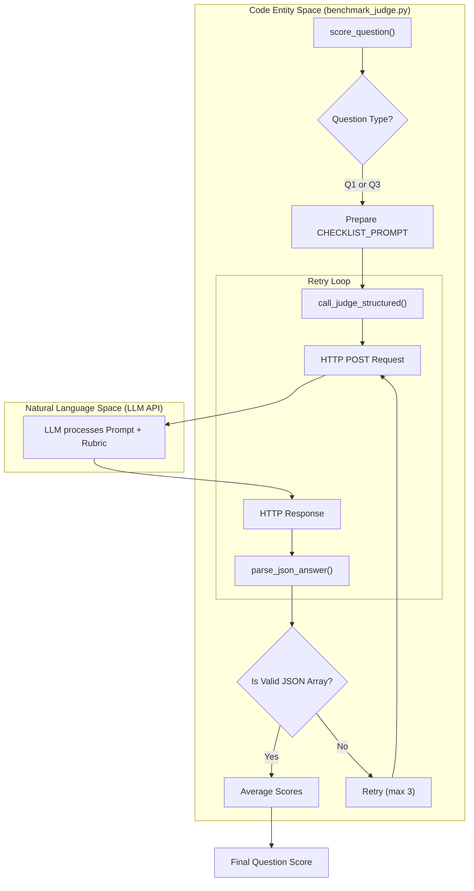
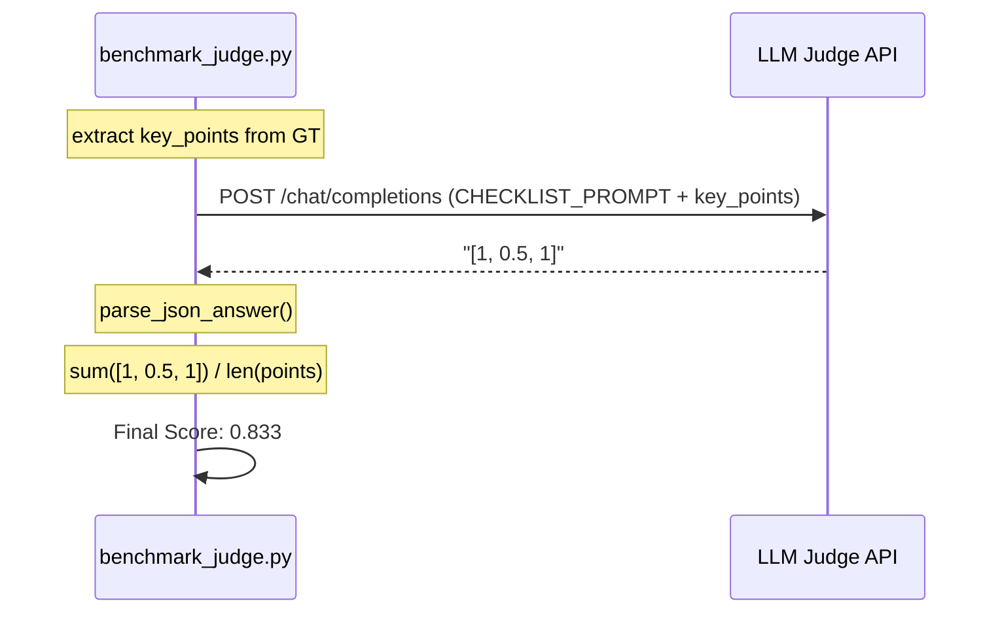

<!-- source: DeepWiki mcp.deepwiki.com · repo NVIDIA/QCalEval · extra page LLM Judge Integration · fetched 2026-10-26 -->

# LLM Judge Integration

<details>
<summary>Relevant source files</summary>

The following files were used as context for generating this wiki page:

- [benchmark_judge.py](benchmark_judge.py)

</details>


The LLM Judge is a critical component of the `QCalEval` scoring pipeline, providing qualitative assessment for complex open-ended responses that cannot be evaluated via simple string matching or numerical tolerance. It is primarily utilized for **Q1 (Technical Description)** and **Q3 (Experimental Significance)**.

The system uses a hybrid scoring model where programmatic checks (JSON parsing, regex) are combined with LLM-based rubric evaluation to produce a final accuracy score [benchmark_judge.py:18-22]().

## Judge Roles in Question Taxonomy

The LLM judge is integrated into the `score_question` logic to handle specific subsets of the evaluation [benchmark_judge.py:383-455]().

| Question Type | LLM Judge Role | Weighting |
| :--- | :--- | :--- |
| **Q1: Technical Description** | Evaluates the descriptive text against a ground-truth checklist. | 50% (The other 50% is programmatic JSON validation) [benchmark_judge.py:392-396]() |
| **Q3: Experimental Significance** | Evaluates the significance explanation against a key-points checklist. | 100% [benchmark_judge.py:414-416]() |

### Q1 Hybrid Scoring Logic
For Q1, the model is expected to provide both a structured JSON object and a natural language description. The `score_q1_programmatic` function handles the JSON fields, while `call_judge_structured` evaluates the text [benchmark_judge.py:390-396]().

## Implementation Architecture

The integration relies on an asynchronous, retry-resilient flow to communicate with OpenAI-compatible APIs.

### Data Flow Diagram: Judging Process
This diagram illustrates the transition from the `benchmark_judge.py` execution environment to the LLM API and back to the scoring state.


Sources: [benchmark_judge.py:57-64](), [benchmark_judge.py:328-378](), [benchmark_judge.py:383-455]()

### The Checklist Rubric
The judge is guided by the `CHECKLIST_PROMPT`. This template forces the judge to decompose the model's answer into discrete points and assign partial credit [benchmark_judge.py:57-64]().

*   **1.0**: Correctly addressed.
*   **0.5**: Partially addressed.
*   **0.0**: Missing or wrong.

The prompt explicitly instructs the judge to respond with **ONLY** a JSON array of scores (e.g., `[1, 0.5, 1]`) to facilitate programmatic parsing [benchmark_judge.py:63-64]().

## Key Functions and Concurrency

### `call_judge_structured`
This is the core interface for the LLM judge. It manages the communication lifecycle [benchmark_judge.py:328-378]().

*   **Payload Construction**: Builds a standard OpenAI Chat Completion payload using the `judge_model_id` [benchmark_judge.py:344-353]().
*   **Retry Logic**: Implements a 3-attempt retry loop for network errors (`urllib.error.URLError`) or JSON parsing failures [benchmark_judge.py:341-375]().
*   **JSON Extraction**: Uses `parse_json_answer` to find the score array even if the LLM includes conversational filler or markdown blocks [benchmark_judge.py:70-101](), [benchmark_judge.py:364-366]().

### Concurrency Control
To prevent overwhelming the API endpoint and hitting rate limits, the judge uses an `asyncio.Semaphore` [benchmark_judge.py:465]().

*   The semaphore limit is controlled by the `--concurrency` flag (defaulting to 10) [benchmark_judge.py:516]().
*   The `main` loop wraps the judging of each sample in an `asyncio.gather` call, ensuring that no more than the specified number of judge requests are active simultaneously [benchmark_judge.py:465-470]().

## Judge Model Selection

The judge is invoked via the CLI, allowing users to point to any OpenAI-compatible server (e.g., vLLM, NIM, or OpenAI).

```bash
python benchmark_judge.py results.json \
  --judge-api-base https://api.openai.com/v1/chat/completions \
  --judge-model-id gpt-4o \
  --judge-api-key $OPENAI_API_KEY
```
Sources: [benchmark_judge.py:25-27](), [benchmark_judge.py:511-525]()

### Requirements for Judge Models
1.  **Instruction Following**: Must strictly follow the "JSON array only" constraint in `CHECKLIST_PROMPT` [benchmark_judge.py:63-64]().
2.  **Reasoning Capability**: Must be able to map domain-specific quantum calibration concepts (e.g., "Rabi oscillations," "DRAG pulses") to the provided ground-truth key points.
3.  **Context Window**: Needs to accommodate the prompt, the model's response, and the ground-truth checklist.

## Logic Flow for Score Aggregation

The judge's output (an array of scores) is averaged to produce a value between 0.0 and 1.0.


Sources: [benchmark_judge.py:364-370](), [benchmark_judge.py:414-416]()

If the judge fails to provide a valid JSON array after all retries, the system defaults to a score of `0.0` for that component to ensure the scoring script completes [benchmark_judge.py:377]().

Sources:
- `benchmark_judge.py` lines 18-22 (Purpose)
- `benchmark_judge.py` lines 57-64 (Prompt template)
- `benchmark_judge.py` lines 70-101 (JSON parsing)
- `benchmark_judge.py` lines 328-378 (Judge call logic)
- `benchmark_judge.py` lines 383-455 (Integration in scoring)
- `benchmark_judge.py` lines 465-470 (Concurrency)
- `benchmark_judge.py` lines 511-525 (CLI arguments)

---

