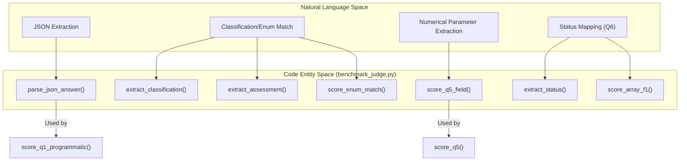
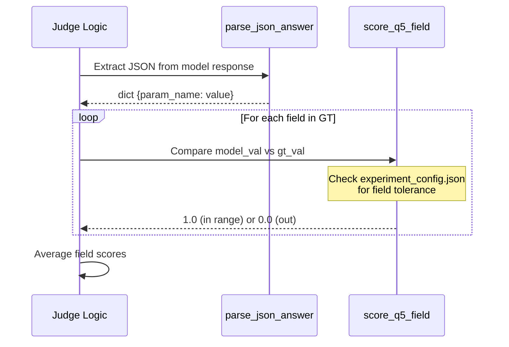

<!-- source: DeepWiki mcp.deepwiki.com · repo NVIDIA/QCalEval · extra page Programmatic Scoring Methods · fetched 2026-10-26 -->

# Programmatic Scoring Methods

<details>
<summary>Relevant source files</summary>

The following files were used as context for generating this wiki page:

- [benchmark_judge.py](benchmark_judge.py)

</details>


The QCalEval benchmark utilizes a hybrid scoring architecture that combines Large Language Model (LLM) judging with deterministic programmatic functions. Programmatic scoring is used for objective fields such as numerical parameters, classification enums, and structured JSON outputs to ensure high precision and reproducibility in evaluation.

## Overview of Programmatic Scoring

Programmatic scoring functions are defined within `benchmark_judge.py` and are responsible for extracting model predictions from raw text and comparing them against ground truth (GT) values. These functions handle data normalization, regex-based extraction, and tolerance-based numerical comparisons.

### System Mapping: Natural Language to Code Entities

The following diagram maps the logical scoring requirements for different question types to the specific functions implemented in the codebase.

**Scoring Entity Mapping**

Sources: [benchmark_judge.py:70-220](), [benchmark_judge.py:410-460]()

## Core Extraction Functions

Before scoring, the judge must extract structured data from the model's free-text response.

### JSON Parsing
The `parse_json_answer` function attempts to locate and parse JSON content within a string using a multi-step fallback strategy:
1. **Direct Parse**: Attempts `json.loads(text)` on the entire trimmed string [benchmark_judge.py:76-77]().
2. **Markdown Blocks**: Searches for content inside ` ```json ` or ` ``` ` blocks [benchmark_judge.py:81-86]().
3. **Regex Objects/Arrays**: Uses regex to find the first occurrence of `{...}` or `[...]` [benchmark_judge.py:88-100]().

### Classification and Assessment
For Q2 (Experimental Conclusion) and Q4 (Fit Reliability), the model is expected to provide a specific tag.
*   **`extract_classification(text)`**: Extracts the value following "Classification:" in Q2. It normalizes common values like "Expected behavior" or "Anomalous behavior" [benchmark_judge.py:104-116]().
*   **`extract_assessment(text)`**: Extracts the value following "Assessment:" in Q4, normalizing to "Unreliable", "No fit", or "Reliable" [benchmark_judge.py:119-130]().

### Status Extraction (Q6)
For Q6 (Calibration Diagnosis), the model must identify diagnostic status codes.
*   **`extract_status(text)`**: Searches for "Status:" or "Classification:" prefixes. If not found, it performs a fallback search against `KNOWN_STATUSES`, a set of 40+ quantum calibration states (e.g., `BEATING`, `SAMPLING_TOO_COARSE`, `TELEGRAPHIC`) [benchmark_judge.py:150-184]().

Sources: [benchmark_judge.py:70-184]()

## Scoring Logic by Question Type

### Q1: Technical Description (Programmatic Component)
Q1 scoring is a 50/50 split between an LLM judge and programmatic validation.
*   **Function**: `score_q1_programmatic(model_text, gt_json)` [benchmark_judge.py:207-220]()
*   **Logic**: It parses the model's JSON response and compares it against the ground truth dictionary. It returns 1.0 if the JSON is valid and matches the GT exactly, and 0.0 otherwise.

### Q5: Parameter Extraction
Q5 requires extracting specific numerical values (e.g., frequencies, amplitudes) and comparing them against GT with a defined tolerance.

**Numerical Scoring Flow**


*   **`score_q5_field(val, gt_val, tolerance)`**: Handles both numeric and string comparisons. For numbers, it calculates the absolute difference and checks if it is $\le$ tolerance. If the GT is a string, it performs a case-insensitive match [benchmark_judge.py:231-252]().

### Q6: Calibration Diagnosis
Q6 evaluation uses an F1-score approach because multiple diagnostic statuses may apply to a single calibration trace.
*   **`score_array_f1(model_arr, gt_arr)`**: Calculates the F1 score between the set of statuses predicted by the model and the ground truth set [benchmark_judge.py:255-271]().
*   **Mapping**: The `q6_status_mapping` in `experiment_config.json` provides the ground truth status arrays for specific experimental outcomes [benchmark_judge.py:448-450]().

Sources: [benchmark_judge.py:207-271](), [benchmark_judge.py:440-460]()

## Configuration Schemas

The programmatic scoring behavior is governed by `experiment_config.json`, which defines tolerances and status mappings.

### Q5 Scoring Schema
The `q5_scoring` object defines the tolerance levels for different physical parameters:
| Field Name | Typical Tolerance | Description |
| :--- | :--- | :--- |
| `frequency` | 0.001 - 0.005 | Tolerance for resonance or qubit frequencies (GHz). |
| `amplitude` | 0.01 - 0.05 | Tolerance for pulse amplitudes (V or normalized). |
| `t1_time` | 5.0 | Tolerance for relaxation time (µs). |

### Q6 Status Mapping Schema
Maps specific experiment "labels" to arrays of `KNOWN_STATUSES`.
```json
"q6_status_mapping": {
    "case_a": ["SUCCESS", "STABLE"],
    "case_b": ["NO_SIGNAL", "FIT_FAILED"]
}
```

Sources: [benchmark_judge.py:150-160](), [benchmark_judge.py:448-455]()

---

