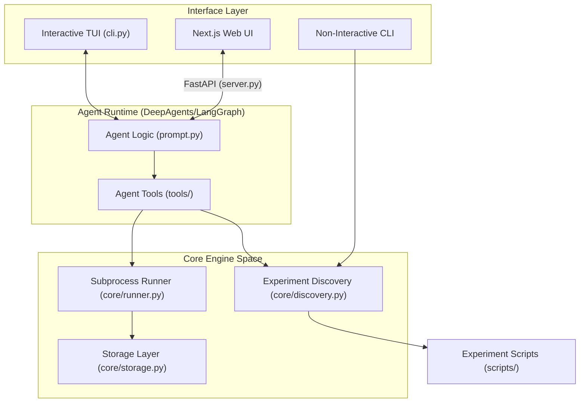
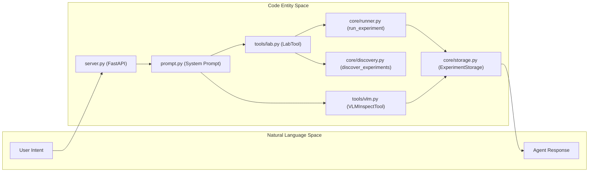

<!-- source: DeepWiki mcp.deepwiki.com · repo NVIDIA/Quantum-Calibration-Agent-Blueprint · page 1 Overview · fetched 2026-10-26 -->

# Overview

Relevant source files

The following files were used as context for generating this wiki page:

- [.env.example](.env.example)
- [README.md](README.md)
- [config.yaml](config.yaml)
- [fern/docs.yml](fern/docs.yml)
- [pyproject.toml](pyproject.toml)

The **Quantum Calibration Agent (QCA)** is a reference blueprint designed for AI-powered quantum device calibration. It leverages Large Language Models (LLMs) and Vision Language Models (VLMs) to automate the discovery, execution, and analysis of quantum experiments [README.md:1-7]().

By providing an intelligent agent layer over standard calibration scripts, QCA enables researchers to interact with quantum hardware using natural language, execute complex multi-step workflows, and perform visual data inspection through an integrated VLM pipeline [README.md:14-24]().

## Key Capabilities

*   **Intelligent Experiment Discovery**: Automatically scans and parses Python experiment scripts using AST to understand parameter requirements and constraints [README.md:18-18]().
*   **AI-Driven Execution**: Supports natural language commands to run experiments, with the agent handling parameter validation and subprocess management [README.md:19-19]().
*   **Visual Analysis**: Integrates VLMs to "see" and interpret Plotly-generated charts, enabling automated qualitative assessment of calibration results [README.md:20-20]().
*   **Workflow Automation**: Orchestrates Directed Acyclic Graphs (DAGs) of experiments with state tracking and human-in-the-loop (HITL) pause/resume capabilities [README.md:21-21]().
*   **Hybrid Storage**: Maintains a complete history of executions using SQLite for metadata indexing and HDF5 for high-performance numerical array storage [README.md:22-22]().

**Sources:** [README.md:14-24](), [pyproject.toml:7-22]()

## System Topology

The QCA system is composed of three primary layers: the **User Interface**, the **Agent Runtime**, and the **Core Engine**.

### High-Level System Relationship
The following diagram illustrates how natural language intent flows from the interfaces through the agent logic into the core execution modules.

**Sources:** [README.md:60-87](), [pyproject.toml:37-46](), [config.yaml:16-30]()

## Major Subsystems

### 1. Interaction Interfaces
Users can interact with QCA through three primary modes:
*   **Web UI**: A Next.js application providing a rich chat interface and experiment visualization [README.md:62-72]().
*   **Interactive TUI**: A terminal-based conversational interface powered by `deepagents-cli` [README.md:90-90](), [pyproject.toml:9-9]().
*   **Command Line**: Direct subcommands for listing experiments, running scripts, and managing history [README.md:98-132]().

For details, see [Getting Started](#1.1).

### 2. The Agent Layer
The brain of the system is a LangGraph-based agent that uses a specialized system prompt to understand quantum calibration domains [prompt.py:1-50](). It utilizes a suite of tools to interact with the rest of the system, including `run_experiment`, `vlm_inspect`, and `workflow` tools.

For details, see [Architecture Overview](#1.2).

### 3. Core Execution and Storage
The backend logic is decoupled from the agent. The **Discovery** module uses static analysis to find experiments in the `scripts/` directory [pyproject.toml:46-46](). The **Runner** executes these as isolated subprocesses to ensure environment stability. All results are persisted in a structured hierarchy of SQLite and HDF5 files.

### Code Entity Mapping
This diagram bridges the conceptual subsystems to the specific code entities that implement them.

**Sources:** [pyproject.toml:37-46](), [config.yaml:32-39](), [README.md:100-132]()

## Project Structure

| Directory/File | Description |
| :--- | :--- |
| `core/` | Logic for experiment discovery, execution, and data storage. |
| `tools/` | LangChain-compatible tools that the agent uses to perform actions. |
| `vlm/` | Vision Language Model provider abstractions and plot rendering. |
| `scripts/` | The library of Python quantum calibration experiments. |
| `ui/` | Next.js frontend and the development proxy gateway. |
| `data/knowledge/` | Markdown files providing domain expertise to the agent. |
| `server.py` | FastAPI entry point for the Web UI. |
| `cli.py` | Typer-based entry point for the TUI and CLI. |

**Sources:** [pyproject.toml:37-46](), [README.md:135-141]()

---

### Next Steps
*   To set up the environment and run your first experiment, see **[Getting Started](#1.1)**.
*   To understand the technical design and data flow, see **[Architecture Overview](#1.2)**.

---

