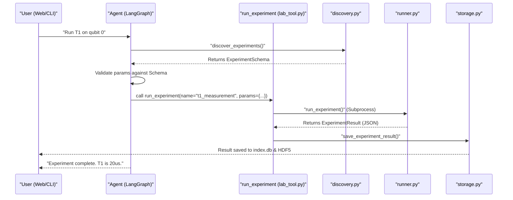

<!-- source: DeepWiki mcp.deepwiki.com · repo NVIDIA/Quantum-Calibration-Agent-Blueprint · page 1.2 Architecture Overview · fetched 2026-10-26 -->

# Architecture Overview

<details>
<summary>Relevant source files</summary>

The following files were used as context for generating this wiki page:

- [.env.example](.env.example)
- [README.md](README.md)
- [docs/latest/developer-guide/architecture.mdx](docs/latest/developer-guide/architecture.mdx)
- [fern/docs.yml](fern/docs.yml)
- [pyproject.toml](pyproject.toml)
- [server.py](server.py)

</details>


The Quantum Calibration Agent (QCA) is a multi-layered system designed to bridge high-level natural language intent with low-level quantum experiment execution. It leverages the `DeepAgents` framework to provide an autonomous agent capable of discovering experiments, managing complex workflows, and performing visual analysis of calibration data.

## System Topology

The QCA architecture consists of three primary interaction layers: the **Web UI**, the **CLI/TUI**, and the **FastAPI Backend**. These layers communicate with a central **Agent Layer** built on `LangGraph`, which orchestrates tools to interact with the **Core Engine** (Discovery, Execution, and Storage).

### High-Level Component Diagram

This diagram illustrates the relationship between the user interfaces, the agentic reasoning core, and the underlying experiment infrastructure.

```mermaid
graph TB
    subgraph "Interface Layer"
        [Web_UI] -- "HTTP/SSE" --> [FastAPI_Server]
        [CLI_TUI] -- "Direct Call" --> [Agent_Runtime]
    end

    subgraph "Agent Layer (LangGraph)"
        [FastAPI_Server] -- "Invoke" --> [Agent_Runtime]
        [Agent_Runtime] --> [System_Prompt]
        [Agent_Runtime] <--> [Tools_Registry]
    end

    subgraph "Core Engine"
        [Tools_Registry] --> [Experiment_Discovery]
        [Tools_Registry] --> [Experiment_Runner]
        [Tools_Registry] --> [Workflow_Manager]
        [Tools_Registry] --> [Storage_Layer]
    end

    subgraph "Data & Scripts"
        [Experiment_Discovery] --> [Python_Scripts]
        [Experiment_Runner] --> [Subprocess_Execution]
        [Storage_Layer] --> [SQLite_HDF5]
    end

    [Web_UI]:::interface
    [FastAPI_Server]:::interface
    [CLI_TUI]:::interface
```
**Sources:** [README.md:14-24](), [docs/latest/developer-guide/architecture.mdx:19-70](), [server.py:16-23]()

---

## Major Subsystems

### 1. Python Backend (FastAPI & CLI)
The backend serves as the orchestration hub. It is responsible for:
*   **Agent Initialization**: Loading the `ChatNVIDIA` or other LLM providers and binding them to the `LocalShellBackend` [server.py:73-91](), [server.py:126-159]().
*   **API Endpoints**: Providing REST and Streaming (SSE) endpoints for the Web UI to interact with the agent [server.py:185-194]().
*   **CLI Entrypoint**: The `qca` command (defined in `cli.py`) allows for both interactive TUI sessions and non-interactive command execution [pyproject.toml:37-38](), [README.md:98-107]().

### 2. Agent Layer (DeepAgents / LangGraph)
The agent is constructed using `create_deep_agent` from the `DeepAgents` library [server.py:149-156](). It uses a `MemorySaver` checkpointer to maintain conversation state across turns [server.py:136]().
*   **Tools**: The agent is equipped with specialized tools: `lab` (querying), `run_experiment` (execution), `workflow` (multi-step logic), and `vlm_inspect` (visual analysis) [server.py:94-123]().
*   **System Prompt**: A dynamic prompt is loaded from `data/knowledge/system-prompt.md` and templated with runtime context [server.py:134](), [server.py:47]().

### 3. Core Engine
The Core Engine is the "Code Entity Space" where the actual work happens:
*   **Discovery**: Uses AST parsing in `core/discovery.py` to scan the `scripts/` directory and extract `ExperimentSchema` from Python type hints [server.py:46]().
*   **Runner**: Manages the execution of experiment scripts as isolated subprocesses, capturing logs and JSON results [README.md:93-94]().
*   **Storage**: A dual-tier system using **SQLite** for metadata indexing and **HDF5** for high-performance numerical array storage [README.md:22](), [server.py:46]().

### 4. Next.js Web UI
A modern frontend located in the `ui/` directory. It communicates with the FastAPI server through a proxy gateway that handles Server-Sent Events (SSE) for real-time agent responses [README.md:68-72]().

---

## Data Flow: Natural Language to Code Execution

The following diagram traces a user request (e.g., "Run a T1 measurement on qubit 0") from the Natural Language Space into the specific code entities that handle the request.


**Sources:** [server.py:94-123](), [server.py:218-230](), [README.md:18-22](), [docs/latest/developer-guide/architecture.mdx:19-70]()

---

## Implementation Details

### Component Mapping

| Subsystem | Primary Code Entities | Responsibility |
| :--- | :--- | :--- |
| **Server** | `server.py`, `app = FastAPI()` | Hosting API, SSE streaming, and agent lifecycle. |
| **Agent** | `create_deep_agent`, `LocalShellBackend` | Reasoning, tool selection, and state management. |
| **Tools** | `lab_tool.py`, `workflow_tool.py`, `vlm_tool.py` | Bridging LLM actions to Python functions. |
| **Discovery** | `core/discovery.py`, `discover_experiments` | Extracting schemas from `scripts/*.py` via AST. |
| **Execution** | `core/runner.py`, `run_experiment` | Subprocess management and parameter validation. |
| **Storage** | `core/storage.py`, `SQLite`, `HDF5` | Persistent storage of metadata and large arrays. |
| **Vision** | `vlm/renderer.py`, `vlm/providers.py` | Converting Plotly JSON to PNG for VLM analysis. |

### Directory Structure
The codebase is organized to separate the agent logic from the experiment logic:
*   `core/`: Internal logic for data, discovery, and execution.
*   `tools/`: LangChain-compatible tool definitions.
*   `scripts/`: User-provided Python experiment scripts (the "Apparatus").
*   `vlm/`: Vision Language Model provider abstractions.
*   `ui/`: Next.js frontend source code.
*   `data/`: Persistent storage (SQLite DB, HDF5 files, and Knowledge Base).

**Sources:** [pyproject.toml:44-46](), [server.py:56-64](), [README.md:133-142]()

---

