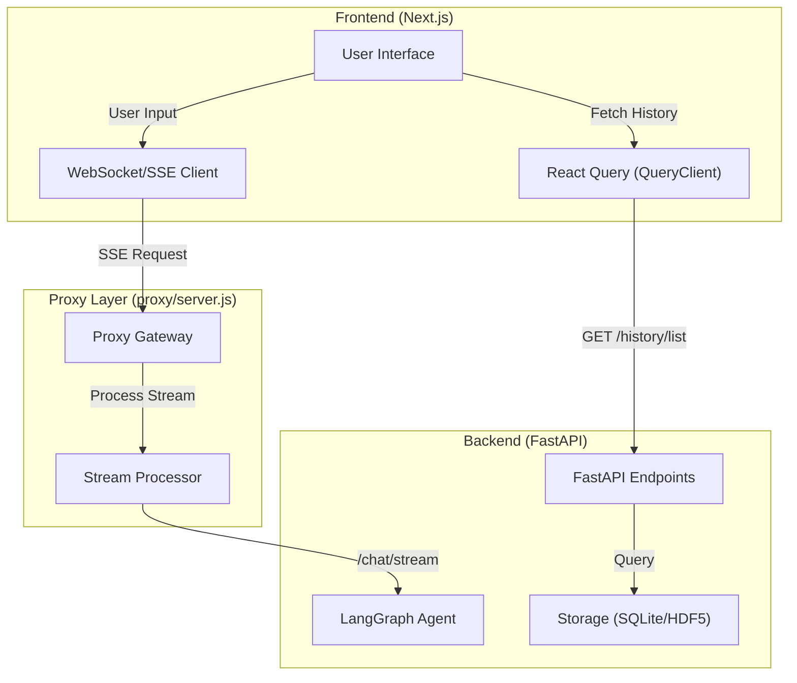
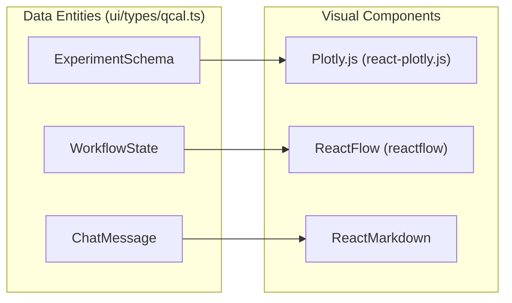

<!-- source: DeepWiki mcp.deepwiki.com · repo NVIDIA/Quantum-Calibration-Agent-Blueprint · page 10.1 Frontend Architecture · fetched 2026-10-26 -->

# Frontend Architecture

Relevant source files

The following files were used as context for generating this wiki page:

- [docs/latest/_static/images/usage/apparatus-panel.png](docs/latest/_static/images/usage/apparatus-panel.png)
- [docs/latest/_static/images/usage/chat-interface.png](docs/latest/_static/images/usage/chat-interface.png)
- [docs/latest/_static/images/usage/experiment-details.png](docs/latest/_static/images/usage/experiment-details.png)
- [docs/latest/_static/images/usage/workflow-dag.png](docs/latest/_static/images/usage/workflow-dag.png)
- [ui/package-lock.json](ui/package-lock.json)
- [ui/package.json](ui/package.json)
- [ui/pages/_app.tsx](ui/pages/_app.tsx)

The Frontend of the Quantum Calibration Agent (QCA) is a modern **Next.js** application that serves as the primary browser-based interface for managing quantum experiments, monitoring workflows, and interacting with the AI agent. It bridges the gap between the user's natural language intent and the underlying Python-based calibration engine.

## Next.js App Structure

The frontend is organized following standard Next.js conventions, utilizing a page-based routing system and a component-driven UI architecture.

### Routing and Pages
The application defines several key views:
*   **Index (`/`)**: The main dashboard featuring the Chat interface for agent interaction and real-time experiment monitoring.
*   **Workflows (`/workflows`)**: A dedicated interface for visualizing Directed Acyclic Graph (DAG) progress, tracking node statuses, and managing multi-step calibration routines.
*   **Database Updates**: Interfaces for viewing historical data and storage metrics.

Sources: [ui/package.json:44-46](), [ui/package.json:4-10]()

### Global Providers (`_app.tsx`)
The application root is wrapped in several providers to manage global state, styling, and data fetching:
*   **QueryClientProvider**: Uses `@tanstack/react-query` to manage server-state, caching, and synchronization with the FastAPI backend.
*   **ThemeProvider**: Handles application-wide styling and theming context.
*   **i18n (appWithTranslation)**: Implements internationalization using `next-i18next`.
*   **Toaster**: Provides global toast notifications via `react-hot-toast`.

Sources: [ui/pages/_app.tsx:18-53]()

## Key Component Groups

The UI is divided into functional modules that correspond to the agent's primary capabilities.

| Component Group | Responsibility |
| :--- | :--- |
| **Chat** | Handles the streaming SSE (Server-Sent Events) connection with the agent, rendering markdown, and tool execution status. |
| **Apparatus** | Displays the current state of the quantum hardware and system configuration. |
| **Experiments** | Provides interfaces for experiment discovery, parameter validation, and result visualization. |
| **Workflows** | Uses `reactflow` to render the DAG of calibration steps and `dagre` for layouting. |
| **Knowledge** | Allows browsing the agent's knowledge base, including skills and memory files. |
| **Sidebar** | Provides navigation and quick access to system-wide settings. |

Sources: [ui/package.json:26-66](), [ui/pages/_app.tsx:31-50]()

## Implementation and Data Flow

The frontend interacts with the backend through a specialized proxy layer that handles the complexity of agent streaming and long-running experiment processes.

### Data Flow Diagram
The following diagram illustrates how user interactions in the UI translate to code entities in the backend.

**User Interaction to Backend Entity Mapping**

Sources: [ui/package.json:6-8](), [ui/pages/_app.tsx:19-44]()

### Component Architecture
The UI leverages specialized libraries for visualization, particularly for quantum data and workflow graphs.

**Component Entity Space**

Sources: [ui/package.json:47-64](), [ui/pages/_app.tsx:25-27]()

## TypeScript Type System

The frontend maintains a strict type system to ensure consistency with the Python backend's Pydantic models. This is primarily defined in `ui/types/qcal.ts`.

Key interfaces include:
*   **`ExperimentSchema`**: Matches the backend's `ExperimentSchema` class, defining parameters, ranges, and metadata for discovery.
*   **`Workflow`**: Represents the state of a multi-node calibration DAG, including node statuses (`pending`, `running`, `success`, `failed`).
*   **`ChatStreamEvent`**: Defines the structure of messages received over the SSE connection, including `thought`, `tool_call`, and `result` blocks.

Sources: [ui/package.json:13-13](), [ui/package.json:99-99]()

## Visual Reference

The following components represent the primary functional areas of the interface:

*   **Chat Interface**: The primary entry point for natural language commands.
*   **Experiment Details**: Visualization of experiment parameters and real-time results.
*   **Workflow DAG**: Graphical representation of the calibration sequence.
*   **Apparatus Panel**: System status and hardware configuration.

Sources: [docs/latest/_static/images/usage/chat-interface.png:1-3](), [docs/latest/_static/images/usage/experiment-details.png:1-3](), [docs/latest/_static/images/usage/workflow-dag.png:1-3](), [docs/latest/_static/images/usage/apparatus-panel.png:1-3]()

---

