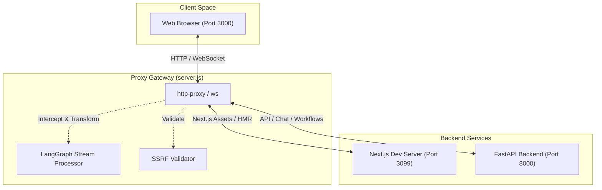
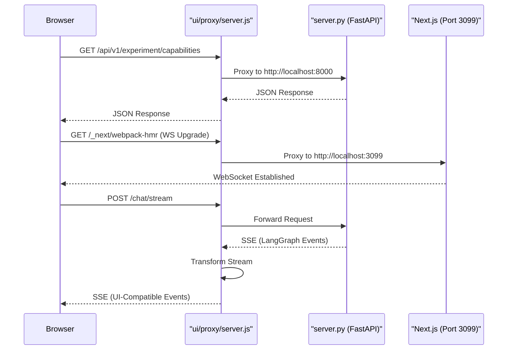

<!-- source: DeepWiki mcp.deepwiki.com · repo NVIDIA/Quantum-Calibration-Agent-Blueprint · page 10.2 Proxy Gateway · fetched 2026-10-26 -->

# Proxy Gateway

Relevant source files

The following files were used as context for generating this wiki page:

- [server.py](server.py)
- [ui/package-lock.json](ui/package-lock.json)
- [ui/package.json](ui/package.json)
- [ui/pages/_app.tsx](ui/pages/_app.tsx)

The Proxy Gateway is a development-time middleware component located in `ui/proxy/server.js`. It serves as a centralized routing and transformation layer that bridges the Next.js frontend with the Python FastAPI backend. It manages HTTP proxying, WebSocket upgrades for real-time communication, and specialized stream processing for LangGraph-based agentic interactions.

## Overview and Purpose

In the Quantum Calibration Agent (QCA) architecture, the frontend and backend operate on different ports during development. The Proxy Gateway provides a unified interface, ensuring that:
1.  **Next.js Traffic** is routed to the development server (port 3099) [ui/package.json:8]().
2.  **API Requests** are routed to the Python FastAPI server (port 8000) [server.py:185]().
3.  **Agent Streams** are intercepted and transformed from the backend's internal LangGraph format into a client-friendly EventStream.
4.  **Security** is maintained through SSRF (Server-Side Request Forgery) validation on outgoing requests.

### System Topology Diagram

This diagram illustrates how the `dev:gateway` script [ui/package.json:7]() positions the proxy as the entry point for all developer traffic.

Title: QCA Development Network Topology

**Sources:** [ui/package.json:6-8](), [server.py:185-193]()

---

## Request Routing and Proxying

The gateway uses `http-proxy` and `ws` to handle bidirectional traffic. It distinguishes between standard HTTP requests, Next.js Hot Module Replacement (HMR) WebSockets, and the agent's streaming chat protocol.

### HTTP Routing Logic
The proxy identifies the destination based on the URL path:
*   **API Routes:** Paths starting with `/api/v1/` or `/chat/` are directed to the FastAPI backend.
*   **Static/Next.js Routes:** All other paths are directed to the Next.js development server.

### WebSocket Handling
The proxy must support WebSocket upgrades to enable:
1.  **Next.js HMR:** Allowing the frontend to refresh automatically during development.
2.  **Agent Streaming:** Real-time updates from the `create_deep_agent` runtime [server.py:149-156]().

Title: Proxy Request Flow (Code Entities)

**Sources:** [ui/package.json:28,38,101](), [server.py:18-23,34-36]()

---

## LangGraph Stream Processor

One of the primary technical roles of the Proxy Gateway is the transformation of the LangGraph event stream. The Python backend utilizes `create_deep_agent` from the `deepagents` package [server.py:43](), which emits granular internal state updates.

### Stream Transformation
The proxy intercepts the `StreamingResponse` from the `/chat/stream` endpoint [server.py:36,235](). It performs the following transformations:
1.  **Filtering:** Removes internal agent logs that are not relevant to the UI.
2.  **Formatting:** Normalizes `AIMessage`, `ToolMessage`, and `HumanMessage` objects [server.py:39]() into a consistent JSON format for the frontend.
3.  **HITL Injection:** If the agent reaches a breakpoint defined in `interrupt_on` [server.py:140-145](), the proxy ensures the `pending_interrupts` state [server.py:167]() is correctly signaled to the UI to trigger human-in-the-loop (HITL) modals.

### Data Flow for Chat Streaming
1.  Frontend sends `ChatRequest` [server.py:206-209]().
2.  Backend initiates `agent.astream` [server.py:235]().
3.  Proxy Gateway reads the stream chunks.
4.  Proxy identifies `metadata` and `values` from LangGraph.
5.  Proxy emits `data: ...` chunks to the browser.

**Sources:** [server.py:149-158,218-230,235-240]()

---

## Security and SSRF Validation

To prevent Server-Side Request Forgery (SSRF), the Proxy Gateway implements validation on the target URLs it communicates with. This is critical because the proxy has access to the internal network where the Python backend and experimental hardware controllers reside.

### Validation Rules
*   **Allowed Hosts:** The proxy is strictly configured to only route to `localhost` or specific IPs defined in the environment configuration for the backend.
*   **Header Sanitization:** Sensitive headers (like `NVIDIA_API_KEY` [server.py:83]()) are managed by the backend, but the proxy ensures that client-side headers do not override critical security context.
*   **Method Restriction:** The gateway enforces the same CORS policy as the FastAPI server, allowing only `GET`, `POST`, and `DELETE` [server.py:191]().

**Sources:** [server.py:187-193]()

---

## Development Workflow

The Proxy Gateway is managed via the `ui/package.json` scripts.

| Command | Action |
| :--- | :--- |
| `npm run dev` | Uses `concurrently` to launch both `dev:gateway` and `dev:next` [ui/package.json:6](). |
| `npm run dev:gateway` | Starts the `proxy/server.js` node process [ui/package.json:7](). |
| `npm run dev:next` | Starts the Next.js server on port 3099 [ui/package.json:8](). |
| `npm run test:proxy` | Executes Jest tests specifically for the proxy logic [ui/package.json:18](). |

**Sources:** [ui/package.json:5-18]()

---

