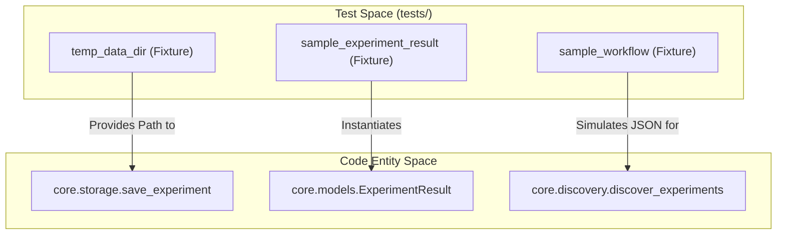
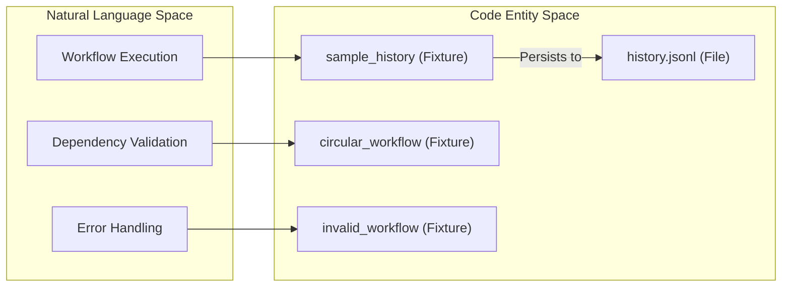

<!-- source: DeepWiki mcp.deepwiki.com · repo NVIDIA/Quantum-Calibration-Agent-Blueprint · page 11 Testing · fetched 2026-10-26 -->

# Testing

Relevant source files

The following files were used as context for generating this wiki page:

- [tests/__init__.py](tests/__init__.py)
- [tests/conftest.py](tests/conftest.py)

The Quantum Calibration Agent (QCA) blueprint includes a comprehensive test suite designed to ensure the reliability of experiment execution, agent tool interactions, and the workflow management system. The suite is built using `pytest` and is divided into unit tests for isolated component validation and integration tests for end-to-end system verification.

## Test Suite Structure

The testing infrastructure is organized into two primary directories within the `tests/` folder. The project root is automatically added to the Python path via `tests/conftest.py` to ensure imports work correctly across the suite [[tests/conftest.py:25-28]]().

| Category | Location | Focus |
| :--- | :--- | :--- |
| **Unit Tests** | `tests/unit/` | Isolated testing of core logic, data models, storage, and individual agent tools using mocks. |
| **Integration Tests** | `tests/integration/` | End-to-end testing of the CLI, experiment pipelines, and workflow lifecycle. |

### Shared Fixtures (`conftest.py`)

The `tests/conftest.py` file provides global fixtures that simulate the system's state without requiring a live environment. These fixtures include:

*   **`temp_data_dir`**: Creates a temporary directory structure for testing file-based operations [[tests/conftest.py:34-41]]().
*   **Workflow Fixtures**: Provides valid (`sample_workflow`), invalid (`invalid_workflow`), and circular (`circular_workflow`) DAG definitions to test the workflow engine's robustness [[tests/conftest.py:45-160]]().
*   **Experiment Fixtures**: Includes `sample_experiment_result` and `populated_storage` to test data retrieval and VLM rendering without running real quantum hardware scripts [[tests/conftest.py:214-230]]().

**Sources:**
- [[tests/conftest.py:25-230]]()
- [[tests/__init__.py:16-17]]()

## Unit Testing

Unit tests focus on the smallest testable parts of the application. They verify that core modules like the AST-based experiment discovery and the HDF5/SQLite storage layer behave as expected.

Key areas covered by unit tests include:
*   **Core Logic**: Validation of `ExperimentResult` models and the subprocess `Runner`.
*   **Agent Tools**: Mocking the LangChain environment to verify that tools like `vlm_inspect` and `workflow` process inputs and return formatted results correctly.
*   **VLM Pipeline**: Testing the `renderer.py` logic to ensure Plotly JSON is correctly converted to base64 images via Kaleido.

For detailed information on unit test modules and mocking strategies, see **[Unit Tests (#11.1)]**.

## Integration Testing

Integration tests verify that different subsystems work together correctly. These tests often invoke the `qca` CLI directly or simulate the full lifecycle of an experiment from discovery to storage.

Key scenarios covered include:
*   **CLI Invocation**: Using `pytest` to run `qca experiments run` and verifying the output and filesystem changes.
*   **Workflow Lifecycle**: Executing a multi-node workflow and ensuring that state transitions (e.g., `pending` -> `running` -> `success`) are recorded in the `history.jsonl` log [[tests/conftest.py:85-107]]().
*   **Data Pipeline**: Running a script and verifying that the resulting arrays are stored in HDF5 and metadata is searchable in SQLite.

For detailed information on end-to-end testing and CLI verification, see **[Integration Tests (#11.2)]**.

## Testing Architecture Mapping

The following diagrams illustrate how the test suite maps to the functional components of the QCA codebase.

### Test Environment to Code Mapping
This diagram shows how `pytest` fixtures in `conftest.py` simulate the data structures used by the core system.

**Sources:**
- [[tests/conftest.py:30-41]]()
- [[tests/conftest.py:214-220]]()

### Workflow State Testing
This diagram bridges the natural language "Workflow Lifecycle" to the specific code entities and fixtures used to test them.

**Sources:**
- [[tests/conftest.py:85-107]]()
- [[tests/conftest.py:130-160]]()
- [[tests/conftest.py:112-126]]()

---

