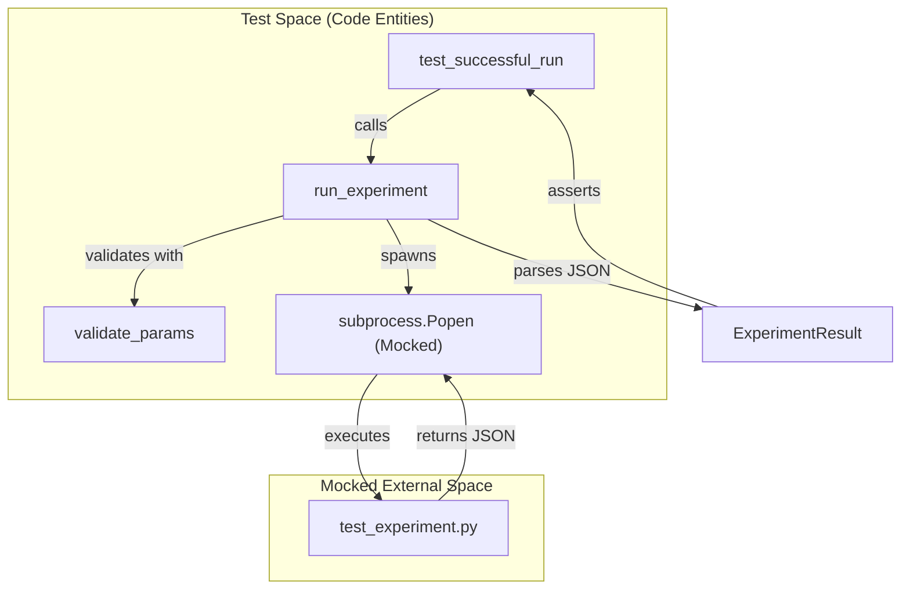
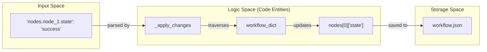

<!-- source: DeepWiki mcp.deepwiki.com · repo NVIDIA/Quantum-Calibration-Agent-Blueprint · page 11.1 Unit Tests · fetched 2026-10-26 -->

# Unit Tests

Relevant source files

The following files were used as context for generating this wiki page:

- [tests/unit/conftest.py](tests/unit/conftest.py)
- [tests/unit/test_discovery.py](tests/unit/test_discovery.py)
- [tests/unit/test_find_tool.py](tests/unit/test_find_tool.py)
- [tests/unit/test_lab_tool.py](tests/unit/test_lab_tool.py)
- [tests/unit/test_renderer.py](tests/unit/test_renderer.py)
- [tests/unit/test_runner.py](tests/unit/test_runner.py)
- [tests/unit/test_scripts.py](tests/unit/test_scripts.py)
- [tests/unit/test_storage.py](tests/unit/test_storage.py)
- [tests/unit/test_vlm_providers.py](tests/unit/test_vlm_providers.py)
- [tests/unit/test_vlm_tool.py](tests/unit/test_vlm_tool.py)
- [tests/unit/test_workflow_tool.py](tests/unit/test_workflow_tool.py)
- [tests/unit/test_workflow_tool_actions.py](tests/unit/test_workflow_tool_actions.py)

This page documents the unit test suite for the Quantum Calibration Agent (QCA). The unit tests are designed to verify the isolated functionality of core components, including experiment execution, discovery, storage, agent tools, and the VLM (Vision-Language Model) subsystem.

## Test Infrastructure and Strategy

The QCA unit test suite utilizes `pytest` as the primary test runner. The strategy relies heavily on mocking external dependencies—such as subprocesses, filesystem operations, and LLM API calls—to ensure tests are fast, deterministic, and do not require actual quantum hardware or cloud credits.

### Fixtures and Mocking
Global fixtures are defined in `tests/unit/conftest.py`. Common mocking patterns include:
*   **Filesystem**: Using `tmp_path` to create isolated environments for experiment scripts and data storage.
*   **Subprocesses**: Patching `subprocess.run` to simulate experiment execution and system commands.
*   **VLM Providers**: Mocking `AsyncMock` responses for VLM analysis to test the rendering and prompt logic without network calls.

**Sources**: [tests/unit/conftest.py:1-19](), [tests/unit/test_runner.py:20-23](), [tests/unit/test_vlm_tool.py:18-21]()

---

## Core Engine Tests

### Experiment Runner (`test_runner.py`)
Validates the logic for executing experiment scripts as subprocesses and enforcing type/range constraints on parameters.

*   **`TestValidateParams`**: Ensures `validate_params` correctly identifies missing required fields, unknown parameters, and out-of-range values based on `ExperimentSchema` [tests/unit/test_runner.py:25-100]().
*   **`TestCheckType`**: Verifies strict type checking for `int`, `float`, `str`, `bool`, and `list` [tests/unit/test_runner.py:101-139]().
*   **`TestRunExperiment`**: Tests the end-to-end execution flow, including successful runs, timeouts, and non-zero exit code handling [tests/unit/test_runner.py:140-186]().

### Experiment Discovery (`test_discovery.py`)
Tests the AST-based scanning mechanism that extracts metadata from Python scripts.

*   **`TestDiscoverExperiments`**: Verifies that `discover_experiments` correctly identifies valid scripts in a directory while skipping private files (prefixed with `_`) or scripts with syntax errors [tests/unit/test_discovery.py:29-93]().
*   **`TestValidateScript`**: Ensures the validation logic enforces the contract (e.g., required return type of `dict`, valid `Annotated` parameters) [tests/unit/test_discovery.py:120-186]().

### Storage Layer (`test_storage.py`)
Tests the dual-tier storage system (SQLite for indexing, HDF5 for large arrays).

*   **`TestSaveLoadExperiment`**: Confirms that `ExperimentResult` objects, including complex plots and arrays, are serialized and retrieved accurately [tests/unit/test_storage.py:35-141]().
*   **`TestSearchExperiments`**: Validates filtering logic by experiment `type`, `target` (qubit ID), and result limits [tests/unit/test_storage.py:142-203]().

**Sources**: [tests/unit/test_runner.py:21-186](), [tests/unit/test_discovery.py:20-186](), [tests/unit/test_storage.py:20-203]()

---

## Agent Tool Tests

These tests verify the LangChain tools that the agent uses to interact with the system.

### Lab Tool (`test_lab_tool.py`)
The `lab` tool acts as the primary query interface for the agent.
*   **Actions**: Tests `info`, `schema`, `history_list`, `history_show`, and `list_arrays` [tests/unit/test_lab_tool.py:23-171]().
*   **Mocking**: Patches `SCRIPTS_DIR` and `DATA_DIR` to point to temporary test directories [tests/unit/test_lab_tool.py:28-29]().

### Workflow Tool (`test_workflow_tool.py` & `test_workflow_tool_actions.py`)
Tests the multi-step execution and state management logic.
*   **`_apply_changes`**: A critical helper that uses dot-notation (e.g., `nodes.node_1.state`) to update nested JSON structures [tests/unit/test_workflow_tool.py:28-99]().
*   **DAG Validation**: `_validate_dag` checks for circular dependencies, duplicate IDs, and missing references in the workflow JSON [tests/unit/test_workflow_tool_actions.py:161-189]().

### Find and VLM Tools
*   **`test_find_tool.py`**: Validates the filesystem search utility, ensuring it handles patterns, depth limits, and permission errors [tests/unit/test_find_tool.py:39-121]().
*   **`test_vlm_tool.py`**: Tests the `vlm_inspect` tool, verifying it handles cases where VLM is unconfigured, plots are missing, or rendering fails [tests/unit/test_vlm_tool.py:23-172]().

**Sources**: [tests/unit/test_lab_tool.py:20-171](), [tests/unit/test_workflow_tool.py:25-203](), [tests/unit/test_workflow_tool_actions.py:26-189](), [tests/unit/test_find_tool.py:23-121](), [tests/unit/test_vlm_tool.py:23-172]()

---

## VLM and Rendering Tests

### VLM Providers (`test_vlm_providers.py`)
Tests the abstraction layer for different LLM backends.
*   **Factory Logic**: `get_vlm_client` is tested for correctly instantiating `NVIDIAProvider`, `AnthropicProvider`, or `CustomEndpointProvider` based on config [tests/unit/test_vlm_providers.py:34-118]().
*   **Environment Variables**: Ensures API keys are correctly pulled from the environment if `api_key_env` is specified [tests/unit/test_vlm_providers.py:125-154]().

### Plot Renderer (`test_renderer.py`)
Tests the conversion of Plotly JSON to static images for VLM consumption.
*   **`render_plot_to_base64`**: Verifies that valid Plotly dicts are converted to base64-encoded PNGs [tests/unit/test_renderer.py:32-60]().
*   **Error Handling**: Ensures `RuntimeError` is raised if `kaleido` or `plotly` are missing [tests/unit/test_renderer.py:89-116]().

**Sources**: [tests/unit/test_vlm_providers.py:21-189](), [tests/unit/test_renderer.py:24-135]()

---

## Data Flow and Mocking Diagrams

### Diagram: Experiment Execution Mocking
This diagram bridges the Natural Language Space (running an experiment) to the Code Entity Space by showing how `run_experiment` is isolated during testing.

**Sources**: [tests/unit/test_runner.py:140-161](), [core/runner.py:1-50]()

### Diagram: Workflow State Update Logic
This diagram illustrates how the `_apply_changes` function maps dot-notation strings to Python dictionary manipulations.

**Sources**: [tests/unit/test_workflow_tool.py:52-62](), [tools/workflow_tool.py:25-30]()

---

## Summary of Test Coverage

| Module | Test File | Primary Focus |
| :--- | :--- | :--- |
| `core/runner.py` | `test_runner.py` | Subprocess management, type checking, param validation. |
| `core/discovery.py` | `test_discovery.py` | AST parsing, script validation, schema extraction. |
| `core/storage.py` | `test_storage.py` | HDF5/SQLite CRUD, experiment search, array retrieval. |
| `tools/lab_tool.py` | `test_lab_tool.py` | Agent query interface, history listing, schema access. |
| `tools/workflow_tool.py` | `test_workflow_tool.py` | Dot-notation updates, DAG validation, history logging. |
| `vlm/providers.py` | `test_vlm_providers.py` | Provider factory, API key handling, multi-modal prompts. |
| `vlm/renderer.py` | `test_renderer.py` | Plotly-to-PNG conversion, kaleido integration. |
| `scripts/*.py` | `test_scripts.py` | Built-in calibration logic, output format verification. |

**Sources**: [tests/unit/test_runner.py:1-200](), [tests/unit/test_discovery.py:1-186](), [tests/unit/test_storage.py:1-200](), [tests/unit/test_lab_tool.py:1-171](), [tests/unit/test_workflow_tool.py:1-203](), [tests/unit/test_vlm_providers.py:1-189](), [tests/unit/test_renderer.py:1-135](), [tests/unit/test_scripts.py:1-158]()

---

