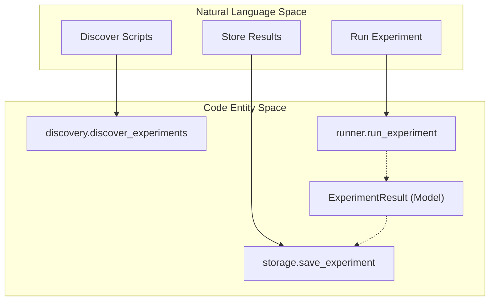
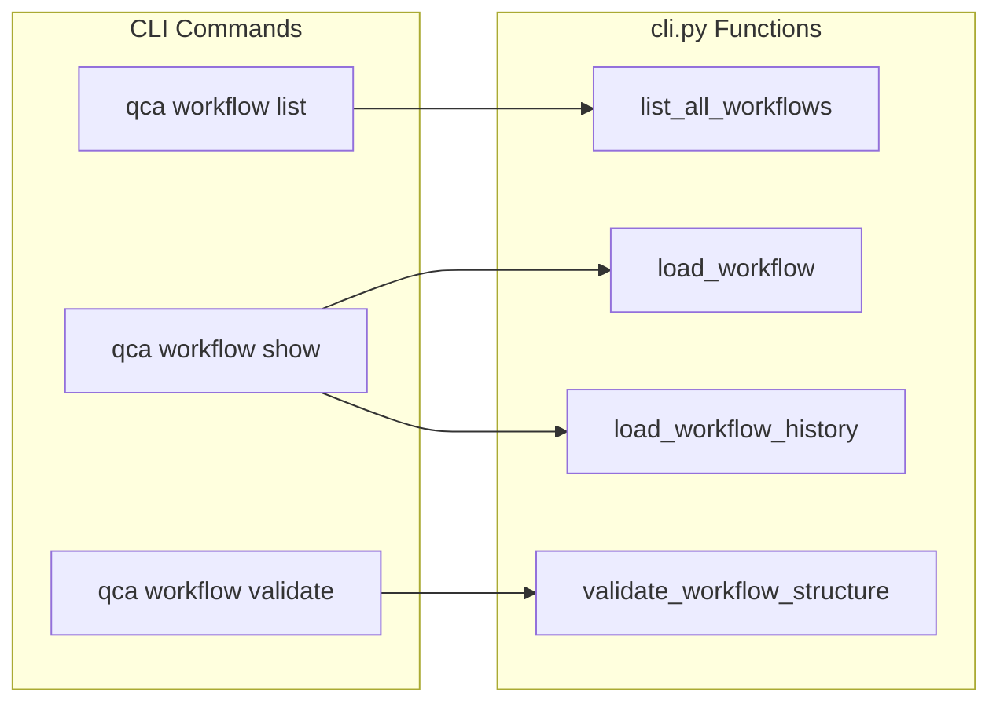

<!-- source: DeepWiki mcp.deepwiki.com · repo NVIDIA/Quantum-Calibration-Agent-Blueprint · page 11.2 Integration Tests · fetched 2026-10-26 -->

# Integration Tests

Relevant source files

The following files were used as context for generating this wiki page:

- [tests/integration/conftest.py](tests/integration/conftest.py)
- [tests/integration/test_experiment_cli.py](tests/integration/test_experiment_cli.py)
- [tests/integration/test_experiment_pipeline.py](tests/integration/test_experiment_pipeline.py)
- [tests/integration/test_workflow_cli.py](tests/integration/test_workflow_cli.py)

Integration tests in the Quantum Calibration Agent (QCA) verify the end-to-end functionality of the system by exercising multiple subsystems simultaneously. These tests cover the full lifecycle of experiments and workflows, from CLI invocation and discovery to execution, storage, and retrieval.

## Overview and Scope

The integration test suite is located in `tests/integration/` and focuses on three primary areas:
1.  **Experiment CLI Execution**: Testing the `qca experiments run` command and its output formats.
2.  **Experiment Pipeline**: Verifying the data flow between `discovery.py`, `runner.py`, and `storage.py`.
3.  **Workflow Management**: Validating the lifecycle of multi-step workflows, including DAG validation and history tracking.

Sources: [tests/integration/test_experiment_cli.py:16-17](), [tests/integration/test_experiment_pipeline.py:16-17](), [tests/integration/test_workflow_cli.py:16-17]()

---

## Experiment Execution Pipeline

The experiment pipeline tests verify that the system can successfully discover a script, execute it with parameters, and persist the results to the storage layer.

### Data Flow: Discovery to Storage
The pipeline test `test_discover_run_store_load` ensures that the `ExperimentResult` model is correctly populated and retrieved.

| Step | Component | Action |
| :--- | :--- | :--- |
| 1 | `core.discovery` | Scans `temp_scripts_dir` to find `ExperimentSchema`. |
| 2 | `core.runner` | Executes the experiment via `run_experiment` and returns a result dictionary. |
| 3 | `core.storage` | Saves the `ExperimentResult` object to `temp_data_dir`. |
| 4 | `core.storage` | Loads the experiment by ID to verify data integrity. |

### Lab Tool Integration
The `test_lab_tool_full_workflow` test mocks the environment to verify that the agent-facing tools (`lab` and `run_experiment`) correctly interface with the underlying core logic.

**Pipeline Component Association**
The following diagram maps the logical pipeline steps to the specific code entities involved in the integration tests.

Title: Experiment Pipeline Code Map

Sources: [tests/integration/test_experiment_pipeline.py:26-62](), [tests/integration/test_experiment_pipeline.py:64-95]()

---

## CLI Integration Testing

The CLI tests use `subprocess.run` to invoke the `cli.py` entry point, simulating real-world user interactions with the system.

### Experiment CLI (`test_experiment_cli.py`)
Tests in `TestExperimentsRunCommand` verify the `experiments run` subcommand:
*   **JSON Output**: Validates that `-p` (parameters) are passed correctly and the output is valid JSON with a `success` status [tests/integration/test_experiment_cli.py:32-50]().
*   **Data Preservation**: Ensures that the `results` field in the experiment output is not empty and contains the expected keys [tests/integration/test_experiment_cli.py:52-71]().
*   **Human-Readable Format**: Checks that the `-h` flag produces text containing "Experiment ID" and "Status" [tests/integration/test_experiment_cli.py:73-92]().

### Workflow CLI (`test_workflow_cli.py`)
The workflow CLI tests cover both internal helper functions and E2E command execution.

#### DAG Validation and Helpers
The suite tests critical logic used by the CLI to manage workflows:
*   **`validate_workflow_structure`**: Detects missing IDs, missing nodes, and circular dependencies in the workflow JSON [tests/integration/test_workflow_cli.py:148-182]().
*   **`list_all_workflows`**: Verifies that workflows are correctly discovered in the data directory and sorted by creation date [tests/integration/test_workflow_cli.py:83-125]().
*   **`load_workflow_history`**: Ensures that `history.jsonl` files are correctly parsed into event lists [tests/integration/test_workflow_cli.py:66-80]().

**Workflow CLI Entity Map**
This diagram bridges the CLI command concepts to the implementation functions in `cli.py`.

Title: Workflow CLI Function Mapping

Sources: [tests/integration/test_workflow_cli.py:30-36](), [tests/integration/test_workflow_cli.py:47-58](), [tests/integration/test_workflow_cli.py:148-154]()

---

## Test Environment and Fixtures

The integration tests rely on `conftest.py` and standard `pytest` fixtures to isolate test execution from the production environment.

| Fixture | Purpose |
| :--- | :--- |
| `temp_scripts_dir` | A temporary directory containing mock experiment scripts for discovery testing. |
| `temp_data_dir` | A temporary directory used for SQLite and HDF5 storage operations. |
| `workflow_dir` | A specialized directory containing a `workflow.json` and `history.jsonl` for workflow testing. |
| `sample_workflow` | A dictionary representing a valid workflow with 3 nodes (success, running, pending). |

Sources: [tests/integration/test_experiment_cli.py:32](), [tests/integration/test_workflow_cli.py:50](), [tests/integration/test_workflow_cli.py:130-138]()

---

