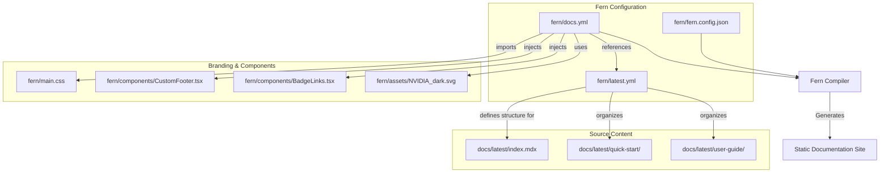
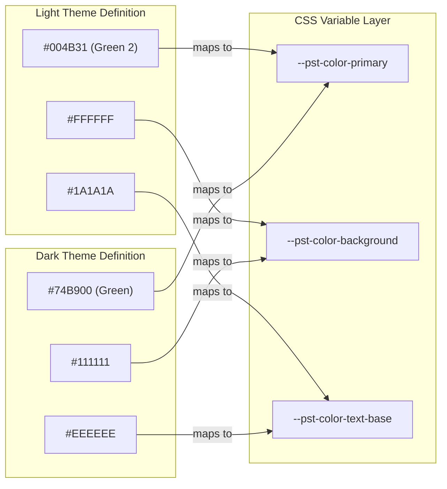

<!-- source: DeepWiki mcp.deepwiki.com · repo NVIDIA/Quantum-Calibration-Agent-Blueprint · page 12.2 Documentation Portal · fetched 2026-10-26 -->

# Documentation Portal

Relevant source files

The following files were used as context for generating this wiki page:

- [docs/latest/index.mdx](docs/latest/index.mdx)
- [fern/assets/NVIDIA_dark.svg](fern/assets/NVIDIA_dark.svg)
- [fern/components/BadgeLinks.tsx](fern/components/BadgeLinks.tsx)
- [fern/components/CustomFooter.tsx](fern/components/CustomFooter.tsx)
- [fern/fern.config.json](fern/fern.config.json)
- [fern/latest.yml](fern/latest.yml)
- [fern/main.css](fern/main.css)

The Quantum Calibration Agent (QCA) documentation infrastructure is built using [Fern](https://buildwithfern.com), a documentation-as-code platform. The portal is designed to provide a high-quality, NVIDIA-branded experience that integrates technical reference material with user-facing guides. The configuration and assets reside primarily in the `fern/` directory, while the content is sourced from `docs/`.

## Infrastructure Overview

The documentation site is governed by three primary configuration files that define the organization, navigation, and visual theme.

### Configuration Files

*   **`fern/fern.config.json`**: Defines the top-level organization and the Fern compiler version. It identifies the project as belonging to the `nvidia` organization [fern/fern.config.json:1-4]().
*   **`fern/docs.yml`**: Contains the primary site configuration, including the site URL, branding assets (logos, favicons), and global navigation settings. It also defines the custom CSS and JavaScript overrides used to achieve NVIDIA's visual identity.
*   **`fern/latest.yml`**: Specifies the navigation structure for the "latest" version of the documentation. It maps specific folders and MDX files to sections in the sidebar, such as "Quick Start", "User Guide", and "Developer Guide" [fern/latest.yml:1-25]().

### Branding and Assets

NVIDIA branding is implemented through a combination of SVG assets and custom CSS.
*   **Logos**: The site uses `fern/assets/NVIDIA_dark.svg` for the primary brand identity [fern/assets/NVIDIA_dark.svg:1-35]().
*   **Theming**: `fern/main.css` defines the NVIDIA color palette, including "NVIDIA Green" (`#76B900`) and specific grayscale variables for light and dark modes [fern/main.css:14-44](). It overrides standard Fern components to match NVIDIA's typography and spacing requirements [fern/main.css:49-82]().

## Documentation Structure

The documentation follows a hierarchical structure where configuration in the `fern/` directory points to content in the `docs/` directory.

### Documentation Data Flow

The following diagram illustrates how Fern assembles the final documentation site from disparate configuration and content files.

**Documentation Assembly Pipeline**

Sources: [fern/latest.yml:1-25](), [fern/fern.config.json:1-4](), [fern/components/CustomFooter.tsx:7-13]()

## Custom MDX Components

To extend the capabilities of standard Markdown, the portal utilizes custom React components (MDX) to handle specialized UI elements.

### BadgeLinks
The `BadgeLinks` component, defined in `fern/components/BadgeLinks.tsx`, is used to display horizontal rows of status badges (e.g., GitHub stars, License type, PyPI version). It uses a flex wrapper and specifically suppresses Fern's default external-link icon to maintain a clean visual appearance [fern/components/BadgeLinks.tsx:13-26]().
*   **Usage**: Accepts an array of `BadgeItem` objects containing `href`, `src`, and `alt` attributes [fern/components/BadgeLinks.tsx:7-11]().
*   **Styling**: Relies on the `.badge-links` class in `fern/main.css` [fern/main.css:90-92]().

### CustomFooter
The `CustomFooter` component provides a consistent NVIDIA-branded footer across all pages. It is implemented in `fern/components/CustomFooter.tsx` and mirrors the markup of standard NVIDIA documentation portals [fern/components/CustomFooter.tsx:7-12]().
*   **Logic**: It dynamically calculates the `currentYear` [fern/components/CustomFooter.tsx:8]() and renders both the NVIDIA logo and a "Built with Fern" attribution [fern/components/CustomFooter.tsx:24-46]().
*   **Responsive Design**: The footer uses CSS classes like `only-light` and `only-dark` to toggle logo visibility based on the user's theme preference [fern/components/CustomFooter.tsx:24-25]().

Sources: [fern/components/BadgeLinks.tsx:1-26](), [fern/components/CustomFooter.tsx:1-55](), [fern/main.css:90-92]()

## Styling and Theming

The `fern/main.css` file contains extensive overrides to ensure the documentation aligns with NVIDIA's corporate identity.

| Feature | Implementation | CSS Variables |
| :--- | :--- | :--- |
| **Brand Green** | NVIDIA's signature green | `--nv-color-green: #74B900` [fern/main.css:16]() |
| **Light Mode** | High-contrast light theme | `--pst-color-background: #fff` [fern/main.css:96]() |
| **Dark Mode** | Deep-grey dark theme | `--pst-color-background: #111` [fern/main.css:117]() |
| **Sidebar** | Custom border and padding | `#fern-sidebar` [fern/main.css:189-192]() |
| **Headers** | Bold typography | `h1`, `h2`, `h3` [fern/main.css:49-65]() |

### Theme Transitions
The documentation supports seamless switching between light and dark modes. The `main.css` file uses the `html[data-theme=dark]` selector to redefine color variables when the theme changes [fern/main.css:116-134]().

**Theme and Variable Mapping**

Sources: [fern/main.css:95-113](), [fern/main.css:116-134]()

## Landing Page (index.mdx)

The documentation entry point is `docs/latest/index.mdx`. This page serves as a high-level overview and uses custom MDX components to provide a visual introduction to the system [docs/latest/index.mdx:1-5]().

*   **Feature Highlights**: Lists key capabilities such as the Intelligent CLI, Workflow System, and VLM Integration [docs/latest/index.mdx:29-35]().
*   **Visuals**: Uses the `<Frame>` component to display screenshots of the Web UI and CLI [docs/latest/index.mdx:9-15]().
*   **Navigation**: Provides quick links to Installation, CLI Overview, and Workflow guides [docs/latest/index.mdx:37-41]().

Sources: [docs/latest/index.mdx:1-46]()

---

