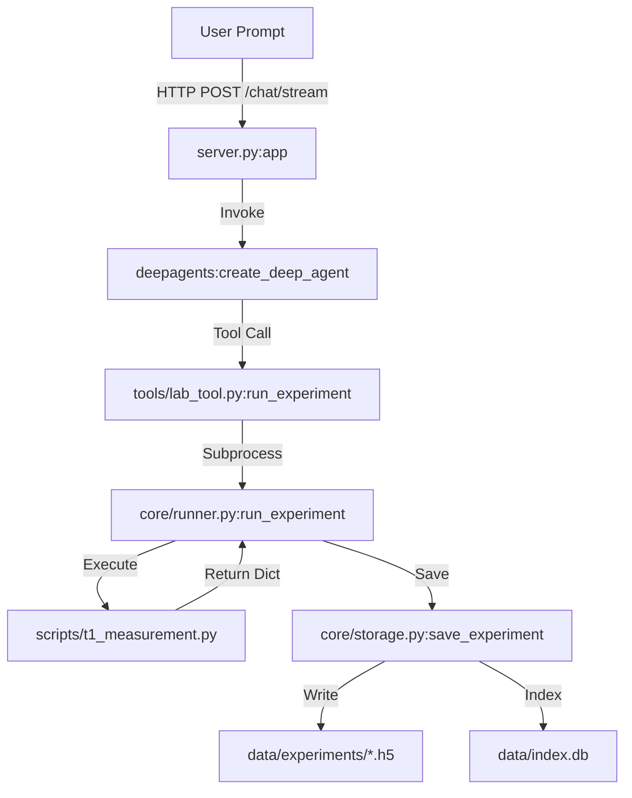
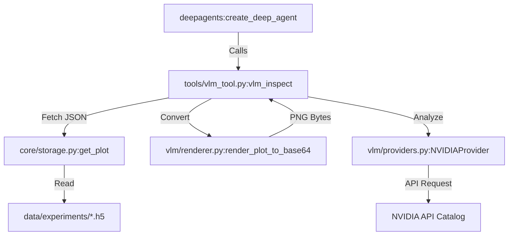

<!-- source: DeepWiki mcp.deepwiki.com · repo NVIDIA/Quantum-Calibration-Agent-Blueprint · page 13 Glossary · fetched 2026-10-26 -->

# Glossary

Relevant source files

The following files were used as context for generating this wiki page:

- [.env.example](.env.example)
- [README.md](README.md)
- [config.yaml](config.yaml)
- [core/discovery.py](core/discovery.py)
- [core/models.py](core/models.py)
- [core/runner.py](core/runner.py)
- [core/storage.py](core/storage.py)
- [data/knowledge/documents/.gitkeep](data/knowledge/documents/.gitkeep)
- [data/knowledge/memory/workflow-preferences.md](data/knowledge/memory/workflow-preferences.md)
- [fern/docs.yml](fern/docs.yml)
- [pyproject.toml](pyproject.toml)
- [server.py](server.py)
- [tools/vlm_tool.py](tools/vlm_tool.py)
- [tools/workflow_tool.py](tools/workflow_tool.py)
- [vlm/providers.py](vlm/providers.py)

This glossary defines the technical terms, architectural concepts, and domain-specific abbreviations used within the Quantum Calibration Agent (QCA) codebase. It serves as a reference for onboarding engineers to bridge the gap between quantum physics terminology and the underlying software implementation.

## Core Concepts

### Experiment Discovery
The process of automatically identifying executable quantum calibration routines from the `scripts/` directory. This is implemented using Static Analysis (AST) to avoid executing untrusted code during the scanning phase.

*   **Implementation**: The `discover_experiments` function in `core/discovery.py` scans Python files and extracts metadata from function signatures.
*   **Key Logic**: It looks for type annotations (specifically `Annotated`) to determine parameter ranges and requirements.

**Sources**: [core/discovery.py:1-50](), [core/runner.py:23-24]()

### Deep Agent
The primary agentic loop built on `langgraph` and `deepagents`. It manages the conversation state, tool calling, and integration with the local shell and filesystem.

*   **Code Entity**: Created via `create_deep_agent` in `server.py`.
*   **Backend**: Uses `LocalShellBackend` to provide the agent with a restricted execution environment.

**Sources**: [server.py:43-45](), [server.py:126-159]()

### Workflow DAG
A Directed Acyclic Graph (DAG) representing a sequence of calibration steps. Each node in the DAG represents an experiment or a decision point.

*   **Schema**: Defined in `workflow.json` (managed by `workflow_tool.py`).
*   **State Tracking**: The system tracks `status` (pending, running, success, failed) and uses dot-notation for state updates between nodes.

**Sources**: [tools/workflow_tool.py:1-30](), [README.md:94-95]()

---

## Technical Terms & Abbreviations

| Term | Definition | Code Pointer |
| :--- | :--- | :--- |
| **VLM** | Vision Language Model. Used to analyze experiment plots (e.g., finding Rabi oscillations or T1 decay). | `vlm/providers.py` |
| **HITL** | Human-in-the-Loop. A mechanism where the agent pauses for user approval before executing "dangerous" tools. | `server.py:138-145` |
| **SSE** | Server-Sent Events. The protocol used by the FastAPI backend to stream agent tokens and tool updates to the UI. | `server.py:36-37` |
| **HDF5** | Hierarchical Data Format version 5. Used for high-performance storage of large multidimensional arrays from experiments. | `core/storage.py:24-27` |
| **AST** | Abstract Syntax Tree. Used to parse experiment scripts without importing them. | `core/discovery.py` |

---

## System Topology Diagrams

### Natural Language to Code Entity Mapping (Execution Flow)
This diagram illustrates how a user's natural language request is transformed into a specific code execution within the QCA architecture.

**Sources**: [server.py:185-193](), [server.py:149-158](), [core/runner.py:76-83](), [core/storage.py:64-70]()

### Visual Analysis Pipeline (VLM Integration)
This diagram shows the flow from stored experiment data to visual reasoning by the Vision Language Model.

**Sources**: [tools/vlm_tool.py:50-53](), [vlm/renderer.py:26-27](), [vlm/providers.py:49-51](), [core/storage.py:158-165]()

---

## Domain Concepts

### Experiment Script Contract
For a Python script to be recognized as an "experiment" by the QCA, it must follow a specific contract:
1.  **Public Function**: The entry point must be a top-level function.
2.  **Annotated Parameters**: Parameters should use `typing.Annotated` to define metadata like ranges.
3.  **Result Dictionary**: Must return a dictionary containing `status`, `results`, and optionally `arrays` and `plots`.

**Sources**: [core/discovery.py:1-40](), [core/runner.py:121-128]()

### Dual-Tier Storage
The system uses a hybrid storage approach to balance query speed and data volume:
*   **SQLite (`index.db`)**: Stores metadata (IDs, timestamps, experiment types) for fast searching and filtering in the UI.
*   **HDF5 (`.h5` files)**: Stores the actual "heavy" data, including raw numpy arrays and serialized Plotly figures, organized in a date-based directory hierarchy (`YYYY/MM/DD`).

**Sources**: [core/storage.py:30-60](), [core/storage.py:74-86]()

### Agent Memory (Long-term)
Located in `data/knowledge/memory/`, these are markdown files that the agent can read and write to persist user preferences across different chat sessions (threads).

*   **File**: `workflow-preferences.md`
*   **Usage**: The agent checks this file during the "Planning" phase of a workflow to ensure it adheres to previously established success criteria or device settings.

**Sources**: [data/knowledge/memory/workflow-preferences.md:1-20](), [server.py:58-64]()