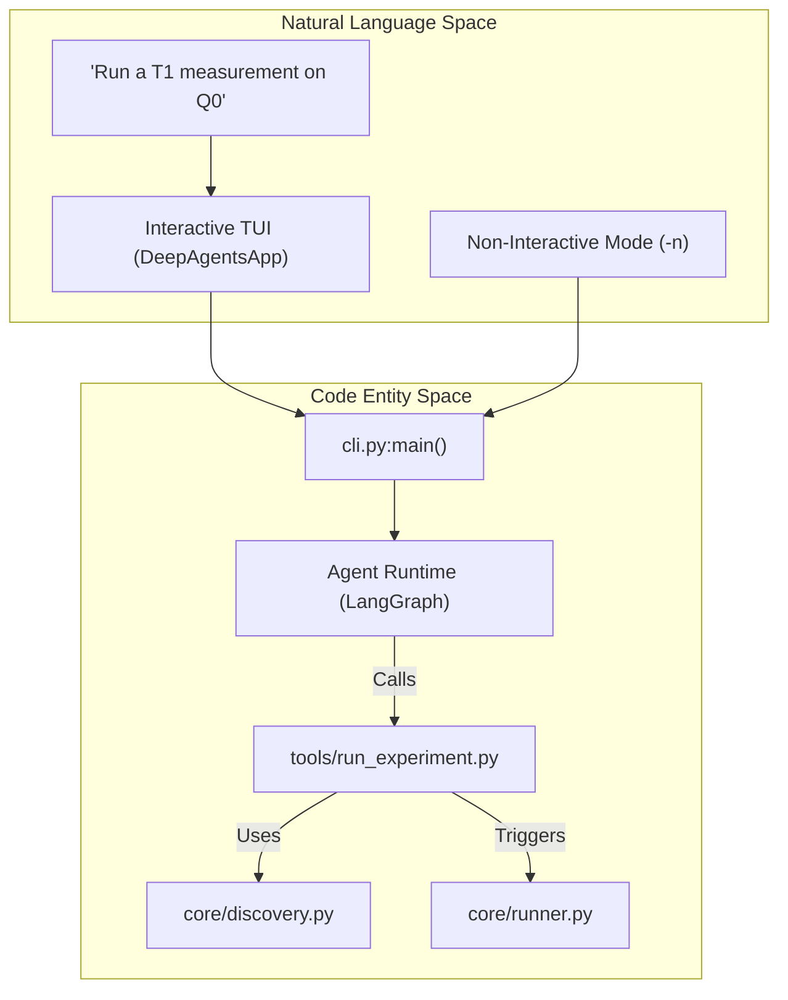
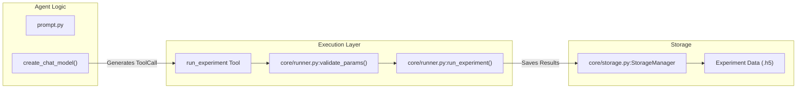

<!-- source: DeepWiki mcp.deepwiki.com · repo NVIDIA/Quantum-Calibration-Agent-Blueprint · page 2 CLI and Agent Interface · fetched 2026-10-26 -->

# CLI and Agent Interface

Relevant source files

The following files were used as context for generating this wiki page:

- [.env.example](.env.example)
- [README.md](README.md)
- [cli.py](cli.py)
- [core/__init__.py](core/__init__.py)
- [docs/latest/user-guide/cli-overview.mdx](docs/latest/user-guide/cli-overview.mdx)
- [fern/docs.yml](fern/docs.yml)

The Quantum Calibration Agent (QCA) provides a multi-modal interface for interacting with quantum hardware. Users can engage with the system via a high-level conversational agent (Natural Language Space) or through direct, deterministic commands (Code Entity Space). The underlying agent runtime leverages LangGraph and the DeepAgents framework to bridge these spaces, allowing natural language prompts to trigger structured Python experiments and workflows.

## Interaction Modes

QCA supports three primary interaction modes, all accessible via the `qca` entry point defined in [cli.py:18-40]().

| Mode | Command | Description |
| :--- | :--- | :--- |
| **Interactive TUI** | `qca` | A terminal user interface featuring a chat window, tool execution logs, and real-time status updates [cli.py:21](). |
| **Non-Interactive** | `qca -n "prompt"` | Executes a single natural language task and exits, useful for scripting [cli.py:23](). |
| **Direct CLI** | `qca <subcommand>` | Bypasses the LLM to execute specific functions like `experiments run` or `workflow status` [cli.py:25-39](). |

For a detailed breakdown of every command and flag, see [CLI Commands Reference](#2.1).

## Agent Runtime

The QCA agent is an autonomous loop that processes user input, selects appropriate tools, and executes them to fulfill requests. It is built on the `deepagents` framework and utilizes a system prompt that defines its persona as a quantum calibration expert.

### Model Selection and Configuration
The agent's "brain" is configured via the `QCA_MODEL` environment variable. QCA supports multiple providers through a unified interface in `cli.py`:
*   **NVIDIA**: Default provider using `ChatNVIDIA` for optimized inference [cli.py:74-80]().
*   **Anthropic/OpenAI**: Supported via `init_chat_model` [cli.py:82-86]().

### Tool Integration
The agent does not perform calibration directly; instead, it invokes specialized tools. These tools act as the bridge between the agent's reasoning and the `core` engine. Key tools include:
*   `lab`: Queries experiment schemas and history [tools/lab.py]().
*   `run_experiment`: Executes Python scripts in the `scripts/` directory [tools/run_experiment.py]().
*   `workflow`: Manages multi-step DAG execution [tools/workflow.py]().
*   `vlm_inspect`: Sends plots to a Vision Language Model for analysis [tools/vlm_inspect.py]().

For details on how the agent is constructed and the logic within its system prompt, see [Agent Runtime and System Prompt](#2.2).

## System Topology: Language to Execution

The following diagrams illustrate how user intent in "Natural Language Space" is mapped to specific code entities and execution flows within the "Code Entity Space."

### Intent Mapping Diagram
This diagram shows how different `qca` CLI modes route requests to the underlying system components.

**Sources:** [cli.py:18-40](), [docs/latest/user-guide/cli-overview.mdx:8-48]()

### Component Interaction Diagram
This diagram maps the internal Python classes and functions responsible for fulfilling an agent's tool call.

**Sources:** [cli.py:68-86](), [README.md:18-22](), [docs/latest/user-guide/cli-overview.mdx:140-163]()

## Child Pages

*   **[CLI Commands Reference](#2.1)**: Detailed reference for all `qca` CLI subcommands including `experiments`, `history`, `data`, and `workflow`.
*   **[Agent Runtime and System Prompt](#2.2)**: Technical details on the LangGraph construction, the `prompt.py` templating system, and model provider configuration.

**Sources:**
*   [README.md:98-132]() (Command summaries)
*   [cli.py:18-104]() (CLI structure and branding)
*   [.env.example:1-16]() (Model configuration)
*   [docs/latest/user-guide/cli-overview.mdx:1-171]() (Command usage and examples)

---

