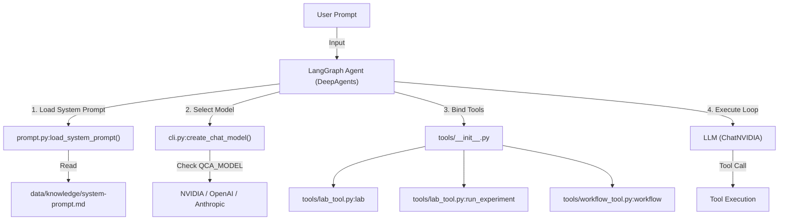
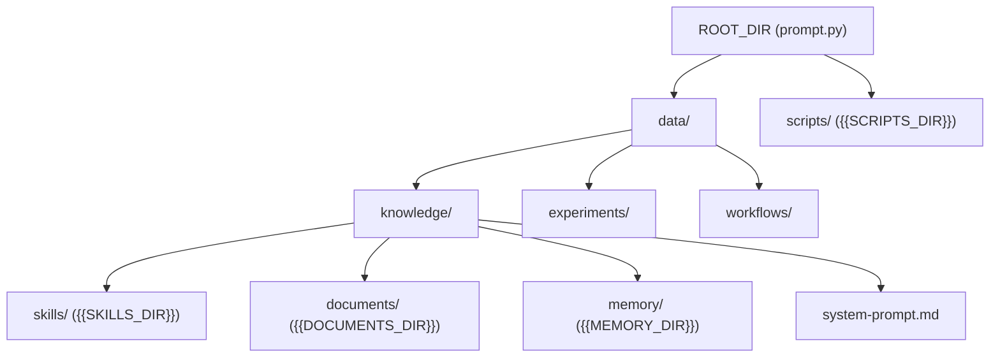

<!-- source: DeepWiki mcp.deepwiki.com · repo NVIDIA/Quantum-Calibration-Agent-Blueprint · page 2.2 Agent Runtime and System Prompt · fetched 2026-10-26 -->

# Agent Runtime and System Prompt

Relevant source files

The following files were used as context for generating this wiki page:

- [cli.py](cli.py)
- [config.yaml](config.yaml)
- [core/__init__.py](core/__init__.py)
- [prompt.py](prompt.py)
- [tools/__init__.py](tools/__init__.py)

This page describes the initialization and execution lifecycle of the Quantum Calibration Agent (QCA). It details how the LangGraph-based agent is constructed, how the system prompt is dynamically templated, and how the model provider and toolset are assembled at runtime.

## Agent Architecture and Construction

The QCA agent is built upon the `DeepAgents` framework, which utilizes `LangGraph` for orchestration. The agent's lifecycle begins when the CLI or Server initializes a chat model and binds it to a specific set of tools.

### Model Selection and Initialization
The agent's Large Language Model (LLM) is determined by the `QCA_MODEL` environment variable, defaulting to `nvidia:nvidia/nemotron-3-nano-30b-a3b` [cli.py:65-65](). 

The `create_chat_model` function in `cli.py` handles the instantiation of the model provider:
- **NVIDIA Models**: If the model string starts with `nvidia:`, it uses `langchain_nvidia_ai_endpoints.ChatNVIDIA`. Note that streaming is disabled for these models to avoid truncation issues [cli.py:74-80]().
- **Other Providers**: For other prefixes (e.g., `openai:`), it utilizes `langchain.chat_models.init_chat_model` [cli.py:82-86]().

### Tool Assembly
The agent is equipped with a specialized toolset defined in the `tools/` package [tools/__init__.py:18-23](). These tools allow the agent to interact with the quantum hardware simulator, manage workflows, and perform visual inspections:
- `lab`: Query experiment schemas and history.
- `run_experiment`: Execute calibration scripts.
- `workflow`: Manage multi-step DAG execution.
- `vlm_inspect`: Analyze plots using Vision Language Models.
- `find`: Search the filesystem for scripts and data.

### Runtime Data Flow: Natural Language to Code Entities

The following diagram illustrates how a user request flows through the agent runtime, bridging the gap between natural language intent and the underlying Python implementation.

**Diagram: Agent Execution Flow**

**Sources:** [cli.py:65-87](), [tools/__init__.py:18-23](), [prompt.py:43-77]()

---

## Dynamic System Prompting

The system prompt is not static; it is loaded and templated at runtime to provide the agent with environmental context, such as the current operating system, directory structures, and real-time timestamps.

### Template Injection
The `load_system_prompt` function in `prompt.py` reads the base template from `data/knowledge/system-prompt.md` and performs string replacement for several keys [prompt.py:43-49]().

| Placeholder | Value Source | Description |
| :--- | :--- | :--- |
| `{{DATETIME}}` | `datetime.now()` | Current system time for time-sensitive analysis [prompt.py:65-65](). |
| `{{PLATFORM}}` | `platform.system()` | Identifies Windows, macOS, or Linux [prompt.py:52-60](). |
| `{{SHELL}}` | Platform detection | Specifies bash, zsh, or PowerShell/cmd [prompt.py:55-61](). |
| `{{SCRIPTS_DIR}}` | `SCRIPTS_DIR` | Relative path to experiment scripts [prompt.py:68-68](). |
| `{{SKILLS_DIR}}` | `SKILLS_DIR` | Relative path to the skills knowledge base [prompt.py:69-69](). |
| `{{MEMORY_DIR}}` | `MEMORY_DIR` | Path to agent long-term memory files [prompt.py:71-71](). |

### Directory Context
The prompt loader defines the root hierarchy of the QCA system, ensuring the agent understands where to find its internal documentation and data [prompt.py:23-40]().

**Diagram: Knowledge and Data Hierarchy**

**Sources:** [prompt.py:23-40](), [prompt.py:64-72]()

---

## Configuration and Model Providers

The agent runtime behavior is further tuned via `config.yaml` and environment variables.

### Model Configuration
While the chat model is primarily controlled via `QCA_MODEL` [cli.py:65-65](), the Vision Language Model (VLM) used by the `vlm_inspect` tool is configured in the `vlm` section of `config.yaml` [config.yaml:32-38]().

- **Provider**: Typically "nvidia" [config.yaml:33-33]().
- **Model**: Specific VLM endpoint (e.g., `nvidia/ising-calibration-1-35b-a3b`) [config.yaml:34-34]().
- **Parameters**: `temperature`, `max_tokens`, and `enable_thinking` toggles [config.yaml:36-38]().

### CLI Customization
The QCA runtime includes custom branding and UI overrides for the DeepAgents TUI. The `_patch_banner` and `_patch_colors` functions in `cli.py` modify the CLI appearance to use NVIDIA's branding (Emerald Green) and distinct colors for tool outputs (Light Purple) [cli.py:117-170]().

**Sources:** [config.yaml:32-38](), [cli.py:65-87](), [cli.py:117-170]()

---

