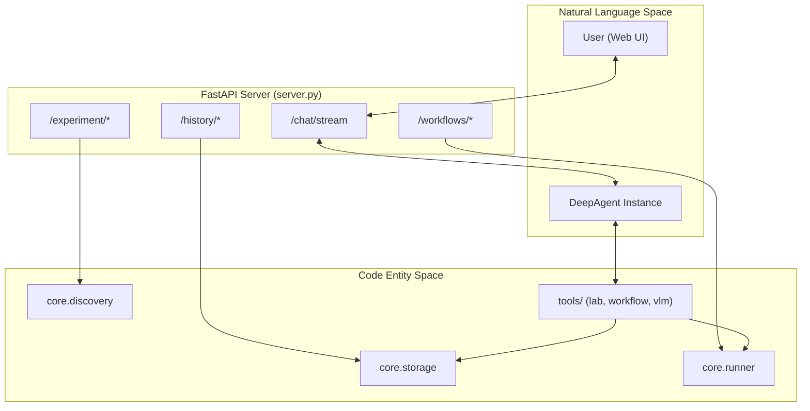
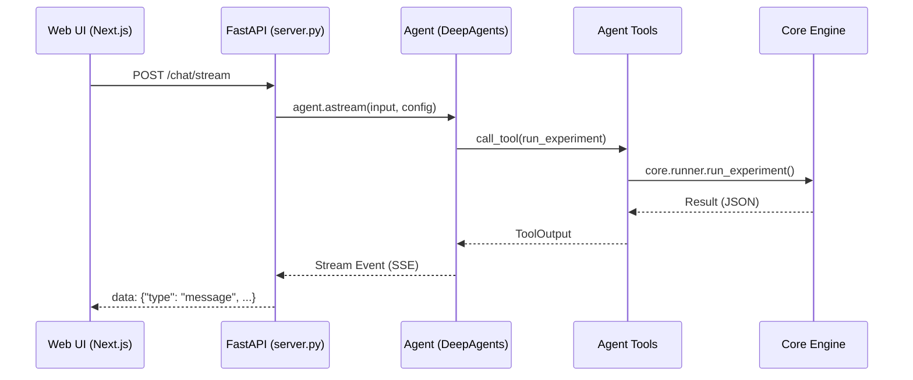

<!-- source: DeepWiki mcp.deepwiki.com · repo NVIDIA/Quantum-Calibration-Agent-Blueprint · page 3 Backend Server · fetched 2026-10-26 -->

# Backend Server

Relevant source files

The following files were used as context for generating this wiki page:

- [server.py](server.py)

The Backend Server is a FastAPI-based application that acts as the central orchestration layer for the Quantum Calibration Agent (QCA) blueprint. It bridges the [Web UI](#10) with the [Agent Runtime and System Prompt](#2.2), experiment [Experiment Discovery](#4.2) engine, and [Storage Layer](#4.4) layer. 

The server is defined in `server.py` and provides a unified API for chat streaming, experiment management, workflow control, and historical data retrieval.

### Role and Responsibility

The server performs several critical roles within the system topology:
1.  **Agent Integration**: It initializes and maintains the `DeepAgent` instance using `create_deep_agent` [server.py:149-156]().
2.  **State Management**: It manages chat session persistence using a LangGraph `MemorySaver` [server.py:136]() and tracks pending Human-in-the-Loop (HITL) interrupts [server.py:167]().
3.  **Resource Bridging**: It exposes the internal Python APIs for experiment discovery and HDF5/SQLite storage as RESTful endpoints for the frontend.
4.  **Workflow Hosting**: It manages the lifecycle of long-running calibration workflows, including process spawning and status tracking.

### System Topology and Data Flow

The following diagram illustrates how the `server.py` connects "Natural Language Space" (the Agent) to "Code Entity Space" (the underlying tools and storage).

**Backend Entity Mapping**

Sources: [server.py:16-23](), [server.py:43-47](), [server.py:185]()

---

### API Surface Areas

The backend is organized into four primary functional domains. Each domain is covered in detail in its respective child page.

#### 1. Chat and Streaming API
The server implements an asynchronous streaming protocol using Server-Sent Events (SSE). It handles the conversion of frontend message formats to LangChain primitives (`HumanMessage`, `AIMessage`) [server.py:218-230]() and manages the `thread_id` session context. It also supports a "resume" mechanism for handling agent interrupts.

*   **Key Endpoints**: `/chat/stream`, `/chat/resume`.
*   **For details, see [Chat and Streaming API](#3.1)**.

#### 2. Experiment and History Endpoints
This area provides the Web UI with visibility into available hardware capabilities and past results. It uses the `core.discovery` module to scan for scripts [server.py:413-417]() and the `core.storage` module to retrieve HDF5 arrays and Plotly visualizations [server.py:348-356]().

*   **Key Endpoints**: `/experiment/capabilities`, `/history/list`, `/history/{id}/plot`.
*   **For details, see [Experiment and History Endpoints](#3.2)**.

#### 3. Workflow Server Endpoints
Workflows are managed as managed subprocesses. The server provides endpoints to start, stop, and monitor the execution of multi-step calibration DAGs. It tracks process IDs (PIDs) and handles the transition between workflow nodes.

*   **Key Endpoints**: `/workflows/start`, `/workflows/stop`, `/workflows/status`.
*   **For details, see [Workflow Server Endpoints](#3.3)**.

#### 4. Knowledge and Static Assets
The server serves the markdown-based knowledge base used by the agent for RAG (Retrieval-Augmented Generation) and provides access to raw logs generated during experiment execution.

---

### Internal Service Architecture

The server maintains several global instances and directory configurations to ensure consistency across different API calls.

| Entity | Code Reference | Description |
| :--- | :--- | :--- |
| `ROOT_DIR` | [server.py:56]() | The base directory of the QCA project. |
| `_agent` | [server.py:162]() | Global `DeepAgent` instance initialized during `lifespan`. |
| `_checkpointer` | [server.py:164]() | `MemorySaver` instance for persisting agent state. |
| `lifespan` | [server.py:171-179]() | Startup/shutdown logic for initializing the agent and model. |
| `CORS` | [server.py:187-193]() | Middleware configured to allow communication with the Next.js UI. |

**Component Interaction Diagram**

Sources: [server.py:149-156](), [server.py:235-260](), [tools/lab_tool.py]() *(implied by imports)*

### Configuration
The server behavior is influenced by environment variables, primarily `QCA_MODEL` [server.py:70](), which determines the LLM backend used (e.g., NVIDIA NIM, OpenAI, or Anthropic). It also automatically ensures that required directories like `data/` and `scripts/` exist upon startup [server.py:61-64]().

Sources: [server.py:49-123](), [server.py:171-179]()

---

