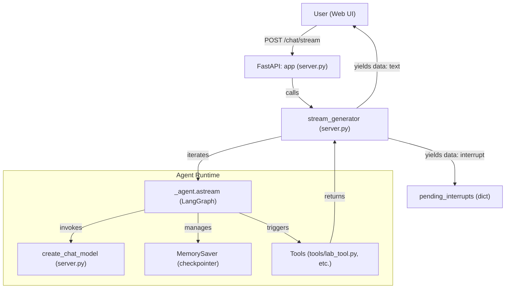
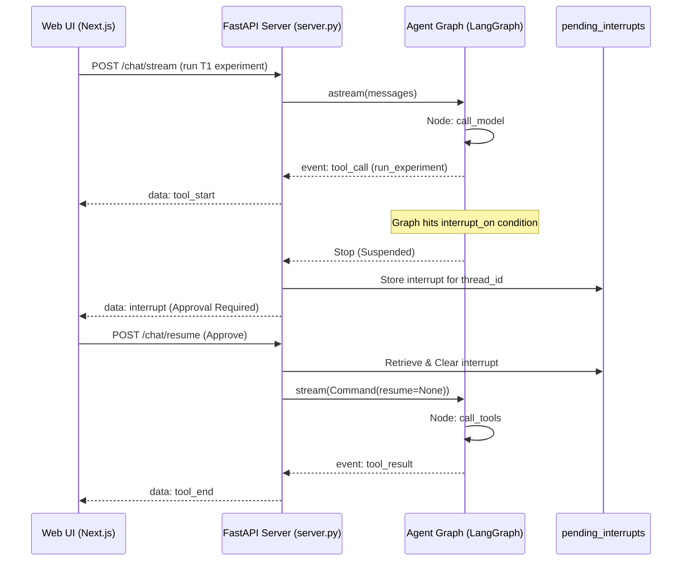

<!-- source: DeepWiki mcp.deepwiki.com · repo NVIDIA/Quantum-Calibration-Agent-Blueprint · page 3.1 Chat and Streaming API · fetched 2026-10-26 -->

# Chat and Streaming API

<details>
<summary>Relevant source files</summary>

The following files were used as context for generating this wiki page:

- [server.py](server.py)

</details>


The Chat and Streaming API serves as the primary communication gateway between the Web UI and the Quantum Calibration Agent (QCA). It implements a Server-Sent Events (SSE) protocol to provide real-time updates on agent reasoning, tool execution, and experiment progress.

## Overview of Chat Endpoints

The backend, defined in `server.py`, exposes two primary endpoints for agent interaction:

1.  **`/chat/stream`**: Initiates a new interaction or continues an existing thread by sending a user message.
2.  **`/chat/resume`**: Handles Human-in-the-Loop (HITL) scenarios where the agent has paused for user approval or feedback.

### Data Flow and Serialization

The server uses `DeepAgents` (a wrapper around LangGraph) to manage the agent state machine [server.py:43-44](). Messages are converted from the frontend's JSON format into LangChain message objects (`HumanMessage`, `AIMessage`, etc.) before being processed by the graph [server.py:218-230]().

**Sources:** [server.py:43-44](), [server.py:218-230]()

---

## SSE Streaming Protocol

The `/chat/stream` endpoint returns a `StreamingResponse` using the `text/event-stream` media type. This allows the UI to render the agent's response incrementally.

### Stream Event Types

The agent emits several types of events during its execution cycle:

| Event Type | Description | Data Content |
| :--- | :--- | :--- |
| `text` | Incremental tokens of the agent's natural language response. | String chunk |
| `tool_start` | Indicates the agent is calling a specific tool (e.g., `run_experiment`). | Tool name and input arguments |
| `tool_end` | Provides the result of a tool execution. | Tool output/result |
| `interrupt` | Signal that the agent has paused for HITL approval. | Details of the pending action |
| `error` | Reports a runtime exception during the graph execution. | Error message |

### Implementation Detail: `stream_generator`

The `stream_generator` function in `server.py` iterates over the LangGraph event stream. It filters and serializes specific nodes (like `call_model` or `call_tools`) into the SSE format expected by the `ui/proxy/server.js` and the React frontend.

**Sources:** [server.py:253-316]()

---

## Human-in-the-Loop (HITL) and Interrupts

The QCA architecture supports a sophisticated "pending interrupts" state machine to ensure safe execution of hardware-altering commands.

### The `pending_interrupts` State Machine

When the agent reaches a node configured for interruption (e.g., `run_experiment`), the graph enters a `suspended` state. The server tracks these interruptions in an in-memory dictionary.

*   **Storage**: `pending_interrupts: dict[str, dict]` maps a `thread_id` to its current interrupt data [server.py:167]().
*   **Mechanism**: The `interrupt_on` configuration in `create_agent` defines which tools require manual approval [server.py:140-145]().

### Resume Logic

When a user approves or rejects an action in the UI, the `/chat/resume` endpoint is called. The server uses the LangGraph `Command` object to resume the graph with the user's decision.

```python
# Example of resuming with a decision
if decision.get("type") == "approve":
    # Resume the graph with no changes to the current state
    cmd = Command(resume=None)
else:
    # Resume with a rejection message back to the agent
    cmd = Command(resume=decision.get("message", "Action rejected by user"))

# Feed the command back into the agent stream
_agent.stream(cmd, config=config, stream_mode="messages")
```
*(Simplified logic based on [server.py:348-360]())*

**Sources:** [server.py:140-145](), [server.py:167](), [server.py:348-360]()

---

## System Topology: API to Code Entities

The following diagram bridges the natural language requests from the user to the specific code entities in the backend.

### Request Routing and Execution



**Sources:** [server.py:126-159](), [server.py:253-270](), [server.py:321-340]()

---

## Interaction Sequence: Tool Execution with Interrupt

This diagram illustrates the flow when the agent attempts to run an experiment that requires user confirmation.

### HITL Sequence Diagram



**Sources:** [server.py:140-145](), [server.py:321-340](), [server.py:348-360]()

---

## Key Functions and Classes

### `ChatRequest` and `ResumeRequest`
Pydantic models that define the structure of incoming API calls. `ChatRequest` includes the message history and an optional `thread_id` for session persistence [server.py:206-216]().

### `create_agent()`
The factory function that assembles the `LocalShellBackend`, `MemorySaver` checkpointer, and the `DeepAgent` graph. It configures the `system_prompt` and the available toolset [server.py:126-159]().

### `convert_to_langchain_messages()`
A utility function that maps the generic `ChatMessage` objects (role/content) to specific LangChain classes like `HumanMessage` or `AIMessage`, ensuring compatibility with the underlying LLM providers [server.py:218-230]().

**Sources:** [server.py:126-159](), [server.py:206-216](), [server.py:218-230]()

---

