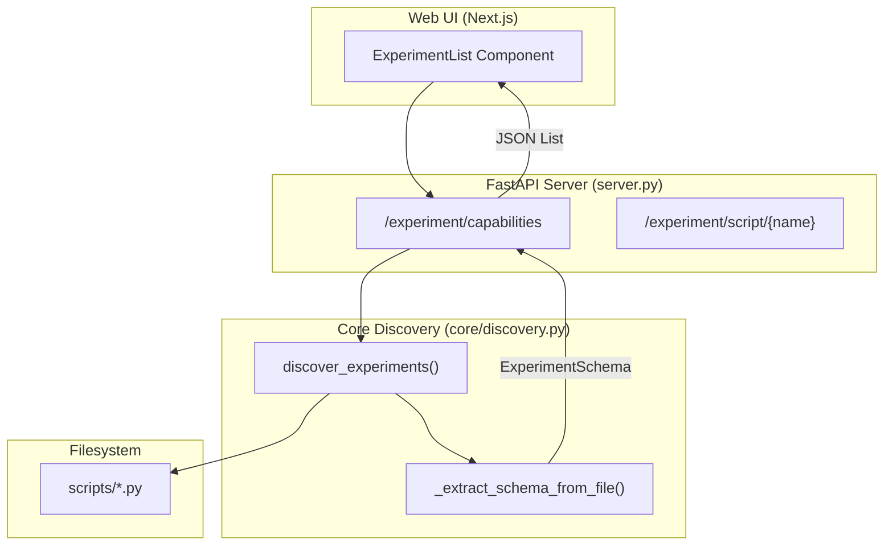
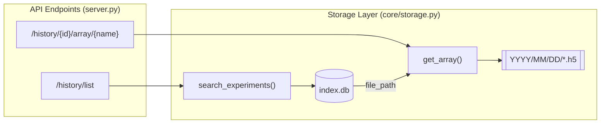

<!-- source: DeepWiki mcp.deepwiki.com · repo NVIDIA/Quantum-Calibration-Agent-Blueprint · page 3.2 Experiment and History Endpoints · fetched 2026-10-26 -->

# Experiment and History Endpoints

Relevant source files

The following files were used as context for generating this wiki page:

- [core/discovery.py](core/discovery.py)
- [core/storage.py](core/storage.py)
- [docs/latest/user-guide/experiments/experiment-storage.mdx](docs/latest/user-guide/experiments/experiment-storage.mdx)
- [server.py](server.py)

The **Experiment** and **History** endpoints in `server.py` serve as the primary bridge between the core discovery/storage modules and the Web UI. They allow the frontend to browse available experiment scripts, inspect their parameter schemas, and retrieve historical data stored in the dual-tier SQLite/HDF5 storage system.

## Experiment Discovery Endpoints

These endpoints utilize the `core/discovery.py` module to perform static analysis on the `scripts/` directory, exposing experiment metadata to the UI without executing the scripts.

### `/experiment/capabilities`
- **Method**: `GET`
- **Implementation**: Calls `discovery.discover_experiments(SCRIPTS_DIR)` [server.py:348-351]().
- **Functionality**: Scans the `scripts/` directory for Python files, parses them using AST, and returns a list of `ExperimentSchema` objects. This allows the UI to populate the "Available Experiments" list.

### `/experiment/script/{name}`
- **Method**: `GET`
- **Implementation**: Calls `discovery.get_experiment_schema(name, SCRIPTS_DIR)` [server.py:354-361]().
- **Functionality**: Retrieves the detailed schema for a specific experiment, including its `ParameterSpec` (type, range, default values). This is used by the UI to generate dynamic input forms for experiment execution.

### Discovery Data Flow
The following diagram illustrates how a request for experiment capabilities moves from the Web UI through the FastAPI server to the AST-based discovery engine.

**Experiment Discovery Architecture**

Sources: [server.py:348-361](), [core/discovery.py:25-51](), [core/discovery.py:71-124]()

---

## History and Data Endpoints

The history endpoints provide access to the `data/` directory, which contains the `index.db` (SQLite) and the date-partitioned HDF5 files [docs/latest/user-guide/experiments/experiment-storage.mdx:9-19]().

### `/history/list`
- **Method**: `GET`
- **Implementation**: Calls `storage.search_experiments(DATA_DIR, ...)` [server.py:382-393]().
- **Parameters**: Supports `limit`, `offset`, `type`, and `target` filters.
- **Functionality**: Queries the SQLite `experiments` table to return a list of past runs.

### `/history/{id}/array/{name}`
- **Method**: `GET`
- **Implementation**: Calls `storage.get_array(id, name, DATA_DIR)` [server.py:411-421]().
- **Functionality**: Extracts a specific numerical dataset (e.g., "frequencies") from the HDF5 file associated with the experiment ID. It supports `start` and `end` indices for partial data slicing [core/storage.py:197-202]().

### `/history/{id}/plot`
- **Method**: `GET`
- **Implementation**: Calls `storage.load_experiment(id, DATA_DIR)` and filters the `plots` attribute [server.py:438-450]().
- **Functionality**: Returns the Plotly JSON or binary plot data stored in the HDF5 file [core/storage.py:203-218]().

### `/history/{id}/logs`
- **Method**: `GET`
- **Implementation**: Locates the `.log` file associated with the experiment's HDF5 path [server.py:424-435]().
- **Functionality**: Streams the execution logs back to the UI for debugging.

### Storage and Retrieval Mapping
This diagram bridges the logical "History" concept to the specific database and file entities used in the code.

**History Data Access Flow**

Sources: [server.py:382-450](), [core/storage.py:64-128](), [core/storage.py:158-223]()

---

## Implementation Details

### Dual-Tier Storage Logic
When an experiment is saved via `storage.save_experiment`, the system performs two operations:
1.  **HDF5 Write**: Large arrays and plot data are written to a file at `data/experiments/YYYY/MM/DD/HHMMSS_{type}.h5` [core/storage.py:75-86]().
2.  **SQLite Index**: Metadata (ID, type, status, parameters, and the HDF5 `file_path`) is inserted into the `experiments` table in `index.db` [core/storage.py:130-155]().

### Endpoint Summary Table

| Endpoint | Core Function | Primary Data Source |
| :--- | :--- | :--- |
| `/experiment/capabilities` | `discovery.discover_experiments` | `scripts/` (AST) |
| `/history/list` | `storage.search_experiments` | `data/index.db` (SQLite) |
| `/history/{id}/array/{name}` | `storage.get_array` | `data/experiments/.../*.h5` |
| `/history/{id}/plot` | `storage.load_experiment` | `data/experiments/.../*.h5` |

Sources: [server.py:348-450](), [core/storage.py:30-61](), [docs/latest/user-guide/experiments/experiment-storage.mdx:82-101]()

---

